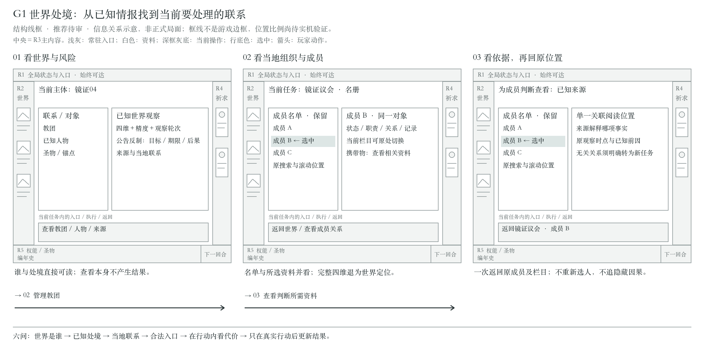
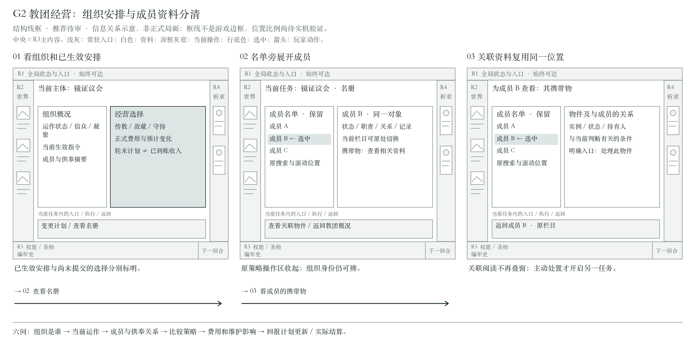
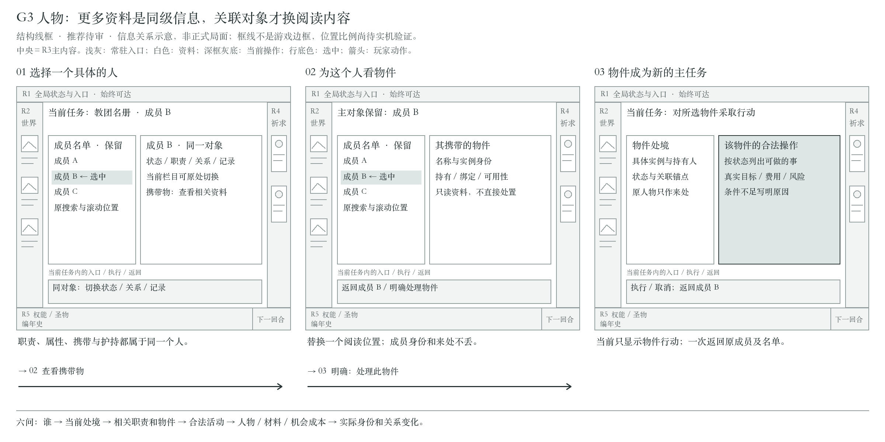
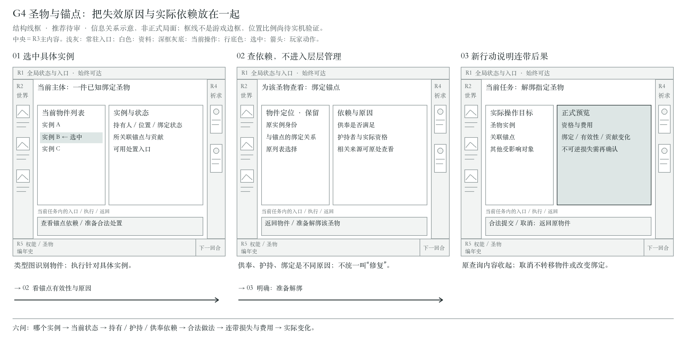
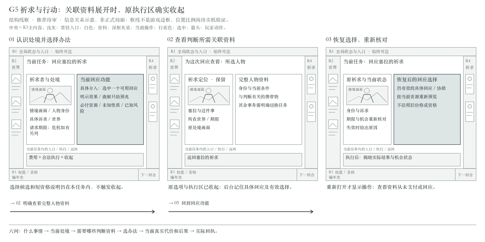
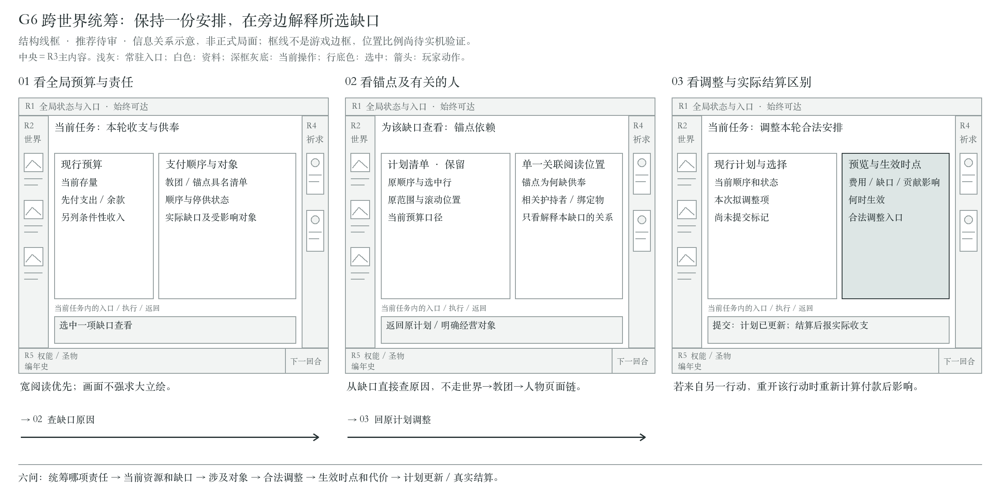
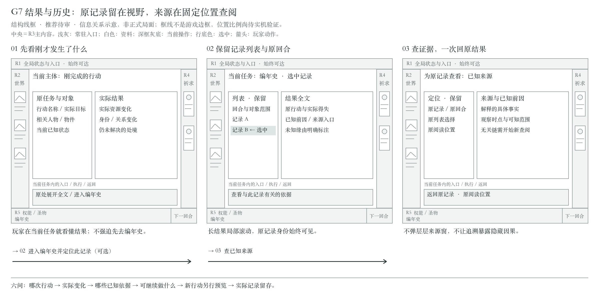

# 幽界群像 · 功能呈现与组件接入规范

TL;DR：每个功能先确定入口与呈现区域，再组合共用组件；不要每页重新设计外壳。本文是功能合同附件，交互视觉的唯一规范正文为 [visual-system.md](visual-system.md)，业务合同引用 [ui-interaction](../../specs/ui-interaction.md)，不复制一套规则。

**正式接入排期（2026-11-04）：**当前样板已获准作为接入基线；P01/P14/P15→B01，P02→B02，P03–P05→B03，P06常用权能→B04，P07–P09/锚定→B05，P11/P12/P16/P17→B06，P10/P13/降临→B07，P18/P19及正式入口→B08。最低必要的菜单／结果／计划随首个消费批次一起接入。B01–B03 已接入，见[任务书](../../tasks/ui-production-integration.md)；每批沿唯一规范D5完成实机美术检查及修复。场景立绘后置，组件功能不后置。

**状态标记**：“样板已有”仅指独立展示；“接入设计”指尚未在新美术下实现。下面的信息清单是开发依据；中央放什么、关联信息怎样展开及具体导航仍在讨论，区域路径属于候选，不是已锁定的全页面形态。DEC-060仅锁定后台记住有价值选择、再次打开恢复、行动面板不常驻。本轮首选呈现方法见[规范F5](visual-system.md#information-flow)，正式J／样板S验证见[D4](visual-system.md#flow-delivery)。标准区域 R1–R6 见视觉规范 F1；当前代码位置用于定位，不要求生产节点原名照搬。

轮初动效与对应 P01／P02、C06 的样板参数及 F3 对照以 [视觉规范 V4.1](visual-system.md) 为准；制作人对当前样板评价为“勉强合格”，已纳入当前标准；正式接入及其他页面仍需适配验证。

实现入口与视觉状态只在 [规范 V6](visual-system.md#control-catalog) 维护。当前世界条目、祈求摘要、观察指标及威胁使用 `ui_composites.gd`，按钮／搜索／图标／承托使用 `ui_components.gd`；样板和展示页共用它们。下列 C 编号表示功能职责，未提取条目不等同于现成控件。

## P. 功能应该放在哪里

### P01 全局与默认世界

入口：轮初强提示结束后进入合法行动阶段、关闭主体子页或选择左侧世界。R1 常驻现有资源及全局入口；R2 世界联系清单；R3 世界观察与当地教团概况；R4 祈求摘要；R5 权能、圣物、近况及回合动作。样板已有。小尺度远景应保全建筑主体，摘要与管理入口相邻置于景观之外，仍可辨认归属。无教团世界也能查看世界信息，不补造教团。世界联系清单是常用子集，全部已知世界入口不能被它替代。

### P02 祈求摘要与回应

入口：轮初本回合新增祈求展示卡或 R4 摘要 → R3 祈求者场景＋身份／角色／世界、诉求、请求期限、原危机期限、浅触／深应、必付、主要得失、失败／灾变及固定执行区。详情与世界／教团互斥，右侧仍保留请求定位；协助、媒介等仅在正式存在候选时展开。选择直接可准备回应，不增加“准备→预览→回应”的强制多页流程。B02 已接正式祈求、准备候选、不可逆确认、真实结算和同轮只读状态。概率必须来自同次正式预览；确定性过程不画假概率。

### P03 世界档案与世界观察

入口：R1 全部世界或对象关联 → R3 可搜索全世界清单／具体世界。范围包含无教团世界；筛选遵守已知状态。具体世界呈现四维、历史精度／时点／来源，已公告反制的目标／期限／后果，当地人物、教团、圣物和锚点入口。长来源在中央单一阅读位置，短来源可用唯一临时阅读面；查看不占关注、不刷新知识。B03 已接世界档案、名称／ID 搜索、关注范围、已知四维与观察来源、当地教团入口。其他对象关系随对应批次开放。

### P04 教团管理

入口：世界中的管理入口、全局教团索引、关联教团 → R3。场景表现组织／群体，资料区呈现世界、运作／休眠／毁灭、无名信众、具名成员与凝聚；传教／敛藏／守持按正式纯预览比较费用、信众变化、察觉方向及预计收入。成员名册、职责、材料、供奉／锚点／圣物关联在本区按需深入。策略是轮末计划，非立即到账，也不用每轮重复选择。B03 已接当地教团、名册与三种策略预览和登记，轮末实际支出与入账由回执和教团页呈现。

### P05 人物、成员与名册

入口：R1 人物、教团名册、祈求人或关系链接 → R3。列表有全局／当地／本团范围、搜索、总数／匹配数及实际可用机会筛选。身份详情展示已知职责、处境、属性、执行机会、归属、携带、护持和其他关系；非成员不套完整成员字段，未知机会不能当未用机会。B02 接祈求关联人物的只读资料与一次返回。B03 接本团名单、职责和只读携带物。全局人物与其他操作随对应批次开放。

### P06 权能准备

入口：R5 权能图标 → R3 当前行动，保留身份、合法目标／媒介、资格、费用、后果与固定执行区。全十二项沿 Catalog 固定顺序滚动，未解锁可查门槛；无合法目标、资源不足、阶段不符分别解释。多候选显式选择，不偷偷选第一人。打开功能可恢复该功能之前有价值的选择，面板在离开后收起；普通浏览不暗换行动目标。选择记忆的具体范围与时效待讨论。底栏按两行权能与三行圣物的实际内容分别控制视觉重心，锁定原因不能与名称重叠。样板目前只有说明弹窗，正式接入不能照搬为完成页。

### P07 圣物当前列表与实例详情

入口：R5 当前物件或全局圣物入口 → R3 列表／实例。类别图负责识物，实例 ID 负责关系；显示持有人／位置与保管、携带、绑定、扣押、封存、消耗的区别，合法携带／卸下／解绑／回收／解离由正式条件开放。不可逆处置进入 R6 确认。已消耗退出当前栏但保留历史，不伪造未获取收藏。底栏名称与实例状态保持清楚层次，空态无虚构器物；与权能共用承载，不强制内容高度一致。样板有滚动与零件状态，正式实例管理为接入设计。

圣物来自有来源的机会与事件。携带时仅对该物件规定的准备生效并支付代价；绑定提供锚点媒介，解绑会影响锚点；可控且未绑定的圣物可永久解离为信仰、洞见、信众或低语，具体净收益和代价以正式规则重算。死亡、迁移和扣押会改变所在地及持有资格。底栏优先表达实例身份和当前状态，详情再呈现合法用途、依赖与后果。依据 [圣物生命周期](../../specs/system-powers-cults.md#8-圣物的生命周期)。

### P08 圣物媒介取得机会

入口：世界、机构、人物或已知机会提示 → R3 上下文任务。展示来源、真实期限和可用分支（回收／公开／等待等，以当前机制为准）、费用与资格。没有发生的机会不能呈现为随时可用的“获取”按钮。接入设计。

### P09 锚点、护持与修复

入口：世界／教团／圣物／人物关系 → R3。呈现有效／休眠原因、护持者、绑定圣物、当前贡献、供奉缺口、合法材料与修复条件。“已建成”不等于“本轮有效且已付”。相关预算链接到 P11，普通查看不要求行动面板常驻，后台选择记忆按F2处理。接入设计。

### P10 活动、材料实践与互惠

入口：相关人物／教团／机构 → R3 上下文行动。保留原参与者、材料／媒介、来源、尚缺条件、跨轮进展和最早继续时点；互惠展示两端原条款及实际履行。交予记录从目标机构／教团或人物材料入口进入，明确原持有人、指定已知材料、合法接收者及目标；唯一强制合法接收者可由正式选择器预填，多候选显式选择；预览／取消不转移材料。具体操作按 ActionCatalog 提供，不把每个内部操作 ID 变成常驻导航。接入设计。

### P11 收支与供奉

入口：R1 收支、行动维护警告 → R3。当前信仰、先付支出、支出后余额、另计条件收入依次表达；具名团／锚点列出支付次序、停供／恢复、不能支付对象与实际风险。行动假设预算和当前计划明确分开，改计划后刷新原行动提示。阶段不允许修改时只读。B03 通过当地教团接最小策略预览、登记、预计支出后余额与实际经营回执。全局收支和供奉调整随对应批次接入。

### P12 关注、成员与临时名额

入口：R1 关注／容量或相关对象 → R3。分别显示世界关注、正式成员、临时人物的已用／上限及合法操作；延后生效要写明时间，下轮释放不能提前当成本轮腾位。世界浏览与正式关注操作分离。左侧世界清单的准入／排序／退出仍需正式定义，不能由本规范创设数值条件。接入设计。

### P13 本体、敛息与降临

入口：R1 本体及相关持续行动 → R3。苏醒及来源、创伤、敛息资格／费用／结束本轮，进行中降临的原主体、固定两锚点、已付轮次和继续／中止。中止永久损失及费用不退由 R6 明确确认；前期继续阶段不展示最终骰。没有对应责任时不制造常驻空面。接入设计。

**B01 最小范围（P01/P03、G1、C01–C03）：**顶部投影资源与阶段，世界清单显示关注与有效祈求线索来源，中央展示所选世界的只读观察与标明的示意图。清单局部滚动。世界档案与其搜索在后续批次接入。

### P14 轮初事件

入口：实际 events 阶段或恢复事件 → 优先呈现轮初事件卡及真实处理选择；使用 F3 的非纯色半透氛围遮罩与主场景隔离，并在该环节完成处理。对象、期限、真实选项、代价、后果完整；可暂看现状并可恢复，未完成阶段不允许普通行动。数量及选项由正式数据提供，不自动选项。事件完成后再显示本轮新祈求。B01（G5、C04/C06/C16/C20）按正式队列逐项处理，选项名称沿 CSV，确认重查费用与资格，选项附加字段使用 ActionCatalog。暂看时留在原阶段。B02 在事件处理结束、正式进入行动阶段后介绍本轮新增祈求。

### P15 回合推进

入口：R5 右侧唯一阶段动作。依真实阶段显示恢复事件／结束本轮／终局去向等语义；未回应／到期损失提示不强制付费。执行 end_actions 后自动完成内部结算及推进，禁止加第二次“进入下一回合”。B01 的阶段牌接真实阶段、轮末预览、未回应提示、提交保护与自动轮间推进。

### P16 实际结果、近况与编年史

刚执行后：当前主体附近 C15 简短回执，重要资源和身份变化当场可见；全文／已知前因／来源按F5在同一阅读位置替换；短说明可用唯一临时阅读面，长查阅保留记录列表和原任务定位。R5 的图标与“编年史”是入口，旁边的近况文字为只读摘要；该行与底缘及显现中的滑轨都须留出视觉空间。完整编年史支持对象过滤、真实数量和原型历史分页。未知因果保留未知；不能要求去历史页才看懂刚发生什么。B01/B02 的近况和回执读实际已知变化，资源变化同时显示在底栏。B02 在原祈求位置显示回执，可返回现状。完整编年史属后续批次。

### P17 来源、对照和不可逆确认

入口：具体字段来源、保留对照对象、不可逆操作 → R6。对照最多两个对象、同字段对齐且身份分开；确认显示实际对象、永久损失、收益与取消，默认安全返回。取消不消费、不清空草稿；关闭回原主体和有效焦点。接入设计，样板只有部分说明窗口。

### P18 新局、继续、暂停与存档

入口：启动或暂停 → 独立元界面／R6 菜单。真实保存、新局种子及可执行继续／保存／返回／放弃，错误和忙状态明确。原型“体验首团”、F1/F2、夹具切换不进入发行菜单。元界面沿同一文字与状态语义。B01 提供种子新局、最近存档继续、导入副本、返回、保存与保存退出。完整设置和终局回顾属后续批次。

### P19 终局与恢复失败

入口：真实结束状态／加载错误 → 只读终局主区或元错误页。结束原因、回合、苏醒与已知历史可查，普通动作停止；错误说明可恢复去向，不伪装继续成功、不覆盖原保存。接入设计。

## C. 组件合同与复用

这些是职责名，不声称已封装同名 Godot 组件。所有状态沿视觉规范 V5，实际样式不得从旧 HTML 或未使用的细线皮肤复制。

- **C01 ResourceReadout**：输入资源类别、当前值、容量和时间口径；图标／标签／值／单位分开。用于 R1、P11/P13；未知不是0。样板 `_build_top`。
- **C02 NamedEntry**：输入稳定 ID、对象类别、名称、情境图、辅助身份、状态、选中；输出查看意图。用于世界／人物／教团清单；选中与焦点独立。样板 `_build_world_index`。B03 世界档案与本团成员名单使用稳定 ID。
- **C03 SearchAndRange**：范围、查询、匹配数、清除、空匹配、滚动位置与选中定位；输入法不因重绘丢字。用于世界／名册／档案／库存。B03 档案有全部／已关注／未关注三档、匹配总数和清除搜索，筛选不改变关注或常用世界。
- **C04 ActionButton**：明确动词、可用性原因、执行中／按下／焦点。查询不装成提交；提交防重复。普通承托、选择材质、回合印记按职责分家族。共用 `ui_components.gd` 与 `round_action_button.gd`，B01 已接阶段与确认。
- **C05 ExclusiveChoice**：候选、当前值、资格／理由，选择仅更新草稿；焦点不选中。用于浅／深、策略、合法来源；多选与单选不可混淆。B02 接正式浅／深选择与准备候选。
- **C06 PrayerSummary**：请求 ID、人物／角色、类别、世界、诉求、请求期限、机会状态和必要危机提示；输出打开该请求。轮初仅展示本回合新增请求，点卡进入对应详情，不直接结算；进入主场景后右侧摘要提供持续访问。样板的三个请求是展示夹具，不规定真实供给数量。B02 以独立轮初介绍与右侧常驻摘要消费公开祈求数据。
- **C07 KnowledgeMetric**：四维每项独立名称、图形、确值／区间／未知、观察时点和来源；不做“占领总进度”。世界和关联页复用。B03 复用语义图标与正式投影中的精度、轮次和已知来源。
- **C08 ThreatNotice**：已公告事件、目标、时点、后果和来源；可查看详情；未知反制不写“没有”。当前世界和其他世界分别定位，不得仅因察觉下降或切换页面自行撤销已公告反制；实际执行／取消／失效后更新当前提示，原记录留历史。样板两处局部承托。
- **C09 OutcomeGroup**：正式预览的必付、深刻成功／成功／失败／灾变及条件项，默认露出关键风险和正式概率；长详情可展开。不得自行计算随机值。B02 复用 Semantics 后果与 Session 正式概率，长正文局部滚动。
- **C10 ActionFooter**：实际目标、费用、机会、维护缺口、不可用原因和唯一执行／退出，当前行动打开时固定于正文滚动之外；转去完整关联查看或其他任务时随行动面板收起。B02 接 P02 固定费用、拒绝原因与提交。
- **C11 ObjectRelations**：输入已知成员、归属、职责、持有／护持、机构、材料、原参与者等；输出带具体 ID 的关联浏览。关联查询时行动面板不常驻，后台可保留有价值的选择。B03 接当地教团、成员和携带物关系，来源就地替换并一次返回。
- **C12 ProgressAndTerms**：活动步骤、原条款、已付轮次、最早继续时点；区分条件预期和已兑现。P10/P13复用。B03 的 P11 最小经营计划区分拟定、已登记与轮末实际执行。
- **C13 MaintenanceList**：当前贡献、支付次序、停供／恢复、缺口对象；改计划是正式意图，重查合法阶段并刷新预览。P09/P11复用。
- **C14 RelicEntry**：实例ID、类型图、名称、持有人／位置及具名状态，输出看实例意图。底栏／库存共用语义、不同密度；hover强调器物本身。B03 接本团成员携带物的只读实例和已知来历。样板 dock_content 有原稿四类裁片，其余符号占位不能作为全量完成。
- **C15 InlineReceipt**：输入实际结果及前后已知变化，短摘要＋全文入口，可收起；不复用预览对象冒充结果。B01 接事件与轮末结算，B02 接实际祈求回应，B03 接教团实际策略、支出与入账。
- **C16 DialogSurface**：单一临时层，标题、正文滚动、固定关闭／取消／确认、焦点圈定和返回；不可叠无限弹窗。主体长管理页不使用此件。B01 已接事件、轮末、回执与最小菜单。
- **C17 ComparisonSurface**：两个具体对象，同字段分栏、独立观察时点与来源。读完返回原任务，不改变草稿目标。接入设计。
- **C18 HistoryList**：原回合、具体对象、来源、已知前因、过滤及正式分页；没有内容时诚实空态。近况只是摘要入口，不是第二套历史数据源。样板 open_chronicle 是夹具。
- **C19 SemanticIcon**：按稳定语义键／内容类型取图，图形邻接名称，大小等比。资源、四维、人物、权能、圣物不串类；色彩不能独自编码资格。图标资产与正文独立。
- **C20 MaterialSupport**：承字面、局部渐隐、允许的边饰／纹理；无业务数据与输入。边角保形、平铺中段、装饰不遮字，不把边框当所有分组的默认解法。样板 `_soft_support` / `_separator` / 部分 skin。

## G. 七组信息的呈现流（本轮推荐，待制作人审阅）

以下以“正在关注谁／什么事 → 当前处境 → 影响判断的关系 → 可用做法 → 代价与后果 → 实际结果”推演。六步是信息顺序，不是六张页面或六次强制点击。下列线框只解释信息位置、保留上下文与显示变化，不规定皮肤／像素尺寸；[深层查看六状态图](flow-wireframes/depth-walkthrough.png)集中示范成员、关联资料与返回恢复。S1／S2 代表路径已在独立样板实机试作，布局仍待制作人审阅；正式机制继续读 P 条目的业务依据。

共用深度处理：同对象的更多字段在本地展开；关联资料使用中央的一块可替换阅读区域，保留主任务身份／场景及原列表位置。继续查与当前判断有关的资料只替换这块区域，不叠新窗口、不增长返回层数；超出本任务声明的判断范围，须明确转为新任务，不能用单一阅读区无限追链。需要操作另一个主体时，明确把它作为新主任务；保留一个来处返回，不建立浏览历史栈。离开原行动任务、转为完整关联资料查看后，其选择与执行面板收起，有价值的选择在后台保留，重新打开时恢复并重查。鼠标失焦、滚动、当前候选选择或短解释仍属于当前行动，不触发面板闪退。机构仅按既有已知关系／行动条件呈现，不因关联深度新增机构管理页。

### G1 世界处境：先认出世界，再找到值得深入的联系

**推导与取舍：**世界首先承担判断环境的任务，观察信息和可经营组织不能混成一个对象。先给情报可信范围与迫近风险，再显露当地联系，才能避免把未知当事实、把点开世界当作已采取行动。

[可编辑线框 SVG](flow-wireframes/g1-world.svg)

**六步：**①选中一个世界，名称、情境与已知联系建立定位；②默认呈现四维观察的确值／区间／未知及轮次，已公告危机突出目标与期限；③当地教团、人物、锚点等仅给关系摘要，按需打开某项；④显露真实可达的管理、观察来源及行动入口；⑤只在具体行动打开后展示费用、资格和后果；⑥查看本身不产生结果，真实行动完成后更新相应对象及已知观察。

**深度与屏幕：**世界概况保持身份和危机，选教团／成员时在中央内容区并置必要列表与所选资料，完整四维可压为当前世界概括。来源全文替换关联阅读区域，不把世界→来源→前因做成返回链。无教团只保留实际联系，长来源局部滚动。

**样板验收：**从世界到一名成员，再看本次判断所需的关联物，仍能认出原世界；一次返回恢复原选中成员、所看栏目及名单滚动位置，不能退回教团概况。**正式验收：**无教团世界可达；未知不补0，查阅不刷新情报／改变关注；失效对象说明去向，不静默跳到别的世界。

### G2 教团经营：组织整体与当前安排始终可辨

**推导与取舍：**经营的核心是比较组织安排，名册的核心是找到具体的人；把二者都摊开会同时出现多套操作目标。因此组织概况与策略先并看，进入名册时把经营控件收起，留下足以判断成员处境的组织摘要。

[可编辑线框 SVG](flow-wireframes/g2-cult.svg)

**六步：**①明确当前教团及所属世界，场所表现群体；②默认给运作状态、信众、凝聚和当前指令，具名成员与无名信众分计；③成员、供奉、锚点、圣物摘要说明哪些关系影响经营，按需核查；④选择实际可用的传教／敛藏／守持或进入某成员的合法行动；⑤并列比较相关策略的费用、预计变化与维护影响，保留“轮末计划”语义；⑥提交安排后显示已改变的计划，实际人口／收入变化等结算后再报。

**深度与屏幕：**打开成员列表时，组织身份与当前安排缩为稳定摘要；名单保留，选择成员只更新旁边资料。成员的职责在同对象详情切换，携带物关联说明替换同一阅读区域；要经营此人则转为人物主任务，原教团仅作来处。不得把未提交策略面板常驻在人物功能旁。

**样板验收：**长名单选人、查看关联、关闭后仍在原行，能分清组织状态与个人状态。**正式验收：**三策略预览来自规则；查看不改计划，提交只改合法安排，不提前入账；休眠／已毁与空名单均可解释。

### G3 人物：先回答与当前事情有关的身份，再展开完整资料

**推导与取舍：**人物资料深通常是字段多，而非任务层级多。保留名单使玩家能横向换人；同一人物的栏目复用一个详情位置，关联物件另以关系标题解释，减少记忆负担且避免误操作其他主体。

[可编辑线框 SVG](flow-wireframes/g3-person.svg)

**六步：**①在祈求、教团或全局名单中认出同一人物；②先给当前处境、角色和与本次问题相关的已知条件；③职责、归属、携带物、护持及机构关系按具体判断展开，历史与全部属性按需读；④提供当前真实可用的活动、任命或其他主体操作；⑤选择后集中展示参加者／材料、机会、费用与具体后果；⑥执行后原身份位置显示实际变化，更新受影响关系。

**深度与屏幕：**从成员名单进入人物时保留名单与选中。人物内部职责、属性、携带、护持及经历属于同对象的同级内容，不逐层建页。点携带物可替换关联阅读区域，人物仍是主对象；只有主动操作物件才切换主任务。无关字段不为填满空间强行展示。

**样板验收：**成员→本次判断所需的携带物→来源后，一次关闭关联阅读就恢复原选中成员、资料栏目和名单位置，不能退回教团概况；长姓名、多个职责不挤掉身份。**正式验收：**非成员不套成员全部属性，未知机会不算可用；角色／物件变化后重查旧选择，死亡或失控保留已知历史。

### G4 圣物与锚点：物件和依赖关系一起解释

**推导与取舍：**玩家处理的是具体实例，判断却依赖持有、绑定、护持和供奉的组合。应把失效原因与所影响对象同时讲清，避免把所有异常做成一个泛化的“修复”按钮；查看原因无需先进入每个对象的管理功能。

[可编辑线框 SVG](flow-wireframes/g4-relic-anchor.svg)

**六步：**①明确所选实例／锚点，类型图不替代实例身份；②默认给位置、持有人、绑定／携带等状态，锚点同时说明有效／休眠原因；③把相关持有人、护持者、绑定物和供奉列成有名称的依赖摘要；④提供状态允许的携带、解绑、修复等做法；⑤预览指出实际影响的物件、锚点、苏醒贡献与费用，不可逆项再确认；⑥按实际回执刷新物件及受影响对象，旧记录留史。

**深度与屏幕：**库存／锚点列表与选中详情相邻。查持有人或供奉只替换关联阅读区域，原物件身份和绑定关系仍能辨认；需要改供奉安排时明确进入统筹任务，关闭原处置面板，不在详情中再嵌一套收支页。

**样板验收：**绑定圣物→锚点→护持人能保持原对象定位，无第三层窗口；零件和长依赖列表可读。**正式验收：**持有、绑定、扣押、消耗分别处理；取消不转移物件，失效授权不能沿用，解绑等后果以正式预览与实际结算为准。

### G5 祈求、事件与主动行动：判断材料围绕同一件事展开

**推导与取舍：**期限与机会使这里成为决策任务，关键条件应紧邻选项，不能要求每次选协助者都离开。只有主动展开长资料才暂时让出操作空间，回来重新计算，兼顾完整阅读与防止旧费用、旧目标误提交。

[可编辑线框 SVG](flow-wireframes/g5-action.svg)

**六步：**①摘要选中具体事情／权能；②默认明确实际主体、事情与阶段资格，祈求标请求期限，有原危机时另列其期限，其他任务只显示实际存在的期限；③只展开影响判断的协助者、来源、媒介或相关风险；④浅／深、目标与候选在当前功能内选择；⑤费用、必付、正式预览提供的概率及主要后果与固定执行同处（确定性操作不造概率），详情可展开；⑥结算后就地显示实际得失与机会状态，再允许继续其他功能。

**深度与屏幕：**候选选择器及其短解释属于当前行动，不隐藏原面板，也不能另开第二个行动面板。只有明确选择“查看完整资料”时，原行动选项和执行区才收起，保留事情身份／场景和一次返回；关联阅读仅覆盖本次判断所需内容，回来恢复选择并重新预览。事件可暂看现状但须有恢复入口，未结束事件阶段不开放普通行动。权能从世界进入时不能在浏览另一世界后暗换目标。

**样板验收：**选深应及协助→明确查看协助者完整资料→查看本次判断所需的携带物→返回，恢复已选内容；完整资料期间无悬挂执行按钮，局部候选解释则不隐藏原行动面板。**正式验收：**无合法候选、请求过期、资源改变均有原因；合法失败仍消费实际机会，拒绝执行与结算失败区分。

### G6 跨世界统筹：围绕一份资源安排，而非逐世界钻取

**推导与取舍：**跨域判断依赖同一口径、顺序和多对象比较，大立绘不应挤占这些信息。保留统筹清单，在旁边解释缺口；真正改变某对象才转任务，避免查一个原因就丢失全局支付次序。

[可编辑线框 SVG](flow-wireframes/g6-budget.svg)

**六步：**①明确本次关注收支、名额、本体或持续降临；②默认给当前余额／容量、已有责任与最迫近缺口；③受影响教团、锚点、人物按对应任务组成有序清单，必要时同字段比较；④在实际资格内调整供奉、安排、关注或继续／中止；⑤展示本次假设与现行计划的差别、延后生效及不可逆损失；⑥修改后报计划已更新，真实结算另报实际支出／收入／进展。

**深度与屏幕：**统筹清单和选中对象说明占中央主要阅读空间，减少场景装饰密度但保留气氛。查某锚点护持人时，清单及选中行保持；阅读区域替换关联内容，不把用户带入世界→教团→人物的层级。要实际经营对象时才转主任务，之后可一次回原清单。

**样板验收：**缺口锚点→人物→返回，支付顺序、滚动位置与所选对象不丢。**正式验收：**当前存量、行动假设、轮末计划三口径分开；未来收入不提前支付，释放时点及降临既付进度按规则显示。

### G7 结果与历史：先解释刚才发生什么，再追溯已知缘由

**推导与取舍：**结果承担操作反馈，历史承担回顾与求证，二者入口相连但不能相互替代。先就地说明实际变化，再允许进入有列表定位的历史；追溯以已知证据为限，避免把查看旧记录做成实时探知。

[可编辑线框 SVG](flow-wireframes/g7-history.svg)

**六步：**①回执明确哪次行动及哪些对象；②默认显示实际资源、身份或状态变化和仍未解决的处境；③需要解释时展开已知来源／前因及关联对象，未知因果明示；④提供合法的继续操作或查看对象入口，只读历史不硬塞执行；⑤若转入新行动，在该功能重新预览代价；⑥实际结果作为新的记录，并与当前对象状态保持一致。

**深度与屏幕：**刚发生的结果先在原任务处简报，全文按需展开。完整编年史用记录列表＋选中正文，原回合与对象始终可辨；前因、来源在同一阅读区域替换，保留原记录选择，一次返回原结果。不得顺着因果不断弹新层，也不要求先去历史才能看懂刚才变化。

**样板验收：**长结果→已知前因→来源→返回，仍定位原记录；两个同名对象不混淆。**正式验收：**结果来自执行回执，预期收益不冒充实际所得；历史对象失效仍可读，终局停止普通行动但保留已知记录，空匹配与缺来源可解释。

## I. 接入责任与完成定义

**共享外壳**负责 R1–R6、单一主区路由、唯一临时层、输入分发、滚动及焦点恢复。**业务视图**负责把已知投影映射到 C 组件和真实意图。**行动适配**负责当前行动、后台选择记忆、正式纯预览、提交与刷新；选择记忆的具体组织方式待讨论。**美术资产**负责可替换的形象、状态材质和可裁切／阅读范围。Session/Turn 继续拥有规则、随机、扣费、保存和结果；控件不直接持有世界真相。

当前节点映射：`Interface/TopBar`→R1；`WorldIndex`→R2；`WorldContext` 与 `PrimaryStage`→R3；`Prayers`→R4；`Dock` 与 `Chronicle`→R5；`PreviewLayer`→R6。`World` 是独立环境层，`FeedbackLayer` 是工具检查，后者不进入正式菜单。正式屏幕信息挂 architecture 指定的 overlay 根。

一页完成须有：P条目与 C组合、正式投影／命令来源、适用状态、真实短流程证据、同尺度画面和剩余差异；仅能点开说明不算业务完成。色值或正文一致不等于构图一致；完整截图、内容语义和操作后的画面要一起审阅。新增页面／组件需同时更新本文和同步范围，不能自行发明第二份设计规范。
