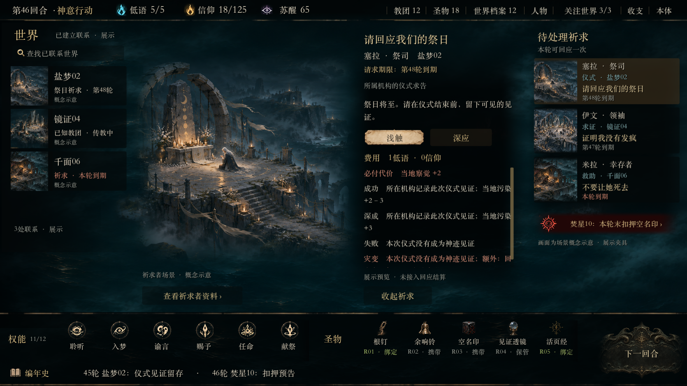

# 幽界群像 · 轮初单场景样板

信息流图示：[七组＋深层路径，共八张可编辑线框](../flow-wireframes/README.md)。S1／S2 代表状态已在样板试作，推荐布局待审。

后续打磨与接入共同使用：[深信息呈现方法](../visual-system.md#information-flow)、[七组信息流](../component-map.md#flow-g1)、[样板S／正式J验收](../visual-system.md#flow-delivery)。本入口为夹具样板，正式 B01–B03 与修复记录见 [任务书](../../../tasks/ui-production-integration.md)。

开发依据：[活设计规范](../visual-system.md)、[功能与组件](../component-map.md)、[当前参数](../tokens.json)。标准启动已接规范同步检查；修改后按规范 D2 更新并显式记录。直接用 Godot 指定场景能绕过检查，不作为规范同步证明。

当前接入基线为 `echoes-ui-motion-v1`（`d1da450`）的实际运行场景，参考版本核验规则见视觉规范 S0。原始场景材质来源为 [echoes-home.png](../../../game-state/presentation-refinement-2026-11-03/echoes-home.png)，[ui-overflow-c.png](../../../game-state/ui-overflow-c.png) 仅作左侧图文组织局部参考。

双击项目根目录 [美术打版.command](../../../../美术打版.command)，或在项目根目录运行：

```sh
./美术打版.command
```

2026-11-04 重新运行取证，与 tag 布局核对。




**以下为历史截图，不是 motion-v1 布局基线。** [世界与祈求原稿／实机对照](../../../../tools/echoes-art-master/evidence/compare-world-prayer.png) · [教团管理预览](../../../../tools/echoes-art-master/evidence/world-prayer-cult.png) · [未知世界状态](../../../../tools/echoes-art-master/evidence/world-prayer-unknown-world.png) · [深应状态](../../../../tools/echoes-art-master/evidence/world-prayer-prayer-deep.png)

世界清单包含三项人工展示联系，缩略图是情境示意而非正式世界设定。点击右侧祈求在中央展开，收起或切换世界不消耗回应；已知教团可展开管理预览。底栏保留权能／圣物滚动与近况／编年史。

这是未接 Session 的展示夹具：回应、教团经营、事件供给和回合推进未实现；不支付、不改存档。[本轮来源及差异](restoration-breakdown.md) · [运行与验证](../../../../tools/echoes-art-master/README.md) · [概念图及提示词](restoration-assets/prayer-scenes/README.md)。本次真实输入检查：世界／祈求 29 项、底栏 46 项、视觉状态 22 项。先前鼠标悬停探针存在未定位的不稳定，本次通过不证明其已消除。自动检查不能代替审美或正式玩法验收。伊文的概念画面目前以群像呈现，祈求者个人辨识度有限；左侧复用的联系情境也不是正式世界肖像。
