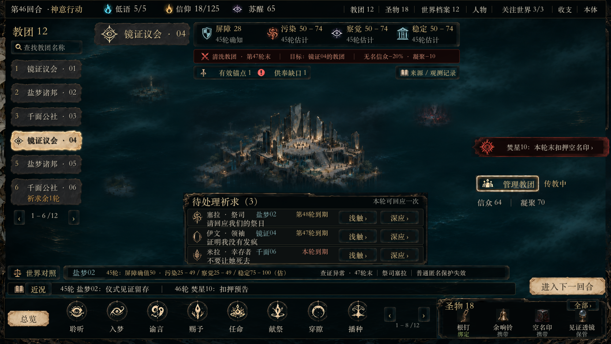

# 幽界群像 · 轮初祈求还原样板

当前状态：**制作人认可方向比前版进步，但指出融合、交互和素材问题，尚不可交付后续流程，待修复。** 依据[还原与制作对齐基线](../visual-system.md)；标的为[echoes-home 原稿](../../../game-state/presentation-refinement-2026-11-03/echoes-home.png)，overflow 按制作人标注辅助浪雾、顶栏、警告和主体信息组织的局部对照。

双击根目录 [美术打版.command](../../../../美术打版.command)。[场景](../../../../tools/echoes-art-master/scene.tscn)由独立环境/场所/雾、纹理区域、原生文字和控件组成；图为实际引擎截屏。

默认祈求居中，底栏从原稿约186px压到112px，保留图标、名称、状态及十二权能访问。场所保持原稿位置与尺度，教团管理移至右侧。F2切换[原稿布局对照](../../../../tools/echoes-art-master/evidence/restoration-reference-layout.png)，F1逐层开关，Esc关闭预览并恢复焦点。

- [原稿分层、控件拆解、当前参数及差异](restoration-breakdown.md)
- [代表组件的同尺度实机对照](../../../../tools/echoes-art-master/evidence/restoration-components.png)
- [独立素材及原图区域来源](restoration-assets/manifest.json) · [补制提示](restoration-prompts.json)
- [字体字重问题的真实对照](../../../../tools/echoes-art-master/evidence/restoration-font-comparison.png)
- [启动、编辑、分层和运行边界](../../../../tools/echoes-art-master/README.md)
- [35项新运行检查](../../../../tools/echoes-art-master/evidence/restoration-probe-results.json)

本场景是人工 T46 美术样板；不支付、不推进、不写存档，没有接入正式 Session。运行检查不证明正式阶段/结算或审美验收。原图未给出的交互状态、后四权能图形和补制材质属于相容实现，不能冒称逐像素还原。前版 `01`–`09`、22项检查及旧资产保留为历史，不作为本轮认可依据。
