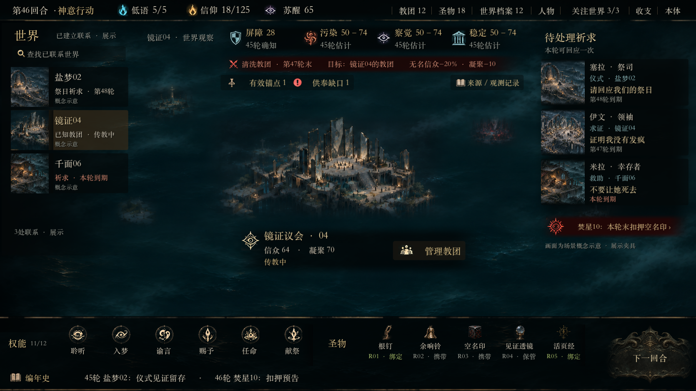
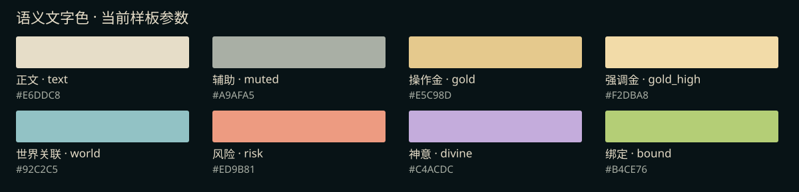
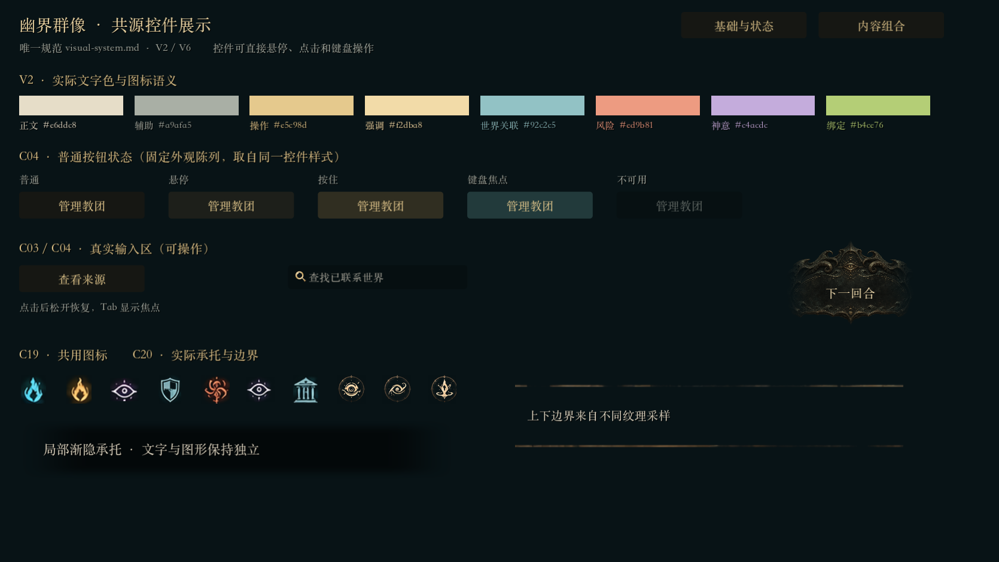
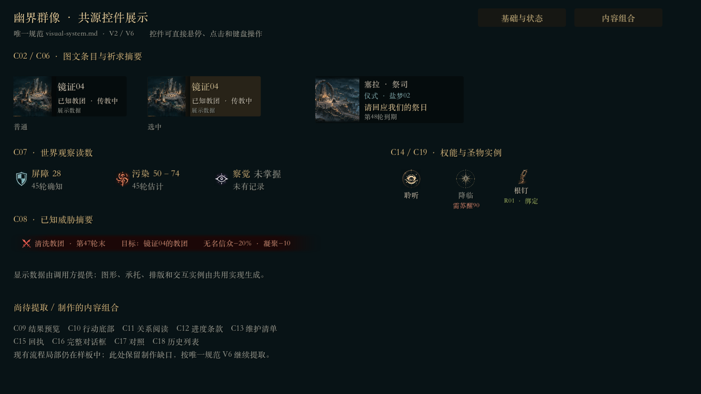
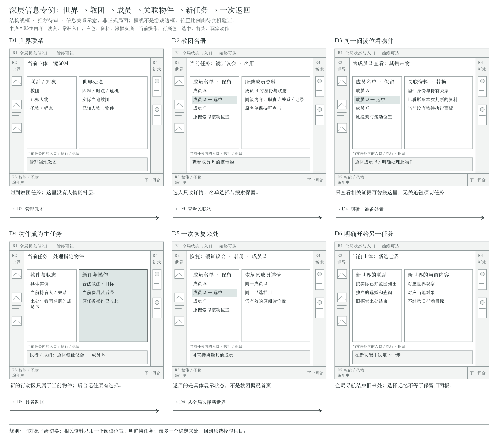
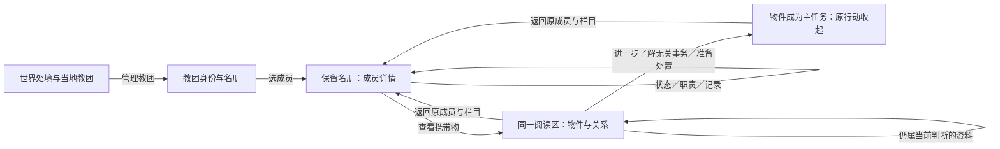

# 幽界群像 · UI 设计规范与对齐基线

TL;DR：这是正式游戏接入与后续所有页面共用的活规范，依据当前 Godot 样板及制作人反馈。制作人已认可当前样板作为正式接入基线，**不表示全页面实现或正式功能验收完成**；每次样板变化须同步正文、组件职责及相关参数，并通过同步检查。

<a id="current-baseline"></a>

## S0. 如何使用与判断权威

**2026-11-04 当前范围（DEC-062）：**制作人认可当前样板并要求规划正式UI接入；现有样板作为视觉基线，新页面逐批实机适配、检查并修复。场景立绘后置；每批精简功能验证，但不能省略美术检查。执行见[Sol任务书](../../tasks/ui-production-integration.md)，共同收尾要求见D5。该确认覆盖当前样板，不把此前未制作页面升级为通过；旧“单场景未准接入”的阶段限制由本条覆盖。

本文件是唯一交互视觉规范。旧 [06-components.html](06-components.html)／PNG 是早期静态控件图册；[archive-v01/visual-system.md](archive-v01/visual-system.md) 是已废止规范，仅供复盘。旧图中的色值、细线、选中态和布局不可直接用作当前标准；`art-kit/README.md` 仅为迁移跳转。

先读本文的区域和状态规则，再查 [功能与组件映射](component-map.md)、[本文控件标准](#control-catalog)，最后取 [制作参数](tokens.json)。功能、资格、费用、可知信息与结算以 [ui-interaction](../../specs/ui-interaction.md)、各系统 spec、正式 CSV 和 Session 投影为准；规范不能创造机制。技术挂载和正式画幅以 [architecture](../../architecture.md) 为准。原型页面覆盖证据见 [prototype-coverage](prototype-coverage.md)。

规范中的三种状态不能混用：

- **已确认约束**：制作人明确反馈或既有正式交互合同，开发必须遵守。
- **当前制作参数**：能在当前样板代码／实机找到的选择，作为下一页的起点，可随复审改动。颜色、坐标、透明度和皮肤并未逐项获批。
- **接入设计／待验证**：从当前场景推导到其他页面的组合方式或未补齐状态，开发需在真实数据下验证，不冒称现成组件或已验收。

**DEC-060 已确认：**可以在后台记住有价值的选择；玩家再次打开对应功能时恢复之前的选择；离开该功能后行动面板收起，不持续占据画面。保留选择与保留面板是两件事。中央信息流的本轮推荐方案见F5，关联展开与返回尚待实机和制作人审阅。

### 参考版本核验（2026-11-04 更正）

接入基线是 Git tag **`echoes-ui-motion-v1` → `d1da4509aac348de6807bd0684f7cd83398c990e`** 的运行样板，入口 `美术打版.command` → `tools/echoes-art-master/scene.tscn`。开工先核对 tag、当前布局源码及实际运行状态。当前分支相对该 tag 的控件迁移不能改变母版布局。截图只记录当时运行状态，文件名、文档里的“当前”字样与指纹登记不能证明截图新于运行源码。

本轮重新启动核验世界、祈求、教团三种状态。tag 的 `scene.tscn`、`prayer_stage.gd`、`cult_stage.gd` 与当前布局一致，`scene.gd` 仅共源脚本路径迁移。教团摘要在建筑下方，底栏为两组图标、下方历史行和右侧雕饰回合牌。下方三张重取证图记录该结构。旧 `evidence/world-prayer-*.png` 和 `compare-world-prayer.png` 为更早历史证据，不得再作为接入对齐依据。`echoes-home.png` 仅保留材质／场景源图身份，不能覆盖已完成样板的布局。

### 正式接入必须保留已锁定的样板审美

**制作人硬约束（2026-11-04）。** 已锁定的样板构图、图文组合、信息位置与阅读顺序、视觉主次、材质及状态表达必须保留。禁止以接真实数据、处理交互、适配画幅、缩短工期或降低实现成本为由，改用更容易制作的布局或通用组件。只沿用配色、字体和部分按钮皮肤不满足此约束。已有组合控件应复用同一实现，将真实数据与状态接入其展示结构。

允许按功能需要适当调整按钮、窗口和信息块的尺寸，在原有结构内处理长文、空态、未知、禁用与动态条目。缺专属立绘时沿用原图槽与裁切关系，可使用明确标注的示意素材。若局部尺寸适配后仍存在可复现的功能或可读性冲突，须带样板与正式实机对照、具体阻碍和最小改动范围，取得制作人明确同意后再改变已锁定的样式或构图。

当前适用对象包括左侧世界联系卡的小情境图与文字层级、右侧祈求摘要卡的情境图与身份优先顺序、中央远景上方的四维观察带，以及远景下方就地可读的教团摘要。新功能可补充详情与管理入口，禁止借接入把已有摘要移出原场景。尚未制作页面的区域组合仍须实机验证。已确认的细线禁令、底栏融合与图标反馈等要求继续有效。

本规范覆盖设计和接入规则。独立美术样板及共源控件展示页保留原范围，正式接入实证见各批任务书记录。正式机制、CSV、Session、存档和工程默认分辨率依各自现行合同。`in-game-ux`、`visual-art-production` 及副本、附属规则和间接委托持续禁用。

## V1. 视觉身份、参考与空间

原始场景与材质来源为 [echoes-home](../../game-state/presentation-refinement-2026-11-03/echoes-home.png)。[ui-overflow-a](../../game-state/ui-overflow-a.png) 辅助浪雾、顶栏纹理、警告与主体聚集；[ui-overflow-c](../../game-state/ui-overflow-c.png) 只辅助世界栏的“小场景＋文字＋提示”。当前交互构图以 S0 核验后的运行样板为准，图里的文案和建筑不自动成为游戏设定。



[祈求主区](visual-exhibits/motion-v1-prayer.png) · [教团主区](visual-exhibits/motion-v1-cult.png)。本轮由实际 Godot 样板重取证，1672×941，展示夹具。

空间由连续海面、远处现实碎片、当前场所、局部雾、阅读承托、文字／图标／操作依次构成。远感知到具体处境再退回，是信息聚焦；不建立共同地理、移动或额外知情。世界文化先于教团形象，组织应读作群体及其场所，不能用领袖伏案大头像代替整个教团。个人祈求须能辨出祈求者和处境。

常态克制但保留完整彩色、局部光泽和重点反差；“降低华丽程度”不再作为削掉材质和完成度的依据。诡异与压迫来自凡人与玩家的感受，不塑造邪神害怕自己的叙事。神性母题须经过世界文化转译，不能所有世界只换徽章；整体色调与具体文化造型仍可继续调整，旧候选／失败稿不重获当前权威。

沿 DEC-058 保持七条原则：连续空间先于拼接；承托／边界／装饰分工；围绕主体聚集；背景、普通项、选中、风险和主动作有层级；统一材质与光照但不强制同皮；素材面向真实尺寸及交互状态；视觉暗示必须有实际行为。

每次可见修改后，实机回答：**遮住文字后是否仍属同一个空间；读内容时是否看得出主体、层级和可执行操作；实际操作时画面是否仍完整？** 这由人看图和操作判断，不由检查数替代。

## V2. 调色盘与信息角色



下面是当前共用控件 `ui_components.gd` 的制作起点，机器可读值及来源在 `tokens.json`；场景自然色不受 UI 语义色数量限制。

- `text / #E6DDC8`：正文、事实、对象名，暖白而非纯白。
- `muted / #A9AFA5`：来源、历史时点、辅助说明；不可把关键风险也降为此级。
- `gold / #E5C98D`：标签、操作文字和少量重点；避免整屏所有文字同权。
- `gold_high / #F2DBA8`：主要标题及当前对象强调。
- `world / #92C2C5`：世界定位与关联信息，不表示新鲜度或安全。
- `risk / #ED9B81`：实际风险、到期与必付代价，须同时写明内容；不能只靠颜色传义。
- `divine / #C4ACDC`：苏醒／神意及原稿相应图形；世界察觉图形的淡紫只辨类别。
- `bound / #B4CE76`：当前圣物“绑定”状态的局部沿用，必须有文字；不是通用成功色。

承托为带青绿的近黑，选中联系卡用低亮暖褐，焦点用半透明灰青面。它们与底图合成后的明暗才是验收对象；不能以源色值对比合格代替实景阅读。未知≠0，区间≠危险档位，历史确值≠当前实时值；这三类区别靠文案与结构表达。

## V3. 字体、字级、间距与可读性

当前样板使用 Songti SC **Regular**。`restoration_font.gd` 处理本机 TTC 错选 Black；字体不随项目复制，发布前须确认可分发字体或合法替代，并重新检查字宽、长名和换行。不能用默认粗黑补层级。正式界面保留标准／放大两个文字档，改变 Theme、最小尺寸与换行，不改逻辑画幅、候选数量或规则；放大后执行与退出仍固定可达。当前 tokens 字级仅代表样板标准档，放大档需在正式画幅验证。

当前 1672×941 比较画幅的实际字级范围：区域／对象标题 26–30，关键数据 20–24，正文／操作 18–20，期限／来源 16–18，素材范围提示 14–16。最后一档仅用于辅助说明；费用、目标、风险和执行不能靠缩到这一档塞入。使用名称、值、单位、时点分层，数字及其单位相邻。

同组信息以邻近和对齐聚集，不靠加线分组。当前卡间 8、正文组间约 10–16、按钮间约 12 是制作起点，新增页优先沿同一组件取值。长名称允许两行；列表可以省略并提供完整详情，目标确认、费用、期限、风险不可省略。长正文在本区滚动；身份、关键代价、关闭与执行留在滚动区外。

正式工程仍为 **1280×720**，样板 1672×941 和结构原型 1600×900 均是独立研究画幅。禁止把样板坐标直接当成工程配置，也不能整屏缩小后宣称阅读已验。正式接入先在既有逻辑画幅适配一个真实长内容页：维持层级和最小可读正文，减少同屏条目、局部滚动、调整区域比例；不写响应式断点。若目标内容与可读性确实冲突，带实机差异提交制作人决定。

### V3.1 桌面输出：1080p实施，1440p／4K锁定留用

**制作人更正：本轮仅实施与检查1920×1080内容输出。2560×1440、3840×2160规格锁定留用，未经制作人另行解锁，不进入任何本批实现、设置入口或验证要求。**保留工程1280×720逻辑画布，共用布局，在目标分辨率绘制原生文字与控件；不是把720p整屏截图放大，不为三档写断点或复制三份页面。正式新布局需按V3重新组织密度、字级和间距，不能机械缩小1672×941样板。

标准／放大文字档保持。窗口按可用桌面限幅、必要时回既有720p窗口，非16:9等比留边不裁UI；HiDPI区分内容像素与窗口尺寸。不强制修改系统显示模式，不扩做超宽或掌机专用布局。首次及公共缩放修改只核1080p代表状态，不做1440p／4K测试或离屏取证。既有720p窗口限幅属于兼容行为，不新增独立美术验收档。

依据：[Steam 2026年10月调查](https://store.steampowered.com/hwsurvey/)（2026-11-04读取，FHD 50.23%、QHD 21.82%、4K 5.05%）与[Godot逻辑尺寸／输出说明](https://docs.godotengine.org/en/stable/tutorials/rendering/multiple_resolutions.html)。这是本项目的桌面支持取舍，不承诺覆盖所有设备。具体派发见任务书§2；B01 通过独立入口设置实际窗口尺寸，沿用工程逻辑画幅与缩放配置。

## V4. 材质、边界与控件家族

- **全局顶栏、共同底栏**：左右连贯承字面，使用磨损、断续、粗细变化的金属纹理边界。上下边界同家族不同纹理；当前取样见 `_separator`。不能换成均匀一像素直线。底栏内部权能／圣物／近况靠距离和标题分组，无第二块背景接缝。
- **世界联系卡、祈求摘要**：小情境画面＋主要名称／身份＋一条关键状态，低亮暗面，图边向承托过渡。普通项克制，选中用暖色实体强调。卡片本身可点击；不可做成看似按钮的纯标签。
- **主体与详情**：局部渐隐暗面保证阅读，场所／人物依旧可见；无四边围框，无内部细分隔。世界观察与教团身份可以邻近，语义不能混成一组总分。
- **普通查询／返回／管理按钮**：低亮承托，hover、按下、focus 有独立面色或图形变化；不恢复细线。浅触／深应选中目前用不规则浅骨金材质，表示选择，不能被误读为已经执行。
- **权能／圣物**：身份图标和文本独立，hover／焦点强调图标自身的亮度与轻微尺度，禁止椭圆底色。当前放大 1.09、亮度约 1.35 是样板参数，不是动效定案。锁定仍可看身份和原因；未拥有圣物不伪造成一排锁定收藏。
- **底栏横向列表**：不为常显滑轨另设独占行。指针进入列表或滑轨时淡入低对比滑轨并提供可拖动热区，离开后淡出；布局不随其显隐跳动。遮罩向底栏渐隐并随滚动位置显示，抵达首尾时对应边缘不遮暗首尾条目，遮罩不拦截输入。两组各自支持滚轮、拖动与键盘浏览。
- **底栏构图复核**：图标、悬停放大后的轮廓与顶部纹理之间必须保有可见呼吸；编年史正文与底缘也须留出视觉余量，滑轨显现时不得压住内容。权能通常只有图标和名称，圣物还有实例身份和状态，应分别调整图标尺度与视觉重心，在共同底面建立均衡，而不是强行三行对齐或填入虚构信息。标题、条目和所属关系需作为一组观察；同时对照完整、锁定、空态以及滚动首中尾。样板尺寸是试作参数，不能把压缩高度或截图像素当审美验收。
- **世界远景与主体摘要**：按实际场景轮廓预留视觉主体区。当前样板的世界远景较小，教团名称、状态、操作及其渐隐承托组合置于远景下方，依邻近关系保持归属，避免遮住主体建筑。较大场景可按实际构图处理覆盖，不能机械复用相同坐标；同时检查右侧祈求、顶部观察和底栏之间的空间。该方案是当前样板实机试作，待制作人审阅。
- **风险提示**：局部暗红承托、风险符号、目标／期限／后果。当前世界反制随世界内容显示，其他世界的已知警告保持有来源的摘要；不得凭红条发明倒计时或隐藏事件。
- **临时窗口**：必要时以统一遮暗压低后景，正文局部滚动，关闭／确认固定；不是每次查看都弹窗口。无清晰细边线，装饰不得拦截鼠标。轮初事件和本轮新祈求使用有游戏氛围的半透纹理遮罩而非纯色遮罩，保留背景层次并让卡片清晰可读；两者共用遮罩视觉语言但独立呈现、各自服从 F3 阶段顺序。
- **回合动作**：独占右下区域，与共同底面融合。当前仪式牌压低铜色饱和度、向青黑底色过渡，边缘渐隐并将文字放回承字面的视觉中心。文字由引擎绘制，按下、悬停和键盘焦点分别反馈。阶段、可执行性和按钮文字由真实流程决定，最终造型待制作人审阅。

具体组件输入、状态和复用位置见 `component-map.md` 的 C01–C20。`restoration_skin.gd` 中残存的旧细线样式不能因可调用就推广；当前控件覆盖后的实际状态才是样板证据。

### V4.1 轮初与祈求动效（已纳入当前美术标准）

制作人于 2026-11-04 对当前轮初事件至祈求的动态样板评价为“勉强合格”，要求纳入美术标准。以下为后续同类界面制作和接入的当前起点，仍可继续打磨；确认范围限本次样板动效及所述操作链，不延伸为全游戏、正式接入或其他视觉部分已验收。实际参数与适配须在具体页面及正式画幅复核。

以下样板参数由 `tokens.json` 的 `motion` 区读取，`motion.gd` 管理可打断过渡。远／近雾采样沿相反方向各 0.003／0.006 UV/s；轮初遮罩各减半。祈求入场 220ms、错开 40ms、下方 8px；图像悬停／焦点 100ms 至 1.13，离开 140ms，按下 1.04。轮初层 160ms 退出，祈求图像 260ms 柔边噪声显现，阅读承托与内容 120ms；浅深只更新选择、费用和后果并在 100ms 恢复亮度；人物／返回右侧 140ms，世界恢复 160ms。仅米拉场景用已有烛火叠加 8% 半径、峰值 0.06 的暖光，周期 0.73s／1.91s。

B01 和样板通过 `src/presentation/ui/opening_veil.gd` 共用轮初雾层，沿共用动效时钟实现 160ms 退场。退场仅保留雾纹，事件正文和热区立即撤下。F3 在样板启停动效；关闭时当前过渡进入目标值，雾及烛火冻结。新操作取消同节点同属性的旧过渡，退出层立即失去输入。对应操作链为事件→新祈求→详情→浅深→人物→返回→收起。动态图形和节奏作为当前标准起点，不代表正式游戏音效、结算或全游戏动效设计已完成。

B02 将本轮新祈求居中排卡，沿共用动效时钟错峰入场。选卡后雾纹短退，旧卡与热区立即移除，中央示意场景淡入。浅深切换保留标题和场景，仅更新选项、后果与费用。关联阅读替换右半阅读区，返回时恢复到原入口和滚动位置。正文局部滚动，资源费用与执行区固定。右侧摘要在主场景中保留，指针或键盘焦点强调祈求图标本体。

B03 的档案和名册沿同一中央双栏。左栏 221 逻辑像素放搜索、范围和名单，右栏 427 像素读当前对象，底部固定返回、栏目与登记。组织页左栏由柔边组织场景示意、身份和状态承托，右栏先读已登记指令，再看拟定预览；预计收入独占一行，实际执行与入账取轮末记录。四维使用原语义图标和文字，未知保留明确状态。

## V5. 全状态标准

普通用于识别，hover用于可操作提示，按下用于即时反馈，选中用于持久内容定位，focus用于键盘当前位置；这五者不可互相替代。焦点移动不改选择、不支付；选中项获得焦点时仍保留选中含义。

普通操作按钮仅在按住时显示按下态，松开后恢复普通或悬停；鼠标留下的输入焦点不伪装成已选状态。通过键盘导航时保留可见焦点。列表、栏目和模式选择可持续强调真实选中项。

输入来源仅由鼠标操作或实际键盘导航／激活更新。修饰键、窗口切换组合键与 Esc 不应将鼠标焦点转换为可见键盘焦点；Tab、方向键和键盘激活仍显示焦点。窗口失焦及返回须结合真实窗口复查，不能只测试 Esc。

鼠标打开弹窗后直接按 Esc 关闭，焦点可回到原入口以便继续操作，但 Esc 只表示关闭，不把原入口渲染成键盘焦点、按下态或选中态；指针仍在入口上时仅显示正常悬停。若在弹窗中使用 Tab 或方向键导航，再关闭应保留可见的键盘返回焦点。图标按钮与回合按钮遵循相同输入来源，不能因 Esc 单独点亮。校验须覆盖顶部入口、普通操作、底栏图标与真实列表选中项。

本次在样板通用焦点路由记录弹窗入口及弹窗内的最后输入方式，回合按钮共用此判断。`button_focus_probe.gd` 的无窗口输入覆盖编年史、世界档案、锚点、教团指令、下一回合及弹窗内 Tab 返回；当前名册／祈求流程另用原探针检查。图形窗口下编年史路径取得[关闭后截图](../../../tools/echoes-art-master/evidence/focus-escape-chronicle.png)，指针留在入口时仍显示悬停。图形输入曾偶发未送达，不能以单次图形结果声称所有入口均已人工实机验证。

不可用时保留名称与第一条实际原因，详情可解释更多缺口；灰色不是说明。执行中须防重复提交，结果回来后根据 Session 更新；不能先播放成功再等待结果。已完成显示实际结果、已用机会与后续入口，过期／失效对象可去历史。

键鼠共用相同状态：滚轮作用于指针所在列表，横向底栏可滚轮、拖条和键盘到达尾项；焦点项应自动进入可视范围，不能只改变索引。搜索有范围、清除与无匹配反馈，不改变正式对象或关注状态。列表刷新尽量保留稳定 ID、选择、滚动和有效焦点；失效则给原因并回到仍存在的控件。

装饰与文字默认不截输入；实际按钮接输入。按钮热区不能依赖发光边缘，箭头与滚动条拖柄须可操作；正式 1280 画幅需实测，不能由样板尺寸推断通过。弹窗内焦点循环，关闭回触发控件或相邻有效入口。Esc 顺序见 F3，不以新样式改键盘合同。

<a id="control-catalog"></a>

## V6. 可复用控件标准与实物目录

本文件是本游戏交互视觉的唯一规范正文。颜色、字体、材质、状态、控件组合及制作要求在此定义。组件地图仅保留功能合同，tokens 记录参数，Godot 控件和展示页执行本规范，实机截图用于留证。变更视觉规则须原地更新本文，禁止另立并行美术规范。

控件展示页直接实例化样板共用的控件实现。文字、图标、材质与交互独立可编辑；状态由真实控件响应。未完成的内容组件明确列为待提取／待制作，不能以旧图或截图切片充作可复用控件。

运行：项目根目录执行 `./美术打版.command --controls`。可编辑入口为 [component_catalog.tscn](../../../tools/echoes-art-master/component_catalog.tscn)。展示页的组装入口是 [component_catalog.gd](../../../tools/echoes-art-master/component_catalog.gd)。展示页是本规范的实物附件，不是另一套规范。下面两图由该场景直接渲染，供文档阅读；标准化的对象是共用控件源码，不是这些截图。



按钮五态这一排是同一控件样式的固定外观陈列；下一排才是可直接操作的按钮和搜索框。颜色、图标和回合牌也直接读取当前实现，不用截图切片模拟状态。



实际复用入口：

- [ui_components.gd](../../../src/presentation/ui/ui_components.gd)：色彩常量、文字／图标、按钮五态及键鼠焦点、搜索输入、承托、纹理边界。
- [ui_composites.gd](../../../src/presentation/ui/ui_composites.gd)：`world_entry`、`prayer_card`、`metric`、`threat`。调用方提供可知展示字段、图像和点击意图，不传 Session 写权限。
- [dock_content.gd](../../../src/presentation/ui/dock_content.gd)：`power_entry`、`relic_entry`、`bind_icon`；[round_action_button.gd](../../../src/presentation/ui/round_action_button.gd) 为独立回合控件。

样板已使用上述相同构造函数；不再为展示页复制皮肤。现阶段通过脚本构造原生节点，不能误称所有 C01–C20 已有独立场景资源或正式状态。

B01 的正式画面沿用字体、材质、按钮、回合牌与雾层。轮初卡使用独立场景示意槽和局部正文滚动，确认与返回在固定区。主体与事件图按各自的裁切范围羽化。标准与放大档相差 3 逻辑像素，实机以放大档核查长选项及确认区。回合牌的动态文字在承字面居中，键盘焦点环与正文分开。B01 的实机对照见[交付记录](../../tasks/ui-production-integration.md#b01-delivery)。

### V6.1 基础控件

| 控件家族 | 视觉组成及应用 | 状态与交付要求 | 当前依据 |
| --- | --- | --- | --- |
| 顶部资源／入口栏 | 共用深色承托、资源图标与文字、磨损金属下边界；资源值和入口分清 | 普通、hover、按下、键盘焦点；普通入口关闭后不持续选中 | C01、C04；`scene.gd:_build_top` |
| 普通操作／查询／返回按钮 | 动词文字与低亮局部承托，边缘融于场景；功能重要性决定强调 | 普通、hover、按下、键盘焦点、不可用及原因；不画普遍细线边框 | C04；`ui_components.gd:button` |
| 主阶段动作 | 专属仪式牌与引擎文字，共用底面；文字位于承字面视觉中心 | 普通、hover、按下、焦点；忙态和正式不可用状态待设计 | C04；`round_action_button.gd` |
| 单选／栏目 | 真实选中使用可辨材质，焦点与选中分别表达 | 普通、hover、按下、选中、焦点、不可用；切换不代表执行 | C05；`prayer_stage.gd`；其他栏目待统一 |
| 世界联系卡／普通列表项 | 小情境图、名称、简短状态；图边与暗面自然过渡 | 普通、hover、选中、焦点、空态；长名与截断待真实内容验证 | C02；`ui_composites.gd:world_entry` |
| 祈求摘要卡 | 情境图、人物角色、类型、诉求、期限；层级先身份再请求 | 普通、hover、焦点、临期；已处理和失效待设计 | C06；`ui_composites.gd:prayer_card` |
| 搜索输入 | 图标、提示语、可编辑文字与局部承托 | 空、输入中、焦点、清除、无匹配；输入法及长内容待正式验证 | C03；`ui_components.gd:search_field` |
| 权能图标项 | 权能徽记、名称、必要的锁定原因；图标与文字可编辑 | hover／焦点强调图标自身，锁定可读；不加椭圆背景 | C04、C19；`dock_content.gd` |
| 圣物实例项 | 器物图、名称、实例 ID 与状态；保持可辨的不同材质 | 普通、hover、焦点、绑定／携带／保管、空态；其他状态待设计。原稿四类裁片之外仍有占位 | C14；`dock_content.gd` |
| 横向／纵向滚动与边缘渐隐 | 低亮滑轨、可拖动滑块；横向内容按方向渐隐，贯通底面 | hover 显现、拖动、首／中／尾、无溢出及键盘；遮罩不拦截输入、不遮住末项 | C03；`dock_content.gd:_scroll` |
| 世界数值／状态读数 | 类型图标、名称、值或区间、观察时点与来源分层 | 确知、估计、未知分开；颜色不单独承担语义 | C07；`ui_composites.gd:metric` |
| 警告／风险 | 红色局部渐隐承托、风险图标及目标／期限／后果 | 可查来源、已公告／已失效需区分；不可仅靠红色 | C08；`ui_composites.gd:threat` |
| 临时窗口／关闭 | 局部暗面、标题、正文、固定关闭与必要动作 | 普通／焦点／关闭返回；长内容滚动、确认与执行中状态按正式功能补齐 | C16；`scene.gd:_modal` |
| 编年史入口及只读摘要 | 图标与名称是入口，旁边文字是历史摘要，共用底面 | hover、按下、焦点；只让入口接收点击 | C18；`scene.gd:_build_chronicle` |
| 图标／材质与分界 | 语义图标保持比例；承字面渐隐；仅顶栏和底栏使用清晰的纹理分界 | 透明边、裁切、采样、目标尺寸及背景叠加均须检查 | C19、C20；`ui_components.gd:icon/soft_support/separator` |

### V6.2 内容组合

这些是跨页面的美术制作范围。标为待设计的条目已有业务／信息合同，还没有可视作最终皮肤的组件。

| 编号 | 内容组合 | 当前可用依据与缺口 |
| --- | --- | --- |
| C01 | 资源读数 | 顶栏样板；不同容量、变化及放大文字待核查 |
| C02 | 对象条目 | 世界卡已提取并与样板共用；人物、教团条目待真实内容适配 |
| C03 | 搜索与范围 | 世界搜索及滚动已有；范围筛选、无匹配需按场景补齐 |
| C04 | 动作按钮 | 普通、选择和回合家族已有示例；正式执行中与错误态待制作 |
| C05 | 单选 | 祈求浅触／深应有样板；其他单选、长说明和不可用待制作 |
| C06 | 祈求摘要 | 祈求卡已提取并与样板共用；其他期限、失效状态待制作 |
| C07 | 已知信息指标 | 指标已提取，展示确值／估计／未知；不同时点和长来源待适配 |
| C08 | 威胁提醒 | 世界威胁摘要已提取；异地摘要仍在场景；执行、解除和历史态待制作 |
| C09 | 结果与风险组 | 部分样板文本；正式概率、四类结果完整视觉待制作 |
| C10 | 行动底部区 | 行动信息顺序已定义；固定操作区与正式提交状态待制作 |
| C11 | 对象关系 | 成员／关联阅读有样板；更广对象及长关系待制作 |
| C12 | 进度与条款 | 信息合同已定义；进度、阶段和条款视觉待制作 |
| C13 | 维护清单 | 信息合同已定义；贡献、顺序、缺口视觉待制作 |
| C14 | 圣物实例 | 底栏实例项已提取并共用；实例详情与完整素材待制作 |
| C15 | 执行回执 | 信息合同已定义；成功、失败、变化及详情入口待制作 |
| C16 | 临时窗口 | 说明窗口已有；不可逆确认、错误和长正文待制作 |
| C17 | 双对象比较 | 信息合同已定义；并列视觉及来源对照待制作 |
| C18 | 历史清单 | 入口和夹具记录已有；过滤、分页、空态待制作 |
| C19 | 语义图标 | 部分 SVG 和器物裁片已有；全量身份、透明边及正式素材待补齐 |
| C20 | 材质与承托 | 渐隐、部分控件面与纹理边界已有；资产切片、适配及状态待完善 |

### V6.3 交付与同步

新增或修改时按同一条目记录：名称与 C 编号、使用位置、参考图和实机截图、构成层及资源路径、素材尺寸与透明边、色彩与字体、正常／hover／按下／选中／焦点／不可用等适用状态、长文与空态、鼠标热区和键盘焦点、已验证画幅及待审差异。适用状态按功能选择，未做的状态明确标记待制作，不能用同一张静态图冒充完整状态。

当前样板采用 Songti SC Regular，字级、材质及尺寸见视觉规范 V3/V4 和 tokens。正式 1280×720 需逐页适配，不能把样板 1672×941 的坐标直接当生产规范。素材应提供源文件和导出文件，记录裁切、安全区域、透明方式、可伸缩区域以及引擎中文字与图像的边界。


## F1. 功能区域与使用方式

以下区域梳理当前样板职责及接入候选，中央内容、按需展开与导航方式尚未定案；不得据此将所有功能固定为中央整页替换。具名节点只是当前实现映射。

- **R1 顶部全局栏**：回合／阶段、当前资源及低频全局入口。显示可立即支付的现值，不混入预计收入；世界档案、人物、教团、收支、关注与本体等入口按真实可用性呈现。
- **R2 左侧世界联系清单**：深入联系或被关注世界的小图、名称、状态，搜索和滚动；是常用联系入口，不是全世界数据库。接入暂行显示策略：真实已关注世界＋当前有效祈求涉及的世界线索，按稳定ID去重；线索与完整已知范围区别展示，失去两种来源后从常用清单退出。这只是显示集合，不自动取得关注或情报，B03实机后可调整；禁止擅造“只能三个”。全部已知世界仍可从世界档案访问，包括无教团世界。
- **R3 中央主区**：按F5选对象浏览、行动判断或跨域统筹组合。主任务与一个关联阅读位置区分，同对象补充原处切换；不把世界、教团、成员和物件关系机械做成同一面板连续下沉。
- **R4 右侧待处理祈求**：摘要承载人物、类别、核心诉求、期限与机会状态。轮初展示完新祈求、进入主场景后，默认不挡中央世界／教团；选择后 R3 替换。其他已公告异地危机可在此下方摘要，不扩成第二条常驻消息条。
- **R5 底部共同区域**：权能与圣物独立横向滚动；下方以图标与“编年史”作为入口，右侧显示近况摘要，共享底面并向左贯通屏幕。只有入口接受点击；数量是辅助说明，具体身份、状态和可达操作更重要。下一回合在右侧专用区，不能挤入近况正文。
- **R6 临时层**：优先用于不可逆确认、暂停菜单和必要的两对象对照；相关短来源／结果全文可由一个临时阅读面承载，长因果查阅进入R3单一阅读位置。事件沿合法阶段获得任务优先级，其长内容按行动判断组合组织，不强制套小弹窗。临时层不能逐次嵌套。

场景在底层持续存在，信息更新不重开一套全屏皮。元界面（新局／载入／暂停／终局）可采用独立构图，但沿同一文字与状态体系，不能混入工具导览或展示夹具入口。

<a id="selection-memory"></a>

## F2. 后台记住选择，行动面板不常驻（DEC-060）

**已确认交互原则：**可以在后台记住有价值的选择；玩家再次打开对应功能时保留之前的选择；不能一直把行动面板摆在那里。离开功能、查看世界或人物时收起该行动的面板，选择记忆可在后台保留，重新进入时再呈现。

“行动草稿”是旧原型对尚未执行选择的内部称呼，不要求向玩家展示草稿概念、持续面板、草稿列表或常驻恢复栏。关闭／收起面板不再自动等同于丢弃全部选择；主动另选功能也不能仅依据旧原型的覆盖实现推断选择记忆必须清空。

选择恢复不自动执行、不付款、不预占资源。浏览对象与行动实际目标继续分开，重新使用时依当前状态校验资格、费用与对象，不能把旧预览当成有效结果，也不能把另一个对象的选择误套到当前对象。

**正式接入暂行默认（待实际体验，不冒称单独获批）：**同一运行、同回合内按功能＋对象ID记忆选项；成功执行或对象失效清对应项，换回合／换局／读档清行动记忆。取消确认、收起及关联阅读不清选择。失效时解释原选择已不可用，不擅自替换；阅读位置另存。该策略不新增存档字段，跨回合／读档保留可在后续体验后调整。

**当前实现差异：**独立样板按祈求分别在内存中记住浅触／深应，离开时收起行动区，再次进入恢复选择。人物关联阅读替换行动区，具名返回恢复选择。样板未接入实际候选或 Session，失效校验、跨回合及读档等不在本次验证范围。旧原型的常驻行动面板与清空行为仍须在正式接入时调整。

## F3. 阶段、返回、结算与数据

轮初事件先于自由行动；允许暂看现状，但普通行动的资格由正式阶段约束，并能返回未处理事件。底部只保留一个阶段推进入口：事件恢复／结束本轮／结束局等由正式状态决定。结束行动后内部 between 自动推进到次轮，不再要求玩家点第二次“进入下一回合”。未回应及到期损失应提示，但不强制回应或付款。

**轮初强提示（制作人新增要求）：**进入新回合后，若有待处理轮初事件，优先以卡片与实际处理选择突出呈现，并在该环节完成事件处理；必须遵守正式阶段与选项，不能通过关闭或展示假结果绕过事件。合法的暂看现状及恢复入口仍按正式合同提供。事件处理结束后，再展示本回合新收到的祈求；祈求环节只展示本轮新增对象，数量由实际数据决定，样板的三个请求仅为展示夹具，不能当每轮固定数量。点击任意祈求卡切换至主场景并打开对应请求的详情，查看不等于回应；后续右侧待处理清单仍承担持续访问。新祈求为零时不能伪造三张卡，也不应留下无内容的阻塞界面。事件、祈求层与主页面通过符合游戏氛围的半透明非纯色纹理遮罩隔开，不在遮罩上增加无关机制或承诺自动结算。两环节的具体材质、节奏、空态和输入体验待实机及制作人审阅；正式结果以 Session 为准。

**新祈求接入暂行默认：**B02 使用请求卡公开的 `visible_turn`，仅介绍当前回合首次可见且仍开放的请求；旧请求留在右侧摘要。一次运行的同一回合只介绍一次，刷新不重播；读档允许再介绍一次当前回合，查看本身不回应。该表现策略待接入体验，数量与资格仍归正式规则。

推荐Esc先取消确认／关闭临时层，再关闭关联阅读回到具名来处，然后关闭当前行动或退出主体任务，最后进入菜单；一次只处理当前可见的一层。关闭行动面板与选择记忆清除分开，取消确认不丢本次选择。主区同级关联替换，不制造层层返回栈。选择重绘后恢复选择控件焦点，不能跳到提交。正式保存快捷键沿原型；F1 图层和 F2 旧比较是工具功能，不移入正式游戏。

组件接收玩家已知投影和纯预览，发出意图，由 Session 校验并结算；渲染不直接改模拟状态、不抽随机、不靠缓存预览扣费。执行前重查资格和费用；合法结算无论成功、失败或灾变，都按实际回执刷新资源、对象和机会，祈求失败仍消耗本轮回应机会。资格重查拒绝执行时另行说明原因，不能冒充已发生结算。目标失效不自动替换另一个对象。

当前存量、行动假设后的维护影响、轮末先付支出与条件收入三个口径明确分开；未来收入不能提前支付。每个四维单独呈现确值／区间／未知、观察轮次和来源。UI 查看不会刷新世界知识；艺术场景不能暗示额外已知事实。

## F4. 内容规模与异常状态

每种页面至少安排适用的空、少、多、长、未知、不可用、执行中、完成、失效、恢复失败；不是每页都画十套，而是复用相关组件。

- 无联系／无教团／无圣物：短空态及真实可用去向，不造占位人物、锁定收藏或补位请求。
- 超屏：局部滚动、范围和数量、选中定位；世界及人物可搜索。不能为同屏全展示持续缩小字体。已知历史量很大时可沿现有分页查询；权能和圣物浏览明确使用滚动。
- 请求数取真实供给规则与 Session；当前三张是夹具，不写死在组件。零合法请求须区分正常只读／机会用尽／供给异常，UI 不伪造一条补齐。
- 期限区分请求期限和原危机期限；当轮到期用文字和色彩同时指出。失败／灾变仍说明具体未解决处境。
- 未知数据用“未掌握”等真实语义；“展示未配置／部分图示待配”只用于样板，不作为正式未知机制文案。
- 长结果在就地短回执后按需展开；实际资源和关系变化来自执行结果，不用预览或 requested 数量冒充实得。

<a id="information-flow"></a>

## F5. 深信息的呈现流：主任务稳定，详情横向展开

**性质：本轮推荐方案，待样板实机和制作人审阅。** 已确认的约束是避免同一界面连续下沉而丢失位置，以及 DEC-060 的后台选择记忆／行动面板不常驻。以下是依据实际任务关系推导的首选实现方案，不声称用户已逐项批准；七组具体内容见 [G1–G7](component-map.md#flow-g1)。

### 2026-11-06 制作人确认：以玩法组织信息（覆盖所有正式入口）

本轮已授权全盘纠偏及必要交互调整，不限于教团页。既有样板审美、固定标题和局部滚动保持；信息组织不得复制数据对象/事实关系图。

- 属性与功能有明确归属：四维态势与社会机构属于世界；教团页只显示组织经营、成员与本团事务。跨主体信息仅在影响当前决定时说明具体影响，不复制整份属性。
- 全局与当地入口分工：顶部“世界档案”负责跨世界检索；中央“世界情报”只展开当前世界的机构、已知反制与当前态势的观察依据。不在中央再开全局目录，不重复活动/锚点/教团菜单；资料按同级栏目直接阅读，标题与导航固定，仅正文滚动。
- 主要玩法直接可达：中央世界区提供当地活动、锚点和交予记录入口；当地限时圣物机会在该区显示数量、最近期限并直接处理，全局圣物页保留跨域汇总。玩家不经人物资料、机构、源事实链才能找到行动。
- 活动只有一份配置：同页选活动、参加者、所需材料并查看进度/费用、执行；不得先在“当前事务”选择后再到“行动准备”重复选择。活动以事项、可参与者、进度和缺口组织；教团入口限定本团，世界入口限定当地，跨域查看有明确范围。不能把所有人物列出来让玩家逐一试探。
- 候选准入在选择前完成：只有正式规则确认至少存在一个完整可执行组合的候选才开放选择。不可用原因就地可读；异步核对期间明确等待，不能把尚未算完当成无候选。改前项清理相关后项；执行、换轮、读档和资料返回按当前状态重查。未解锁权能/回应方式可阅读规则，不冒充可执行。
- 无候选仍保留准确的功能标题和条件说明；例如“交予记录”没有材料/接收人时，不得退成重复的“行动准备”或误报“行动已经失效”。
- 当场显示选择所需的费用、期限、结果与风险。唯一强制依据由正式规则归一后就地解释，不伪造一个选择步骤；多个有意义的来源保留选择。资格检查不等于玩家操作。
- 记录呈现已知事情与影响，来源只在原处有限说明。不得生成可反复追逐的前因链接；原始字典、内部规则名/类型码和事实序号不作为玩家说明。缺少已知信息不补造因果。
- 同一对象的身份只在必要定位处显示一次。没有新含义的同世界全称、标题、概率与状态不反复展开；简化不删除实际代价/不可逆后果。
- 验收同时核“做什么、为什么、下一步在哪里”，以及真实选择/执行/返回/知识边界。功能可达或截图样式一致不能代替理解验证。人审继续负责最终体验判断。

### F5.1 六个问题是阅读顺序，不是六个页面

“我正在关注谁／什么事 → 当前处境怎样 → 哪些关系影响判断 → 有哪些做法 → 付出与后果 → 实际发生了什么”。前四问通常在一个任务画面内可读，选择办法后紧接呈现代价后果，实际执行后才显示结果。纯查看没有提交环节，不为了凑流程加操作。

每个字段按用途分配：**马上判断必需**的身份、期限、关键风险、可用做法直接显示；**解释当前判断**的关联人物条件／材料／来源按需原处展开；**进一步了解另一个主体**的完整资料由明确入口进入。信息多不能单靠增加导航层级，信息少也不应填满所有插槽。

### F5.2 三种变化，三种明确行为

1. **同对象的更多信息**：人物的状态、职责、携带、护持、关系和记录是同级资料。对象身份保留，在当前详情位置切换内容或展开正文；不构造“成员页→职责页→职责细节页”的层级，也不强制每个对象都有所有栏目。操作名称、返回和数据绑定不变。
2. **为当前判断查看关联对象**：在中央一个可替换的阅读位置显示，留住当前任务身份／场景／名单中有用的定位。标题写具体关系，如“该成员携带的圣物”，而非孤立“物品详情”。只有一个关联阅读位置，打开下一份资料替换它，不叠第二层窗口。需要比较时才沿既有两对象对照合同并置。每个主任务先声明关联查看所需的判断项（如当前资格、持有／护持依赖、费用或事实来源）；新关系与这次判断无关时，不再顺着链接原区替换，须以明确动词转为新主任务。不能用唯一阅读区实现无限追链。
3. **决定处理另一个对象**：用明确动词“转到该人物”“管理该锚点”“准备解绑”等表明任务切换。新对象成为主任务，原行动面板收起；后台选择按 DEC-060 保留。不能在点第二个关联链接时偷偷转成新任务，也不能在只读资料里直接执行原任务或另一对象的动作。为本次行动展开人物资料仍可属于第2类；明确转到该人物开展别的事务才属于第3类。

当前行动内部的选项、候选列表和短资格说明仍是同一任务：滚动、悬停、键盘移焦或选择协助者不导致行动面板突然关闭。真正转为完整关联资料查看或另一个功能时，原执行控件与行动面板收起，只可保留简短的任务身份／来处，不能变成伪装的常驻草稿栏。

### F5.3 用空间承接深度，不照着数据关系造页面树

中央最多同时保留**两种高密度阅读内容**；场景、主体身份可成为整体底景和紧凑定位，不固定占第三列。推荐三种组合：

- **对象浏览**（世界／教团／人物／物件）：同范围名单或关系索引与一个详情相邻，主体场景作为共同背景。人物被选中后名单保留，便于横向换人；人物进一步资料在同一详情区切换。世界四维在世界主任务中完整，转看成员时保留世界定位及相关风险，其他字段按需查看。
- **行动判断**（祈求／权能／活动／事件）：处境画面与决策信息共同构图；身份、期限、费用与执行可达，选项和长后果局部滚动。查看完整关联资料时，阅读内容替换决策内容并隐藏原执行区；看完一次回到对应功能。当前判断所需候选摘要可直接在选项旁展示，不强迫离开。
- **跨域统筹或记录**（收支／关注／本体责任／历史）：让宽列表、比较和细节获得空间，场景退后。预算总览与所选缺口解释并看；历史列表与所选记录全文并看。不能为了统一立绘占比挤掉金额、对象名或前后变化。

正式1280画幅下先保证这些阅读关系，再决定比例；无关的世界／祈求摘要必要时可压缩为仍可到达的轻量入口，具体形态须样板验证，不自动隐藏关键危机。不得靠缩正文、无限窄列或堆叠三个独立面板强塞。三个组合共用材质、文字、状态和输入规则，不要求同一种几何模板。

### F5.4 一次关联查看只有一个明确来处

从教团名册展开成员资料时，本次查看的来处固定为该教团及选中成员；再查看携带物、持有人或来源，不产生逐层返回栈。唯一“返回镜证议会·成员B／返回塞拉的祈求”等具名入口回到本次起点，恢复名单选择、同一对象已选栏目和有效阅读位置；重新打开行动功能才恢复其有价值选择并重新预览。不能只返回教团概况后要求玩家重新找人。

同一次关联查看中，来处不随链接跳转不断覆盖。点全局入口／左侧另一个世界，是主动开始另一任务，结束旧来处；不保留多个漂浮返回按钮。明确转去处理关联对象时可保留这一个来处，直到返回或主动从全局开始新任务。Esc关闭当前关联阅读回到稳定起点，不要求连续按多次才能脱身；若在确认窗，先取消确认，不能跨层执行或删除选择。

这一个具名返回是任务来处，不是“世界＞教团＞成员＞圣物＞来源”的面包屑。查看位置的恢复与后台选择记忆分开，不承诺跨回合／读档恢复全部导航。

### F5.5 具体深路径推演

以“世界→教团名册→成员→携带物→处理该物件”为检验路径，关系仅为说明，不声称当前夹具已经配置这些人物和持有关系：



[可编辑SVG](flow-wireframes/depth-walkthrough.svg) · [八张线框与使用说明](flow-wireframes/README.md)。图中线条仅为结构标注，不是游戏边框；具体几何、内容密度和素材须在正式画幅内验证。



这条路径的重点是：选人不丢名册，同人物细节不加页面，物件关系不再叠窗，开始处置时才改变主要任务。查看来源沿同样规则；实际原型没有独立机构管理页，机构只按已有关系和资格信息呈现，不为了填满层级新增经营机制。

### F5.6 可复用的设计方法

新增功能先写一句玩家此刻的任务，再按六问列信息。把每条链接标为“同对象补充／关联查看／切换任务”，标不清就不要先画按钮。然后选上述三种组合之一，确定唯一来处、当前对象、需要并看的两组信息，以及不必常驻的内容。最后用**更换对象、追两次关系、退出再打开、执行失败、目标失效**检验是否仍能看出自己在看谁、准备做什么和如何回去。

关系需要并看时用名单＋详情或明确两对象对照；仅有信息量大时用同对象内容切换／局部滚动；只有任务改变才切换主要场景。图标、短说明、 hover 不能独自承担关键资格、代价和风险。选择记忆是减少重复操作的便利，不是行动队列，也不能把未执行选择显示成已生效的教团指令或供奉安排。


B03 关联阅读沿右栏替换。世界观察返回同一来源入口，圣物及其已知来历均一次返回原成员「携带物」；来源打开时保留左栏选择，并恢复来源打开前的有效滚动位置与键盘焦点。

## A1. 图标、场景与资产交付合同

**本轮生产顺序：**世界、祈求、事件、人物的场景立绘后置，不生成／量产。接入时提供可替换槽：稳定对象ID与情境类型、裁切焦点、安全阅读区域、等比显示及柔边融合，先用现有中性纹理或明确标记的临时情境图。不能用他人专属形象冒充当前对象；无图也保留身份与正式内容，不塞刺眼空框。占位必须经过整屏构图检查。正式图标、文字、控件材质、状态和功能不随立绘延期，后续换图不应改导航与业务接线。

权能按稳定 ID 映射符号，圣物按类型图＋实例状态，世界／人物／教团的类别图与专属身份图分开；禁止随列表排序换图。场景缩略图与详情用同一对象资产或明确关联情境，不能随机换城堡代表不同世界。缺素材时在样板标注；正式缺图采用经审阅的中性类别回退，保留身份文字，不能借用别的已知对象。

每项新素材登记源文件、导出文件、身份／用途、原始尺寸、目标显示范围、色彩空间、透明方式、允许裁区、主体定位点、承字避让区、可平铺／九宫格边距和版本。文字、数值、按钮、状态不得烘焙进场景。图标保持比例；边角保形、中段平铺／拉伸；材质尺度不能因容器变宽就一起放大。

在深浅背景、目标尺寸、hover、按下、焦点和不可用状态检查透明边／源图残留／遮挡。覆盖裁切时渐隐按可见裁区计算，不能沿整图 UV 导致竖直切口。当前 home 裁片仍含局部背景、提取暖边会损失暗细节，不是完整透明重建。

新三张祈求图是 [概念情境示意](round-start-master/restoration-assets/prayer-scenes/README.md)，伊文偏群像，个人辨识待改善。世界文化、神性母题、角色造型未因生成图出现而定案。声音尚未制定标准，轮初／祈求过渡沿V4.1；后续只能为悬停／选择／执行／结果等既有状态增加反馈，不更改操作时点或强制玩家等待表演。

## D1. 正式开发一页的最短流程

1. 在 `component-map.md` 的 P01–P19 与 G1–G7 找到该功能的入口、信息顺序和业务依据，并按F5选择呈现组合；未覆盖时先补映射，不自行加一套常驻栏。
2. 确定主体 ID、阶段、可知字段、草稿和命令，列出本页适用的空／长／未知／不可用状态。使用真实投影，展示夹具单独标注。
3. 组合已有 C 组件，沿 tokens 和实机参考实现；先适配正式画幅的代表内容，再接更多对象。共享主题负责样式，业务组件负责语义，Session 负责事实。
4. 验证一次真实短流程：进入→查看／选择→预览→提交或取消→结果→其他功能→返回；同时看长内容、键鼠及失效。只读页面不伪造提交步骤。
5. 更新受影响规范、参数、资产记录和实际截图；运行同步检查及必要业务测试。交付分别说明可编辑性、操作结果、已验证范围和视觉待审差异。

V6 列出的基础及代表组合已从场景提取，样板与展示页直接复用；仍是样板级组件，不是完整生产组件库。后续优先实例化同一实现，按页面补齐缺失组合及状态，再以投影适配接 Session。不要复制场景脚本或重绘一套相似皮肤；正式画幅、长内容和业务状态逐页验证。

## D2. 持续同步与防遗漏

每次调整必须更新相应 V／F／A／D 章节、C／P 条目和受影响 tokens；若是修复到既有规范，也要在差异或当前实现说明写明修复范围。用户反馈中改变语义／布局的内容先写正文再继续相关实现。维护一个当前版本，Git 留历史，旧稿不得同时充当有效标准。

`design-sync.json` 记录受管实现、素材、规范正文与配套参数／合同及代表截图的指纹。`design_sync.mjs --check` 检出修改、新增和删除；标准启动入口在检查失败时阻止启动并提示同步。检查通过只证明记录与当前文件一致，不判断文档是否写对、不授予审美通过。

修改后的收尾命令：

```sh
node tools/echoes-art-master/design_sync.mjs --record --note '说明变化及实机验证范围' --sections 'V4,C06,P02'
node tools/echoes-art-master/design_sync.mjs --check
```

记录时必须提供说明和受影响章节；实现变化但规范未变会被拒绝。工具不自动生成“已同步”文案，也不替人认可设计。先读差异、更新正文及相关截图，再记录；不能为绕过检查只改日期。非可见重构可保留原截图，但说明为何无视觉影响；可见修改须更新对应状态图。当前图像证据变化会列出，工具不能自动判断哪张图足够。

**保证范围**：标准启动入口和此检查覆盖列出的样板实现／素材／规则依赖；直接运行 Godot 可以绕过，尚未接 CI／提交钩子，也不能检查未来未纳入清单的生产页面。正式组件接入时须同时把新代码／资产路径加入受管范围并运行检查。任务触发和派发见[项目 UI 执行路由](../../progress/stage-priorities.md#game-ui-routing)。

## D3. 当前证据、未闭合项与复审

轮初动效样板视频：[Godot 录制的操作链与 20 次切换](../../../tools/echoes-art-master/evidence/motion-review.mp4)，通过图形窗口的合成输入与必要的函数调用驱动、固定 30fps 录制，非人工手持操作；F3 对比在末段。已复跑 information_flow 与 button_focus 探针，20 次切换检查最终主体、选择、可见焦点、节点数和动画／遮罩清理。制作人已对本次样板动效给出“勉强合格”的审阅结论；录像由脚本驱动，不能替代其他场景和正式接入的人工键鼠验证。

轮初新试作：[事件与选项](../../../tools/echoes-art-master/evidence/opening-event.png)、[本轮新祈求](../../../tools/echoes-art-master/evidence/opening-prayers.png)。纹理遮罩为样板雾纹 shader，透出原场景；事件的选项、费用与后果从 events.csv 和 event_effects.csv 读取 EVENT_01 作展示，选择只切换演示环节，不支付、不结算。三祈求为展示夹具，点击分别进入对应详情。Godot 图形输入覆盖事件选项、Esc 不跳过及三张卡；当前样板限定一个两选事件和三张卡，不覆盖正式多事件、零新增、不同数量、资格变化、预览确认、默认后果、恢复入口与真实 Session，均待正式接入验证。视觉待制作人审阅。

2026-11-04 控件提取：基础控件、世界／祈求卡、指标／威胁、底栏条目和回合牌已共源；V6 两张图来自独立 Godot 展示场景。提取后复跑 33 项信息流、按钮焦点及底栏回归，验证结构／输入兼容；不据此判定审美或正式接入通过。历史图册已标失效，生成器重建仍保留历史提示。尚未提取的完整业务组合及未制作状态见 V6，不以文字清单冒称现成库。

本次 S1／S2 的实机状态见[成员名册](../../../tools/echoes-art-master/evidence/info-flow-member.png)、[成员关联物](../../../tools/echoes-art-master/evidence/info-flow-member-relic.png)、[祈求者资料](../../../tools/echoes-art-master/evidence/info-flow-prayer-person.png)、[返回祈求](../../../tools/echoes-art-master/evidence/info-flow-prayer-return.png)。历史场景材质来源是 [echoes-home](../../game-state/presentation-refinement-2026-11-03/echoes-home.png)，这些是新增信息流的不同内容状态，不能把相异内容当作逐像素对照。示例成员及其物件关系、人物资料均为独立展示夹具。

[世界](../../../tools/echoes-art-master/evidence/world-prayer-world.png)、[祈求](../../../tools/echoes-art-master/evidence/world-prayer-prayer-shallow.png)、[教团](../../../tools/echoes-art-master/evidence/world-prayer-cult.png)、[未知世界](../../../tools/echoes-art-master/evidence/world-prayer-unknown-world.png)是早期历史实机，现已由 S0 的 motion-v1 重取证替代；[历史原稿／实机对照](../../../tools/echoes-art-master/evidence/compare-world-prayer.png)。29项世界／祈求、46项底栏和22项视觉状态是上一轮具体输入证据，非审美验收。旧悬停探针的不稳定未完全定位；这些检查不覆盖本次新增的信息流。

本次新增输入探针的初版曾在图形窗口走通 S1／S2 的 25 项。补充 Esc、跨世界和焦点恢复后，多次图形运行出现不同位置的点击未触发或渲染等待，原因尚未定位，图形窗口没有完整稳定复验。最终脚本在 Godot 无窗口模式用输入事件走通 33 项，覆盖两个 Esc、选择记忆、世界切换、列表位置及成员焦点恢复；它不证明渲染与人工操作体验。截图取自图形窗口的代表状态，最后焦点修订未重新取得完整图形证据。

仍需后续实机验证：正式1280画幅文字与比例；草稿保留／恢复；真正回应与教团经营；动态供给与更多世界滚动；全状态组件；真实资产替换、字体发布、音效／动效及性能。现样板的无作用范围说明按钮、未配图、固定数据、旧F2对照和遗留细线皮肤不可当生产完成品。

用户反馈和历史审阅依据保留在 [制作记录](round-start-master/restoration-breakdown.md) 与决定记录 DEC-030/045/049/051/057/058。DEC-058六类问题是底栏融合、索引承载与真滚动、警告边界、顶栏衔接、主体聚集、素材状态穿帮；原始八张标注：[1](round-start-master/review-2026-11-03/01.png)、[2](round-start-master/review-2026-11-03/02.png)、[3](round-start-master/review-2026-11-03/03.png)、[4](round-start-master/review-2026-11-03/04.png)、[5](round-start-master/review-2026-11-03/05.png)、[6](round-start-master/review-2026-11-03/06.png)、[7](round-start-master/review-2026-11-03/07.png)、[8](round-start-master/review-2026-11-03/08.png)。图5实机在上、参考在下。

遇到关键材质、真实内容与可读空间、成本或性能难以兼容时，尽早提供同尺度原稿／实机差异、已确认原因、已试方法与具体取舍，请制作人决定。未定位不能写成引擎限制；普通适配自行完成。最终审美通过由制作人明确确认，并只针对确认的范围登记。

<a id="flow-delivery"></a>

## D4. 同一结论用于正式接入与样板打磨

F5与G1–G7是同一份推荐设计的两种使用方式。本轮在独立样板内构造 S1、S2 代表状态供审阅；完整业务和正式验收仍待接入。选中与执行、已生效安排与后台记忆必须始终区分；不建立另一份只供美术阅读的冲突规则。

### 正式功能接入：任务映射、状态和数据边界

每个接入任务引用 `Pxx + Gx + Cxx + F5`，并写明三类进入动作：同对象切换、关联查看、开始新任务。路由状态至少表达当前任务／主体ID、同对象栏目、单个关联阅读对象、该次查看的稳定来处及列表定位；不得以不断增长的页面数组实现逐层下沉。后台选择记忆单独管理，不由面板显示状态代表，不写入Session事实。

来自、当前查看、实际操作目标三个身份显式区分：查询不能偷偷改目标，关闭资料不能误提交，重新打开只能恢复仍属于对应功能／对象的选择。当前资源或目标变化后重新预览；失效项指出原因，不偷偷替换第一候选。记忆是否跨回合／读档仍属DEC-060未定部分，后续专门决定，不默认持久保存。

正式验收至少覆盖：

- **J1 深层成员**：世界→教团名册→选成员→携带物→本次判断所需来源→具名返回。名单选择、原成员栏目与有效滚动位置恢复，当前主体／关系始终能识别；同对象栏目与关联查看都不改变正式状态。测试说明携带物及来源如何影响本次判断，不能为验证深度而串无关链接。
- **J2 关联查询与选择记忆**：回应功能选择浅／深及实际存在的可选准备→查看人物完整资料→回对应回应。查询期间原执行区隐藏，返回后选择恢复且费用重新计算。若原请求过期／机会用尽／材料失效，显示不可用原因，不自动执行。
- **J3 依赖与独立行动**：绑定圣物或缺供奉锚点→查看护持／绑定关系→明确开始修复、任命或解绑中的一种合法操作。新的行动拥有正确目标，原行动面板不残留；取消不改物件归属／供奉。不能把停供计划、修复与解绑混成一个按钮。
- **J4 跨域预算**：从某行动发现维护缺口→看收支与具体锚点→合法调整计划→再次打开原行动。分别看到现行计划、行动付款假设和轮末条件收入；再次预览反映计划变化，不复用过期数字。
- **J5 结果与来源**：实际结果→全文→已知前因→来源→一次回原结果。记录的原回合和对象保持可辨，隐藏前因不因UI追溯被揭示，已消耗／死亡对象仍可查其已知历史。

新页面纳入同步检查范围，并以真实Session完成相关短路径；当前样板夹具不能代替这些测试。正式1280标准／放大文字档下验证至少J1/J2的长内容，费用、执行、退出不依赖滚到最后，焦点不会重绘后跳到提交。

### 美术样板打磨：在现有场景内验证空间关系

优先以**S1（J1）世界／教团名册／成员／携带物**与**S2（J2）祈求／关联人物／返回恢复**建立代表实物；它们最直接检验深度、主体和DEC-060。仍在当前典型场景内切换状态，不自动扩成全游戏美术制作。没有真实局面时明确标为夹具；没有文化资产时复用已标明的示意，不把新关系或示意造型当正式设定。

每组交付进入前、展开关联、继续查关系、返回后四个真实Godot状态；再补一次“明确切换新任务”的画面。截图须配实际输入走查，静态概念图不能证明焦点、滚动与选择恢复。验证并记录：

1. 不读长正文，也能辨出当前主任务、正在看的关联对象和具体来处；标题、场景、名单选中不可相互矛盾。
2. 打开成员资料仍能横向换成员；查看携带物不挤掉名单定位，同对象更多字段不生成第三层页。一次具名返回恢复原选择与位置。
3. 离开行动后看不到其悬挂执行按钮或展开的选项面板；滚动、键盘换焦点或在同任务内选协助者时面板不闪退。
4. 中央最多两组高密度阅读；长人物名、多职责、长后果、未知／无关联、失效对象均可读。场景、承托与控件延续当前无细线和共同空间原则；不能用缩字消化深度。
5. 返回后恢复选择；若局面已变则显示重查后的结果。夹具模拟失效须明确，不用假成功回执冒充真实机制。

S3（J3依赖链）、S4（J4宽预算）、S5（J5长结果）按随后实际打磨内容逐项补，不要求首批新画所有页面。每次规范参数改变同步tokens；仅改变信息流而未定几何时不填一套猜测坐标。

### 本轮结论如何进入后续任务

正式接入任务和样板任务都先读F5，再选对应G组及J/S验收句；交付注明“规范要求／当前实现／仍有差异”。证据沿同一规范维护，反馈先原地改对应条目，再影响两个执行入口。同步检查能发现文件漂移，仍需人工确认实现真的符合关系、语义和空间；不能以记录成功或旧检查次数代替本轮状态验收。


<a id="production-batch-review"></a>

## D5. 正式接入每批的功能核查与美术修复（DEC-062）

**行动对象选择接入：**经制作人确认赐予的整体方向后，权能、圣物处置、媒介机会、关注、人物活动与降临行动按实际字段复用左侧配置与右侧纵向候选；标题与执行区固定。对象使用已有世界情境、圣物图形或明确示意的人物／机构符号，数量输入采用数字控件。祈求和事件保留既有专属场景，只在需要时以图文项选择对象或资格。菜单按新局与继续管理分组；原场景世界、祈求、教团及底栏的锁定构图不变。结果、不可逆代价和维护支付从当前正式规则呈现，已选失效时重查。此项为实现记录，不代替制作人对新增页面的审美复审。

**赐予代表页整体方向获认可：**按 P06/G5 在左侧切换配置类别和查看已选摘要，固定行动标题、配置栏与当前列表标题，只有右侧候选／结果内容纵向滚动；以既有世界情境与赐予符号建立场景焦点；人物目前仅有中性占位符，正式角色肖像未制作。本次不改变已锁定的世界主场景构图，其他覆层按当前接入记录逐项扩展，具体效果待制作人审阅。

**2026-11-05 入口响应修复：**单个功能只准备它自身的候选与预览，纯列表和标题不得预先求解所有行动；返回与改选继续按当前局面重查。不能靠删合法操作、沿用失效资格、改简化布局或只加等待提示掩盖卡顿。

制作人要求控制时间和成本：每批交付一个可亲自体验的真实闭环，不先做完一整套静态页，也不先建设测试平台。任务边界及闭环见[Sol任务书](../../tasks/ui-production-integration.md)。以下方法覆盖旧流程中不适用于本次接入的全局测试／证据矩阵要求；不免除真实缺陷修复。

1. **精简功能检查**：走一次本批真实Session主路径，外加直接相关的取消／不可用／失效等少量状态。优先复用既有短探针，纯视觉修改不写镜像单元测试。只有改变支付、阶段、重复提交等高风险行为时补最小用例；不跑全游戏长局、平衡或排列组合。不改的部分不重复验证。
2. **每批必须实机美术检查并修复**。先按 S0 核验参考 tag、提交、场景入口及实际画面，记录证据对应版本，不得只读留存 PNG。对本批接入或改动且已有样板的区域，用同功能、同类状态的样板与正式 Godot 整屏并排逐块核对 S0 锁定的构图、图文组合、信息位置、阅读顺序和视觉主次。简要记录尺寸适配的功能理由；任何未经制作人同意的锁定项偏差须修复后复看，方可交付。同步检查和真实流程通过不能替代此对照。按 V1–V6 检查共同承托、留白、文字层级、顶底栏之外的细线禁令、底栏呼吸、编年史底距、图标本体 hover、按钮状态、焦点、遮挡、透明边、拉伸、滚动渐隐及遮罩。占位图也须融入画面。动效改变时查看真实过渡。
3. **按改动扩大，不按页面数扩大**：一般业务批次主档1080p实际输入，最长内容检查标准／放大字。只有共享控件、输入或缩放改动，补一个原有代表页及1080p代表状态；修复后复验受影响项即可。找不到合法高阶前置就报告未验，不伪造World或为覆盖开长跑。
4. **证据保持轻量**：一般保留2–4张有区别的实机图及简短“发现→修复→复看”记录；按必要性增减。仅动效改变时录短片，沿现有方式，不建录制框架。未实际运行／未物理屏查看的内容如实注明。
5. **交付门槛**：本批功能闭环可操作；发现的明显视觉／输入缺陷已经修复；规范和受管路径同步。分别报告功能结果、美术自查与制作人审阅状态，不用检查PASS代替美术判断。若关键目标冲突，或两轮定向修复仍未解同一关键差异，带实机对照、原因和取舍及时报告，不拖到整版结束。

沿D2运行现有同步记录与检查，新增生产路径纳入受管范围。不增CI／hooks／全局审计体系，不重签历史证据。美术终审仍归制作人；每批执行者必须先完成自己的检查和修复，不能把明显问题留给制作人找。

### B01–B03 按 motion-v1 修复的适配记录

C02/C06/C07 与样板共用 `ui_composites.gd`，保留原生 Label／Button，不对完整画面烘焙缩放。1280 逻辑画布内，世界卡宽216、祈求卡宽271；名称过长在列表省略并提供全文提示，详情不省略身份与期限。四维排列在场景上方，精度及观察轮次独立；教团摘要在建筑下方。无教团与无圣物使用真实空态。

B02 保留左侧场景与右侧决策关系。真实长名称在身份区允许两行，放大字加3；模式／费用／执行固定，后果本地滚动。B03 教团概况与指令在同一左侧阅读位置切换，场所作为共同背景；名册及关联阅读继续保留原对象与返回位置。新增入口「指令与安排」承接真实计划控件，没有改变经营语义。

底栏复用 `dock_content.gd` 的图标与滚动，保持权能／圣物／历史行／回合牌结构。B01–B03 范围内权能和圣物仅可查资料，施展及处置仍归 B04/B05，不能冒称玩法锁定或接入完成；近况连接实际回执，完整编年史仍归 B06。当前真实存档无圣物，不复制样板的18件夹具。实例图按真实类型映射，状态先于长标识，溢出可查全文。

此次修复记录见[任务书](../../tasks/ui-production-integration.md#b01-b03-motion-v1-repair)。此前美术自查结论已被制作人否决，不能沿用为通过；本次实现和功能证据与制作人审阅分开登记。


### B04–B08 正式接入适配

权能、圣物沿 motion-v1 样板的左起标题、软承托、正文与固定返回。合法候选及当前条件在正文滚动区展开。费用、执行与返回固定横排；不可逆操作只在提交前确认。关联阅读占同一个主体位置，保留原目标、焦点和滚动。圣物实例先读状态、归属与真实关系，已知媒介机会另列。

收支和编年史需要同时读取列表与详情。收支分别显示当前余额、轮末先付、条件收入；拟定安排仅在登记后成为正式计划。底栏只由编年史图标和标题打开全历史，旁侧摘要保持只读。同一条实际变化只排一次，回应方式与判定结果分别命名。关注、正式成员及预留分别呈现，释放时点以正式投影为准。本体先显示已有持续责任及已付款轮次；新行动仍使用同一个工作台。启动、设置和封存沿正式共同材质，标准／放大文字继续共用 1280×720 逻辑画布。实现与实机限制见[交付记录](../../tasks/ui-production-integration.md#b04-b08-delivery)。


### 全功能接线复查的局部适配（2026-11-05）

沿 S0/F5/D5、P03–P10/P17–P19 的现行样式。世界／教团新增资料入口放在原阅读滚动区，返回恢复原对象和阅读位置。机构资料、已有存档列表复用正式软承托与同族按钮。人物筛选采用同族范围按钮，避免默认下拉弹层与正式键盘导航冲突。选择项旁的单对象查阅宽 74、间距 8（逻辑像素）；多对象保留逐项阅读，唯一强制依据只给阅读入口，同一依据去重。已知活动材料与扎根依据沿玩家术语显示字段，文明和媒介类别读取正式目录名称。普通阅读不改变任务；开始其他行动或管理教团须显式切换，取消恢复原准备。跨页返回保留阅读位置；从资料进入教团管理时，返回按钮明确标为“返回资料”。费用、执行、返回保持固定横排。

尺寸适配的理由是增加知情资料入口并保持可操作区域，而非改变已锁定布局。实际采用的资料层仍须制作人复审；[复查范围、实机证据及集中待决策项](../../tasks/ui-production-integration.md#full-ui-audit)与功能检查分开。
