# 《旧日星图 · Eldritch Starchart》深度 Review

> **调查对象**：`ref-project/ses-84f98ad37d0844af-A`（Godot Web 导出 + 完整源码 `project/`）
> **调查方式**：逐行阅读 6 个 GDScript、13 个 `.gdshader`、3 个 `.gdshaderinc`、Blender 建模脚本与工程配置；**实际启动 Web 构建**（Godot 4.7.2 / WebGL2）并逐张打开截图核对；所有图片均为本次实拍，非示意图。
> **报告日期**：2026-11-09
> **图片目录**：`img/`（20 张，含 8 风格对比拼图与动效差分热力图）

---

## 0. 一页速览

| 项 | 结论 |
| --- | --- |
| 它是什么 | **离线/半实时的「动态概念图版（kinetic concept plate）生成器」**，不是游戏。产出一张带装帧、带标注、带氛围动效的 16:9 图版 |
| 技术栈 | Blender 4.x 无头建模 → GLB（1.3 MB）→ Godot 4.7 `gl_compatibility` / WebGL2 → 13 个 spatial shader + 3 个 canvas_item shader + CPU `_draw()` 排版 |
| 核心架构 | **几何极简、着色极重**。GLB 只有 13 个基础网格且**不含任何材质/贴图**；星球、星云、星环、触手、眼睛、符文、裂隙的每一像素都在 fragment shader 里现场算 |
| 光照 | **场景里 0 个 Light3D 节点**。自研解析光照，11 个 `global uniform` 注入所有 shader，配合 `unshaded` render_mode |
| 参数化 | 11 原型 × 10 色板 × 8 风格 × 3 场景 × 6 构图 × 5 画幅；**编译期宏 / 运行时 uniform / 独立随机流**三层解耦 |
| 动效 | 唯一时间源 `g_time`，逐帧 `RenderingServer.global_shader_parameter_set`。**无骨骼、无关键帧、无序列帧贴图** |
| 美术定位 | **程序化概念美术 + 印刷媒介拟态 + 伪档案装帧**（详见 §3）。8 种风格不是 8 种造型，而是 **8 种「承印物/媒介」** |
| 「画笔」可复用性 | 极高。关键是把 `Surf { alb, emit, spec, h, land }` 提升为统一材质契约，把「信号场 / 笔触 / 墨 / 媒介 / 装帧」拆成可插拔层（详见 §4） |

**一句话**：它把「画一张画」拆成了 `几何载体 × 程序化信号场 × 笔触算子 × 色板 × 解析光照 × 媒介滤镜 × 装帧排版` 七个可独立替换的因子——这正是它能被抽象成通用「画笔」的原因。

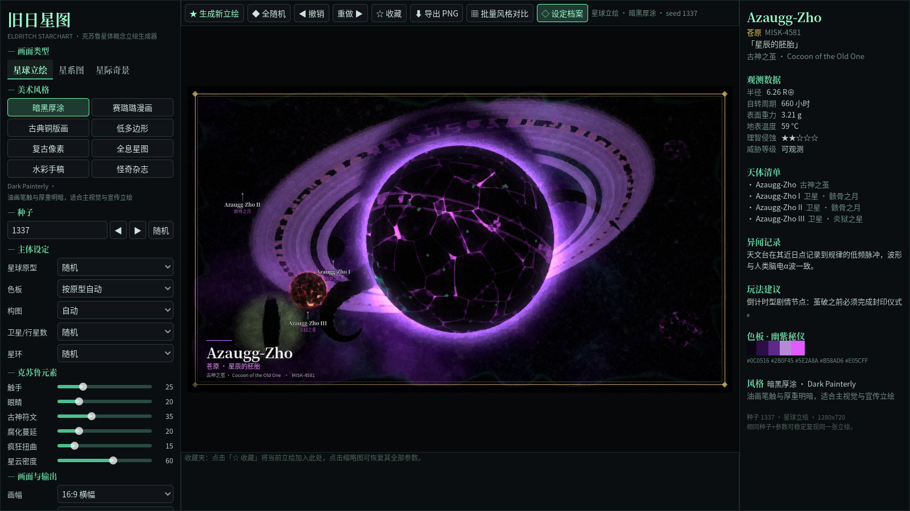

*实拍：完整工具界面。中间金色双线框内即为最终导出的图版区域，左右 UI 不进入导出 PNG。*

---

## 1. 先厘清术语：这里的「立绘」是什么

用户说的「立绘（有动态效果）」，在这个项目里更准确的术语是：

> **Plate（图版 / 插画页）**——一张以天体为主体的**概念设定图**，外面套了图鉴/杂志/观测日志的**装帧层**；同时它是 **kinetic（活的）**：符文会滚动、触手会摆、眼睛会眨、裂纹会脉动。

这点很重要，因为它决定了美术分类：它不是角色立绘（character illustration），而是**「带副文本的宇宙恐怖天文图版」**。装帧（`PLATE VIII`、`Fig. I.`、`25¢`、`RA/DEC`、色卡、准星）不是 UI 装饰，而是美术本体的一部分——属于 **diegetic editorial design（世界观内装帧）**，即"这件物品在游戏世界里是一页档案"的叙事手段。

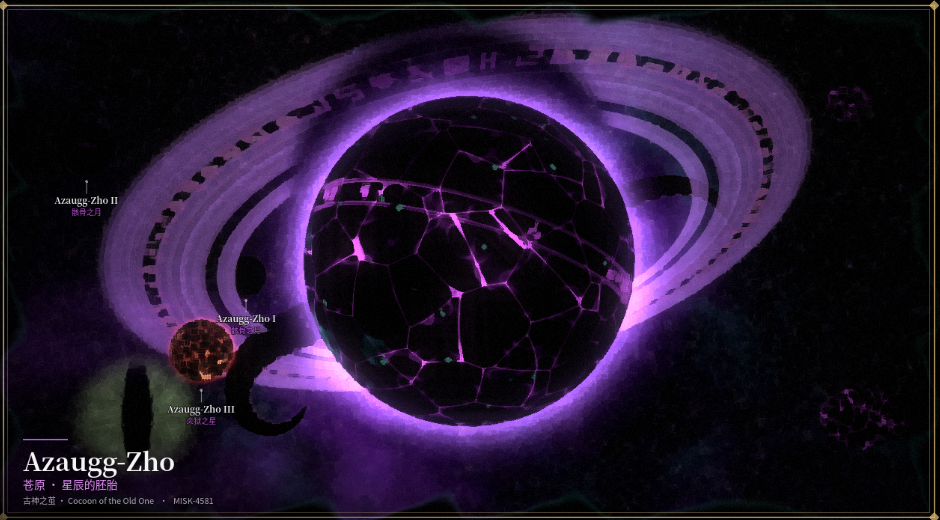

*实拍：seed=1337 / style=0 / 古神之茧。注意左下标题卡、天体引线标注、双金线边框——图版感由排版层完成，而非渲染层。*

---

# 第一部分 · 技术

## 2. 星球 / 星系生成的技术架构

### 2.1 四层管线总图

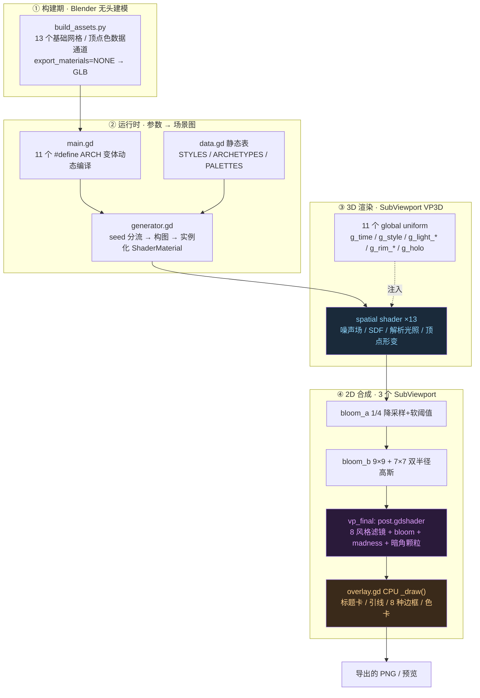

证据：`main.gd:4-6` 的注释即为渲染图设计文档；`main.gd:138-225` 构建渲染图；`README.md:5-11` 列出完整工具链。

### 2.2 资产层：几何只负责「载体」和「数据通道」

`blender/build_assets.py`（329 行）用 `bpy.ops.mesh.primitive_ico_sphere_add` / 手工顶点表无头生成 13 个对象，全部平铺在根 collection，**不导出材质**（`export_materials='NONE'`）：

| 网格 | 构造 | 顶点量级 | 在 Godot 里的角色 |
| --- | --- | --- | --- |
| `Planet` | icosphere subdiv=6, smooth | ≈ 40,962 | 行星 / 恒星 / 天空球（放大 1500× 后 `cull_front` 从内侧看） |
| `PlanetLow` | subdiv=4 + ±2% 顶点抖动 + `shade_flat()` | ≈ 2,562 | 低多边形风格专用替换 |
| `Orb` | subdiv=3 | ≈ 642 | 小卫星 / 大气壳 |
| `Tentacle` | `NA=200, NR=40` 的**直管** + 两排吸盘几何 + 顶点色 | ≈ 8,042 | 卷曲完全由 vertex shader 现场积分生成 |
| `TentacleLow` | `28×6` 低模管 | ≈ 175 | 低模替换 |
| `Ring` | `SEG=256, RAD=10` 环面 | ≈ 2,816 | 星环 / 法阵 / 吸积盘的极坐标画布 |
| `Rock0..3` | subdiv=4 + 双层噪声扰动 + 5 陨坑 + squash | 各 ≈ 2,562 | `MultiMeshInstance3D` 小行星带（420 / 360 实例） |
| `Monolith` / `Gate` / `Ruins` | 手工顶点 / 旋转立方体环 / 压扁浮岛 + 塔楼 | 小 | 遗迹类剪影 |

**最关键的设计**：顶点色被当成**数据通道**而非颜色。`COLOR.r = 吸盘 mask`、`COLOR.g = 轴向参数 t`（`build_assets.py:143-155`），`tentacle.gdshader:58` 用 `v_suck = COLOR.r` 上色、`vertex()` 用 `VERTEX.y` 当轴向参数。同理 `PlanetLow` 靠 `shade_flat()` 把面法线塞进 `NORMAL`，`planet_body.gdshaderinc:434` 用 `v_face = NORMAL` 取平面法线。

> **结论**：GLB 是一个「空白的几何调色板」。它不承载任何表面细节——表面是 shader 的领地。这与常规 3D 项目（几何 + 贴图 + PBR 材质）是相反的权重分配。

### 2.3 视觉来源三分

| 层 | 负责什么 | 代表证据 |
| --- | --- | --- |
| **A · 3D 几何** | 轮廓、体积、顶点属性、极坐标画布、billboard quad | `build_assets.py`；`generator.gd:27` 的 `QuadMesh(1,1)`；MultiMesh 实例化 |
| **B · spatial shader** | **几乎全部视觉内容**：11 种地表、巨眼/众眼、符文带、腐化蔓延、夜面城市灯、环阴影、凹凸法线、星云三层星点、螺旋星系、大气、日冕、吸积盘多普勒、触手皮肤与形变、裂隙 SDF、传送门涡旋 | `planet_body.gdshaderinc`、`sky.gdshader`、`ring_fx.gdshader`、`tentacle.gdshader` 等 |
| **C · 2D 后期 + CPU 排版** | bloom、8 种风格滤镜、madness 畸变、暗角颗粒；标题卡、引线、8 种边框、色卡、全息刻度 | `post.gdshader`；`overlay.gd:67-319` |

一句话边界：**GLB 给形状，shader 给内容，`canvas_item` + `_draw()` 给媒介与排版。**

### 2.4 无光源的自研解析光照

全局搜索 `Light3D` / `DirectionalLight3D` 为 0 匹配。所有 shader 声明 `render_mode unshaded, shadows_disabled`，光照完全由 `project.godot:33-79` 的 `[shader_globals]`（11 个全局 uniform）+ `common.gdshaderinc` 手写：

| 函数 | 作用 | 位置 |
| --- | --- | --- |
| `light_vec(wpos)` | 平行光 ↔ 点光按 `g_light_point` 混合 | `common.gdshaderinc:18-20` |
| `style_diffuse(ndl)` | **把媒介响应写进明暗曲线**：style 1/4/7 硬分层（两档 `smoothstep(-0.24,-0.18)` / `(0.18,0.24)`），style 3 五级量化 `floor(d*5)/5`，其它用 `d²(3-2d)` 柔化 | `:22-34` |
| `style_shade(...)` | 反照率 × (解析漫反射 + 暖色明暗交界 + 环境 + 纸感补光) + Blinn 高光；铜版/水彩 `amb_k` 放大 2~5.5 倍模拟纸面反光 | `:36-55` |
| `perturb_normal(N, pos, h, k)` | 用 `dFdx/dFdy` 从高度场 `h` 反推法线（**不需要法线贴图**） | `:66-76` |
| `rim_term` | 方向性 4 次菲涅尔轮廓光 | `:61-64` |

额外物理近似都写在各自 shader 里：大气解析视线积分（`atmo.gdshader:17-44`）、星环前向散射 + 行星遮挡求交（`ring_dust.gdshader:39-52`）、吸积盘 **多普勒 beaming** `1 + 0.75*dot(tang, V)`（`ring_fx.gdshader:84-88`）、黑洞光子环与引力透镜盘（`corona.gdshader:40-51`）。

> 为什么这么做：`gl_compatibility` 下 Godot 的光照管线既难精确控制、又与"风格化明暗"冲突。自研解析光照把「明暗」变成了一个**可被风格参数调制的算子**，这是 8 种画风能共用同一套几何的前提。

### 2.5 参数化：三层解耦（全项目最值得学的工程决策）

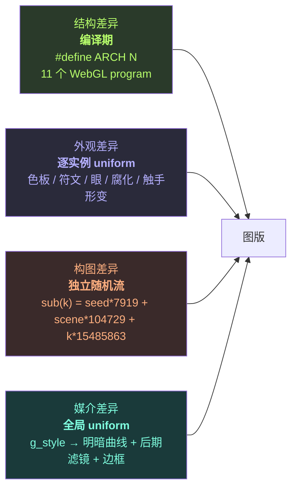

- **编译期变体**：`main.gd:75-79` 运行时拼 11 段 shader 源码，每段只有 `#define ARCH n` + `#include planet_body.gdshaderinc`。`planet_body.gdshaderinc:71-301` 里 11 个 `#if ARCH == N` 的 `Surf` 分支，编译期裁掉其余 10 个——**避免 WebGL program 过大**，也避免动态分支开销。
- **逐实例 uniform**：`mat(key)` 每次 `ShaderMaterial.new()`（`generator.gd:65-68`），不做缓存。`add_planet` 一次注入 20+ 个 uniform（`generator.gd:181-213`）：色板 5 色 + 大气色 + 腐蚀双色 + 虹膜色 + `seed_off` + 海平面 + 八度数 + 凹凸 + 符文/腐化/夜灯/眼群 + 单眼 7 参数 + 环阴影 5 参数。
- **独立随机流**：`sub(k)` 用「特征编号」做种子盐（`generator.gd:33-35`），所以拖动"触手数量"滑块**不会重排整张构图**；`seed_vec()` 给每个 shader 实例独立噪声相位；Web 端 `?seed=` 可复现。
- **全局 uniform**：`g_style` 同时改变 3D 明暗曲线（`common.gdshaderinc`）、各 spatial shader 的特化分支（`planet_body:534-555`、`sky:104-130`）、后期滤镜（`post.gdshader`）、CPU 边框（`overlay.gd:86-181`）与 bloom/grain/vignette 权重（`data.gd:5-22`）。**一个整数驱动五个渲染层**——这是"风格"能被做到彻底统一的技术根源。

### 2.6 构图：用归一化屏幕坐标而不是世界坐标

`generator.gd:81-93, 111-133`：相机固定 `(0,0,D=10)`、`FOV=34°`，`screen_pt(u,v,z)` 把**归一化屏幕坐标 + 深度**映射到世界坐标：

```
k = (D - z) / D;  world = (u * hx * k, v * hy * k, z)
```

好处：换画幅（16:9 / 1:1 / 3:4 / 9:16 / 21:9）不会破坏构图。6 种构图都是对这个坐标系的调参：`居中`、`三分构图`、`巨构地平线`（`R = short_h * 4.2`，星球大到只剩地平线）、`远景`（`R = short_h * 0.27`）、`日蚀逆光`（背后 `z=-32` 放恒星）。

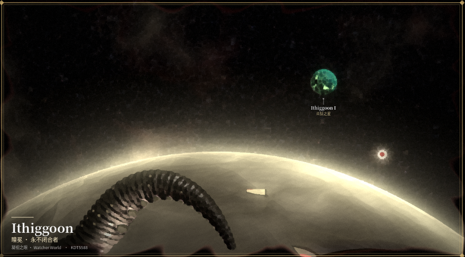

*实拍：seed=777。「凝视之眼」原型 + 巨构地平线构图。巨大的金色大气弧、前景卷曲触手、远景小卫星与带瞳孔的红星——全部由参数组合得出，没有一张预设构图图。*

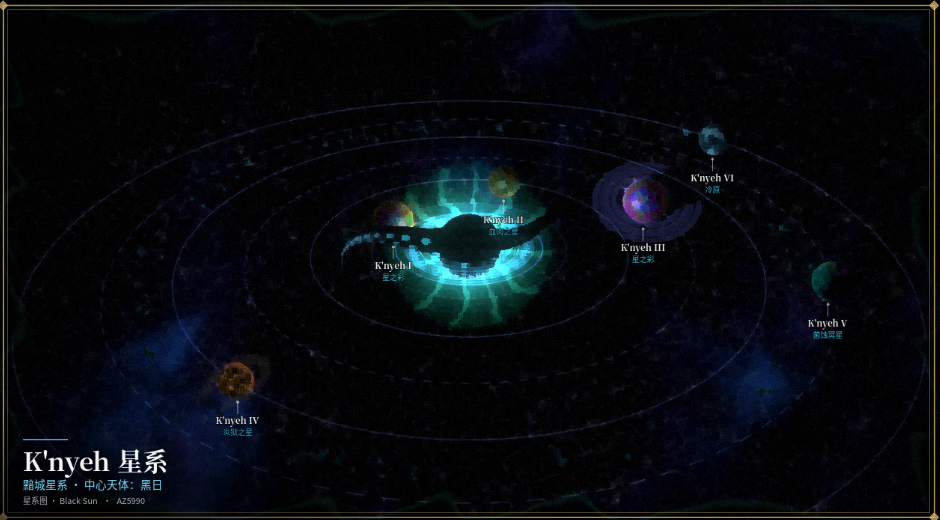

*实拍：scene=1 星系图。中心黑日 + 吸积盘/日冕 + 5 颗行星沿倾斜椭圆轨道 + 轨道线 + 小行星带 + 逐天体引线标注。相机改为 `looking_at` 俯视。*

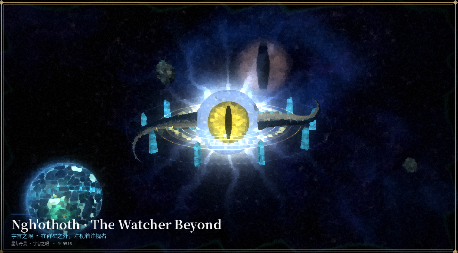

*实拍：scene=2 奇景。巨型竖瞳 + 发光法阵环 + 青色方尖碑阵列 + 触手 + 背景星云巨眼。这类"奇景"是 6 个独立构图函数之一。*

### 2.7 渲染图：4 个 SubViewport 手工后期链

`main.gd:138-225` 全部在运行时建节点（`main.tscn` 只有 13 行、一个 `Control` 节点）：

| Pass | 尺寸 | 算法 |
| --- | --- | --- |
| `vp3d` | `size_out`（1280×720 × quality 0.6/1.0/1.5） | `own_world_3d`, `MSAA_4X`, `UPDATE_ALWAYS`, `TONE_MAPPER_LINEAR`（避免 ACES 篡改色板） |
| `bloom_a` | 1/4 | `bloom_down.gdshader`：4 次对角采样均值 + 软阈值 `smoothstep(threshold-knee, threshold+knee, luma)` |
| `bloom_b` | 1/4 | `bloom_blur.gdshader`：9×9 高斯（步长 1.6px）+ 7×7 高斯（步长 4.5px），输出 `small*0.65 + s2*0.75` → 双半径光晕 |
| `vp_final` | `size_out` | `post.gdshader` 合成 + `overlay` Control（**在 SubViewport 内，因此进入导出 PNG**） |

**跨 pass 全靠 `SubViewport.get_texture()` 显式串接**：全项目 `BackBufferCopy` / `hint_screen_texture` / `SCREEN_TEXTURE` 匹配数为 0。这是为 WebGL2 可移植性做的取舍，副作用是**导出 PNG 天然包含完整后期与装帧**——一个很划算的工程收益。

### 2.8 动效：单一时间源

`main.gd:317-320` 是唯一的逐帧更新：

```gdscript
if animate: time_acc += delta
RenderingServer.global_shader_parameter_set("g_time", time_acc)
```

**没有任何节点位移/旋转动画、没有 AnimationPlayer、没有骨骼**。所有动效都是 shader 内 `g_time` 的函数，可归为三类算子：

| 算子类型 | 公式形态 | 实例 |
| --- | --- | --- |
| **相位平移 / 脉冲** | `sin(g_time * a + 空间相位)` | 血肉脉动 (`planet_body:131`)、熔岩闪烁 (`:174`)、茧呼吸 (`:269`)、符文脉冲 (`:473`)、腐化波纹 (`:483`)、法阵闪烁 (`ring_fx:69`) |
| **域流动** | `q + vec3(0, t, 0)` / `旋转(p, 2.4/(r+0.25) - t*spin)` | 恒星表面流场 (`star:26-27`)、混沌核心 (`planet_body:245-249`)、传送门涡旋 (`portal:28`)、吸积盘 (`ring_fx:77-79`) |
| **离散事件** | `smoothstep(0.92, 1.0, sin(g_time*a + hash))` | **众眼眨眼** (`planet_body:374`)、裂隙群眼 (`rift:40`)、星点闪烁 (`sky:36`) |
| **顶点级形变**（单独一类） | 沿 `dir_at(s)` 积分 20 步重建触手中心线 | `tentacle.gdshader:30-63`，`theta_at` 含 `- g_time*wave_speed`、`phi_at` 含 `+ g_time*wave_speed*0.45` |

**实拍证据**（同一 seed / 同一构图，间隔 2.6 秒两帧）：

| 时刻 T0 | 时刻 T1 |
| --- | --- |
|  | 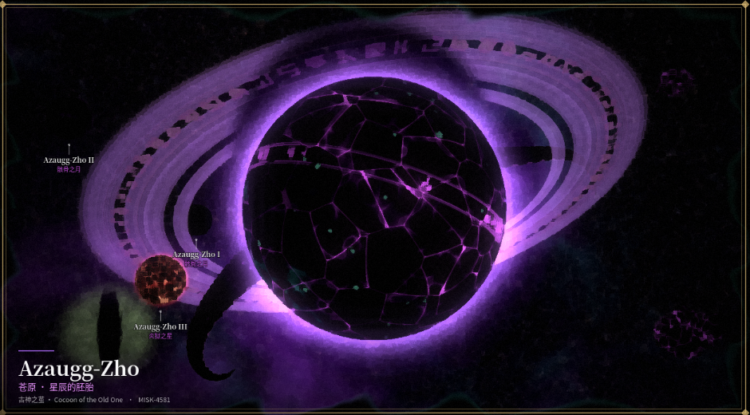 |

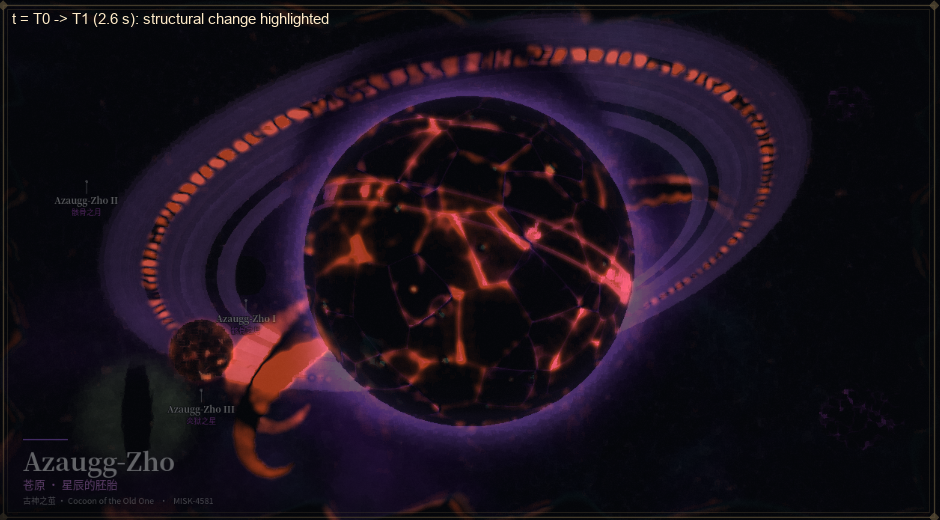

*差分热力图（高斯去颗粒后取结构差异，橙红 = 变化区）。可以清楚看到三处主变化：**环上符文带整体滚动**、**星球表面裂纹发光脉动**、**左下触手摆动**。这不是整屏噪声，而是三个独立的、局部化的时间算子在起作用。*

冻结时间也很干净：`animate` 复选框停 `time_acc`；`--shots` 批跑把 `time_acc = 3.0` 固定（`main.gd:110`），保证相同参数产出完全一致的 PNG。

### 2.9 绘制技术的准确表述

| 常见猜测 | 实际 |
| --- | --- |
| 贴图 / PBR 材质 | ❌ GLB `export_materials='NONE'`，工程内 0 张纹理贴图 |
| AI 生成图 | ❌ 全部为手写 GLSL 与 GDScript，无外部模型调用 |
| 粒子系统做星尘/星环 | ❌ 星点是 `star_layer()` 的 3D 细胞哈希；小行星带是 MultiMesh；星环是环面 fragment |
| 后处理描边（法线/深度） | ❌ **解析 SDF 描线**：`sd_segment`、`circle_line`、`glyph_dist` 直接算到笔画的距离 |
| 法线贴图做凹凸 | ❌ `dFdx/dFdy` 从程序化高度场实时求导 |

**描线是这个项目的核心技术资产**。`planet_body.gdshaderinc:415-424`：

```glsl
float fw = length(fwidth(g));          // 屏幕空间导数
float lw = 0.028 + fw * 0.3;           // 线宽随像素尺度自适应
float line = 1.0 - smoothstep(lw, lw + fw * 0.8 + 0.01, d);
float vis = smoothstep(0.5, 0.2, fw);  // 远处自动淡出，避免摩尔纹
```

`fwidth` 让「笔画宽度」在任何分辨率下都保持视觉恒定，远距离自动淡出——**这是把 shader 从「概念图生成」推广到「游戏内 UI / 图标 / 卡面」时最需要保留的一条**。同一手法贯穿 `ring_fx.gdshader:23-26`（`circle_line`）、`prop.gdshader:53-54`（石碑符文）、`ring_dust.gdshader:65-68`（环上符文）。

### 2.10 WebGL2 / GLES3 兼容性对写法的约束

| 约束 | 代码里的应对 |
| --- | --- |
| 无 compute / sky / particles shader | 只用 `spatial` + `canvas_item` 两种类型 |
| 全局 uniform 必须在项目设置声明 | `project.godot:33-79` ↔ `common.gdshaderinc:2-12` 一一对应 |
| 不能用 screen texture / BackBufferCopy | 4 个 SubViewport + `get_texture()` 显式传图 |
| `thread_support=false`、`extensions_support=false` | `export_presets.cfg:25-26`；`index.wasm` 38 MB 单线程 |
| billboard 需手写矩阵 | `corona.gdshader:17-24` 直接覆写 `MODELVIEW_MATRIX` |
| 透明特效排序 | `blend_add`（日冕/法阵/大气）+ `depth_draw_never`；`blend_mix`（星环/裂隙） |
| 确定性 | 独立随机流 + URL seed + 固定 `time_acc` + `await frame_post_draw` ×4 |

### 2.11 Planet archetype = 一份「算子配方表」

`planet_body.gdshaderinc` 的 11 个 `Surf` 函数其实是**同一套算子库的不同组合**，这是「画笔结构化」最直接的证据：

| ARCH | 原型 | 主算子配方 |
| --- | --- | --- |
| 0 | 溺亡之海 | `warp3` 域扭曲 → `fbm3` 高度场 → 海平面 `smoothstep` → 对数螺旋 `sin(ang*3 + log(d)*9 - t)` → `voronoi3` 石缝 + 海岸线 |
| 1 | 凝视之眼 | 脊线 `pow(1-|gnoise|, 6/8)` 做皱纹 → **`apply_eye()`**（眼睑解析式 + 双频虹膜纤维 + 4 种瞳孔 SDF） |
| 2 | 血肉之星 | `voronoi3` 细胞 + 血管脊线 `pow(...,14/18)` + 脉动 `sin(t*2.5 - 空间相位)` |
| 3 | 菌蚀冥星 | `ridged3` 山脉 + 纬度冰盖 + Voronoi 菌落斑点 + 呼吸发光 |
| 4 | 炎狱之星 | **双层 Voronoi `F2-F1` 裂缝**（粗细两级）+ 熔岩阈值 + 闪烁 |
| 5 | 冷原 | 高度量化 `floor(h*7)/7` 造台地 + 雪线 + 裂纹 |
| 6 | 星之彩 | Voronoi cell hash → 色相 `fract(...)` → **余弦调色板** `0.5+0.5*cos(TAU*(hue+vec3(0,.33,.67)))` + 视相关 `ndv` |
| 7 | 黄衣王城 | 正弦沙丘 + 湖 + Voronoi 城市网格发光 + 夜面城市灯 |
| 8 | 混沌核心 | **三级 fbm 域扭曲自反馈**（`o1 → o2 → f`），最"活"的表面 |
| 9 | 古神之茧 | Voronoi 裂缝 + 纵向条纹 `sin(p.y*60)` + 脉动发光（本次主视觉即此原型） |
| 10 | 骸骨之月 | 双层解析陨石坑 `crater = (d²-1)*0.35` + `rim = exp(-((d-1)/0.18)²)` |

**所有原型共享一条后处理流水线**（`:463-557`）：符文铭刻带 → 腐化蔓延 → 众眼 / 单巨眼 → 解析光照 + bump → 夜面灯 → 环阴影 → 菲涅尔大气 + 轮廓光 → 全息风格特化。

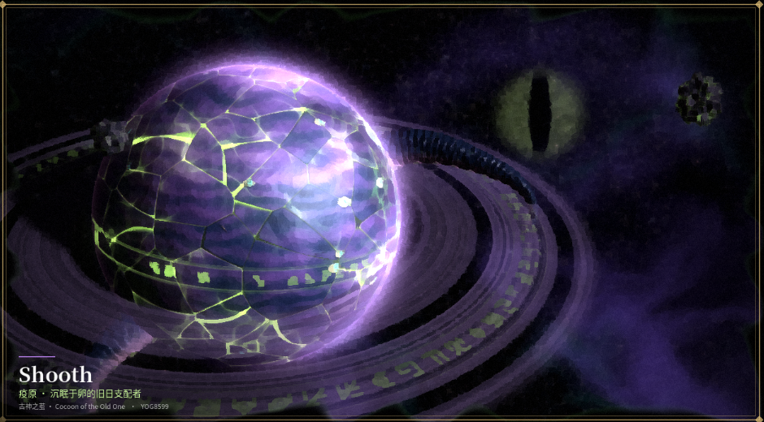

*seed=42：古神之茧 + 符文环 + 背景星云巨眼。*

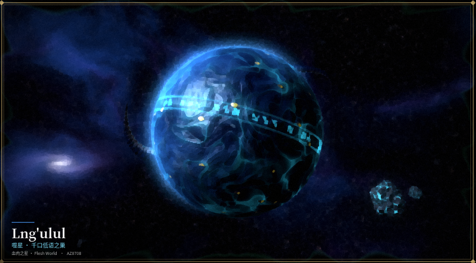

*seed=2024：血肉之星。涡旋状血肉纹 + 赤道符文带 + 夜面城市灯 + 大气边缘光。*

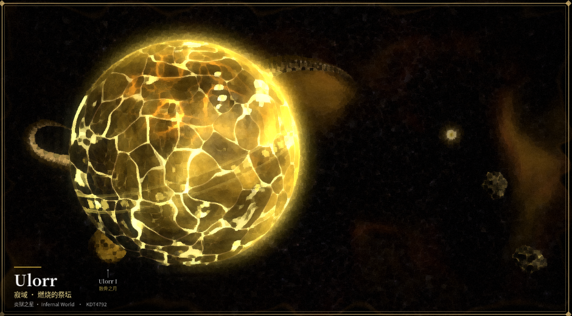

*seed=9001：炎狱之星。Voronoi 熔岩裂缝 + 强自发光 + 大范围 bloom 溢出。*

---

# 第二部分 · 美术

## 3. 专业分类与视觉语言结构

### 3.1 给这套风格一个可引用的分类坐标

你问「如何为其分类」——游戏技术美术（Technical Art）里通常不会用一个词概括，而是用**多个正交坐标**定位。这套作品可这样描述：

| 坐标 | 归类 | 说明 |
| --- | --- | --- |
| **生产范式** | Procedural / Generative Illustration（程序化生成式插画） | 非手绘、非摄影、非 AI 出图；图像是参数 + 算法的求值结果 |
| **渲染范式** | Shader-driven implicit field rendering（噪声场 + SDF 隐式场渲染） | 不是传统 3D PBR，也不是 2D 逐笔绘制 |
| **题材 / 图像学** | Cosmic Horror / Eldritch（宇宙恐怖） | 一套固定圣像母题：**球 · 环 · 眼 · 触手 · 符文 · 方尖碑 · 裂隙** |
| **美术史参照** | 象征主义 / 黑暗浪漫主义的当代数字版 + 19 世纪天文图鉴铜版画 + 20 年代 Pulp 杂志封面 + 木刻/版画 | 见 §3.3 逐风格对照 |
| **媒介策略** | **Medium / Print Emulation（媒介拟态）** | 核心不是"画什么"，而是"**假装用什么材料印出来**" |
| **装帧策略** | Diegetic Editorial Design / Fictional Archive（伪档案、世界观内装帧） | `PLATE VIII`、`Fig. I.`、25¢、RA/DEC、色卡、准星，让图成为"世界里的物件" |
| **动效类型** | Ambient Kinetic Illustration / Living Plate（氛围动效插画） | 呼吸、脉动、眨眼、流场；非角色动画、非叙事动画 |
| **色彩结构** | 低明度冷底 + 5 级 ramp + 单点互补高饱和发光 | 见 §3.4 |

> 最贴切的一句话：**「一套以宇宙恐怖为题材、以程序化噪声场为笔、以古董印刷媒介为纸、以伪档案排版为框的动态图版系统」**。

### 3.2 核心洞察：8 种风格 = 8 种「媒介」，不是 8 种造型

这是理解整套设计最关键的一点。看 `data.gd:5-22` 的风格表，字段是 `bloom / grain / vig / rim`——**全是后期参数**；再看 `post.gdshader:120-226`，8 个分支全部是**对同一张已渲染好的 3D 图做的媒介转换**。

也就是说：**几何、构图、色板、主体位置在 8 种风格下完全一致**，变的是「这张图被什么材料重现」。`grid-styles.png` 是同一 seed=1337 的 8 张实拍，可以直接用眼睛验证：星球、环、触手、卫星、陨石的位置一模一样。

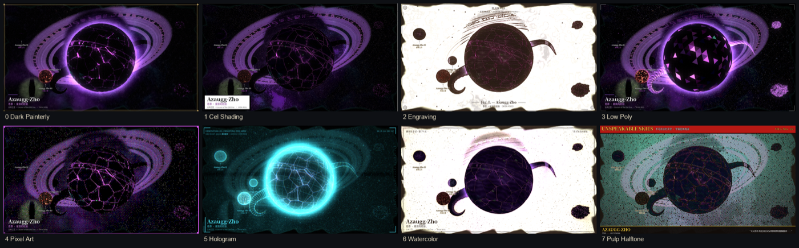

*4×2 拼图，全部实拍。左上→右下：0 暗黑厚涂 / 1 赛璐璐漫画 / 2 古典铜版画 / 3 低多边形 / 4 复古像素 / 5 全息星图 / 6 水彩手稿 / 7 怪奇杂志。注意主体轮廓与构图完全一致，只有媒介在变。*

这个设计在美术生产上极其聪明：**一次造型投入，八次媒介复用**。对游戏项目意味着一套程序化资产可以同时供给主视觉（厚涂）、卡牌（赛璐璐）、图鉴（铜版画）、UI 终端（全息）、教程插图（水彩）、成就/海报（杂志）——而不需要重画。

### 3.3 8 种风格逐个体检

| # | 名称 | 美术史 / 媒介参照 | 技术实现（`post.gdshader`） | 3D 侧配合（`common.gdshaderinc` / 各 shader） | 最适合的游戏内对象 |
| --- | --- | --- | --- | --- | --- |
| 0 | 暗黑厚涂 | 油画 / 数字绘景概念画 | **Kuwahara 滤波**（4 象限 4×4，取方差最小者的均值，模拟笔触方向）+ fbm 笔触明暗调制 + 饱和度 ×1.1 | 柔化明暗曲线 + 暖色明暗交界 + 高 rim(0.7) + bloom 0.75 | 主视觉、Loading 插画、章节封面 |
| 1 | 赛璐璐漫画 | 日式动画 / 美漫 | Sobel 描线 `mix(ink*0.25, e)` + 亮度 4 阶量化 + 饱和度 ×1.25 | `style_diffuse` 两档硬分层 + 高光 `step(0.4, sp)` | 卡牌卡面、角色/单位头像 |
| 2 | 古典铜版画 | 19 世纪天文图鉴 / 蚀刻铜版 | **三方向交叉排线**（`h1/h2/h3` 按亮度阈值逐级叠加）+ Sobel 补线 + 纸纹 fbm + 饱和区手工上色保留 | 纸感 `amb_k=2.0` + 补光 + 天空取负片（纸白底、墨色星点） | 图鉴、典籍、卷轴、百科条目 |
| 3 | 低多边形 | 低模独立游戏 | 14 阶色阶量化 `floor(c*14+0.5)/14` + 饱和 ×1.08 | **换几何** `PlanetLow` / `TentacleLow` + `flat_normal()` + 五级明暗量化 | 3D 场景内的物体、棋子、微缩景观 |
| 4 | 复古像素 | 8-bit / PC-98 | 4px 块采样 + **Bayer 4×4 有序抖动** + 5 阶量化 + 暗部描边 | 硬分层 + `octaves=4` 降噪细节 | 像素风游戏、复古 UI、小图标 |
| 5 | 全息星图 | 科幻 HUD / CRT 投影 | RGB 色差 + 扫描线 `sin(fc.y*1.6)` + flicker + 滚动带 + 噪点 | **所有 spatial shader 集体切到单色 `g_holo` + 经纬网格 + 等高线**（`planet_body:534-546`、`sky:104-112`） | 星图界面、终端、扫描/侦测 UI |
| 6 | 水彩手稿 | 调查员笔记 / 田野速写 | fbm 域扭曲 + 8 邻域边缘暗化 + 颗粒 + 降饱和 0.85 + 纸纹 + 墨线 | `amb_k=5.5` 强纸面反光 + 补光 + 发光 ×0.55 + 天空改水彩 wash | 日记、手记、任务日志、教程插图 |
| 7 | 怪奇杂志 | 1920s Pulp 封面 / 廉价四色套印 | **CMYK 四角半调**（0 / 0.26 / 1.31 / 0.785 rad 四个网角）+ 1.5px 错版 + 重墨 | 三层硬分层 + 额外高光档 + 天空改平面渐变 | 海报、成就、宣传物料、章节标题卡 |

四张单张特写：

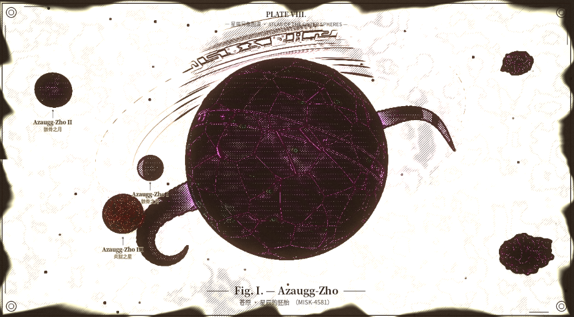

*style=2：纸白底、深褐墨、交叉排线密度编码明暗，`PLATE VIII` / `Fig. I.` / 双规线 / 四角装饰线。注意星环被"翻译"成了细密刻线而非实体环——这是媒介转换而非滤镜叠加。*

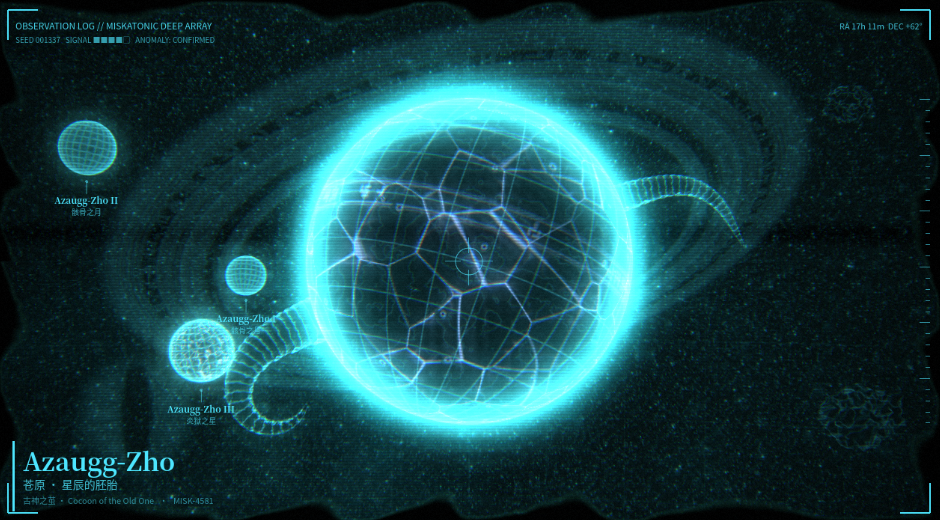

*style=5：单色青 + 经纬网格 + 等高线 + 扫描线 + 准星 + 右侧刻度尺 + `OBSERVATION LOG / SEED / RA DEC`。这一风格连 3D shader 都改了输出通道，是渗透最深的风格。*

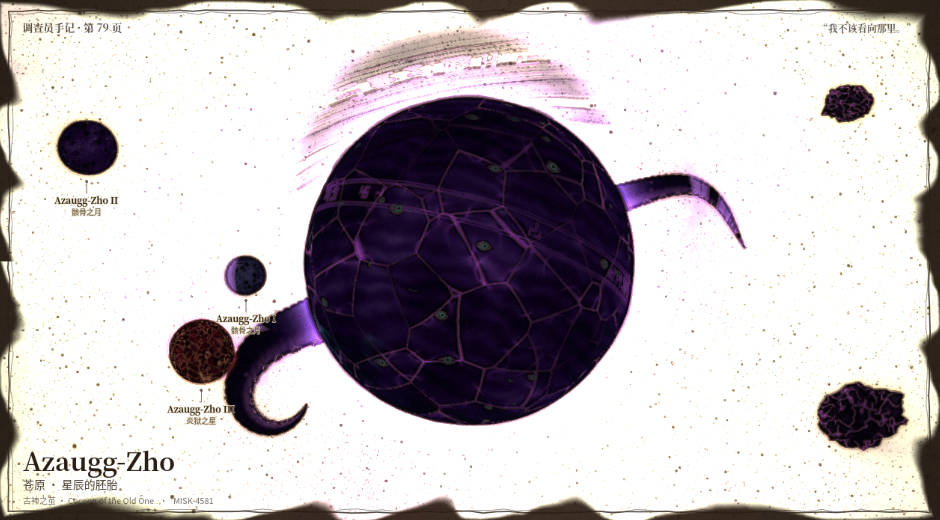

*style=6：抖动的手绘边框（`_wobble_rect`）、"调查员手记 · 第 79 页"、"我不该看向那里。"、纸面颗粒与颜料晕染。*

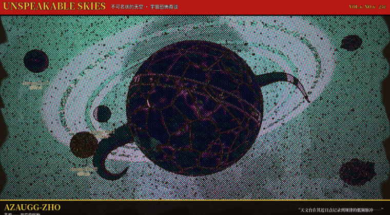

*style=7：CMYK 网点、红色刊头 `UNSPEAKABLE SKIES`、黄色大标题、`VOL. / 25¢`、套印错位。*

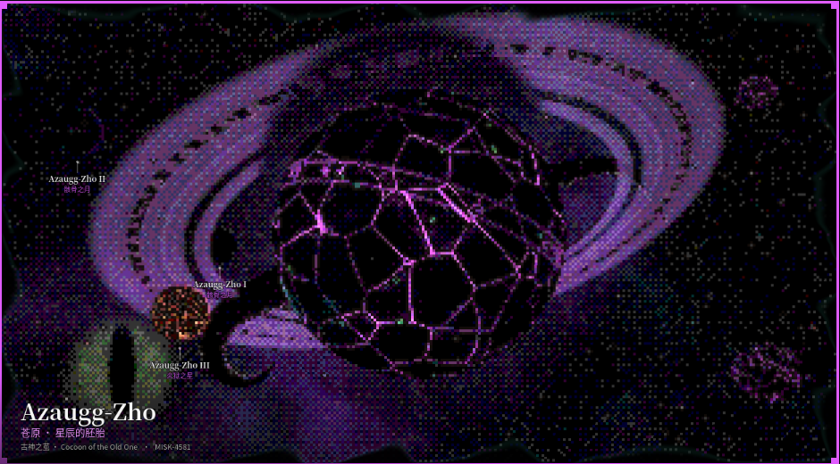

*style=4：4px 块 + Bayer 有序抖动，星环的符文被量化成像素点阵。*

### 3.4 视觉语言的六个可拆解构件

| 构件 | 内容 | 为什么成立 |
| --- | --- | --- |
| **① 圣像母题库** | 球 / 环 / 眼 / 触手 / 符文 / 方尖碑 / 裂隙 / 陨石 | 数量少、可组合、语义明确。`glyph_dist()` 甚至把"符文"做成了 3×3 锚点 + 12 段线 + 随机圆弧的**生成式文字系统**（`noise.gdshaderinc:137-172`），有文字感但不构成可读语言 |
| **② 5 级色板 ramp** | `c0`(最暗) → `c3`(最亮底色)，`c4` **专作发光/高光墨**；另配 `atmo / iris / rim / neb[3] / cor[2] / star[2]`（`data.gd:68-89`，10 套色板） | `ramp4()` 只消费 `c0..c3`，`c4` 独立进 `emit`。**底色与发光在数据结构上就分离**，所以"暗底 + 单点霓虹"能稳定复现，不会过曝成一团 |
| **③ 恒定线宽的解析描线** | `fwidth` + SDF + `smoothstep` | 见 §2.9。这是"画"的感觉（而非"渲"的感觉）的主要来源 |
| **④ 承印物质感** | grain / 纸纹 fbm / 网点 / 抖动 / 扫描线 / 暗角 | 纯数字渲染容易"太干净"；加一层**材料噪声**才有物件感。每种风格的 grain 强度都不同（`data.gd:5-22`） |
| **⑤ 装帧副文本** | 标题卡、引线标注、边框、色卡、编号、刊头、刻度 | 把"一张渲染图"抬成"一件游戏内物品"。`overlay.gd` 为 8 种风格各写了一套边框（`:86-181`）和标题卡（`:221-293`） |
| **⑥ 氛围动效** | 脉动 / 眨眼 / 流场 / 符文滚动 / 触手摆动 | 低频、局部、无叙事。让图版"活着"但不抢注意力——对卡牌/UI 尤其重要，见 §3.5 |

### 3.5 动效的美术归类

它**不是**角色动画（无骨骼/关键帧），也**不是**特效动画（无粒子/时间轴）。准确叫法是：

> **Ambient Kinetic Illustration / Living Plate（氛围动效插画）**：把「时间」当作材质的一个通道，让静态插画具备呼吸感。

专业上可再分三类，正好对应 §2.8 的三类算子：

| 类别 | 视觉语义 | 例子 |
| --- | --- | --- |
| **Physiological（生理节律）** | 让物体读作"活的" | 血肉脉动、茧呼吸、众眼眨眼、视线游移 |
| **Material flow（材质流动）** | 让表面读作"非固态" | 恒星流场、混沌核心、熔岩闪烁、符文脉冲 |
| **Mechanical / ritual（机械 / 仪式）** | 让画面读作"正在运转的装置" | 法阵旋转、七芒星反向转、环上符文滚动、吸积盘差速旋转 |

从上面的 `anim-diff.png` 可以看到，2.6 秒内的变化**集中在三块局部区域**，其余画面几乎静止。这是很好的动效设计纪律：**低频、小振幅、局部化**——因此可以安全地放进卡牌、图鉴、HUD 而不会造成视觉噪音。

### 3.6 为什么"好看"：四条可复制的原理

1. **一个强主体 + 一层负空间**：球体占画面 35~60%，其余是程序化星云与颗粒。构图参数（6 种）只调主体尺度与偏位，不叠加更多主体。
2. **明暗对比压到极致，颜色只留一处**：`c0` 常接近纯黑，`c4` 是高饱和霓虹；`atmo` / `rim` 只沿菲涅尔边缘出现。发光集中在一条边、一条裂缝、一圈符文上。
3. **媒介一致性**：风格切换时，**3D 明暗、后期滤镜、边框、字体描边、bloom 权重、甚至天空的画法一起变**（`g_style` 一个整数贯穿五层）。最忌讳的是"铜版画线稿 + 照片级渐变"，这里完全没有这个问题。
4. **副文本承担世界观**：名字（`Azaugg-Zho`）、编号（`MISK-4581`）、别称（「苍原 · 星辰的胚胎」）、观测数据、语气文案都在 `lore.gd` 里程序化拼接。**文字让图变成了档案**，这一步的成本远低于再画一层细节，收益却极高。

---

# 第三部分 · 把「画笔」结构出来

## 4. 从这套项目抽象出可复用的游戏美术系统

### 4.1 关键发现：已经存在一个天然的「材质输出契约」

`planet_body.gdshaderinc:44-50`：

```glsl
struct Surf {
    vec3 alb;     // 反照率 / 底色
    vec3 emit;    // 自发光（独立于 alb）
    float spec;   // 高光强度
    float h;      // 高度场（供 dFdx/dFdy 生成法线）
    float land;   // 分类遮罩（海/陆、夜灯等）
};
```

**11 个原型、13 个 shader 全都在往这 5 个槽里写值**，之后的所有处理（符文、腐化、眼睛、光照、bump、夜灯、环阴影、大气、风格化）都只依赖 `Surf`，不关心内容是谁生成的。

> 这就是可以直接搬走的「画笔接口」。它本质是一个**极简 GBuffer**：把"长什么样"和"怎么被画出来"彻底分开。只要新对象能产出 `Surf`，就能自动获得全部风格、光照、动效与装帧能力。

### 4.2 七层画笔栈

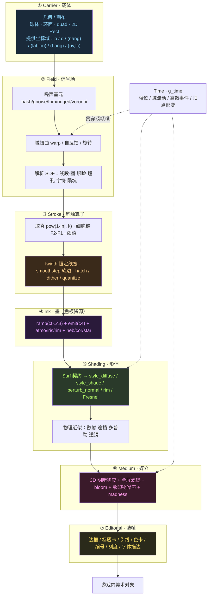

### 4.3 每层的可插拔算子清单

| 层 | 输入 | 输出 | 算子（可直接做成节点/函数库） |
| --- | --- | --- | --- |
| ① Carrier | 尺寸 / 拓扑 | 坐标域 | `SphereDomain`、`RingPolar`、`BillboardQuad`、`RectUV`、`Axial(t,ang)`、`LatLon` |
| ② Field | 坐标 + seed | 标量/向量场 | `Hash`、`GradientNoise`、`FBM(oct)`、`Ridged`、`Voronoi(F1,F2,id,cp)`、`DomainWarp`、`FeedbackWarp`、`SDF_Segment / Circle / Ellipse / Lid / Pupil / Glyph / Crater` |
| ③ Stroke | 场 | 遮罩 mask | `Ridge(k)`、`CellSeam`、`Threshold(lo,hi)`、`AA_Line(fwidth)`、`CrossHatch(angles[3])`、`Bayer4/8`、`Halftone(angle,cell)`、`Quantize(n)`、`Kuwahara`、`Sobel` |
| ④ Ink | mask + ramp | `alb / emit / spec / h / land` | `Ramp4`、`CosinePalette`、`AccentGlow`、`TwoTone`、`Misregistration` |
| ⑤ Shading | `Surf` + 光 | 线性颜色 | `AnalyticLight`、`BandedDiffuse`、`QuantizedDiffuse`、`BumpFromHeight`、`Rim`、`FresnelAtmo`、`ShadowRay`、`ForwardScatter` |
| ⑥ Medium | 线性颜色 + 媒介 id | 风格化颜色 | `Painterly / Cel / Engraving / LowPoly / Pixel / Hologram / Watercolor / Pulp`、`Bloom(threshold,knee,radii)`、`Grain`、`Vignette`、`Madness` |
| ⑦ Editorial | 成图 + 元数据 | 成品 | `Frame(8)`、`TitleCard`、`LeaderLine`、`Swatch`、`PlateNumber`、`Ruler`、`Reticle`、`WobbleRect` |
| ⟂ Time | `g_time` + 相位种子 | 逐帧 | `Pulse`、`Flow`、`BlinkEvent`、`VertexWave`、`Spin` |

### 4.4 建议的接口形态

把上表落成数据而非硬编码：

```text
BrushSpec = {
  carrier : "SphereDomain" | "RingPolar" | "RectUV" | ...
  field   : [ {op:"FBM", oct:6, scale:1.8}, {op:"DomainWarp", amt:0.35}, ... ]
  stroke  : [ {op:"CellSeam", width:0.06}, {op:"AA_Line", px:1.2}, ... ]
  ink     : PaletteID            # 10 套 ramp 之一
  shading : {diffuse:"smooth", bump:1.0, rim:0.6}
  medium  : StyleID              # 0..7，一个整数贯穿 ⑤⑥⑦
  time    : [ {op:"Pulse", freq:1.6, mask:"emit"}, ... ]
  editorial: {frame:"Engraving", title:true, labels:true}
  seed    : int
}
```

**组合公式**：

\[
\text{ArtObject} = \text{Carrier} \times \text{Field} \times \text{Stroke} \times \text{Ink} \times \text{Shading} \times \text{Medium} \times \text{Editorial} \times \text{Time}
\]

三条必须遵守的解耦规则（来自本项目实证）：

1. **结构差异用编译期变体，外观差异用 uniform。** 11 个 `Surf` 配方是 `#define ARCH`；色板/符文/眼睛/腐化是逐实例 uniform。若把 11 个配方塞进同一个 shader 用动态分支，WebGL2 下 program 会过大。反过来若为每套色板编译一个变体则会爆炸。
2. **墨与笔分离。** `c0..c3` 走 `ramp4()`，`c4` 只进 `emit`（`planet_body:59-65, 98, 135...`）。换色板不换笔法，换笔法不换色板。
3. **风格是一个全局整数，不是一个开关集合。** `g_style` 同时驱动 3D 明暗、各 shader 特化分支、后期滤镜、边框、bloom 权重。**任何一层漏掉，风格就会"不纯"**——这是本项目最值得抄的一条纪律。

### 4.5 迁移到更广泛的游戏内美术对象

| 游戏内对象 | 推荐 Carrier | 推荐的 Field/Stroke 组合 | 推荐 Medium | 需注意 |
| --- | --- | --- | --- | --- |
| **卡牌卡面 / 卡框** | `RectUV` + 圆角 SDF | 中央主体 `SphereDomain` 复用；边框用 `AA_Line(fwidth)` + `glyph_dist` 符文带 | 1 赛璐璐 / 2 铜版画 / 7 杂志 | 逻辑分辨率固定，`fwidth` 保证任何缩放下线宽一致；文字层必须独立于风格层 |
| **道具 / 技能图标** | `RectUV`（小尺寸） | 单一强母题（眼 / 符文 / 裂隙）+ `Ridge` 发光 | 4 像素 / 1 赛璐璐 | 关掉 `fbm` 高频层（小尺寸会糊成噪点），本项目已有 `octaves = 4 if R<0.5` 的同类处理 |
| **图鉴 / 百科页 / 卷轴** | 整页 `RectUV` | 保留天体主体 + 引线标注 | 2 铜版画 / 6 水彩 | **副文本层最值钱**：`PLATE`、`Fig. I.`、观测数据直接复用 `overlay.gd` 的排版算子 |
| **法阵 / 技能范围特效** | `RingPolar` | `circle_line` + `glyph_dist` 56 格符文环 + 七芒星 `sd_segment` + `Spin` | 5 全息 / 0 厚涂 | 直接搬 `ring_fx.gdshader` mode=1；`blend_add` + `depth_draw_never` |
| **星图 / 世界地图 UI** | `RectUV` + 经纬网格 | `star_layer` 细胞哈希 + 轨道 `circle_line` + 刻度 | 5 全息 | 搬 `sky.gdshader:104-112` 的网格 + `overlay.gd:142-164` 的 RA/DEC 与准星 |
| **角色 / 单位头像立绘** | `RectUV` + 剪影 SDF | `apply_eye()` / `apply_many_eyes()` 作为「怪物特征笔刷」；`Ridge` 做血管/甲壳 | 1 赛璐璐 / 0 厚涂 | 本项目没做人物，但 `apply_eye` 的眼睑/虹膜/瞳孔是一套完整的**参数化解剖笔刷**，可直接当器官生成器 |
| **UI 边框 / 分隔线 / 徽章** | `RectUV` | `_wobble_rect`（种子抖动手绘线）、`_corner_ornament`、`draw_arc` | 跟随全局 `g_style` | 纯 CPU `draw_*` 即可，不必上 shader；本项目已证明 8 套边框可以只靠 200 行 `_draw()` |
| **Loading / 章节封面 / 成就** | 全屏 `RectUV` | 完整 3D 管线降级为 2D 版 | 0 厚涂 / 7 杂志 / 6 水彩 | 用 Medium + Editorial 两层即可复用同一套资产 |
| **场景内 3D 物体（祭坛、石碑、遗迹）** | GLB 几何 | `prop.gdshader`：fbm 石材 + `Ridge` 裂纹发光 + `glyph_dist` 平面符文 + `flat_normal` | 跟随全局 `g_style` | 顶点色当数据通道（`COLOR.r = mask`），别当颜色 |
| **环境氛围（天空盒、传送门）** | 放大球 / billboard quad | `sky.gdshader` 三层星点 + 域扭曲星云；`portal.gdshader` 旋转域涡旋 | 跟随全局 `g_style` | 手写 billboard 矩阵（`corona.gdshader:17-24`） |

### 4.6 两条落地路线

| | **2D 路线（推荐先做）** | **3D 路线** |
| --- | --- | --- |
| 载体 | `canvas_item` shader + `Control._draw()` | `spatial` shader + 极简几何 |
| `Surf` 简化 | `alb / emit / mask` 三槽即可（`h` 用不上可省） | 完整 5 槽，含 `h` → `perturb_normal` |
| 光照 | 可省，直接把明暗编码进 ramp | 保留 `AnalyticLight + style_shade + rim` |
| 风格层 | `post.gdshader` 8 分支原样搬 | 加 `common.gdshaderinc` 的 `style_diffuse` 分支 |
| 适用 | 卡牌、图标、UI、图鉴、头像 | 场景内物体、天空盒、特效 |
| 成本 | 低，无需 3D 管线、无 MSAA / Viewport 链 | 高，要 4 个 SubViewport 或等效后期链 |

**务实的顺序**：先把 ②Field / ③Stroke / ④Ink / ⑦Editorial 四层做成 2D 画笔库（这四层贡献了绝大部分"画味"），验证能稳定产出卡牌与图鉴后，再决定是否接 3D 层。⑤Shading 与 ⑥Medium 可以后期补，因为 `Surf` 契约已经把它们隔开了。

### 4.7 工程约束（务必一起搬）

| 约束 | 原因 |
| --- | --- |
| **保留 `fwidth` 自适应线宽 + 远距淡出** | 游戏内对象会被缩放到各种尺寸；硬编码线宽在小图标上必然糊掉或消失 |
| **相位种子随对象实例走，随机流按特征分流** | 本项目 `sub(k)` 的价值：调一个滑块不重排整张图。游戏里对应「同一道具换一个附魔不该重画整个图标」，也关系到存档/网络同步的确定性 |
| **限制编译期变体数量** | 11 个 WebGL program 对离线生成器没问题，对实时游戏可能拖慢首屏。游戏内建议：共享 shader + uniform 开关 + 少量（≤4）变体，或预烘焙成图集 |
| **底图与发光分通道输出** | `emit` 独立才能接 bloom、才能在不破坏底色的前提下做"发光呼吸"动效 |
| **风格层必须贯穿所有层** | 见 §4.4 规则 3 |
| **动效低频、局部、可冻结** | 单一 `g_time` + 可冻结；截图/回放/无障碍（减少动态效果）都靠它 |
| **排版层在最终 Viewport 内** | 否则导出的图/截图会丢边框与文字 |

---

## 5. Review：优点、风险与改进建议

### 5.1 做得好的

1. **参数化与确定性是产品级的**：三层解耦、独立随机流、URL seed、`--shots` 固定 `time_acc=3.0`、`_style_sheet()` 自动出 4×2 对比图。这让"风格对比 / 回归验证"变成可自动化的事，而不是靠人肉截图。
2. **几何资产极轻**：1.3 MB GLB + 手写 shader 撑起 11 原型 × 8 风格 × 3 场景 × 10 色板的组合空间。零外部贴图、零外部音频，符合"零外部资源"的极致形态。
3. **风格一致性纪律**：`g_style` 一个整数贯穿 3D 明暗、各 shader 特化、后期滤镜、CPU 边框与 bloom 权重。这是多数"一键换风格"功能做不干净的地方。
4. **可移植性取舍清醒**：主动放弃 screen texture / BackBufferCopy，换来 WebGL2 兼容 + 导出即成品。
5. **美术上最值钱的一招是装帧**：`overlay.gd` 约 320 行 `_draw()` 贡献了"图版感"，成本远低于同等效果的 3D 细节。

### 5.2 发现的问题（含文件与行号）

| # | 问题 | 位置 | 影响 |
| --- | --- | --- | --- |
| 1 | **README 的批跑示例与实际语义不符**：`--cfg=scene:0,style:2,seed:42` 里每个 `--cfg=` 被解析成**一个** Dictionary，逗号只是同一张图的多个键；README 写成"一张图的配置"，但没有说明多张图要重复传多个 `--cfg=` | `README.md:11` vs `main.gd:101-107` | 使用者按 README 跑会只得到 1 张图，误以为批跑坏了 |
| 2 | `--cfg` 值只解析 int / float，无法传字符串或布尔（如 `show_title`） | `main.gd:106` | 批跑无法控制开关类参数 |
| 3 | `var bloom_a_rect: ColorRect` 声明后从未赋值/使用；实际链上全是 `TextureRect` | `main.gd:38` vs `:169,180,196` | 死代码，误导读者以为用了 ColorRect |
| 4 | `set_corner_colors()` 定义但全文件未调用；`PlanetLow` 注释声称"face centres in COLOR"，实际只靠 `shade_flat()` 提供平面法线 | `build_assets.py:37-50, 67-74` | 死代码 + 注释与实现不符 |
| 5 | GLB 导入仍开启 `generate_lods / create_shadow_meshes / light_baking`，但项目 0 光源、全部 `shadows_disabled` | `eldritch_assets.glb.import:26-31` | 无谓的导入开销与包体 |
| 6 | `thread_support=false` 却仍保留 `threads/emscripten_pool_size=8` | `export_presets.cfg:26, 44` | 配置噪声 |
| 7 | `_collect_meshes` 按**节点名**索引 GLB mesh，而导入设置 `use_name_suffixes=true` | `main.gd:115-119` vs `.glb.import:24` | 隐式契约：Godot 改名规则一变，全部天体取不到 mesh，且报错不直观 |
| 8 | 11 个 ARCH 在 `_ready()` 里同步编译 11 个 WebGL program | `main.gd:75-79` | Web 首屏启动慢；对离线生成器可接受，对实时游戏需要改 |
| 9 | shader 里存在若干"写死"的魔法数与注释遗留（如 `ring_fx.gdshader:47` 的 `// rune band ... (wait: use 0.64..0.88)`） | 多处 | 可读性，不影响功能 |
| 10 | 每个天体 `ShaderMaterial.new()` 无缓存 | `generator.gd:65-68` | 大量天体时（星系 420+360 碎石走 MultiMesh 尚可）实例内存增长；批量生成 PNG 场景需注意 |

### 5.3 若要把这套能力产品化，建议的改造顺序

1. **先修文档与死代码**（第 1/3/4 项）：成本 < 30 分钟，立刻消除误用。
2. **把 `BrushSpec` 抽成数据文件**（CSV/JSON），让 ②~⑦ 层可声明式组合——这也契合"策划数据 → code"的工程纪律，避免新原型必须改 shader。
3. **做 2D 版画笔库**：把 `common.gdshaderinc` 的噪声库、`glyph_dist`、`AA_Line`、`ramp4`、`post.gdshader` 8 分支、`overlay.gd` 排版算子迁到 `canvas_item`，先服务卡牌/图鉴/图标。
4. **收敛变体**：把 11 个 ARCH 里共性后处理（符文 / 腐化 / 眼 / 夜灯 / 环阴影）抽成共享函数，把配方差异压缩到 3~4 个变体 + uniform。
5. **加一张「风格一致性验收表」**：每种风格列出 3D 明暗 / 后期 / 边框 / bloom / 字体五项是否都响应 `g_style`，防止后续扩展时漏层。
6. **动效可访问性**：`g_time` 已有全局冻结能力，补一个"减弱动态效果"档位，把 `BlinkEvent` / `Flow` 振幅降到 0，保留静态相位。

---

## 6. 图片索引与复现

| 图片 | 内容 | 参数 |
| --- | --- | --- |
| `img/00-full-ui.png` | 工具全貌（1600×900 全屏） | `seed=1337&style=0&scene=0` |
| `style-0.png` … `style-7.png`（共 8 张） | 8 种风格单张特写 | `seed=1337&style=N&scene=0` |
| `img/style-7-small.png` | 杂志风格缩略版（大图 1.2 MB） | 同上 |
| `img/grid-styles.png` | 8 风格 4×2 对比拼图 | 由 8 张 style 图拼成 |
| `img/scene-1-system.png` | 星系图 | `seed=1337&style=0&scene=1` |
| `img/scene-2-wonder.png` | 星际奇景 · 宇宙之眼 | `seed=1337&style=0&scene=2` |
| `img/seed-42 / 777 / 2024 / 9001.png` | 不同原型与构图 | `seed=N&style=0&scene=0` |
| `img/anim-t0.png` / `anim-t1.png` | 同一画面间隔 2.6 s 两帧 | `seed=1337&style=0&scene=0` |
| `img/anim-diff.png` | 结构变化热力图 | 上两帧高斯去颗粒后差分 |

**复现方式**（本次实际采用）：

```bash
cd ref-project/ses-84f98ad37d0844af-A
# 起一个带正确 wasm MIME 的静态服务器
python3 -m http.server 8931       # 需把 .wasm 映射为 application/wasm
# 浏览器打开（URL 参数支持 seed / style / scene）
open "http://127.0.0.1:8931/index.html?seed=1337&style=2&scene=0"
```

引擎实测输出：`Godot Engine v4.7.2.stable` / `OpenGL ES 3.0 (WebGL 2.0 Chromium) - Compatibility` / `single-threaded, no GDExtension support`。

**源码证据索引**（均在 `project/` 下）：`scripts/{main,generator,data,lore,overlay,shots}.gd`、`shaders/*.gdshader{,inc}`、`blender/build_assets.py`、`project.godot`、`main.tscn`、`export_presets.cfg`、`README.md`。

---

> **边界说明**：本报告只做技术架构分析与视觉风格分类学整理，所提出的「画笔」结构是**通用的渲染层抽象方法**，不含对本项目题材设定、命名体系与数值契约的移植建议。
