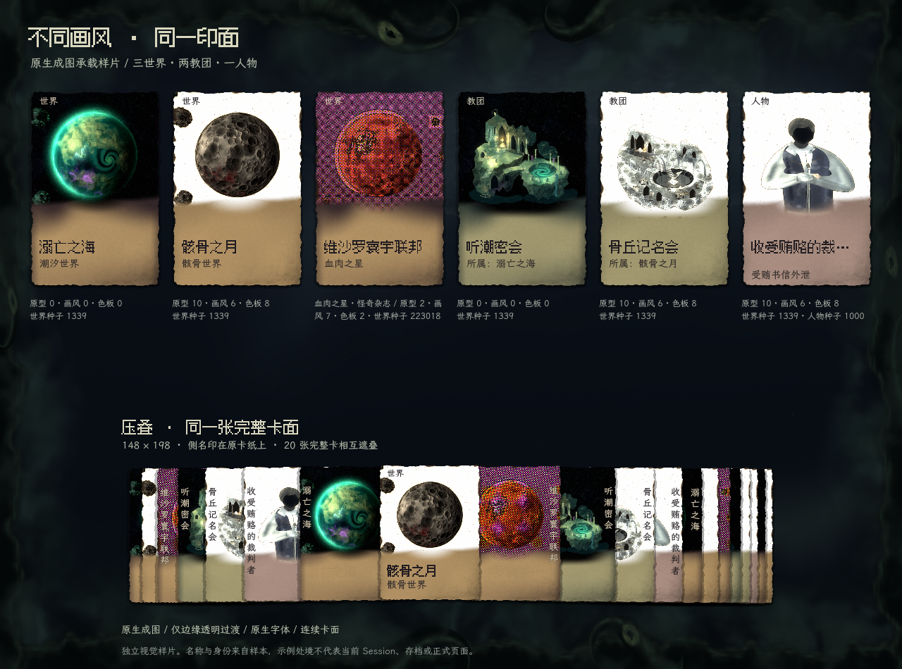
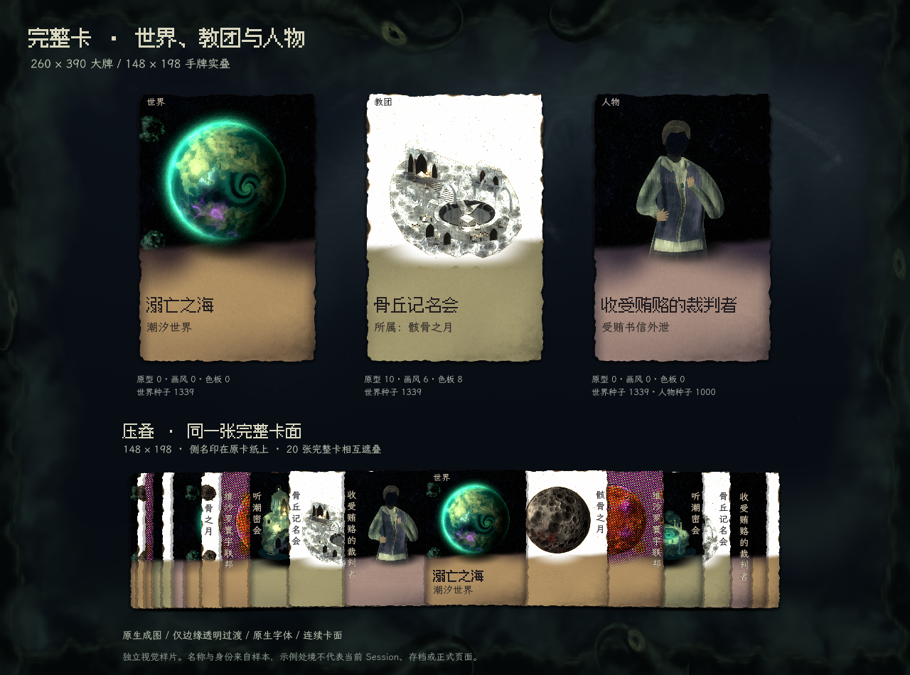
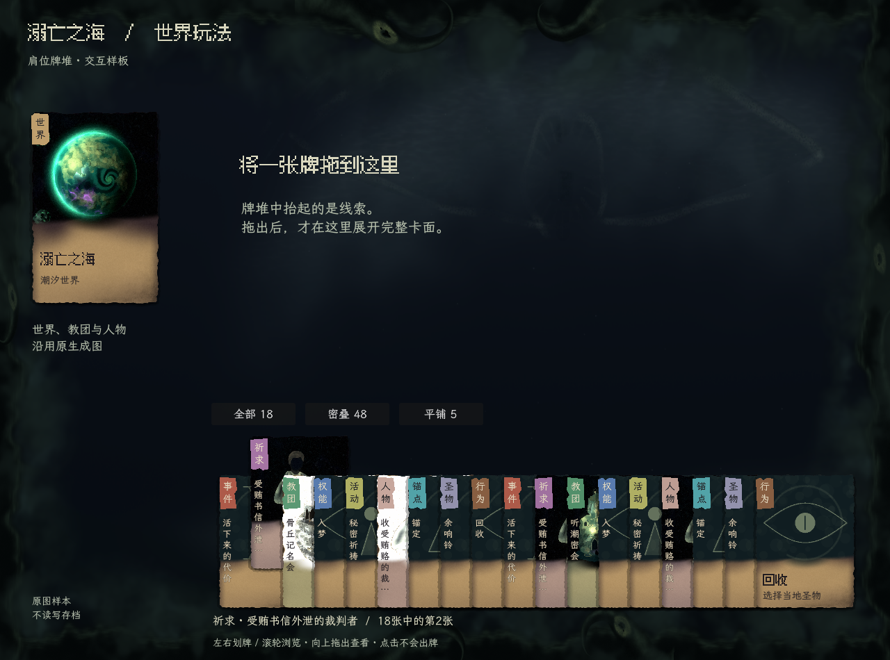

# 卡面重设计 · 连续印面

2026-11-13，连续印面整体风格已获准（DEC-067）；制作人选定方案 2 肩位，并授权单向牌堆（DEC-068）。手牌与查看区开始使用同一正式组件；具体落地视觉与手感待制作人复审。

制作人要求：承载不同画风／背景的原生成图，卡壳不能过强；随后指出中性纸卡太白、原图方形放置生硬，**禁止立绘呈现横平竖直的正方形框，允许渐变遮罩融入卡面**。这两条覆盖此前 B「窥界裂印」的异步选择及近白同壳试稿。

## 当前视觉稿





图中全部立绘来自现有程序生成结果，未重绘或统一染色。字体、背景使用正式共享组件。样本名称及身份来自来源清单，不代表当前 Session；本页比较构图与材料，不是新游戏场景。

<a id="category-identity"></a>

## 当前：单向牌堆与肩位印签

制作人已选择方案 2。当前只运行这一方案，旧三方案图片留在 `category-identity/` 作历史比较，不再是可切换的当前制作方案。



- **右压左**：固定牌序、横距和遮挡顺序，全部留在桌面。浏览仅抬起，不把目标放到最前。
- **左肩**：26×46px，两字类别竖排、14px；只留左签。密叠窄边只认色与轮廓，抬起后文字连续显露；下方提示行给出完整牌名。
- **浏览**：约50ms驻留后抬起，密叠52–56px（由容器净高限制）、平铺12px。不旋转、不缩放。临界阻尼保留当前位置与速度，快速换向不中断归零。
- **出牌**：点击只聚焦；上拖超过阈值后锁定按下的牌，完整拖影才进入上层。有效落牌在上方展开，失败回位；原牌始终留有原位置。

[11秒动态：划牌、反向、取消回位和落牌](shoulder-hand/browse-and-drag.mp4) · [48张密叠](shoulder-hand/hand-48.png) · [5张平铺](shoulder-hand/hand-5.png) · [实际五世界存档的祈求落牌](shoulder-hand/production/placed-card.png)。独立入口仍为根目录 `卡牌类别识别对照.command`（兼容原名称），运行后可切换18张、48张和5张、左右划牌、滚轮/方向键浏览及向上拖出。该样板不读写存档。

正式入口 `正式UI体验.command` 的世界／教团手牌、事件手牌、只读图鉴手牌与查看区使用同一载体；轮初回响复用同一牌堆。首页世界导航卡与左侧主信息卡尚未换此新载体，不能将本批称为全场景视觉迁移完成。

**薄卡体增量：**制作人认可肩位与单向牌堆，要求再加一点厚度。`card_edge.gdshader` 复用原碎齿轮廓绘制1.8–2.4px哑光切面，接触影随抬牌微调；完整拖影自动复用。原生材质样本：[完整卡／抬牌](card-thickness/full-and-hand.png)、[平铺](card-thickness/flat-cards.png)、[密叠](card-thickness/dense-cards.png)。`finish_preview.gd -- --probe --output=res://docs/art/visual-generation/card-design-study/card-thickness/` 只捕获这些材质状态，不执行游戏。已核对同尺寸实图，没有亮框、双轮廓或密叠亮栅栏；新增厚度待制作人复审。

**实现单源：** `src/presentation/production/painted/card_carrier/` 是连续卡面/肩签/shader唯一实现；`tools/card-carrier-study/card.gd`、`category_marks.gd` 仅转接。同一 `production/worldplay/hand_fan.gd` 控制样板与正式手牌。正式纹理 `assets/ui/cards/continuous-stock.png` 与认可稿原纹理逐字节一致。生成图 RGB 保留，只合成边缘 alpha；真实纸底画风或外缘纸色只决定图下承色，不抠白、不改主体。

**类别来源：**读取正式 type/group/kind，不由绘画组件定义玩法。祈求仍归事件筛选，肩签显示祈求；圣物处置归行为。样板九类名称来自已有样本/目录，其状态文案只用于排版，正式状态由 Session 提供。

**有限核对：**5/18/48张逐条牌缘可命中，浏览x/层级恒定；点击不出牌、原生上拖能落牌。真实五世界第9轮存档的隔离副本验证手牌、祈求落牌、模态阻断，浏览不生成额外立绘、不提交行动。原存档未改。此前样板中 SubViewportContainer 双输入导致合成指针被物理位置覆盖，已改为原生根控件，与正式相同输入路径。

采用 A01–A03、A05–A08、A11–A14；新视觉和抬牌手感待制作人复审。识别速度未做玩家实验，不把有肩签当作已经证明快速认牌。

## 为什么撤回白底

近白纸张是前轮为拉开暗背景对比而采取的过度简化，并无世界观上的必要依据。它虽然让卡易见，却把大面积非信息区域推成最亮层；密叠形成白墙，并将所有画风强行套成统一的白纸照片签。风格克制不等于白色，足够可见也不等于尽量明亮。

当前试稿将承载区降到中间明度，以铜、苔、灰紫的克制印色区分类别，保留文字对比、局部纸纹与接触阴影。最亮处主要由原立绘决定，卡缘与环境仍有层次。白底水彩本身的白不因此被删掉或染黑。

## 图像与卡体的合成

- 原方图等比铺到卡的上沿和两侧，使用同一卡体的粗印 alpha 轮廓；不在卡内留出一个独立矩形图片槽，也不加内框。
- 下缘用非均匀的透明过渡融入阅读区。边界宽度、位置及纹理有变化，不能以四条等宽羽化边替代原方框。
- 原图只改变呈现 alpha，不修改内部 RGB；源 PNG 保持原字节。不按亮度抠白／抠黑，不重复 NPR、模糊或锐化。
- 主体保护区按世界／教团／人物分别设置，只能提高内部不透明度，不能变成圆形或椭圆裁图；盆景底座、手和道具仍需实际目视。当前只核对这批样本，不声称任意种子都已适配。
- 白底图的下承材质采用较亮底色，避免渐隐途中出现黑色晕圈；这是图下的卡材质变化，不是给原图染色。
- 卡片与叠牌使用同一组件，整张卡互相遮挡。侧名随原背景选择深／浅字，不加半透明名签底板。

整体材质与构图获准、肩位方向已选；本批已接入上列正式范围。超长文案、任意种子及全场景美术不能据少量样本宣称验收完成。

## 复现与来源

仓库根目录运行：

```sh
/Applications/Godot.app/Contents/MacOS/Godot --path . --rendering-method gl_compatibility --script tools/card-carrier-study/category_preview.gd -- --interactive
```

打开当前可拖拽样板，不实例化 Session、不读写存档；省略 `--interactive` 则截图后退出。正式 `painted/card_carrier/` 内 `card.gd` 负责整牌及侧名，`stock_surface.gdshader` 只处理卡材质，`art_blend.gdshader` 单次采样原图，保留 RGB、合成 alpha。

[原图来源、全部参数与指纹](neutral-carrier/source-manifest.json)：黑底厚涂为溺亡之海／听潮密会（原型0、画风0、色板0、世界种子1339）；白底水彩为骸骨之月／骨丘记名会（原型10、画风6、色板8、世界种子1339）；人物种子1000，身份为收受贿赂的裁判者。鲜艳网点为正式存档中的维沙罗寰宇联邦／血肉之星（原型2、画风7、色板2、世界种子223018）。

纸纹源为前轮 ImageGen 内置工具制作的无字透明底材（[初始提示词](neutral-carrier/stock-prompt.md)、[材质修订提示词](neutral-carrier/stock-refine-prompt.md)），本轮只复用其形状与纤维纹理，显示色由原生材质重新组织；白底试稿不是当前配色母版。程序立绘未使用 ImageGen 替换。

有机外围与粗印语言来自本游戏[已获准母版](../ui-study/evidence/02-twelve-worlds.png)，不恢复其大片灰绿色。具名游戏参照仅保留 Inscryption 的卡片物件感、DICEOMANCER 的绘画同源感，不借用其资产或版式。

## 历史材料（非现行参考）

`neutral-carrier/mixed-styles.png`、`stacked-cards.png`：已被制作人指出近白纸底与硬方框问题；其来源清单仍有效。`first-proof/`：更早的内部退稿。A/B 概念图、`concept-first/`、`rejected-native-first/`及`palette-study/rejected-finish/`均不再是待选方向或执行母版。

正式实施仍需修复既有半透明牌脊、程序符号越界、缺图底与实图尺寸不一致的问题；新合成方法应覆盖实图／符号／缺图，而非只改善这几张样本。正式 sibling 排序和完整牌组交互继续保留。

适用 A01–A03、A05–A08、A11–A14。`in-game-ux`、`visual-art-production` 及副本／附属规则持续禁用。正式默认、存档和立绘生成器没有因本设计样板改变。
