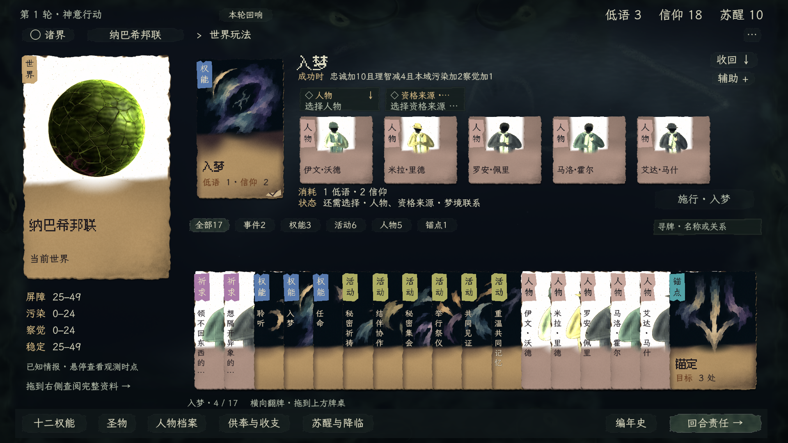
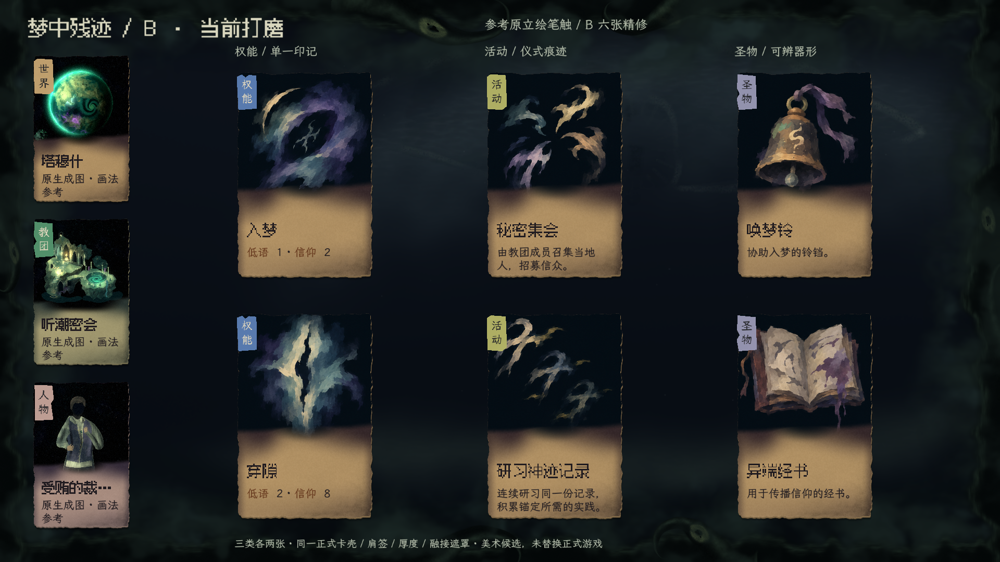
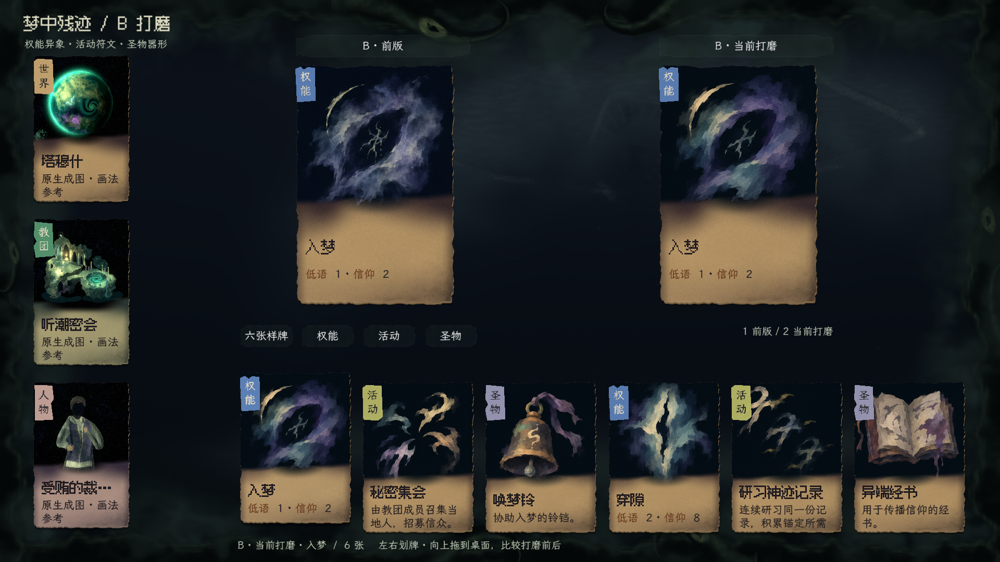

# 非生成卡片立绘 · B「梦中残迹」打磨

2026-11-14，`cthulhu-wakeup`。[DEC-069](../../../progress/decisions-log.md#dec-069)：制作人选定 B，并要求继续贴近游戏当前美术。**制作人已授权正式接入。当前默认已使用 B：64 个目录条目映射至同一套符画，原六张精修保留原像素。**

## 正式接入（2026-11-14）

正式入口为项目根目录 `正式UI体验.command`。新增两张 4×6 图集，按稳定语义 ID 分配，48 个可用图像主题（当前目录使用 46 个，2 个备用）；事件和同语义行为允许复用，不声称 64 张不同画作。权能单一印记、活动多符号关系、圣物器形的区分保持。

正式 `_face`、轮间回响完整卡与牌堆、世界／教团牌桌、对象图鉴、查看执行区、选择器及集合主卡均沿共享入口。圣物选择器传入实际圣物类型，避免所有候选错用同一印章。原世界／教团／人物生成器、原卡壳、规则与存档不变。插画按主题缓存，删除正式路径创建 SubViewport 线框符号的旧实现；通过导入 Texture2D 读取，兼容独立 PCK，不依赖原始 PNG 文件系统路径。

[生产图集及提示词](../../../../assets/ui/card-illustrations/production/manifest.json)记录语义取图顺序和检查过的行起点。六张已确认图直接引用原 512px 单元，其余图格为 256px；新增铺量稿按获选 B 制作，未冒称每张均已获制作人单独审美确认。

[轮间回响](production/arrival.png) · [世界牌堆](production/world-table.png) · [全目录1](production/catalogue-0.png) · [全目录2](production/catalogue-1.png) · [全目录3](production/catalogue-2.png) · [全目录4](production/catalogue-3.png)

核对结果：`PRODUCTION_ART_OK` 覆盖 64 定义、六图保持、正式首轮回响、世界与牌堆、拖牌查看，浏览未写玩法状态。独立导出 PCK 在项目目录外运行，`PACKED_B_ART_OK 48 semantic subjects`。祈求／骰子回执 26 条及真实 Session 提交信号检查通过。全目录截图仅用于查漏和取图检查，灰底目录页不是新增游戏 UI；没有因此重跑全游戏流程。

## 精修阶段记录（下述六张范围为正式铺量前）

## 当前实物

右侧三列为权能／活动／圣物。第一行：入梦、秘密集会、唤梦铃；第二行：穿隙、研习神迹记录、异端经书。名称、费用、说明仍取真实 Catalog 定义，不表示隔离新局已解锁这些牌。

本次沿 B 做定向调整：

- 权能保留单一非实体负形及散边；用较大的叠色笔触组织明暗，减少细烟丝。没有石雕倒角、金属亮边或落地影。
- 集会用多枚印记向共同空处聚集；研习用同一印记重复、错位、消退，保持多符号关系。提高活动的局部笔触覆盖，不整体抬灰。
- 圣物简化铃的锈蚀和书的纸边，用粗细有限的色块保留钟口、铃舌、页折和材质色。只有圣物强调实体器形。
- 原卡纸、字体、左肩签、厚度、渐变融接与原生交互不变。不将三类统一染为潮绿，不在卡内添加硬方框。

## 操作与来源

[卡片立绘对照.command](../../../../卡片立绘对照.command)现在只提供 **B 前版与当前打磨**。默认显示当前精修手牌；按 1／2 切换，分类查看六张样牌，向上拖一张牌可在桌面比较前后。点击不出牌，划牌／抬牌／拖放复用正式组件。没有执行行动，也不读写玩家原存档。上方前后双卡及平铺六卡是明确的比较布局特例。

左侧是获准程序立绘的原图，直接通过同一正式 CardCarrier 呈现：tide／原型 0／画风 0／色板 0／世界种子 1339，人物种子 1000。其来源是 [参数记录](../procedural-study/native-evidence/tide/parameters.json)；不是临时捏入 Session 的对象，也没有修改原生成器。对齐的是笔触尺度、明暗层次和绘画组织，并非所有世界都必须同色同画风。

六张新图是 **内置 ImageGen 制作的静态插画**，不是程序生成产物。[资产、完整提示词及源图路径](../../../../assets/ui/card-illustrations/b-refinement/manifest.json)保存在项目内。源图 1536×1024，3 列×2 行，每格 512×512；每格直接保留 RGB，渲染器取独立 ImageTexture 供原有渐变 shader 使用，不抠黑、不重新调色。

## 有限核对与后续边界

独立复查看过前后图集、六张实卡和手牌。较大片颜料让主形更清楚，但权能原有的透明烟晕相应减少；研习末枚仍比首枚弱，保留逐级消退，手牌不再追加暗化。本轮不新增题材、不重开三案；这些精修取舍交制作人判断。

自动检查只防错误拼图和可见性回退：六主题映射、12 个前后独立图格、512px 尺寸、活动中间调颜料面积。后者以源像素加权 sRGB 通道值 ≥0.24 的覆盖量衡量，集会 2.85%→10.39%，研习 3.92%→6.68%；回归下限分别 6%／4%。**该指标不是审美评分，也不代表识别率。** 原生 1／2 切换、拖放、Session 快照不变检查已完成。未做无关玩法回归。

正式接入前的新画法仅有上述六主题。语义目录仍有 64 定义用于后续铺量，但预告、事件、其他权能／活动／圣物尚未重绘；该精修阶段当时未改正式默认；现已按上方正式接入记录覆盖目录。

## 已结束的方向与收尾

原 A 禁典套印、C 异端剪影已经落选，运行资源与切换入口移除；[上一轮三案记录](category-study/manifest.json)及截图仅存档，不再作为执行参考。更早的[雕塑式三案](rejected-sculptural/README.md)已明确否定，不能回用。

架构与开工路由已同步为选定 B 的六主题精修；玩法和交互 spec 无变化；交付范围及视觉证据集中于本页，沿当前 A06／A08／A13／A14 核对，持续遵守两项技能禁令。精修阶段状态为“方向已选、精修可审阅”，不代制作人记录审美 PASS。
