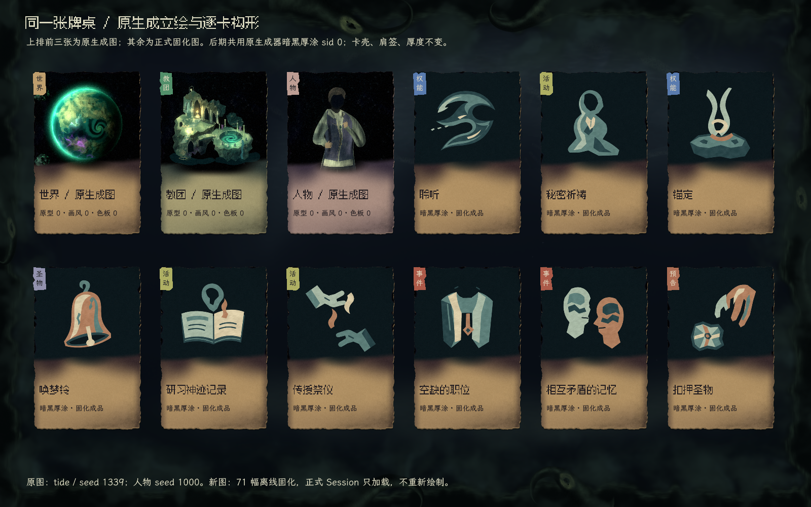

# 全目录立绘 · 暗黑厚涂固化与正式接入

2026-11-15，`cthulhu-wakeup`。制作人认可[全量构形稿](../full-deck-drafts/README.md)，授权选择原生成器的一种后期画风、固化保存并接入正式 Session。构形不重做，全程未使用生图工具。**当前正式默认已切换；本批后期成品交制作人复审。**

[完整成品图册](index.html) · [真实新局牌桌](native/power-table.png) · [轮初回响](native/arrival.png)。启动项目根的[正式UI体验.command](../../../../../正式UI体验.command)即可使用；既有存档也读取同一新资源，无需重建存档。

## 画法与固化

选择原生成器 **暗黑厚涂，sid 0**。沿 `src/art_generation/post/npr_pipeline.gd` 的真实天空合成／bloom／NPR 通路，复用原作 `post.gdshader` 的 Kuwahara 保边、斜向笔触场、颗粒和暗角。输入是制作人认可的逐卡色稿，不重画形状、不引入雕塑、线框或随机符文。固定构形来自手工 Bézier 路径。

参数保持二维立绘的 `px_scale=0.68`、`madness=0.06`、`bloom=0.75`、`grain=0.05`、`vignette=0.55`、固定时间 `0`；每图种子由图义键 SHA-256 派生，与玩法 RNG 无关。符号的浅色颜料不是光源，因此本批单独将 bloom 提取阈值改为 `0.90`、knee `0.10`，避免铃身／书页泛白发光。修改只发生在离线工具的管线实例，世界／教团／人物的后期默认参数不动。

离线在 960px 管线处理，保存为 512×512 的 PNG 审阅图和压缩原生 `Texture2D .res`。正式资源位于 `assets/ui/card-illustrations/painted-deck/`（约 28 MiB），72 图面引用 71 个纹理；`registry.gd` 是生成的映射清单。游戏只加载并缓存 `.res`，无 SVG 栅格化、离线工具调用、NPR 视口或成品重绘。不用系统编辑器导入缓存兜底，也不让游戏依赖本图册。生成对象的预加载继续依原合同工作，未改成静态假人物／假世界。

逐图原稿哈希、成品哈希、种子、后期参数和 shader 哈希见[固化清单](manifest.json)。卡壳、字体、肩位签、厚度和叠牌交互均沿正式组件。

## 覆盖与语义

64 个真实条目全部逐卡接入：12 权能、16 活动、6 圣物、6 预告、12 事件、7 圣物处置、2 锚点动作、3 教团经营。仅 `POWER_ANCHOR` 的权能图鉴和 `anchor/bind` 操作共用同一画作；其余各自独立。此前事件借用权能图、经营借用播种／掩迹图的映射已移除。

8 幅支持图分别接入权能／圣物／人物／事件集合封面、锚点对象、真实来源证据、机构候选（含目标机构）、无来源结算。对象锚点与锚定行为分开；圣物处置即使已选定具体圣物，仍使用该操作的独立画作。世界、教团、人物及祈求者仍取原生成器立绘。

`ROUTE_GUIDED_DREAM`、`ROUTE_PACT_PERFORMANCE` 不是目录中的独立活动牌；其既有内部路径分别沿入梦与约定图义，不新增卡牌。候选、查阅、实际执行仍用原资格和数据。

## 验证边界

- 用真实 CSV 目录核对64定义／63内容图，另核对8支持图；覆盖实例ID、操作ID、圣物类型、事件 content_id、预告 rule 等实际映射。重名或改显示名不会改变图像。
- 正式主场景创建隔离 seed 5 新局，经历预加载和轮初回响，进入世界、拖出入梦；立绘来自保存资源，查看前后 Session 快照不变。逐页检查64卡的正式 `_face` 渲染；独立审阅器另渲染全部72图面，并目视核对四页目录、原生成图并置及支持图。
- 独立 PCK 不包含制作工具或构形稿，71张纹理全部加载成功、尺寸正确、指纹互异。一次冷加载整批含读取像素检查耗时254ms（本机样本，不作为帧率保证）。不是启动时重画。
- 有限视觉检查沿 A06/A08/A13–A16、V01/V03/V05/V07/V08；未实玩全部高阶解锁链或重测全游戏规则。技术覆盖不代替制作人的美术复审。

[检查日志](checks.txt) · [目录1](native/catalogue-0.png) · [目录2](native/catalogue-1.png) · [目录3](native/catalogue-2.png) · [目录4](native/catalogue-3.png) · [支持图](support-0.png)。

架构已登记共享资源库及离线工具；生成 spec 新增固化非生成图边界，交互 spec 无规则变化。成品资源及其正式接线随最新游戏运行状态归档；构形源码与未接入美术草稿按制作人要求留在工作区。

## 重建（仅开发期）

以下离线制作命令需要本机保留的 `full-deck-drafts/` 构形原稿及图册。该目录按制作人要求未随本次提交归档，新检出可直接运行已固化的正式游戏，不应尝试在启动时重建。图册中的构形源稿链接同属本地制作资料。

1. `Godot --path . --script tools/card-illustration-production/bake.gd`：从获准色稿重建固定资源。不要把这条命令挂到正式启动器。
2. `Godot --path . --script tools/card-illustration-production/proof.gd -- --capture --exit`，然后 `python3 tools/card-illustration-production/review.py`：更新原生卡面与图册。
3. `Godot --headless --path . --script tools/card-illustration-study/mapping_probe.gd`；实机检查为 `tools/card-illustration-study/production_probe.gd`。打包后以 `--main-pack /绝对路径/game.pck --script /项目绝对路径/tools/card-illustration-production/pack_check.gd` 检查固定资源。
