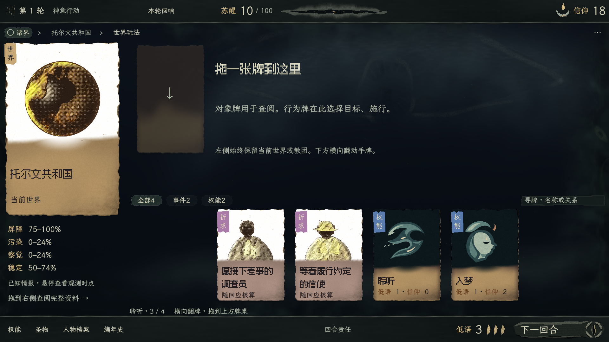
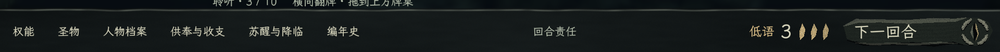

# 正式上下栏 · A 裂隙

2026-11-15。[DEC-071](../../../progress/decisions-log.md#dec-071)：制作人选定 **A 裂隙**，要求修正顶部、底部与路径字号，以及信仰／低语的异常间距。现已进入[正式UI体验.command](../../../../正式UI体验.command)。B、对照启动入口和1/2/G临时热键已删除；以下旧A/B仅作裁决证据，不是可运行候选。

## 当前实机

底栏去掉与顶栏重复的「供奉与收支」和「苏醒与降临」；点击顶部「信仰」与「苏醒」打开对应页面，底栏的编年史紧接人物档案。[本次原生核查](evidence/unique-entries/checks.txt)覆盖正式世界牌桌及两处入口打开、Esc 返回原世界和存档快照未变化。

[诸界态势](evidence/full-width/overview.png) · [大字模式](evidence/full-width/large.png) · [同构图鉴](evidence/full-width/library.png) · [回合责任](evidence/full-width/responsibilities.png) · [下一回合确认](evidence/full-width/next-confirm.png) · [真实下一轮](evidence/full-width/next-round.png)

## 分区与推进按钮精修（2026-11-15）

制作人认可A思路与呈现，要求解决上下栏与主区混淆、推进按钮割裂。当前增加连续的深墨哑光上沿（52px）和下沿（58px），材质含低频擦染、细颗粒、磨损内边及窄接触阴影。资源／导航下方不透出动态雾，主牌桌仍保留原外围。沿现有空隙完成分区，未缩放中央卡牌。

下一回合仍为197×42px，全部位于下沿内；最新形态见下节。原亮色双重碎边及通用Button焦点底图移除，键盘焦点沿同一画法反馈。[悬停实机](evidence/full-width/next-hover.png)。

有限复核覆盖标准／大字、诸界／世界／图鉴、责任查阅、取消及真实推进。新增承载层位于导航之后且不截获输入的层级检查、推进按钮完全在下沿内的几何检查。精修待制作人审阅；上一版证据仍保存在`evidence/final/`。

## 底栏对齐与推进印面（2026-11-16）

原底栏布局父区只有52px，实际承载却延伸至屏幕底边，各组又使用不同y坐标，造成整体偏上。现统一为y=662、高58px；扣除6px磨损内沿后，辅助入口、低语、余焰、推进按钮共用全局y=694的中线。按钮197×42px、局部y=11，内沿之后与底边之前各留5px；标题与本体同心。标准／大字、悬停和图鉴选中均沿该中心线；主牌桌大小不变。

制作人要求推进更有庄严感，并明确玩家是邪神、不是密教教徒。当前直接绘制「界外轮转」：深墨界膜形成不闭合承载，右侧断环围住竖裂，少量暖色落在裂口；悬停／键盘焦点使裂口渐开、印痕加深，按下收紧。无箭头徽章、规整外框、人造祷文、供物或祭坛；不把按键表现成玩家举行教徒仪式。点击仍打开原简短确认，不增加长按或额外操作。此形态待制作人复审。

[大字底栏](evidence/full-width/large-footer.png) · [完整世界牌桌](evidence/full-width/world.png)。新增几何断言覆盖全部底栏组的共用中线、承载与父区同高、推进按钮内部标题及上下留白；原生运行还核对了查阅、取消与真实下一轮。纯布局及绘制改动，无Session／数值／存档规则变化，现有交互spec不改规则。架构登记在[architecture](../../../architecture.md)，视觉约束在A02／A05；本批不宣称全部场景通过。

## 贴边关系修正（2026-11-16）

制作人指出推进按钮外侧空隙远大于上下间距，否定将网页式左右页边距套入游戏HUD。底栏父区现覆盖完整1280px画幅；下一回合命中区距右边6px（原40px），颜料边缘另有自身磨损；其上、下有效间隙仍为5px。低语按按钮左缘反向排布，中间留16px；左侧入口命中区从6px起，文字保留控件内部必要间距。主牌桌和卡牌未缩放，按钮造型不变。

参考实际图像：[《奇迹时代4》战略界面](https://images.cgames.de/images/gamestar/287/age-of-wonders-4_6229251.jpg)将回合／人物操作区接入右下画面边缘；[《文明VI》iPad版实机](https://cdn.mos.cms.futurecdn.net/XHZn82DJqnf85iuobpBxnY.jpg)的右下行动盘同样与边缘连接。这是边角承载关系的参照，不照搬其装饰、尺寸或输入方式，也不据此断言所有策略游戏都无留白。

本游戏规则：可用画幅优先给游戏内容和操作，HUD按边／角组织，不额外套网页内容容器式侧边空白；保留有阅读、操作或构图目的的内部间距。空处不能靠无功能装饰填满。默认／大字、左右边隙、真实回合推进沿原生probe复核；证据见上方当前实机。

## 全主界面边界统一（2026-11-16）

制作人指出上一批只处理底栏、漏掉顶栏及主区域。现全局栏与主牌桌统一6px逻辑外边隙：顶部轮次刻痕和路径从左端组织，信仰数值及菜单靠右；世界／教团／图鉴／事件专桌的主卡x=6，宽250px，内部正文保留10px阅读距离。主卡与桌面之间留16px，查看执行区及手牌从x=272延伸至1274，宽度936→1002px。搜索框、手牌及提示行依实际父区宽度排布，执行字段从旧参考坐标重排到新宽度，不缩放字形或立绘。

诸界总览的标题／摘要左移，世界牌堆宽度920→1002px；少量卡牌保持正常卡宽，多卡时可使用整段宽度。空桌面的执行空间留给出牌内容，不用无功能图案填空。外围氛围仍沿屏幕边缘存在。

已核对默认／大字的总览、世界空桌、实际拖入权能后的执行区和图鉴；[执行态](evidence/full-width/action.png)／[大字执行态](evidence/full-width/action-large.png)。机检新增顶部两端、路径、主卡、桌面／牌堆／搜索框的边界一致性，以及实际执行控件不越界。教团、事件采用同一四区构建代码，本批未为这两种数据状态另开存档拍图。交互与游戏规则不变。

## 信息与操作合同

- 顶部：当前轮次／阶段、本轮回响、苏醒裂口和真实数值、信仰。路径层只说明当前上下文，不与资源读数争夺字号。中央卡面和外围不变。
- 底部：左侧为权能、圣物、人物三项只读图鉴与编年史；回合责任是可选回看入口，右侧低语与唯一下一回合主动作成组。无整块纯色横板。
- 回合责任不含结束回合按钮。下一回合打开就地短确认，说明未用低语不结转及本轮到期祈求数；取消／Esc不支付、不推进。确认仍走Session原预览／结算链，未处理轮初事件不能跳过。
- 低语读公开余额，用余焰辅助偷瞄；本轮已见预算留下熄灭痕迹，跨轮重置，不从当前苏醒反推已发预算。
- 苏醒分母取正式目录`awakening_terminal`；增长张开、下降收拢，真实数字即时显示，变化约1.5秒消退。达到100仍需降临仪式。视图切换不重播；加载／回响／掷骰遮盖时暂存变化，回到牌桌再播。命中区不随演出移动。

## 字号与间距精修

原生1280×720逻辑尺寸：路径／辅助入口／阶段／回响14px；轮次与资源标签16px；三项资源数值统一24px；下一回合20px。大字模式整体沿原设置加3px，卡牌及执行区标题不改。

信仰等资源名称与数字相距8px，数字按实际字宽占位；低语数字与首枚余焰相距10px，不再把一位数居中放入宽槽。低语整体与推进按钮保持相邻，已用余焰占位不消失。底栏各入口和世界路径也按字宽排布，长名悬停可见全文。

## 具名参考与取舍

- [Inscryption](https://store.steampowered.com/app/1092790/Inscryption/)：参考牌桌周边物件承载资源与节奏的思路；不搬运木桌、写实三维器物或摄影机。
- [DICEOMANCER](https://store.steampowered.com/app/2501600/DICEOMANCER/)：参考绘画笔触与操作控件同源；不搬运明亮饱和配色或战斗数值布局。
- [Cultist Simulator 官方原型](https://weatherfactory.biz/cs/main_ui.html)：只参考时间推进具有独立身份；不搬运自动计时、白底按钮或整齐线框。它不作为本游戏现行规范。

视觉依据仍为本项目锁定卡壳与有机外围（美术A01–A08）。本批直接绘制小型颜料符形，使用原色板，未新增卡面绘制或生成任务；禁用生图及两项技能的持续约束不变。

## 有限检查与边界

原生入口：`tools/worldplay-integration/hud_probe.gd`，直接实例化正式主场景，创建隔离的真实新局与显示设置。`-- --live`可保留该真实新局试玩；正式启动仍用仓库根目录的`正式UI体验.command`。

- V01：A方向由制作人选择；字号／间距精修仍待复审，不以机器检查代替审美。
- V02：标准／大字完整截图；全部HUD标签宽度核对，路径和辅助入口同级；三资源字号一致，名称／数值8px和低语图形10px间距断言。一至三位数及0–6低语为不截图、不写Session的排版夹具，检查后立即恢复，不宣称实际达到终值。
- V04：诸界／世界／图鉴共用；回合责任不提交；短确认Esc取消；确认实际进入下一轮；底栏不侵入原手牌边界。
- V05：仅公开投影；查阅和取消前后Session快照一致。
- V07：正式入口默认使用A，无试验开关或演示数值；[运行记录](evidence/full-width/checks.txt)。
- V08：静态颜料不每帧重建，动态笔迹合批，无新增立绘任务。

本批没有宣称全场景全流程通过。多人教团长期局及终局流程未重跑；教团与事件由同一正式HUD承载。原玩家存档未改动。最新上下栏随首次联系／祭仪整改一并归档，见[提交范围核对](../../../qa/first-contact-ritual.md#5-提交范围与正式画面一致性2026-11-16)。

## 选择前的证据（归档）

[A初稿](evidence/a-world.png)／[B初稿](evidence/b-world.png)，[A动态](evidence/a-motion.webp)／[B动态](evidence/b-motion.webp)。两段旧动态包含明确标注的只读演示数值；当前正式版本不存在该演示。原对照操作记录见[旧有限检查](evidence/checks.txt)。这些文件只说明当时的选择，不覆盖上方正式截图与字号合同。

上下栏分区补充：诸界／当前世界／世界玩法属于主区域上下文，位于顶部承载层下方。顶部内沿止于52px，路径从56px开始，不能把路径再次包进全局资源栏。
