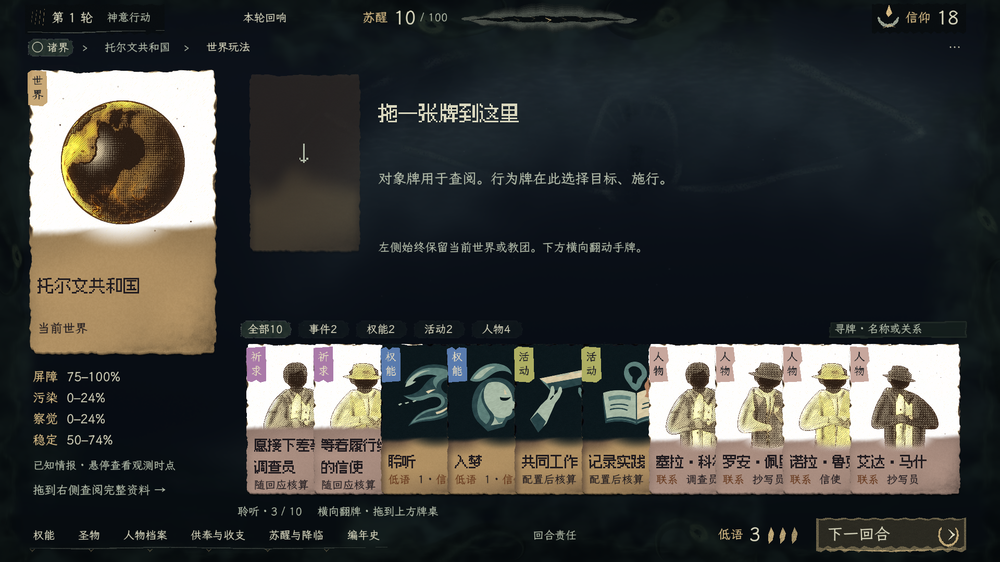

# 正式上下栏 · A 裂隙

2026-11-15。[DEC-071](../../../progress/decisions-log.md#dec-071)：制作人选定 **A 裂隙**，要求修正顶部、底部与路径字号，以及信仰／低语的异常间距。现已进入[正式UI体验.command](../../../../正式UI体验.command)。B、对照启动入口和1/2/G临时热键已删除；以下旧A/B仅作裁决证据，不是可运行候选。

## 当前实机

[诸界态势](evidence/final/overview.png) · [大字模式](evidence/final/large.png) · [同构图鉴](evidence/final/library.png) · [回合责任](evidence/final/responsibilities.png) · [下一回合确认](evidence/final/next-confirm.png) · [真实下一轮](evidence/final/next-round.png)

## 信息与操作合同

- 顶部：当前轮次／阶段、本轮回响、苏醒裂口和真实数值、信仰。路径层只说明当前上下文，不与资源读数争夺字号。中央卡面和外围不变。
- 底部：左侧为只读图鉴及补充模块，编年史相邻；回合责任是可选回看入口，右侧低语与唯一下一回合主动作成组。无整块纯色横板。
- 回合责任不含结束回合按钮。下一回合打开就地短确认，说明未用低语不结转及本轮到期祈求数；取消／Esc不支付、不推进。确认仍走Session原预览／结算链，未处理轮初事件不能跳过。
- 低语读公开余额，用余焰辅助偷瞄；本轮已见预算留下熄灭痕迹，跨轮重置，不从当前苏醒反推已发预算。
- 苏醒分母取正式目录`awakening_terminal`；增长张开、下降收拢，真实数字即时显示，变化约1.5秒消退。达到100仍需降临仪式。视图切换不重播；加载／回响／掷骰遮盖时暂存变化，回到牌桌再播。命中区不随演出移动。

## 字号与间距精修

原生1280×720逻辑尺寸：路径／辅助入口／阶段／回响14px；轮次与资源标签16px；三项资源数值统一24px；下一回合20px。大字模式整体沿原设置加3px，卡牌及执行区标题不改。

信仰等资源名称与数字相距8px，数字按实际字宽占位；低语数字与首枚余焰相距10px，不再把一位数居中放入宽槽。低语整体与推进按钮保持相邻，已用余焰占位不消失。底栏各入口和世界路径也按字宽排布，长名悬停可见全文。

## 具名参考与取舍

- [Inscryption](https://store.steampowered.com/app/1092790/Inscryption/)：参考牌桌周边物件承载资源与节奏的思路；不搬运木桌、写实三维器物或摄影机。
- [DICEOMANCER](https://store.steampowered.com/app/2501600/DICEOMANCER/)：参考绘画笔触与操作控件同源；不搬运明亮饱和配色或战斗数值布局。
- [Cultist Simulator 官方原型](https://weatherfactory.biz/cs/main_ui.html)：只参考时间推进具有独立身份；不搬运自动计时、白底按钮或整齐线框。它不作为本游戏现行规范。

视觉依据仍为本项目锁定卡壳与有机外围（美术A01–A08）。本批直接绘制小型颜料符形，使用原色板，未新增卡面绘制或生成任务；禁用生图及两项技能的持续约束不变。

## 有限检查与边界

原生入口：`tools/worldplay-integration/hud_probe.gd`，直接实例化正式主场景，创建隔离的真实新局与显示设置。`-- --live`可保留该真实新局试玩；正式启动仍用仓库根目录的`正式UI体验.command`。

- V01：A方向由制作人选择；字号／间距精修仍待复审，不以机器检查代替审美。
- V02：标准／大字完整截图；全部HUD标签宽度核对，路径和辅助入口同级；三资源字号一致，名称／数值8px和低语图形10px间距断言。一至三位数及0–6低语为不截图、不写Session的排版夹具，检查后立即恢复，不宣称实际达到终值。
- V04：诸界／世界／图鉴共用；回合责任不提交；短确认Esc取消；确认实际进入下一轮；底栏不侵入原手牌边界。
- V05：仅公开投影；查阅和取消前后Session快照一致。
- V07：正式入口默认使用A，无试验开关或演示数值；[运行记录](evidence/final/checks.txt)。
- V08：静态颜料不每帧重建，动态笔迹合批，无新增立绘任务。

本批没有宣称全场景全流程通过。多人教团长期局及终局流程未重跑；教团与事件由同一正式HUD承载。原玩家存档未改动。本次未提交Git。

## 选择前的证据（归档）

[A初稿](evidence/a-world.png)／[B初稿](evidence/b-world.png)，[A动态](evidence/a-motion.webp)／[B动态](evidence/b-motion.webp)。两段旧动态包含明确标注的只读演示数值；当前正式版本不存在该演示。原对照操作记录见[旧有限检查](evidence/checks.txt)。这些文件只说明当时的选择，不覆盖上方正式截图与字号合同。
