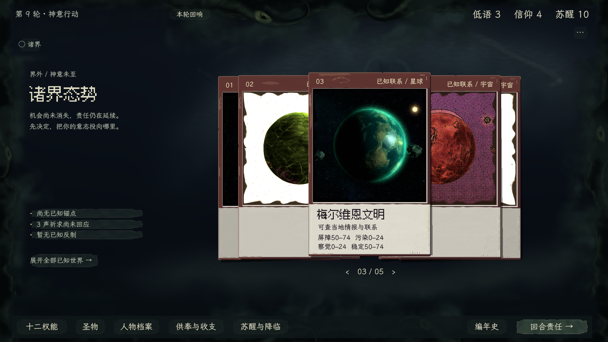
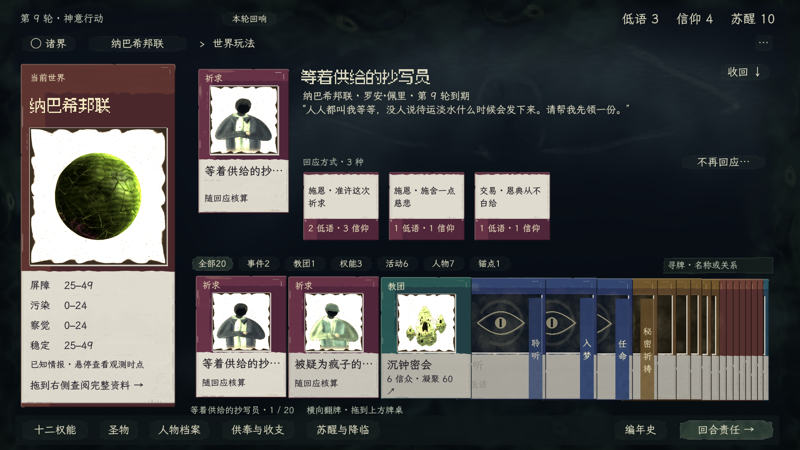
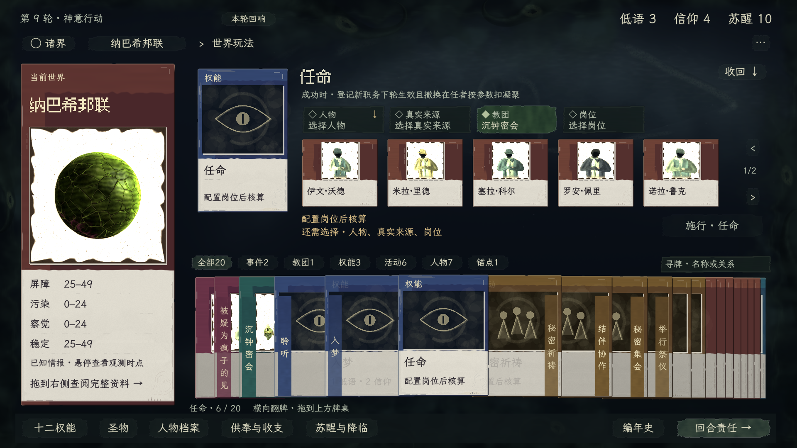

# 归档：配色探索与被否定的卡面细化

状态：**本页最新卡面细化已被制作人否定**，见 [rejected-finish](rejected-finish/README.md)。只保留“卡片／背景明确分层、类别色可辨”的配色确认，规整纸托、图框及三段拼接不再作为美术规范。当前工作转到[卡面重设计](../card-design-study/README.md)。以下是退回过程的原记录。

## 本次细化

保持获准的亮纸阅读面、墨黑字和类别印色，将类别色相对同亮度中性的色度收至 **88%**；纸面明度不降。获准时的实机截图保存在 [accepted-colour](accepted-colour/README.md)，本次不是重新换一套色相。

卡面审查指出旧版边缘破损过密、图窗像模糊贴纸、牌头与费用区收口松散。本次具体处理：

- **纸缘：**大部分完整的裁边，仅留少量 1px 左右浅缺口；清掉旧材质的密集浅黄碎边，不用金线包边。
- **图窗：**保留原位置、尺寸和内部 RGB；alpha 收边缩至约 1 逻辑像素，下面衬固定 2px 中性纸托与断墨暗缝，避免模糊大边框。
- **阅读面：**主卡四维之间放极淡短断线；小牌只在字形间有足够净空时放短分隔。右下低对比接触印痕和底部小刻痕形成家族关系。
- **费用与状态：**费用条两边留小纸口；焦点细节沿原 hover 进度变化，不另加整圈高亮。细节在原文字／立绘下面，避开实际字形，也不增加新的玩家状态含义。

[原版诸界](evidence/worlds-0.png) · [原版牌桌](evidence/table-0.png)

## 操作与边界

启动仓库根目录 `配色对照.command --palette=1`，按 **0 原版／1 修订** 原位切换，H 隐藏提示。正常翻牌、拖牌、选槽和返回；数字在搜索框中只用于输入。入口复制最新的五世界正式存档，也可用 `--save=/绝对路径/存档.json` 指定。副本操作不回写原始存档。

- 复用正式场景、真实 Session、分类、字体、布局、资格、费用和提交边界；原有轻弹、叠牌和轮初演出保持，不改交互机制。
- 只改卡纸画法、配色、装饰关系与文字颜色；背景及立绘内部 RGB 保持原样，仅调整图窗 alpha 收边，不重生成、不重复 NPR、不叠全屏滤镜。试验性的 `object_paper.gdshader` 已删除。
- 原有 Session 和原始存档不因切色改变；正常游戏入口不挂载候选，正式默认不变。
- 原图白底不修改；最终图没有可分离纸底与白衣的主体遮罩，不能以高亮阈值染黄后声称“只改纸底”。当前评审集中于略降饱和与卡面完成度，不重开已接受的配色方向。
- 采用现行 A01–A03、A05–A08、A11–A14；适用 V01/V03/V04/V05/V08。`in-game-ux`、`visual-art-production` 及其副本、附属规则继续禁用。

## 归档与本轮取舍

1. [暗卡丢失分层](rejected-2026-11-13/README.md)：「墨黑与旧铜／深海与骨白」使卡面与背景过度雷同。卡身在无悬停与压叠窄边状态下也必须能辨认，文字可读不能代替物件可见。
2. [灰褐／灰紫纸身](gray-paper-review/README.md)：提亮后仍像粉尘覆盖，不能用中间调灰面和放大的低频斑块代替材料分工；不是当前配色依据。
3. [满面橙紫蓝与黄纸](rejected-full-pigment/table-1.png)：大面积类别色和立绘黄染破坏气氛。原立绘不染色；此前自行追加的“分类色只可在牌头／名签”不作为当前规则。
4. [青墨牌桌](rejected-jade/table-reworked.png)／[诸界](rejected-jade/worlds-reworked.png)：制作人再次否决大片灰绿与灰蒙卡面，不能继续只换一种中间调。
5. 本轮主执行审查与独立复核淘汰[满色阅读面 2](print-review/table-2.png)及[对应诸界](print-review/worlds-2.png)，仍像彩色文件夹；[亮纸早版 1](print-review/table-1.png)及[对应诸界](print-review/worlds-1.png)中的沙黄纸面、塑料渐变和波浪印边也已撤掉。上述文件仅归档，当前运行入口只保留 **0 原版／1 当前修订**。

首要参照仍为本项目获准母版及真实生成立绘；保留此前 Inscryption 的卡纸／环境分层、Cultist Simulator 的类别分工参照范围，不搬布局、木桌或写实灯光。类别、警告继续保留文字。统一来自纸面、印色与阅读秩序，不要求所有卡身铺同一种颜色。

## 有限验证

主执行实看诸界、真实祈求分类牌堆、任命空／已填槽，独立复核比较前后截图，未发现阻断交付的新增美术退化；黑底图窗纸托更显眼，但仍保持薄纸收口。初版新收边仍放大了旧材质中的浅黄磨损，已收掉这些碎亮点；保持可辨纸厚，不加金箔／精装边框。静帧不代验全部动态输入，卡面设计最终由制作人判断。

[checks.json](evidence/checks.json)只防明确退化：抽样背景、黑底世界及白底世界／人物内部与原版逐像素相同；抽样阅读区主／次文字对比 12.03／9.58:1。两次切色与实际牌桌导航保持 Session 快照相同，立绘生成及读盘增量均为 0。原始五世界存档 SHA256 仍为 `9c709560d228f836d672cb237d7367b6d4e3fc64986153839ca8d8af295824c4`。数值不作为审美通过依据，也未声称全场景验收。

实现为 `tools/palette-study/controller.gd`、`pigment.gdshader`、`card_finish.gd` 与 `image_edge.gdshader`，正常游戏入口不挂载。复现：`配色对照.command --capture --output=docs/art/visual-generation/palette-study/evidence`，随后 `python3 tools/palette-study/check_pixels.py`。最新图与检查存放在 `evidence/`；正式共享主题归并尚未执行。
