TL;DR：以制作人已通过的「粗印画牌＋有机窥视窗口」为全游戏界面美术母版，在锁定交互框架上迁移材质、字体、立绘承载和动效。本文件是这一版 UI 美术的唯一执行正文；母版获准不等于所有场景已接入或已验收。

# 邪神苏醒 · 全游戏界面美术规范

[打开图文阅览版](ui-guide/index.html) · [示例与引用有效性清单](ui-guide/manifest.json) · [实施问题台账](ui-art-feedback.md)

**阅读方式：** 下图是获准实机，随后各规则附近直接放对应实物。图册中「获准母版」是制作人已通过的画面；「实现复现」只说明代码实际长什么样；「衍生待审」是本轮补齐而尚未获制作人确认的控件，不能偷升为基线。

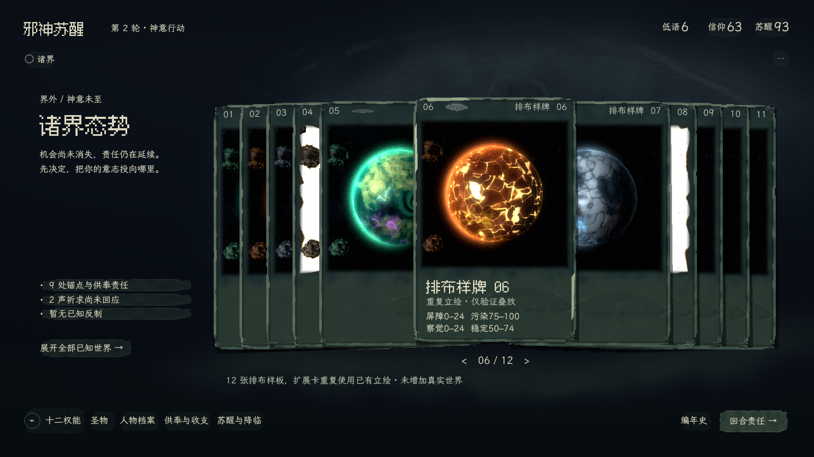

*G00 · 制作人已通过；1920×1080 实机。12 张是排布样牌，并非新增 12 个真实世界。*

## 0. 开工入口与权威边界

**2026-11-12 后续授权：**制作人要求把当地联系重新设计为「世界玩法」，按信息、对象卡、执行卡组织，外露具体操作，教团可下沉一级。该探索依[交互合同](../../specs/ui-interaction.md#worldplay-card-study)重新设计场景几何和卡片收纳。本文 A01–A03、A05–A06、A08 的图像处理、A11–A14 继续作为画法依据。下文沿旧布局、图槽和入口迁移的限制由此在世界玩法样板范围内放开，样板视觉待制作人复审。[运行及现场记录](worldplay-study/README.md)随样板维护。

**制作人裁决，2026-11-12：**「很好，这版游戏界面、美术设计 pass」，并要求建立指导实操 agent 推广到全游戏的规范。获准对象是本分支 `ui-study` 当前的竖卡、粗印标题、文楷正文、分层背景、高维注视暗纹，以及浓雾／暗膜／卷形／附着异形眼构成的完整动态。

阅读顺序：

1. `CLAUDE.md` → [当前 UI 路由](../../progress/stage-priorities.md#game-ui-routing)。`in-game-ux`、`visual-art-production` 及其副本、附属规则、间接委派仍禁用。
2. 本文 §1–§6，观看母版实图与 §5 完整动态。接场景前再读对应 §7、§8–§10；遇到规范无法决定的点按 [§9.3](#art-feedback) 反馈。
3. [交互 spec 当前合同](../../specs/ui-interaction.md#locked-interaction-production)及其交互精修条目，确认本批既有导航、布局、输入和状态。
4. 涉及立绘时读 [立绘生成合同](../../specs/system-art-generation.md)，涉及真实业务时只读相应系统 spec。费用、资格、知情和结果不由本规范定义。

**职责分开：** 交互 spec 决定玩家在哪里看、选、操作、返回；本规范决定这些既有位置如何画；生成 spec 决定插图如何生成。不得用美术改动重排任务结构、删除信息、替换操作或另写规则。已明确授权的竖向世界卡平铺／叠放／翻动与移除游戏内常驻标题为既有例外。其他交互变更先提供具体差异，再请制作人裁决，不以换肤顺便实施。

旧 `docs/art/echoes-ui/visual-system.md` 及旧图册保留只读；其中的颜色、控件、几何、字体、动效和旧检查脚本不是本版接入标准。本轮只用脚本统计它的图文组织形式，不读取或继承具体规范内容。

`presentation-rebuild/interface-design.md` 不再作为本文的整体参考入口。只有现行交互合同明确引用的 §19.1 当地几何及 §19.2 未被替代的空间／返回关系可用于保持交互；§19.1 的旧三世界构图和“顶栏保留品牌”已失效，§6、§15–§18 的美术候选不得进入本图册。优先从当前交互合同和实际生产组件核对，而不是通读旧方案自行混合。

引用需同时满足路径有效、适用章节有效、未被后续裁决替代、与实际源码相符。逐项允许／排除范围记录于 [图册 manifest 的 references](ui-guide/manifest.json)。外部游戏例子只解释历史设计缘由，不是当前视觉制作输入。

**标记约定：**「母版事实」是实际存在且此次获准的样板；「推广规则」是为全场景实施而确定的延伸要求，尚须在对应场景验证；「缺口」是未实现项。三者不能互换。本轮只交规范和证据基线，不执行全游戏换肤、不升级存档、不宣称完成量产。

## 1. 母版、证据与冻结方式

- 运行母版：在冻结版本 `dcaf037` 的探索工作树打开仓库根目录 `UI视觉探索.command`。正式接入分支的正式根已演进，图册仍呈现原获准证据。F1 三世界，F2 十二张排布样牌，F3 二十四张样牌，F4 同世界三类立绘，F5 暂停外围。
- 四张母版图分列文首与本节；24 秒、60 fps 完整动态置于 §5，[无损 WebP](ui-study/evidence/peripheral-motion.webp)供逐帧检查。不能只看静帧就替换动效。
- [获准基线清单](ui-approved-baseline.json)记录这次文件的 SHA-256、证据尺寸、代码与字体来源。它记录实际获准版本，不把当时尚未提交的工作树伪写为某个提交。
- [样板 README](ui-study/README.md)保留复现方式、原图参数和探索边界；当前规范优先于其中历史“待审”措辞。

母版截图和动态从本次起作为对照保留。新场景证据用自己的目录和名称，不覆盖这四张图和完整动态。修改母版须有制作人的新裁决或清楚记录的缺陷修复，更新本规范和基线清单；不得仅为了让检查通过重签指纹。

F2/F3 重复已生成插图检验排布，不代表十二／二十四个独立生成世界。F4 是同源材质对照，不是教团／人物正式页面。母版的世界名与示例图只是图槽映射，正式接入不能沿用这组假对应。

### 母版图像的对应范围

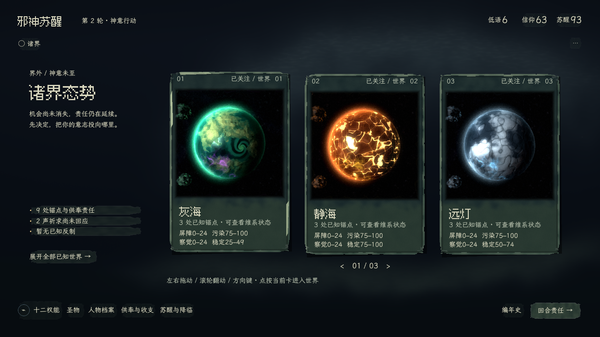

*G01 · 获准母版，少量世界平铺；插图是图槽映射，正式对象仍须正确绑定。*

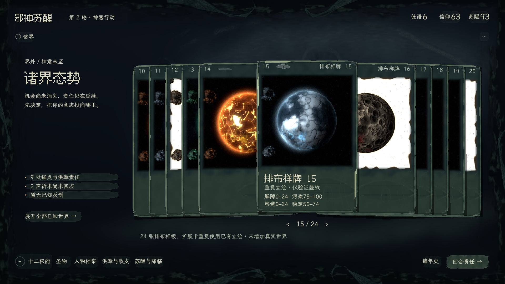

*G02 · 获准母版，超量收叠；保持焦点完整，不缩小所有牌。*

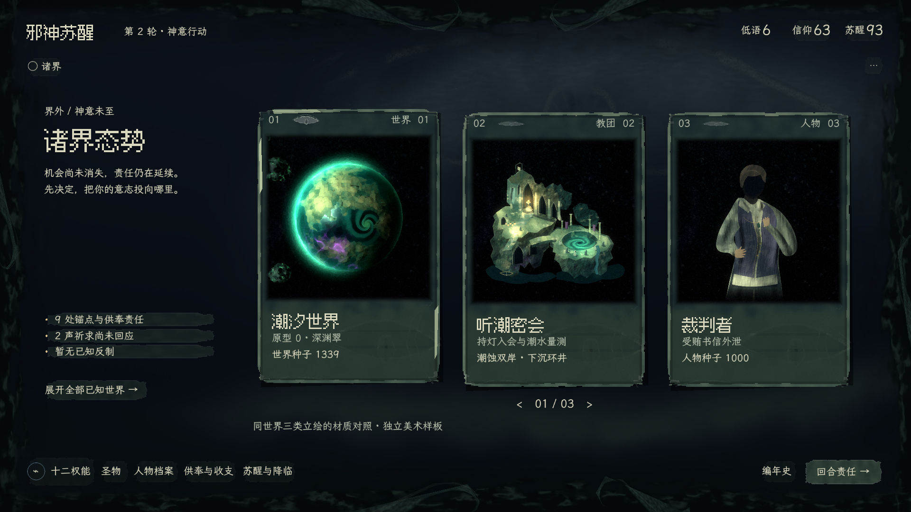

*G03 · 获准材质对照，潮汐世界／听潮密会／裁判者；不是三种正式任务页面。*

## 2. 美术立意与统一尺度

### A01 · 玩家在窗口这一侧

玩家是高维邪神。世界、组织、人物是被观察、选择、干预的客体；卡片是这种尺度关系的共同载体。外围是玩家所处存在的朦胧边界，卡片背后与表面的注视纹样暗示掌控。它们不应像另一个怪物面对玩家，或像正在攻击 UI 的敌人。

同一世界的星球、教团、人物继承其生成参数与绘画语言；跨世界允许不同画风。界面自身使用稳定的灰绿颜料与骨白文字，不跟着每张星球变成火红、冰蓝或彩虹。统一来自承载材料与阅读秩序，不靠给所有立绘蒙同一种绿。

### A02 · 画面主次

第一眼认出当前客体与要处理的事；第二层读到选择、代价和状态；最后才发现背景眼形与外围生命感。主要色彩和细节留给立绘，主动干预的控件只取得足够辨识度。

用低频大片暗色建立空间，中频雾带、卡边和颜料块建立层次，细颗粒只补材料。画面留出连续、安静的暗处；不能满屏等密度噪声、等亮描边、等强纹章。疯狂属于所见世界与窥视方式，规则说明和操作必须清楚。

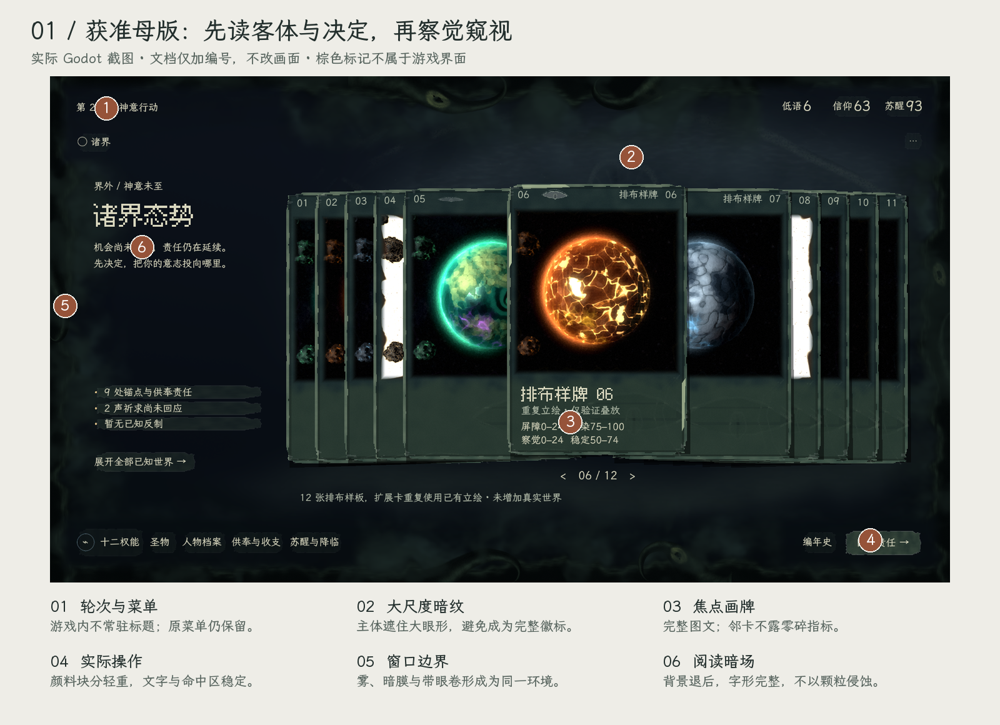

*G04 · 获准截图的文档标注；编号与棕色框不是游戏元素。对应 A01–A02，源码与尺寸见图册清单。*

### A03 · 继承与禁用

保留不均匀的颜料边缘、方向性干刷、暗部省略、轻微错落与局部亮边。卡片像厚实的绘画载体，文字像印在其上；它们不是精装展板或网页容器。

禁止：奢华金线双框、玻璃面板、整齐霓虹描边、满屏符文墙、饱和发光按钮、每个小控件都做一张卡、脱离载体漂浮的眼睛、突出成主角的触手。外围具象异形眼不得复制人眼／猫眼的造型；保留母版背景和卡面已有的低对比干笔印记，此禁令不约束人物原立绘的正常眼部。禁止把程序立绘换成静态 AI 生图、重新做三维人物／教团，或以锐化和高清材质“统一”画风。

已归档的具名参照：Inscryption 的可操纵卡片物件感、DICEOMANCER 的绘画与控件同源感。只保留这些问题意识，不抄其相机、战斗规则、版式或资产；当前游戏实机母版的权重更高。来源见 [样板记录](ui-study/README.md)。

## 3. 基础视觉参数

### A04 · 画幅与几何

逻辑画布 **1280×720**，本阶段展示与验收 **1920×1080**。不新增分辨率档位、响应式断点或移动端适配。现有文字设置继续有效。

样板世界卡 **260×390** 逻辑像素。它是世界总览卡的母尺寸，不要求所有人物、经营详情、文档行都使用同一尺寸。其他插槽按锁定场景的已有范围适配，保留图文比例和完整主体。

正式 `perception_layout.gd` 中有 1600×900 参考坐标，经 `SCALE=0.8` 转为逻辑坐标；不得再乘一次或把它和本节参数直接相加。磨损边缘不改变实际点击范围。文字区和命中区保持稳定，不能跟着雾、卡面暗纹一起起伏。

### A05 · 字体与可读性

母版实际字体来自 `ui-study/type/`，正式资源必须随包携带同一文件与完整许可证，不依赖系统字体：

- **Fusion Pixel 12px Proportional 简中**：场景标题 **36px**，主要卡名 **24px**。关闭抗锯齿、hinting 和 MSDF，oversampling=1，标题纹理 nearest。字形承担粗印感，不再叠加随机破损。
- **LXGW WenKai Screen Regular**：正文／说明／卡片状态通常 **14px**，顶栏资源数值 **20px**。灰度抗锯齿、light hinting、MSDF 关闭、oversampling=2，linear 过滤。母版窄 Button 的直接文字为 **12px**；这不是长正文的字号。
- `Paint.label(...,12)` 实际钳到 14px；不要根据调用参数误写成 12px 正文。正文不描边、不模拟粗体、不抖动、不做缺墨蒙版。

**推广规则：** 长段落优先保留 14px 以上完整字形，沿既有局部滚动容纳；不得用缩小整页、裁掉费用或强制单行解决溢出。新密集文本有空间时可用 16px，但须在原构图中验读。大字模式尊重正式字号设置，不被全局样式覆盖回 14px；其下字号、行高、滚动区域同步检查。像素标题仅用于短标题，长名称不能挤压主体或依赖缩放失真。

查完整世界名、长人物名、两位以上资源值、负数、范围与标点。必要缺字以随包字体的显式 fallback 补齐，不悄悄回落系统字体。来源和许可唯一记录在 [字体说明](ui-study/type/README.md)的当前字体来源／许可／现行设置部分；末尾“上一轮点阵方案”只作历史，不作为字号与过滤依据。

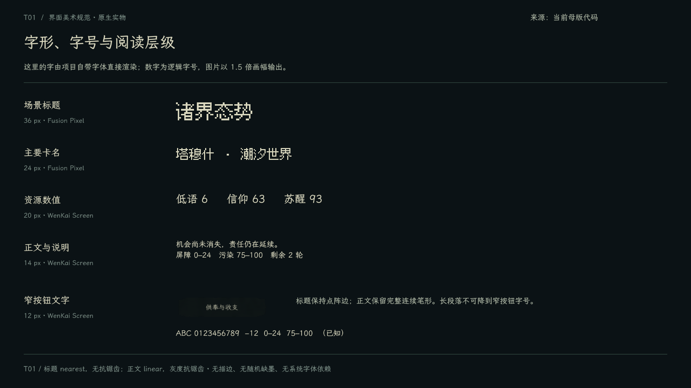

*T01 · 当前原生字体实物复现；不是浏览器近似排版。逻辑字号与显示放大分开标注。*

### A06 · 色彩与材质

以下是母版源值，不是截图取色；材质噪声会使最终像素不同：

- 墨底 `#101719`；主文字骨白 `#d9d7be`；次文字 `#b4bdaa`；卡片焦点短亮边 `#b1c09b`；按钮 hover 文字 `#eee8cc`。源内 `ACCENT=#b7c3a0` 仅为未消费声明，不作为已显示的选中色移植。
- 背景深底 `#080d14`，远冷色 `#1c2330`，远雾 `#344449`，低雾 `#303e37`，近景暗幕 `#080e12`。
- 卡身从 `#19282a` 至 `#34443e`；说明板从 `#26362f` 至 `#38473b`，自然融接，不加独立双框。
- 卡缘从 `#34483f` 至局部 `#829078`；按钮颜料从 `#24342f` 至 `#586952`。

正式化将这些语义角色集中到一处主题／资源，禁止每页手写近似色。原始算法在 `painted_material.gd`；不要把颜色端点当成纯色填充就声称还原。

**推广规则：** 警告、损失、成功、未知必须保留文字和既有状态语义；可用克制的暖灰赭、冷灰等补充，不能把所有语义色洗成同一种灰绿。新语义色在首次实际状态里核对再入共享主题，本母版未覆盖的颜色不冒称获准 token。装饰的黑暗不能让禁用理由和必要数值消失。

底材生成一次后缓存；同一控件不能刷新就重新抽颗粒。九宫格保留角部和边缘比例，长面板内部扩展安静色面，不能把 240×40 按钮纹理整块拉成巨大墙纸。插图、底材、文字各自处理采样，不用一个全屏像素化或噪声后期覆盖所有层。

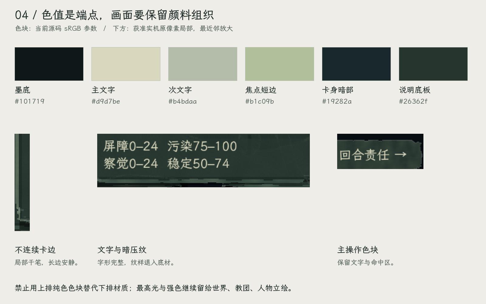

*G05 · 上部是源码色值，下部是获准截图局部；纯色参数不能替代带方向的颜料组织。*

## 4. 卡片与控件家族

### A07 · 三种插图载体，共用一种材料

**世界卡：** 保留母版纵向画牌与方形图窗，焦点牌完整显示图像、名称和状态。放得下时平铺；放不下时有序叠放，一次最多呈现焦点两侧各五张邻卡，其余仍可翻到。不要缩小所有牌塞一屏，不露出邻牌截断的指标碎片。原有世界档案搜索／筛选入口继续存在。

**教团卡：** 显示完整盆景式宗教场所，底座、主要建筑与场景关系必须可读；不要替换为领袖头像，也不为套竖卡切掉底座或改视角。现有经营页的图槽限制与适配见 S03。

**人物卡：** 沿祈求／人物／权能当前主体槽显示半身与手势，保留头、肩、关键道具及身份特征。跨页图像身份按 A13 保持。长篇处境仍在原阅读区，不压在人物身上。不要让所有人占满同一桶形轮廓或强行加兜帽。

世界、教团、人物共用卡边、图窗收边与说明底材，允许适配既有横／竖插槽。**卡片是观看客体的视觉语言，不是把所有页面改成同一套翻牌交互的许可。** 教团和人物列表仍沿原导航，除非制作人另外授权。

### A08 · 图窗与文字底板

当前最终生成图是含天空的 960×960 方图。以完整图窗等比承载为默认，不把星球环、建筑轮廓、人物手势当作可任意裁掉的边角。图窗柔化只收边，不把主体做成毛玻璃；不重复 NPR、不统一染色、不额外高光锐化。透明 `lit` 中间层不是默认最终图，若改合成方式须按生成合同另验。

世界卡母版图窗为 `(10,35,240,240)`，卡名区 `(22,284,222,32)`，副文区 `(22,316,218,20)`，两行指标从 y=339 以 19px 行距排列。图窗使用 linear 采样，只在 UV 边缘 0–0.04 范围收 alpha，原图 RGB 不变；像素标题的 nearest 不能扩成全局过滤。此为母版几何；长名字在既有完整资料入口仍须能读全，不按这组尺寸强塞其他页面。

卡头的眼形印记只反馈现有悬停／焦点，不能表示不存在的警戒、污染或可操作状态。说明板暗压纹在实际文字行下进一步压低，长文本页不能把母版固定行号遮罩照搬过去。完整眼徽标、亮符号不得出现在阅读中心。

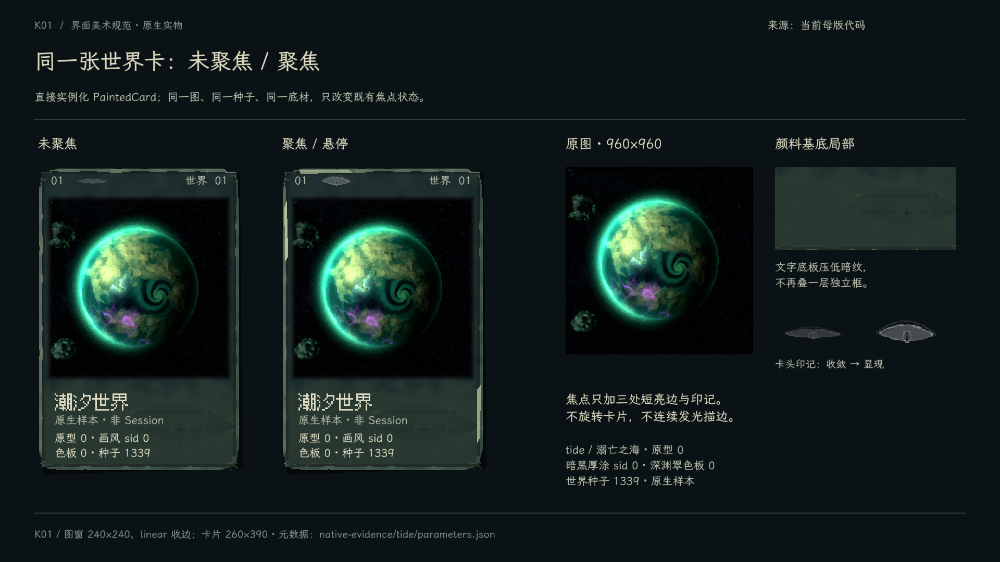

*K01 · 同一 PaintedCard 组件实物；示例来自 tide，原型 0／画风 sid 0／色板 0／世界种子 1339。固定图像，仅比较载体状态。*

<a id="关键信息与控件状态"></a>

### A09 · 按钮、选择、输入、滚动与浮层

母版按钮用不均匀颜料块而非精确几何外框。普通导航退后，责任入口次之，主要确认具有相对完整色块。当前按钮底材 alpha：普通 0.16、责任 0.38、主操作 0.88；hover/focus 普通与责任 0.66、主操作 0.93；pressed 1；disabled 0.10。它们仅是底材强度，不能把整段文字也乘成 0.10。

**推广规则：** 将 normal、hover、keyboard focus、selected、pressed、disabled、locked 分清。鼠标和键盘焦点都清楚可见；禁用项保留原因；锁定项保留条件，不能只变暗。Selected 保留稳定印边／标记，hover 不覆盖它。危险确认沿原确认步骤明确后果，不能借气氛省略文字或自动执行。

搜索框、选择器、数字输入、复选、滚动条、条件行和工具提示采用同源墨底／颜料边；保留原 Tab、方向键、滚轮、焦点与命中范围。输入框需要清晰插入点、选中文字与占位提示，不能为“融入背景”变成不可辨识的暗线。滚动条只在原区域工作，不能因外围 overlay 截走输入。

弹层沿原根和原遮罩结构，底板为安静的暗色材料；标题、当前对象、必付、提交与取消保持固定，内容按原区域滚动。不新建一套网页式卡片弹窗或多级右侧抽屉。回执、轻提示和错误信息共用本套文字／底材，停留时间与交互合同沿原实现。

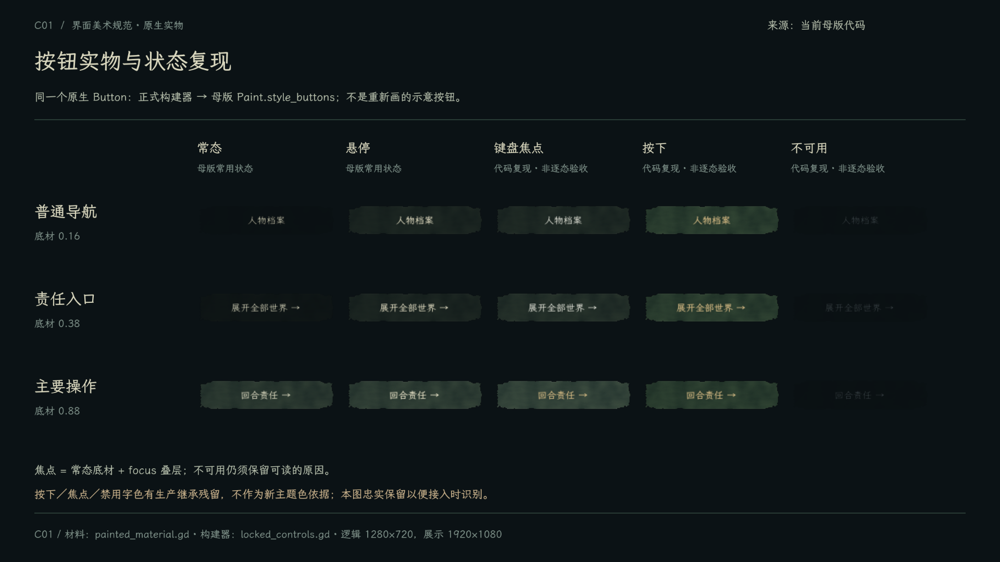

*C01 · 原生 Button 状态复现。normal／hover 底材与文字沿母版；focus 叠层及 pressed／disabled 的部分字色来自现有宿主继承，未逐态审美验收。原生展示建立焦点后重新施加母版皮肤，以排除生产 focus 回调换回旧框；因此也不证明正式回调已完成换肤。图中若有旧冷蓝或不同禁用字色，是待统一的实现残留，不能据此写入新主题。*

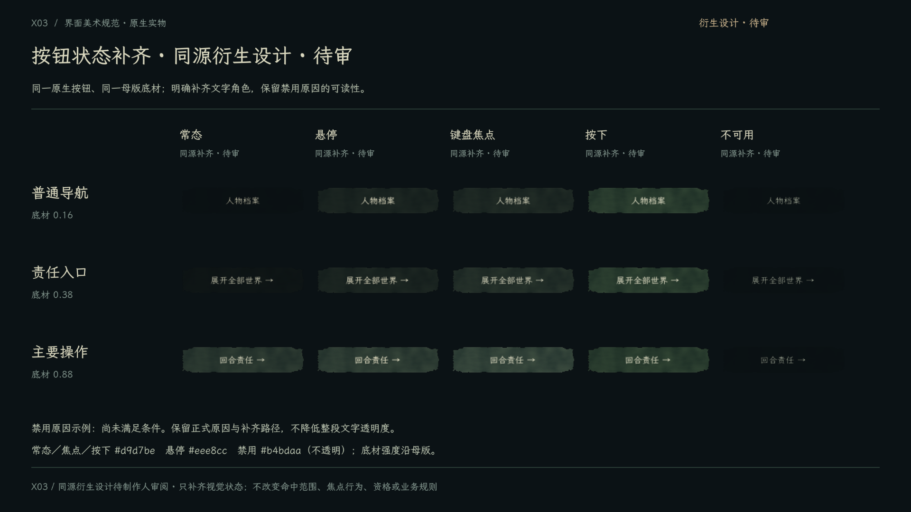

*X03 · 衍生设计，待制作人审阅。与 C01 对照，明确补齐焦点、按下、禁用的文字颜色：常态／焦点／按下 `#d9d7be`，悬停 `#eee8cc`，禁用 `#b4bdaa` 且不透明；保留禁用原因。底材、角色强度与原生状态沿母版。这里是可实施的收口样例，不将旧继承残留或新提议伪称为已批准 token。*

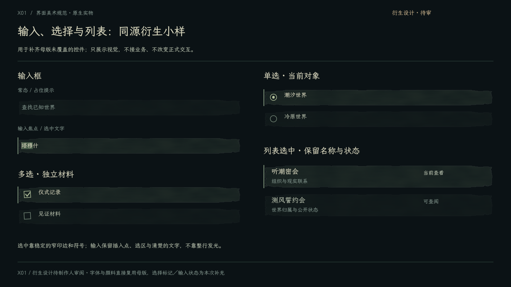

*X01 · 衍生设计，待制作人审阅。演示搜索／输入、选择与列表状态如何使用同源底材；未改正式交互，也不是已通过组件。*

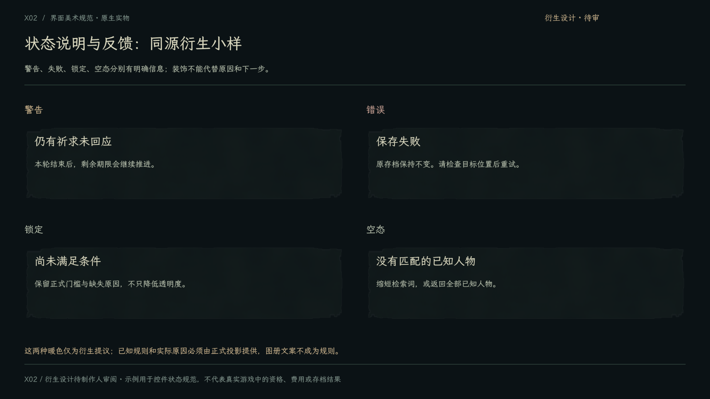

*X02 · 衍生设计，待制作人审阅。补足警告／错误／不可用／空态的可读表达，不引入新规则。*

**控件实物的复用边界：** C01／T01／K01 由 `ui-guide/specimens.gd` 直接调用当前 Godot 字体、卡片和按钮画法渲染；X01/X02/X03 的补齐样式只在图册示例中存在。正式组件负责人按 A09 将衍生样式纳入对应接入批次验证，统一到共同主题并记录待复审状态；同方向的常规控件补齐不要求逐个另起审批。方向或锁定交互发生变化时才按 §0 请制作人裁决。不要复制图册截图当可交互控件，也不要把未审示例登记为已批准 token。

### A10 · 图标与细节

沿用已锁定十二权能及其真实标签／顺序；绘制用少量不等宽干笔、实色印记和可辨轮廓。图标先清楚表达功能，装饰再加入。不要直接混入系统 emoji、通用办公图标、细线科技图标或未知含义的华丽符文。新图标在其最小实际尺寸检查，不靠放大展示证明可用；本轮未宣称全套图标已画完。

## 5. 有机外围与运动

### A11 · 空间关系与共享运动

静态背景保持远雾、中景色带、近景暗幕及被主体遮住的巨大注视暗形。外围动态在同一灰绿颜料场中分为：后层雾团与起伏暗膜 → 六处固定曲面卷形 → 前景薄雾。前雾同时遮住形体和它上面的眼睛，根部融进雾，不呈六根贴上去的孤立触手。

整套外围在背景之上、交互内容之下；“前景”是相对膜／卷形而言，不是盖住全部文字、卡面和按钮的屏幕滤镜。母版后层主要位于 155px 外围，前雾在 145px 范围内、alpha 上限 0.64；推广时不能把这个局部上限当作全屏遮罩强度。

当前五只异形眼：三只画在卷形 UV 上，两只依膜面的同一边界函数定位。随载体平移、转向、弯曲，眼形尺度也服从表面；仅局部开合可有自己的节奏。保持三裂瞳核、偏心小孔与不规则组织，避免人眼／猫眼贴图、完整外部怪脸、独立位置动画。

所有层共用 **24 秒连续周期**，包含位置和速度的闭合。缓存噪声和固定三角索引；不用动态重新三角化、每帧换随机数、分层各自重启或 12 秒回放硬切。菜单或关联层打开关闭不把环境时钟重置为零。卡片、正文、输入框不跟着环境摆动。F5 是样板审阅工具，不能顺手添加为正式玩家功能。

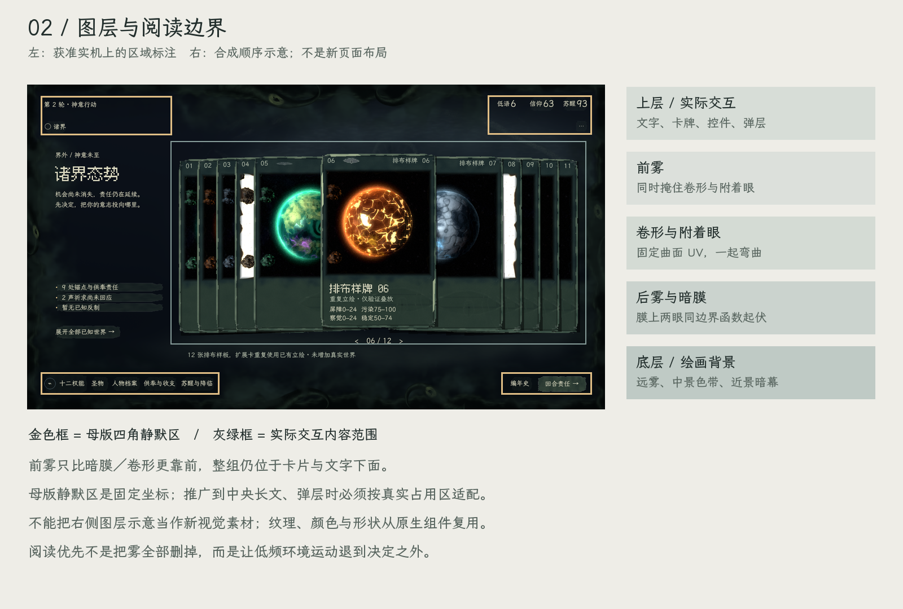

*G06 · 左侧标出当前保护范围，右侧为顺序示意。不是额外游戏底图，也不允许据此挪动原控件。*

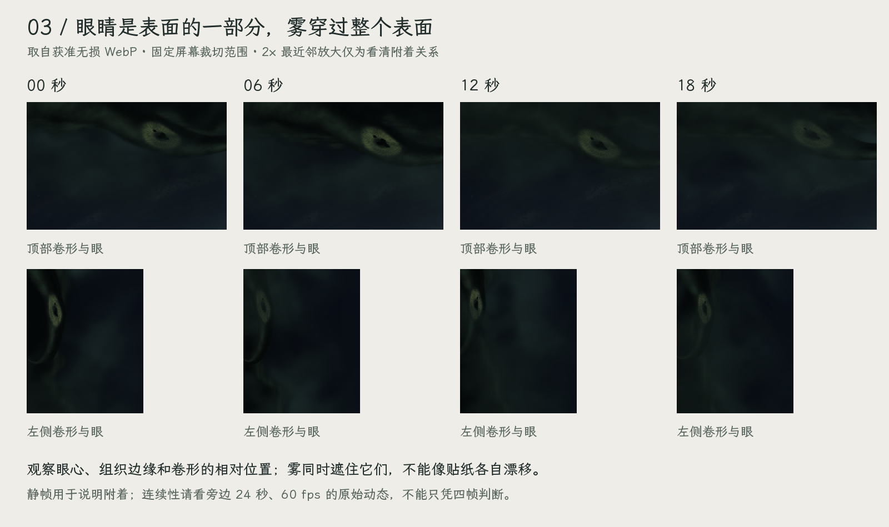

*G07 · 获准无损动态的固定裁切，0／6／12／18 秒；仅帮助看清表面关系。连续性仍以完整动态为准。*

<div class="guide-video"><video controls loop muted playsinline preload="metadata" src="ui-study/evidence/peripheral-motion.mp4" poster="ui-study/evidence/02-twelve-worlds.png"></video></div>

[打开原始 24 秒动态](ui-study/evidence/peripheral-motion.mp4)。若 Markdown 阅读器不播放视频，使用文首图文阅览版。

### A12 · 全场景气氛配置（推广规则）

为同一个环境组件提供语义配置，不按页面复制 shader。以下是实施要求，当前样板尚未实现配置接口：

- `full`：诸界及有充分暗场的客体浏览，以获准母版为上限。
- `quiet`：祈求比较、权能准备、教团经营等决策密集页。保持低频流动与空间深度，降低局部卷形／眼形对阅读的竞争。
- `veiled`：确认、长篇资料、结果与系统弹层。环境留在后面，前景不得跨过浮层文字或边界；不在弹层上再复制一套眼睛。
- `still`：调试捕获、暂停或既有设置确实要求静态时，冻结连续画面；不自动新增设置项。

配置切换须连续衰减、保持共享时钟。实际文字／按钮／资料区域作为阅读保护范围，至少覆盖标题和资源、左侧说明、底栏、当前任务正文与确认区。只压低四角的样板 mask 不足以保护后续中央长文；按实际矩形传入或使用同一可维护遮罩，不把旧卡片坐标写死到每个 shader。

环境复杂度不超过母版再逐页相乘；一份共享噪声与一套外围足够。离屏卡停止昂贵绘制，底材和纹理复用。保持正常翻卡、滚动、输入响应；实机目标 60 fps，不把导出 60 fps 文件当作运行性能证明。性能不足先减外围覆盖／采样成本，不降字号、删状态或破坏主体绘画。

## 6. 立绘身份、运行时与资产

### A13 · 图像不制造游戏事实

美术层只消费玩家可知的对象与现有参数。未知世界、未识别人物、死亡或离场、联系中断、无教团等状态分别沿现有投影呈现；不能因为生成器能画就提前显示隐藏组织、衣饰身份或材料。缺图不代表对象不存在，未生成不等于未发现。

世界使用确定的模板／原型、画风、色板和世界种子；教团继承所属世界的画风与配色；同世界人物继承该世界语言，同时用独立人物种子、身份与受约束 recipe 产生可见差异。对象身份、图像版本与生成参数绑定，翻页、悬停、再次打开、读档不能重新抽签。人物身体、轮廓、衣装、姿势和道具的差异由现有生成器负责，UI 不靠随机色框冒充人物差异。

### A14 · 正式接入的待补合同

母版时期只支持独立工作台。正式身份 v1、文明映射、异步队列及持久缓存以[生成合同](../../specs/system-art-generation.md#正式对象绘画身份--v1)为准；不得把未填项、工作台默认或样板图槽当作正式世界分配规则。

后续生成接入批次必须先在 `system-art-generation.md` 原地确定：真实 ID 到模板的来源；世界与人物视觉种子及独立随机流；已有对象如何稳定兼容；recipe／实现版本；缓存键、失效与生命周期。不得悄悄修改 Session schema 或消费玩法 RNG。需要新增世界映射／身份规则时，数据仍从 CSV 起步，不在界面按名称硬写。

展示只消费最终 Texture2D／图像与元数据，不依赖工作台控件、不调用旧 JS／浏览器服务器，不在 `_draw` 或每帧 `_process` 中启动生成。同一 service 不并发调用；排队生成，切换对象时用请求身份防止迟到图贴错牌，限额缓存／释放。加载、失败和重试沿原交互条件处理，先用同源静态底板保留名称和已知信息；不可用他人的立绘冒充当前对象，也不能让未完成绘图阻塞合法游戏操作。

资产由代码／源数据可复现，保留版本、参数、许可与导入设置。UI 自身干刷／噪声／暗纹保持程序化或由同一源导出的可再生纹理，不能用整张截图作界面。字库和插图不能只在编辑器缓存存在而漏进发布包。首批迁移即验证正常入口和实际打包资源路径。

## 7. 全场景适配清单

本节依据正式入口调用盘点；每项是实施范围，不是已完成勾选。具体函数、批次与遗漏核对见后续条目。所有界面共用 §3–§6，不重复创造主题。

以下代码文件未写前缀时均在 `src/presentation/production/`；共享 `experience_*` 文件另写完整仓库路径。正常入口是 `project.godot` → `game_root.tscn` → `round_view.gd`。

### S01 · 诸界、当地与常驻外框

来源：`interaction_stage.gd:overview()/local()`；`round_view.gd:_build_top()/_build_dock()/_build_worlds()`。

诸界使用批准的卡扇、背景和 `full` 外围；当地保留原世界主体、四维、教团／活动／锚点／圣物机会／祈求联系的构图，采用 `quiet`。顶栏轮次阶段、资源及原游戏菜单入口保留，只撤常驻游戏名；底栏原入口完整。正式图像由 `object_portraits.gd` 按已知对象 ID 提供；仅有请求线索时保留中性图槽。

覆盖少世界／多世界、当前对象、已知不足、无祈求／无教团／无锚点、公开反制和返回。多世界交互复用样板获准行为，当地不改成第二个翻牌大厅。

### S02 · 世界档案与当地情报

来源：`world_management.gd:open_archive()/_show_archive()/_show_intelligence()/_world_details()`。

档案保留检索、筛选与详情；用安静颜料阅读底板、同源世界缩略图和清楚的选中边。正文／四维／时点与精度优先，机构、文明与反制各守原信息归属。`quiet/veiled`，不将全屏眼形放在文字后。档案选择不等于切换主场景，阅读不更新情报。核对无匹配、长背景、未知四维及聆听准备返回。

### S03 · 教团、指令与成员

来源：`world_management.gd:_show_cult()/_show_orders()/_plan_details()/_open_roster()/_member_details()/_read_relic()/_read_source()`；`task_view.gd:_render_subject("cults")`。

统一组织场所绘画、命令选中态、未登记提示与固定执行区；经营表述沿原规则。成员图使用既有 91×92 逻辑图槽，不扩大行高或改变阅读布局。当前下部阅读区的容量是硬边界。先以实际教团图在现有范围验证可辨识度，不能把领袖头像当成教团立绘交差。若无法容纳，按 [§9.3](#art-feedback) 交「当前构图／建议插图占用／移动了哪些控件」对照，由规范维护 agent 先核对或打样；涉及结构变动再交制作人决定。其余字体、材料、状态先按本规范推进。

核对无教团、缺领袖、成员失效、超量名册、携带物和关联阅读返回；文字不得被场景底座遮住。外围 `quiet`。

### S04 · 祈求与回应

来源：`prayer_view.gd:browse()/_render_list()/prayer_scene()/_update_detail()`；`prayer_space_view.gd:update()`。

保留左处境、中央人物、右回应比较及固定费用／执行区域。人物使用对应身份立绘，处境可读而不做字幕压脸；回应选项用同源颜料条与清楚的选中态，不能改为全图抽卡。`quiet`，确认与人物速览为 `veiled`。

同时覆盖新情境与冻结旧请求、短／长选项、已用次数、期限、暂缓、“不再回应”不可逆确认及实际回执。主体与关联图窗解析同一公开人物 ID；返回保留原选择与来处。

### S05 · 轮初事件

来源：`round_view.gd:_event_frame()/_show_event()/_event_options()/_review_event()/_show_event_context()`。

事件、选项与复核使用同一物质语言，仍保留事件的阻断阶段、费用和后果。无对应对象插图的事件使用安静底板／同源小印记，不虚构一个人物作事实主体。关联态势只读，Esc 不绕过未决事件。核对长选项、确认取消、队列消尽；`quiet/veiled`，不引入新的事件进场强制等待。

### S06 · 十二权能全览

来源：`power_stage.gd:open()/_rules()/_prepare()`。

固定十二权能顺序、符印、门槛、费用及规则查阅完整保留。统一印记笔触和墨色层次，选中／可用／未解锁可辨，不用亮眼睛替代资格。降临仍转本体，锚定仍转机构目标；`quiet`。本批包括未解锁项的要求阅读，不能只展示初始四项。

### S07 · 行动准备、候选与确认

来源：`task_view.gd:open_action()/render_workbench()/render_selector()/run_action()`；`action_workbench.gd:render()`、`bestow_view.gd:render()`。

通用准备、赐予专用构图各保留；字段、单／多选、数值候选、材料依据、费用、风险及执行区使用同一组件。实际对象置于原主体槽，不能让装饰挤走可选准备和完整条件。持续活动、圣物处置、机会获取、关注名额等复用原准备入口，不新建重复配置器。

核对核查中／可用／受限候选、无候选、失效依赖、资源不足、切任务确认、只读关联与提交回执。`quiet`；确认、条件长文为 `veiled`。

### S08 · 锚定目标与机构

来源：`task_view.gd:open_anchor_goal()/_render_anchor_goal()/_anchor_details()`；`src/presentation/experience_views.gd:_institution()/_anchor()/_anchors()`。

保留所在世界和机构目标的局部焦点、材料／护持者／圣物／教团／污染条件与补齐路径。同源小印记标注依托关系，不新增机制图或把条件藏进纹样。未有机构生成图时明确复用已有身份标识，不让 UI 临时发明建筑事实。核对不满足／可准备／实际进度、条件查阅和返回；`quiet/veiled`。

### S09 · 人物档案与对象对照

来源：`task_view.gd:_render_people()/_render_subject("person")/_pin_comparison()`；`src/presentation/experience_views.gd:render_comparison()`。

个人大图、关联速览和名单既有 32×32 图标槽使用同一身份，不扩大行高或改变阅读布局。职责／能力／携带物／经历／适用行动五类内容沿既有页签和检索结构。人物差异靠图像生成保持，选择只加同源短印边。对照仍用原范围，不复制整套背景／外围。

核对长名、多人列表、无匹配、已离场／死亡的公开状态与空经历。紧凑画幅保留身份可辨，不用裁头或抹去关键道具换空间。`quiet/veiled`。

### S10 · 圣物、供奉、关注、本体与降临

来源：`task_view.gd:_render_relic_comparison()/_render_budget()/_render_progress()/request_rest()`；`src/presentation/experience_views.gd:_relic()/_opportunities()/_attention()/_self()`。

这些分支共享材料，不强行共享同一大插图构图。已有圣物和权能图标以相同印刷笔触处理；缺少新立绘不等于可删除条目。供奉排序、停供／恢复、未登记状态与登记按钮清晰；关注和容量保持各自归属。

本体与降临的准备／进行中／续付／中止，保留原锚点、已付轮次和真实可知结果。敛息沿原确认。`quiet/veiled`，苏醒高或降临不自动触发更亮、更抖的全屏环境；若要状态演出另列设计。按圣物／经济／降临拆小批，不在一次会话全做。

### S11 · 回合责任、回执、编年史、终局

来源：`round_view.gd:_show_end()/_show_receipt()`；`task_view.gd:_render_history()/_select_record()/_render_subject("ending")`。

回合责任是明确决定的阅读面，支出、条件收入与未回应提示不能被仪式纹样吞没。回执保留通用、权能对象居中、锚定局部三种构图，用同源材料串联；不为了统一而删除对象关系。编年史保留检索／分页／选中详情／关联记录。

终局与封存后只读保持可查资料，不把未实现电影演出算本规范范围。内部 `between/evolution/settlement/ending` 自动推进阶段没有四个独立玩家页面，不为“全覆盖”另造四张画面。核对长回执、空历史、成功／失败与只读动作限制；`quiet/veiled`。

### S12 · 标题、暂停、存档、设置与系统反馈

来源：`round_view.gd:_title_menu()/_pause_menu()/_show_new_game()/_show_saved_games()/_show_settings()/_confirm_switch()/_show_seal()/_save()/_set_notice()/_choose_import()`。

标题菜单允许“邪神苏醒”；游戏内顶栏禁止常挂游戏名。菜单采用同源背景／字体／按钮，保持现有新局、继续、种子、存档列表、设置及退出流程，不扩展成另一套首页探索。暂停和设置优先阅读，`veiled`。

核对无存档／已有存档、导入失败、保存失败、切局与封存确认、文字设置和必要反馈。导入使用 OS 原生文件选择框，这是平台边界，不重绘、不替换成自制文件管理器。所有正式弹窗均使用共享字体与状态，不留默认 Godot 蓝灰控件。

## 8. 从样板到正式组件

### A15 · 直接复用的源与必须去掉的样板方式

`ui-study/` 是母版实现源，正式化提取其画法而不是让游戏运行 `study.gd`：

- `painted_material.gd`：字体加载、色值、底材、卡面暗纹；`occult_marks.gd`：同源干笔眼形；`painted_backdrop.gd`：背景层次。
- `painted_card.gd` 和 `card_fan.gd`：插图槽、焦点／邻卡外观和已获准翻卡行为。将纹理与对象输入改为正式公开数据，不保留示例路径和假世界。
- `peripheral_atmosphere.gd`、`peripheral_tendrils.gd`、三份外围 shader 及 `peripheral_fields.gdshaderinc`：共享时钟、固定拓扑、雾和附着眼。整组迁移，不能只复制一张雾图或一个 shader。

**必须替换的样板技术：**`Paint.style_buttons()` 通过节点名和旧文字亮度全树覆写字号／字色；正式化应改为明确的文字角色、按钮角色、状态角色，尊重大字模式与语义色。不要把样板的 `find_children` 扫树染色作为全游戏主题。

`study.gd` 会加载夹具、隐藏／覆盖原控件、注入卡组、用 F 键造展示模式；它只在诸界且无 dialog 时生效。不得进入生产启动、存档路径、游戏场景生命周期或导出依赖。正式场景不出现“排布样牌”、采样时间、种子调试标签、F1–F5 工具说明。

### A16 · 共享组件的落实边界

推荐在现有生产呈现层内集中主题与视觉组件；名字和具体目录可由实施者按架构决定，但职责必须分明：

1. 主题拥有字体、语义颜色、间距和控件状态；同一数值只维护一个生产来源。
2. 材料资源拥有底材生成／缓存；对象卡拥有图窗、阅读底板、状态和对象引用；容器拥有现有排布和输入。
3. 外围拥有时钟、阅读保护、材质和强度配置；不读写 Session，不消费输入，不向业务发指令。
4. 图像提供者拥有请求／版本／缓存，场景只展示对应 ID 的结果。

迁移时先看 `production/locked_controls.gd`，以及 `round_view.gd` 的 `_scene_plate/_reading_frame/_peek_content/_make_footer/_scroller/_scroll_cue`。同时覆盖 `src/presentation/experience_views.gd`、`experience_actions.gd` 与 `ui/requirement_list.gd` 的正式调用链。共享视图继续传入生产 `host._ui`，不能遗漏后落回旧 UI。沿 `GameRoot/Presentation/CanvasLayer/OverlayRoot` 的正式空间组织接入，装饰节点鼠标穿透，不另搭业务宿主或改世界坐标。

`RoundView._refresh()` 会重建 `_stage`，任务／弹层另有 `_surface`。外围时钟由不会随每次 UI 刷新销毁的呈现宿主持有，或明确传递持续时间；不改业务刷新语义。保持 `ui/motion.gd` 现有转场和输入时序，别把慢雾动画变成阻塞确认的等待。

先让一个正式场景使用提取出的共同实现与母版相符，再扩展消费者。不得留一份样板画法、另一份相似的生产手抄版持续分叉。当前生产映射：`production/locked_controls.gd` 接 `production/painted/theme.gd`；`painted/world_card.gd` 与 `painted/card_fan.gd` 从冻结实现继承画法与手势；`painted/object_window.gd` 共用最终图窗。外围由 `painted/peripheral_atmosphere.gd` 在正式宿主长期持有，继承同一时钟、卷形与噪声，生产 shader 增加强度和阅读范围。图像入口为 `painted/object_portraits.gd`。各批状态见[交付记录](../../tasks/ui-art-production.md)。母版证据与原指纹继续保留。

## 9. 分批接入与 agent 交接

### 9.1 接入批次

当前状态：**B01–B10 已接入代表路径，正式场景待制作人复审。** [逐批交付](../../tasks/ui-art-production.md#实机证据与剩余范围)登记各 S 项的验证和缺口；S03 经营主体大图按 UIA-001 暂留原构图。下列批次定义保留作执行与复审范围。

各批只规定范围、依赖与交付终点；具体画法见 A，场景要求见 S，不在此重述。

1. **B01 共享材料与生命周期。** 无前置；落实 A15–A16，在正式 S01 验证共同主题／外围／控件，交付组件映射与资源打包依据。图像占位仍在则不记 S01 完成。验证 V01/V02/V04/V06/V08。
2. **B02 正式图像身份与诸界卡。** 视觉前置 B01，A14 合同可先行；交付稳定对象图像提供者与真实诸界卡，完成 S01 诸界部分。验证 V03/V04/V05/V07/V08。
3. **B03 当地、档案、教团。** 前置 B01/B02；依次交付 S01 当地、S02、S03。S03 图槽缺口独立反馈，不阻塞其他可实施部分。
4. **B04 人物身份与祈求。** 前置 B01/B02；先交付 S09 人物目录／速览，再交付 S04。人物图像提供者继承 A13–A14，超出单批预算时拆开。
5. **B05 权能与共同准备。** 前置 B01 及本批实际需要的 B02 图像接口；交付 S06 与 S07 通用准备，先贯通一个真实权能再扩消费者，逐项登记覆盖。
6. **B06 锚定与持续活动。** 前置 B05；交付 S08 与 S07 活动／材料分支，不扩新的机构生成系统。
7. **B07 长期经营。** 前置 B05/B06；S10 按圣物／机会、供奉／关注、苏醒／降临／敛息拆成三个独立子批。
8. **B08 事件与回合责任。** 前置 B01 及所需对象图像接口；分别交付 S05、S11 轮末／回执。基础控件换肤不代表完整场景验收。
9. **B09 记录与终局。** 复用已完成的资料底板；交付 S11 编年史／终局及 S09 对象对照。
10. **B10 系统菜单与交付收口。** 前置 B01；交付 S12。最后只补各批仍缺证的衔接、状态与资源路径，不全量重跑业务。

B03–B10 每批使用 V01/V02/V04/V07，加上其实际改动触发的 V03/V05/V06/V08。可并行制作互不冲突的页面，但共享主题、外围与图像提供者各有单一负责人；公共实现未稳定前不得各写一份临时版本。

批次开始先在交付记录中列本次 S 编号、真实入口、涉及状态、现有证据与缺口。批次末按 §10 写状态，不把“多数页面已上色”当作完成。下一步建议从 B01 开始，而不是重新抽字体、色板和氛围方向。

### 9.2 派发任务头

每次派发可直接使用以下任务头；不把 ALL 场景塞进一次会话：

```text
任务：落实 [批次 / S 场景编号] 的已批准 UI 美术。
依据：CLAUDE.md → stage-priorities 的当前路由；ui-art-standard.md 对应 A/S/V 条目；
      ui-interaction.md 当前合同；涉及图像时 system-art-generation.md。
母版：ui-approved-baseline.json 对应四图和 24 秒视频；实际打开本批相关对照。
拥有：写明本次文件 / 共享组件 / 场景；你并非唯一工作者，不回退其他人的改动。
维护：填写本批反馈的实际接收会话或负责人；未填时由本批派发者负责转交原规范主会话。
保持：原玩法、公开数据、导航、焦点/滚动/返回、确认与提交；两项技能禁令继续。
实现：先复用共享画法，说明本批新增的推广组件与缺口，避免扫树临时换肤。
反馈：遇到无法按现有规则决策的点，按 §9.3 在 ui-art-feedback.md 建 UIA 条目，
      附现场证据并交本规范维护 agent；写清受阻项和可继续项，不用猜测填补。
验收：选择本批适用 V 条目；实际场景一张主图，相关状态/短路径按风险补证。
交付：文件、规范条目、实际证据、已实现范围、未验差异；更新本节该批状态。
```

<a id="art-feedback"></a>

### 9.3 实施疑难：记录、交回、打样与回写

**责任人：** 本规范维护 agent，即产生本规范、承接制作人此次母版 PASS 的原视觉探索主会话，不是任意新开的实施会话。派发任务时填写可联系的维护会话或负责人。实施 agent 负责发现问题与提供现场材料；维护 agent 负责判断、补规则、做小样并回复可实施结论。未来换会话时，必须明确由谁接任，先读未关闭条目；不能让每个实施者自行成为一套新标准的批准人。

**按问题分流，不能把诸界样板硬套到所有场景：**

1. **现有规则足够：直接实施。** 已有组件等值复用、同一角色的尺寸适配、缺字或纹理接缝等修复，且不动锁定交互，按 A/S/V 条目完成并记在批次交付中。控件类名不同本身不是升级理由，不另开审批。
2. **现有规则不能作决定：交维护 agent。** 例如全新控件的视觉语义／状态没有对应样例；真实场景的信息密度与立绘冲突；在原区域内无法兼顾必要文字和客体；规则、图样或当前实现相互矛盾；维持现有画法遇到明确技术限制。写成一个具体待决定问题，禁止以默认控件、隐藏信息、缩字号或套诸界卡扇来掩盖缺口。
3. **触及既定边界：维护 agent 整理后请制作人裁决。** 移动／重排锁定布局、改变导航／输入／确认／信息归属，或更换已通过的画风、字体、氛围，须提交可对照的具体方案。维护 agent 可以先研究和打样，不能自行授权正式改动。一个新的视觉控件不自动等于第三类。

**记录与递交：** 使用唯一的[实施问题台账](ui-art-feedback.md)，一问一条稳定 `UIA-001` 编号，同一问题追加原条目，不在聊天、批次报告和独立 proposal 中各抄一份结论。至少填：批次／场景／真实入口与代码位置、玩家要做的决定与必须保留的信息、当前截图及相关状态、已查规则与不适用原因、待决定问题、最小受阻范围和可继续项。截图注明逻辑／展示尺寸、分支与提交（工作树修改另说明）、真实 Session 或夹具；动态问题补短视频。已有有效证据直接复用，不为填表重跑全游戏。

无法先产出合格方案时也应递交，写明能力或信息缺口；不要求先反复试错。若已有尝试，附一张同幅局部草图／失败对照和原因即可。涉及布局的建议必须标出所移动控件；只截一张孤立控件、写“感觉不好”不足以让接手者决定。

子 agent 将 `UIA 编号＋台账路径＋一句待决定问题` 回报父会话，由父会话交本规范维护 agent；独立实施会话在交付中使用台账里的转交短格式，并明确请求维护 agent 接手。**写入文件不会自动通知本会话，也不等于已接手。** 当前负责人实际回复后才登记接手；若没有直达本会话的渠道，将短格式交给制作人转交，不能伪称已通知。

仅暂停受影响控件／区域及依赖它的消费者；保留当前可用实现并在交付中标“未换肤／待决定”，不将开发占位冒充正式完成。其他独立工作继续。若缺口位于共享主题或公共布局，先列清受影响场景，防止各场景绕过同一问题另写临时版本。

**维护 agent 的答复必须可执行：**

- 能由现有规则解释：回复适用 A 条目、使用方式与排除范围；容易重复误解的地方原地澄清。
- 需要新控件或新场景视觉：在问题所在的真实构图、尺寸与信息密度中做最小小样，补必要状态与对应 V 验收句。新图带参数／来源和状态，写入对应 A/S 条目及图册 manifest；不能再只补一段抽象文字或借诸界截图代验其他页面。
- 需要制作人裁决：提供当前与建议的同幅对照、交互差异和影响范围，台账记“待制作人裁决”；按 §0 的边界执行。

同方向的规则解释和补齐由维护 agent 返回实施，不要求每个普通控件单独审批；新小样保持“衍生待复审”，随对应批次交制作人看。维护 agent 的技术复核不等于制作人审美 PASS。

**回写与关闭：** 维护 agent 在原条目回复结论、规范条目／小样路径、可实施范围、仍不允许的改动和必要验证。实施者引用该答复接入，再把实际场景证据与剩余差异回填；维护 agent 对照核查后才关问题。若需要制作人裁决，必须附其裁决出处；审美未审仍保留场景的待复审状态，不因 UIA 关闭冒称通过。批准范围变化才更新决定与获准基线；只补衍生样例不重签母版。

生命周期为 `待接手 → 待打样 / 待制作人裁决 / 已答复·待实施 → 已实施·待核对 → 已关闭`；不需要打样或制作人裁决的步骤可跳过。打样失败、实机不符或新事实使答复失效时重开同一编号。没有明确答复、规范已更新但未验证实景、或仅聊天说“解决了”，均不算关闭。

若结论是“无需改动／现有实现已符合”，维护 agent 可引用已有实景证据核对后直接关闭，并说明依据；不为走状态制造代码修改。

## 10. 可否证验收与收尾

### 每批适用的 V 条目

- **V01 母版一致性：** 同一逻辑尺寸、同类内容并置比较，仍读作灰绿绘画载体、粗印标题和连续笔形正文；没有引入金线、玻璃、纯色软件框或全屏等密度纹理。机器检查不能签此项审美。
- **V02 主次与阅读：** 当前客体／行动／代价能先于背景眼形被读到；最长实际名称、相关长文和最大现实数值不遮挡／截断必要信息。标准与大字模式均保留完整提交区，正文不以缩小掩盖溢出。
- **V03 对象绘画：** 原图等比且主体完整，未重复 NPR 或染色；同 ID 的列表、详情、祈求画面身份一致。至少用本批涉及的冷、暖或高亮图核对，复用母版已有材料证据，不为换肤跑全部生成组合。
- **V04 输入与状态：** 本批正常、hover、键盘焦点、选择、禁用／锁定、空／加载／失败等实际存在状态可辨；原入口、一次返回、草稿、滚动和确认行为保持。装饰不拦截，拖动松手不误入；只查本批改动影响到的路径。
- **V05 知情与结算：** 换图／换材质不改变费用、成功点数、机会、资格、结果与既有玩法存档事实；视觉身份元数据扩展按 A14 合同实施并保持旧档兼容。图像和文字只表示现有已知事实，样牌、调试信息不进入正式局。
- **V06 有机连续性：** 外围修改时看完整 24 秒及切页／开关弹层：眼形与载体同动，雾同时遮住两者；无重三角闪变、纹理游泳、时间重置硬切，阅读保护有效。仅改变不涉及外围的页面文字无需重新录整周期。
- **V07 正式入口：** 用正常入口和真实 Session 到达本批页面，不靠 F 键／截图脚本强开。短路径选一次当前动作、关联查阅、返回或提交后的实际回执；必要坏例只覆盖本批具体风险。不会因图像未就绪卡住操作。
- **V08 性能与发布：** 共享资源未每帧重新生成，单 service 无并发、迟到结果不串对象；受影响处没有新增引擎错误。正常拖动／滚动观察无明显卡顿；声称具体帧率须有设备、分辨率与实测依据。首批资源迁移检查导出加载和字体许可证，后续只补新依赖。

### 证据与状态

每个 S 项维护：`未接入 / 接入中 / 实机核对完成·待制作人复审 / 制作人通过`，并记入口、相关 V 编号、证据路径、实际内容来源和剩余差异。客观检查通过不能自动升为制作人通过；已获准母版无需重复争取方向裁决。

证据优先一次代表实机画面＋必要状态差异；同一版本有效证据直接复用。核心闭环、直接受影响异常及必需检查通过即收尾；追加检查必须有新改动、实际失败或明确未解问题。不得扩成全策略、全存档、全组合长跑，不以图册取代真实可达路径。

每批收尾同时登记四件事：实际架构变化或无变化；对应 spec 原地更新／无需改及原因；明确交付范围；场景与状态 UI 清单。正文、源码映射、证据三者同步，不能“代码已改，规范仍指样板”。

### 本次规范交付的验证边界

本轮仅核对规范、原生示例、图文阅览版与引用有效性；构建和核对方式见 [图册 README](ui-guide/README.md)。没有更改或重测游戏功能。§7 的场景覆盖依据当前生产调用与交互合同；过时且存在格式缺口的 `game-state` 索引不作为覆盖或完成证明。
