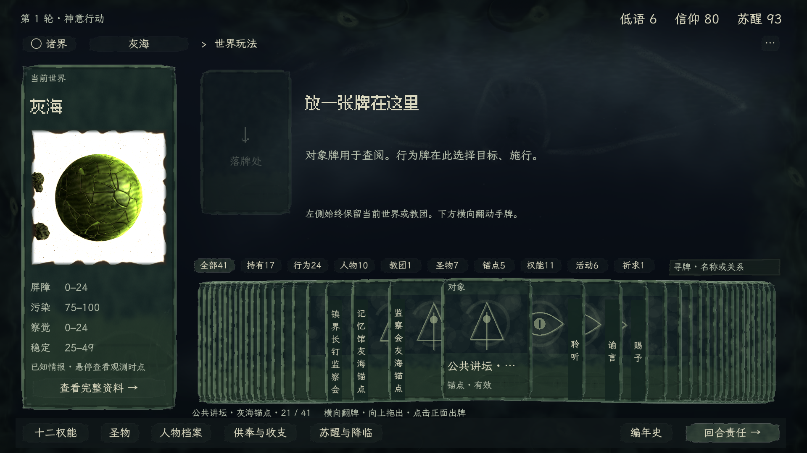
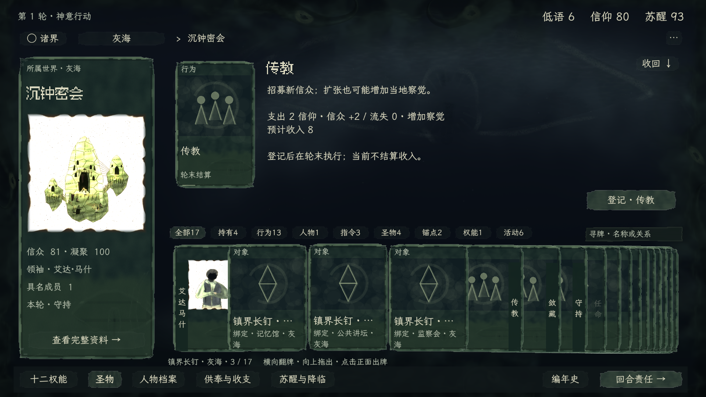

# 世界玩法 · 四区牌桌样板

从仓库根目录双击 `世界玩法探索.command`。每次启动复制五世界测试存档，进入灰海；使用独立会话目录，不写正式存档。本夹具包含 5 个已知世界、3 个教团、16 名已知人物；本次操作不会带入下次启动。

交互依据为制作人对行为归并、真实画牌、上下分区与直接配置的要求，唯一正文在[世界玩法交互合同](../../../specs/ui-interaction.md#worldplay-card-study)。美术沿[当前获准规范](../ui-art-standard.md)的字体、灰绿粗印卡与有机外围。新版构图及操作手感待制作人体验。

## 操作方式

- **左侧主卡固定。** 世界层展示世界立绘、四维与资料入口；教团层展示教团立绘、信众、凝聚、领袖、具名成员与当前指令。选牌和执行不会把主卡换掉。主卡不再在手牌中重复出现。
- **右下连续叠牌。** 灰海手牌为 17 张对象、24 张行为，共 41 张；少量平铺，超量连续层叠，不分页。整组每张牌始终在桌面内，远牌只压叠，保留真实可点击的边缘。整叠外缘固定，翻到首末张分别靠对应侧展开，不再出现半边空桌。附近牌保留竖排名签，深处牌边悬停显示完整名称；卡纸不透出后牌文字。横拖、滚轮、左右键连续翻动；点侧牌先移到正面，再点正面出牌，或直接向上拖出。类别筛选和“寻牌”用于快速定位，完整牌库始终可达。
- **右上查看／执行。** 对象牌只读；行为牌直接显示选择槽与正式条件，不跳通用准备页。主卡资料按钮也在这里展开。收回／Esc 不执行；换牌不收费。同一张牌重复点击保留草稿。
- **底栏常驻。** 十二权能、圣物、人物档案进入同构的只读图鉴，汇集相应定义或跨已知世界对象；没有执行按钮，命令入口也阻止图鉴模式提交。返回时恢复原世界／教团、分类、寻牌、叠牌焦点及完整执行草稿。供奉与收支、苏醒与降临、编年史、回合责任保留原职能。资料覆盖层不遮掉底栏。
- 行为按动词归并：多处锚点共用「维系」，多项机会共用「回收」，「解绑」「公开」「等待」各一张，目标在桌面选择。锚定直接展示机构、媒介、护持者及实际必需槽，唯一必需候选自动填入，可选辅助默认收起。
- Session 预览通过且字段完整时才能提交；不可逆提交另行确认，真实回执回到原桌面。教团指令与供奉只登记安排，轮末实际结算。

对象卡的收纳不赋予支配资格：人物区分信徒和已知联系，圣物显示绑定机构或携带者。灰海三名护持者中仅一名属于沉钟密会，不把其余人算作本团成员。

## 当前实机图

以下均为 Godot 桌面渲染的实际 viewport，1920 × 1080。



[首张靠左展开](evidence/deck-first.png) · [末张靠右展开](evidence/deck-last.png) · [12 秒连续翻动录像](evidence/deck-motion.mp4)

录像为 Godot 原生 viewport 连续帧，30 fps，展示首张、连续翻至末张、再选中部牌；不是静帧补间。



- [行为牌执行区](evidence/four-zone-action.png)：前批配置区证据，世界信息持续可见，候选槽及提交位于右上；此图的旧手牌只作历史，新排布以上图与录像为准。
- [底栏权能图鉴](evidence/four-zone-library.png)：保持相同四区结构，只读条件、费用及效果，不提供施展。

世界、教团、人物使用当前程序生成器。行为、圣物及机构候选仍是程序符画占位，不是已定稿插画。`table-*.png` 是前批上下牌桌记录，更早的 `world.png`／`cult.png` 等是首版记录；它们不再规定当前布局。旧日志不用于验收新版手牌输入。

## 实现与边界

`worldplay_view.gd` 继承正式宿主，只在此独立场景内重组世界／教团、手牌和执行桌面。`hand_fan.gd` 复用获准载体的输入和信号，但重写完整牌组排布：固定外缘、为每张牌分配正间距，余量向当前展开位置集中；相邻牌交换层级时先分离，禁止远牌隐藏／淡出。名签承接压叠后的阅读，以原生向上拖放出牌；`study_card.gd` / `table_drop.gd` 提供卡身和落牌接收。底栏是独立常驻层，三类图鉴目录只构造只读牌；`action_model.gd` 从公开投影与正式目录取得动作和目标，再按动词归并。具体草稿使用 `action_choices`、`preview_action` 与 `execute_action`；指令／供奉用 `preview_plan` 与 `set_plan`。真实回执复用正式 Feedback，不编写假结果。正式 `src/**`、CSV、玩法规则和默认游戏入口未由本轮改动。

**可用性架构问题尚未解决。** `ISSUE-WORLDPLAY-ACTION-AVAILABILITY` 仍为 open。新版目录不运行旧的组合穷举，不显示「可准备／待选对象」资格承诺；当前配置由正式预览校验并给出实际缺口。这不等于证明整个动作目录中哪些牌存在合法组合。全目录的确定性可用／缺条件汇总，仍须在该待办内实现。旧可选扫描分支保留在 action_model 中用于定位原问题，当前牌桌明确以 `build(..., false)` 关闭它。

本轮已接通样板动作，没有逐条回归全部权能、活动、祈求、跨世界仪式、所有可选组合及轮次边界。全游戏其它场景的美术和交互不在本轮交付范围；这些范围不标已验。

## 有限验证

- [整叠在桌检查](evidence/deck-table-check.txt)：41 张真实手牌的首、中、末与换层过渡，加上分类后的少量牌，共 21 个状态；每张牌不透明、不出界、在实际命中检测中逐张可达；首末外缘不漂移，换层时两牌不重叠。
- [更新后的原生输入](evidence/deck-input.txt)：点击、原生向上拖出、横向翻牌及只读图鉴入口保持，没有增加提交。
- [连续翻动出图记录](evidence/deck-motion.txt)：由 `checks/capture_deck_motion.gd` 按 30 fps 导出 360 帧，再编码为录像。

- [四区及图鉴检查](evidence/four-zone-check.txt)：区域不重叠、41 张牌无分页且末张可达；三类图鉴只有对象牌、没有执行按钮且命令入口拒绝提交；图鉴返回恢复执行草稿／教团与寻牌；底栏在编年史覆盖层仍显示。
- [原生输入检查](evidence/four-zone-input.txt)：正面点击、原生向上拖放、横拖翻牌不误出牌、底栏进入只读图鉴；这些操作未增加提交记录。
- [本批出图记录](evidence/four-zone-capture.txt)：世界、教团与图鉴同一现场会话。前批真实入梦、指令提交和回执记录为 `table-check.txt`，本轮没有改动其规则；不冒充已重测所有动作。

`checks/deck_table.gd` 验证完整牌组并导出首、中、末图像。`checks/four_zone_flow.gd` 是前批四区路径检查，本次未重复执行；`checks/four_zone_input.gd` 已针对新排布重跑输入。`checks/capture_four_zones.gd` 复现三场景图像。macOS CUA 捕获前批报错，因此直接使用引擎输入和 viewport 输出；真实鼠标／触控板手感及审美仍交制作人体验。

```sh
./世界玩法探索.command
./世界玩法探索.command --play=POWER_DREAM
./世界玩法探索.command --study-cult --play=order/CULT/DOMAIN-001/expand
./世界玩法探索.command --library=power --play=record/POWER_ANCHOR
```

附加 `--capture=/绝对路径/图片.png --quit-after-capture` 可导出现场。启动参数只改变查看状态，不替玩家执行。
