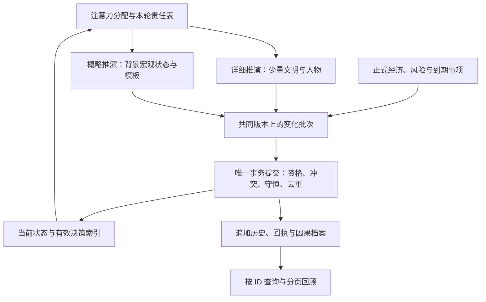

# 分层推演与注意力预算方案

本文将作者的“真实模拟／假模拟”方向落实为一条技术路线：**一个权威世界，两种推演方式，以注意力限制详细推演范围，以增量事务和冷热历史切断每轮工作对全部历史的依赖。**

作者确认的方向见 [DEC-016](../progress/decisions-log.md#dec-016--分层模拟与邪神注意力本轮只制定方案)。以下具体边界是本次技术方案，尚未实现或实测。本文是实施变更提案，不是第二套有效系统 spec；现有规则、代码、CSV 和证据保持原状，实施时按第 12 节原地更新。没有新增短体验前置阶段。

## 1. 要解决的两个问题

**世界越大，逐个推演的对象越多。** 通过限制重点文明、具名教团成员及必要交互对象，只对少量对象运行详细行为，其余文明通过宏观状态生成概略结果。

**一局越长，每个操作搬运的历史越多。** 当前 `turn.submit`、参与者调用和预览多次对全世界做快照、深拷贝、JSON 比较；成功提交还检查全部历史引用、回执与阶段记录。即使全部文明进入后台，这些记录仍会增长。必须另行改造事务、查询和存档。

这与“上下文／注意力”有相似之处：保留完整记忆，不代表每次决定都重新读取全部记忆。这里采用明确的数据与规则，不引入运行时大模型，也不依赖模型摘要保证准确性。

## 2. 两种推演，共同结算

### 详细推演：作者所说的真实模拟

用于重点文明、持续存在的具名教团成员、当前互动必需的对手和相关主体。使用正式属性、当前处境、已知事实的有效投影、关系、证据和成长来源来产生行为。完整历史可以按需查询，但不逐轮遍历人物一生。

### 概略推演：作者所说的假模拟

用于非重点文明的日常社会变化及背景事件、祈求的候选生成。输入限于文明蓝本、宏观现状、少量长期标签、有效风险摘要、模板冷却和固定抽样位置；不读取完整编年史，不为每个居民维护人生，不重放它们未被观察的每一天。

它产生的变化一旦提交，就是该世界真实发生的结果。例如按文明类型、稳定程度与当前污染生成一次宗教分裂，并依规则改变人口分组和污染。可以记录“本轮发生分裂”；不能伪装成已经逐人推演了十年的秘密结社史。

### 共同的权威结算

两种推演只提出变化，统一入口决定能否成立并一次提交。始终准确保存与结算：

- 人物身份、生死、所在地，人口分组与转移；物件和职务的唯一归属。
- 信仰、支付、收入资格、自然流失余量、锚点有效性与终局相关值。
- 已展示的可回应祈求、既有危机、已承诺的任务、期限与默认后果。
- 已产生的暴露、有效证据与持续异常对风险的影响；不能撤关注便停止追查。
- 已消费的成长、献祭、奖励来源，以及请求回执和随机位置。

这是少量数值、资格与待决项的结算，不是再给所有后台文明跑一遍详细 NPC 模拟。文明尚未生成的居民经历、未承诺的机会、日常叙事变化允许概略生成；已经确认的事实不允许重抽。

## 3. 注意力如何限制规模

采用三个独立预算，不把面板展开数当作模拟能力：

1. **重点文明名额**：主动处理屏障、执行定向侵入／污染、持续降临等操作占用名额。检查与预留发生在扣费之前；名额不足时不能开始新的主动工程。当前 CSV 的六个展开管理页只是显示限制，不直接成为新名额值。
2. **具名教团成员名额**：限制仍与玩家建立正式教团成员关系、需要持续详细推演的人物总数，包括受伤、拘禁或暂时失联者。不能通过折叠人物页或把成员送去后台文明释放名额。正式离团、死亡等身份变化才能解除相应占用，历史身份继续保留。
3. **临时交互主体预算**：给祈求者、对手、使者等非教团成员使用。每个事件模板预先声明需要多少人物及关系；展示前预留。既有互动没结束，不能为新内容把原主体悄悄回收。

持久身份容量与这些活动预算分开。一个已经见过、目前没有直接互动的非成员 NPC 可以保留身份及关键状态、进入概略生活；再次出现仍是同一个人。所有已具名的教团成员保持详细推演。身份是否具名、是否为教团成员、是否正在执行自主行为，必须是不同字段。

忠诚达到门槛不自动等于正式入团。祈求、事件、玩家行动和自主行为的所有入团入口，都必须在承诺该结果之前预留成员名额；随机结果有入团分支时按最大需要预留，后续承诺占用预留直到完成或合法失效。正式入团在同一事务内完成身份变更及临时主体／成员预算转换，不重复占用。无名额时只产生尚未承诺入团的意愿或合法替代候选，不能支付成功后再吞掉入团结果、删除人物或偷偷超限。

**个人与文明的精度独立。** 一个具名信徒留在后台文明，可以继续按本人的真实属性与经历做有限行为，读取当地宏观状态；无需激活整域居民。关系引用不递归激活朋友、亲属及其文明。其任务一旦要求定向改变该文明屏障或持续主动污染，则另行占用重点文明名额。

后台教团按既定策略进行的聚合经营，与玩家新发起的定向污染工程分开定义；不能用“本轮污染数值上升”判断是否必须详细，也不能把持续主动工程改名为自动经营来绕过名额。

名额成长若在后续设计中存在，必须有终局上限。名额的具体数值、升级曲线和背景频率在实施前由正式 CSV 统一给出；本轮不以未经验证的数字冒充容量结论。当前十二域的有限世界登记继续作为首版范围；“听见许多文明的祈求”不等于无限新增世界记录。

## 4. 哪些文明可以转入后台

默认文明使用概略推演；玩家正在突破屏障或执行主动污染的文明进入详细推演。作者所说的“污染完成”在本方案中定义为：**当前主动工程已结束，可以转入后台经营**。它不是污染达到某个数字后永久安全的吸收态。

转入后台必须满足：没有尚需连续详细执行的主动工程；所有未结事项已经完成，或明确交给共同结算中的风险、期限、支付职责。不能仅因为污染值高便删除抵抗，也不能因为离开视野冻结世界。

后台文明仍可能衰退、失去教团或锚点、发生反抗。新出现的重大危险按正式预告规则提供应对机会，玩家可以重新分配注意力，也可以承受后果。系统不会为了每一场危机自动激活整个文明、突破重点名额；“无法照顾所有地方”是这条设计的实际取舍。

特别保留**已暴露但尚未形成预告**的风险。后台用当前风险记录继续计算查证与计划资格，相关人物或证据按 ID 查询；不模拟全体机构成员。切回后台不能让既有罪证失效，切回前台也不能凭空生成旧证人使其立即确证。

## 5. 升降级协议与回合时点

每个文明保存模式、模式版本、最近结算位置、背景抽样位置、当前摘要和已有详细状态的存档位置。切换是一笔受协调器管理的状态事务，不是 UI 展开／折叠副作用。

**进入详细模式**允许发生在阶段二的合法事件选择、阶段三的合法行动入口：先检查并预留名额，再按当前摘要展开所需数据，然后核验与提交行动；接口失败时整体回滚。不能先扣费再发现无名额。重点名额一经本轮使用，至少保留至下一轮轮初；不能同轮轮流把所有文明“临时重点化”。

**撤回关注**在阶段三登记，下一轮轮初完成到期整理后生效。持续工程必须先按正式取消／结束规则处理，不因撤关注获得无代价取消。仍有只可由详细推演履行的承诺时暂不释放，原因可解释；能够表示为精确到期事项的承诺不必强留整域详细模式。

阶段四开始冻结本批模式与责任，详细、概略、经济生产者读取前置支付之后的同一版本。每个对象的每一类职责只有一个执行者；背景文明中的真实成员由人物详细职责处理，其人口及效果不会被背景职责再算一次。阶段五收入、期限及后续终局仍遵守现有顺序。

升降级本身不额外执行一次演化、不补发低语、不刷新人物机会、冷却或期限。升级直接从当前状态继续，不重放离线期间全部回合；降级把有效状态投影成摘要并归档详细记录。已有身份、属性、来源和随机位置不能重新生成。

## 6. 背景事件和祈求如何生成

后台生成按低频、错峰的文明周期进行；普通支付、收入、已有风险及到期事项仍按其真实时点结算。背景周期只控制新机会和概略社会变化的评估频率，不把数轮未处理的损失倒填成过去已经发生。

输入为“文明蓝本＋当前宏观状态＋有效标签／风险摘要＋模板冷却＋抽样位置”。候选经过可达性、人口、身份、唯一物件与容量检查后才能产生。模板可以描述当前发生的事情；涉及旧神迹、亲属、证言、圣物时，只能绑定真实存在的对象或事实。

可回应祈求在**展示之前**固化人物、处境、来源、期限、请求 ID 与一次性键，并占用必要容量。需要新人物时从对应无名人口扣除并提名，优先复用合法的现存人物；无容量且无人适用则不生成该候选。它可以跨域传来，不自动将整域升级。回应与普通行动使用同一主动干预分类检查重点名额，一次性的定向深度污染同样占用；只有正式规则明确允许的浅层受限效果可直接在后台结算，不能以“非持续”为理由豁免。

祈求展示后，执行时重查当前资格、费用及对象；人物已死亡或迁走等变化可能使原选项失效，不能照旧收钱并生成替身。祈求窗口与原危机期限独立保存；来回切域、重开页面或读档都不刷新。背景没有候选时可以保持安静，不能为填满界面强造事件。

每个概略变化记录生成规则与版本、发生轮次、所属文明、真实输入来源和模式。根事件可以没有历史父项；不要求为了“有因果”伪造一段前史。旧史仍可在回顾中显示，叙事不得声称概略生成过程已经逐人发生过。

## 7. 历史、注意力与当前决策数据分离

采用三类存储职责：

- **当前权威状态**：现存实体、资源、身份、宏观数值、模式、阶段、未结承诺。
- **有效决策投影与索引**：当前伤害来源、尚有效的证据、未消费行为资格、关系摘要、按域的活动人物、按时点的到期队列。这些是从真实提交增量维护的结构化数据，不是语言模型摘要。
- **完整冷档案**：已经结束的事实、完整因果边、旧知识记录、旧成长消费凭据、死者档案、历史回执及阶段日志。按 ID、索引与分页查阅，不挂在每次深拷贝的状态根下面。

每条行为规则必须声明它读取哪些当前投影、哪些改变会更新或失效该投影。不能继续用“取出此人全部 known_facts，再逐条过滤”实现常规行为；也不能只留最近若干条就把仍有效的旧证据遗忘。

可合并的风险按对象与语义类别聚合，保留真实来源索引；未来可能独立触发不同后果的来源不得任意合并。旧成长来源是否已消费使用持久唯一索引判断，不能在整个人生列表中线性搜索。需要回顾某个已知事实时按 ID 读取，不递归展开整棵历史树。

新增规则若要求任意多条旧事实同时参与当前选择，必须先定义足够的聚合投影、有限检索或明确的规则生命周期；没有这个边界，就不能声称活动状态已经有上界。程序不能自行发明遗忘期限来达成性能目标。

## 8. 事务与校验改造

维持 Godot＋GDScript、纯数据状态、同步六阶段。初期不引入服务端、ECS、线程池或新的数据库依赖。

将目前兼顾回滚、隔离和保存的完整 JSON 快照拆开：

1. **受限读视图**只返回参与者需要的记录与查询结果，隔离嵌套可变数据；不传整个可变世界字典。表现与预览使用同一只读边界。
2. **事务工作区**记录本笔写入对象、待追加事实、索引变化、ID 分配、随机位置及协调器状态。按首次写入复制必要对象，所有写入必须经过归属入口；禁止事后遍历全世界求差异。
3. **工作区合并**先检查效果声明的资格，再按既有身份优先、唯一对象仲裁、来源去重、最终裁界顺序形成候选状态，并刷新派生值与索引；此时尚未对外发布。
4. **增量校验与共同提交**检查合并后的最终候选状态、写集及其受影响的依赖，通过后一次发布。各声明分别合法不等于合并结果合法。例如死亡同时影响人口、职位、媒介、教团、锚点和收入资格，索引不能漏掉这些反向引用。失败丢弃本笔暂存及随机消费，不撤销先前已提交行动；合法判定失败仍遵守原费用规则。

不能直接删掉当前全量校验器。先控制全部写入口、登记字段到不变量的依赖覆盖，再让普通提交走增量检查。全量语义校验保留在读档、开发回归和明确的审计边界。只比较校验和不足以拒绝“结构错误但重新计算了校验和”的坏存档。

技术改造先保持全详细模式、现有随机语义和规则结果，证明表现相同后再接入概略模拟。后者是新的游戏语义，不承诺与旧全详细模式的每一段隐含人生相同；承诺身份连续、既成事实不变、已承诺后果与守恒规则成立，以及新模式自身可重放。

## 9. 随机、回执和存档

随机仍由协调器管理。概略生成使用独立于检定与表现的按域事件流，持久保存 seed、state、周期与消费位置；初始化依赖明确、版本化的域标识派生规则，不用页面排序、系统时间或不受版本约束的内置哈希。切换模式不重新设种子。候选一旦生成便持久化，预览和重复请求不再抽一次。

近期回执留缓存，旧回执通过持久索引定位档案。同 ID、同请求返回原结果，同 ID、异请求拒绝；不能把旧回执清空后允许旧奖励再次执行。已完成工作和阶段链同样归档，热状态保留当前游标及经过验证的检查点。

保存采用“当前状态检查点＋不可变历史分段＋检查点后的提交记录”。提交记录共同覆盖世界、随机位置、阶段、索引版本和回执；未完成持久提交不能在恢复后被当作成功。恢复到临时会话，检查通过后整体替换。分段与索引损坏要可检测，不静默修补事实。

检查点、历史段、提交日志与索引共同关联单调提交序号，以最后发布的提交清单确定可恢复版本，只恢复完整的已提交前缀。保存中断留下的未提交尾部可忽略；清单已确认的内容损坏必须拒绝，不能静默回退掩盖已提交数据丢失。

普通自动保存只写变化与新档案段；完整导出、首次读档审计、历史检索和版本迁移仍可能随总档案变慢，需单列指标。新格式升级 schema；旧档无明确迁移器时拒绝，不自动重抽人物或把旧 RNG 强塞进新规则。完整 JSON 导出可保留为诊断／可移植入口。

## 10. 如何保证“有界”，而不仅是少算一些

必须同时登记：全局文明数 D、重点文明 F、持续详细成员 N、临时主体 P、有效决策状态 K、未结事项 Q、单笔影响范围 X、每轮背景评估 B、热缓存 R。累计历史 H 单独计量，不纳入常规遍历。

设计目标是普通回合的工作量主要由 D、F、N、P、K、Q、X、B、R 决定；允许对 H 做索引查找，禁止每个命令复制／扫描全部 H。不能宣称绝对常数时间：按索引查询、保存、读档与档案体积仍有各自成本，全局宏观结算仍至少受有限 D 影响。

容量控制在内容承诺之前完成：新事件、人物、工程和后继事项必须声明有限的最大展开数与预留需求。无容量时拒绝新主动工程或延后尚未展示的候选；不能丢掉已接下的任务、延长已预告期限、把死亡复活或把代价吞掉。固定世界、人口及对象上限形成系统必然事项的容量基线，不能只给随机事件设限。

背景文明按固定周期与稳定轮转顺序评估，不为每个沉睡回合堆一项“待补模拟”。机会抽样可以低频，已经成立的代价必须准时。实际运行超过声明上限应视为规则／容量错误并有明确诊断，而不是让游戏默默跳过重要事项。

本轮没有容量实测，也不承诺具体毫秒、速度倍率或真实模拟百分比。将来先确定可玩的注意力名额，再用正式负载验证其成本；不能反过来用一次空闲场景的速度证明完整战役可承载。

## 11. 后续实施顺序与验收边界

按作者 DEC-017，本方案已正式编入 [Slice 04](../tasks/slice-04.md)及 [追踪源](traceability.json)，插在已完成的 `TASK-ECONOMY` 与尚未开始的 `TASK-CULTS` 之间。七项任务均为 planned，未启动游戏实现；计划登记与代码验收分别记录。

正式顺序为 `TASK-FIDELITY-RULES → TASK-INCREMENTAL-TX → TASK-HISTORY-INDEX → TASK-ARCHIVE-SAVE → TASK-ABSTRACT-SIM → TASK-ATTENTION → TASK-FIDELITY-VERIFY`。`TASK-CULTS` 增加末项为前置，其余相关下游沿依赖继承。以下五组工作按该七项拆分执行，不另存任务状态。

1. **规则与预算落表**：把注意力、前后台资格、切换时点、后台祈求和风险规则原地写入各自 spec；新增 CSV 参数及背景模板规则；登记新的 REQ／SET／TASK／ACC 依赖。明确替换“聚合推进必须与全详细逐细节一致”的旧边界。
2. **全详细模式下改造热路径**：受限读视图、候选与提交分离、事务工作区、增量索引和校验。与现有实现做差分重放，保留当前 SIM／TURN／ECON 所检查的性质；表示格式可规范化，不能隐藏数值或规则差异。
3. **历史与续存拆分**：迁出冷事实、知识、回执、阶段日志与完成工作；建立持久索引和分段保存。验证回滚包含索引、随机与档案追加位置，读档仍拒绝语义损坏。
4. **接入概略推演与注意力**：先固定共同结算，再加入两个生产者和唯一责任表；接入升降级、成员跨域及背景候选生成／固化协议。新背景机制的预期结果按新规则验证，不强求与旧逐人推演完全相同。完整入团、祈求回应、事件呈现与后果分别留在 `TASK-CULTS / TASK-PRAYERS / TASK-EVENTS`，新增验收追踪其接入；本基础改造不依赖下游已实现，也不以验证准备冒充完整业务。
5. **正式负载与下游接续**：在持续有行为、风险、收入和成长的长局中分别测量活动规模与历史长度影响；达成约定后继续教团、权能、事件和终局，并同步工作台。

上述检查属于正式实施的回归与验收，不是短体验前置阶段。本轮只写验收条件，不运行检查、不创建新的通过报告。

至少覆盖以下可否证情境：

- 暴露后、查证完成前撤关注：风险继续推进，已成立的证据不消失。
- 后台护持者死亡：身份、收入资格、锚点贡献与终局按原时点一致失效。
- 同一祈求反复看／切域／存读：ID、人物、期限和抽样结果不刷新。
- 提名、跨域迁移与升降级交织：总人口守恒，无名与具名收入不重复。
- 成员进入后台文明：本人真实推演继续，关系链不会递归激活全世界。
- 先供奉后切换、拒付后再关注：不重扣、不免单、不免费恢复锚点。
- 重点名额用满：新主动工程在支付前失败；已有到期后果仍全部结算。
- 成员名额用满：祈求结果、自主成长和事件入团不突破上限，也不在已付款后吞掉承诺；预留与身份转换原子完成。
- 背景祈求包含一次性深度定向污染：与普通主动干预采用同一重点名额检查，不因入口不同而豁免。
- 同批背景变化与详细人物死亡／迁移竞争：仍遵守同快照、身份优先及唯一归属。
- 失败事务及保存中断：世界、索引、档案、随机、阶段与回执恢复至同一提交。
- 追加大量无关旧历史而保持相同当前有效状态：常规回合不新增全档案扫描／复制；需要历史索引的操作单独计量。
- 分别增加 F、N、P、Q 和 H：报告实际读写、候选数、复制字节、历史触达量及时间；不能只报告总轮数和平均耗时。

当前报告中的 32 项正式推演、29 项回合、27 项经济检查是旧实现的既有证据；本轮未重跑，它们不能证明本方案已经可用。未来不得通过删除反例或放宽断言取得迁移通过。

## 12. 影响范围与明确待更新项

本方案完成后，作者已要求当轮编入正式计划；任务、依赖、交接、路线及工作台的登记已按 DEC-017 补齐。以下游戏规则／实现来源由 `TASK-FIDELITY-RULES` 及其后续任务在正式实施时原地修改，当前不宣称已经实现：

- `docs/architecture.md`：把全量快照的职责拆开，登记双生产者、冷热档案与概略语义；替换“这些优化不能改变回合结果”的笼统约束，区分保语义重构与新模拟规则。
- `docs/specs/system-civilizations.md`：重点／后台资格、宏观输入、风险推进、责任唯一性及背景更新规则。
- `docs/specs/system-powers-cults.md`：具名成员与临时主体预算、身份持久化、跨域个人推演；修订每域固定初始六人、机构必须预先具名的生成要求。后台机构先保留合法岗位与宏观状态，需要人物时再提名；旧有身份继续保留。
- `docs/specs/system-events.md`：概略来源、展示前固化、预算预留、冷却、祈求与危机不同期限，以及旧事实绑定限制。
- `docs/specs/system-turn-economy.md`：名额预留／释放的输入边界、阶段四唯一责任表、共同经济不变量与事务约定。
- `docs/specs/system-progression.md`：持续降临等主动工程占用重点的规则，后台损失继续影响苏醒及终局。
- `data/civilization_parameters.csv` 等归属表：注意力与活动容量、背景周期、模板约束；不得直接把 `expanded_domain_limit` 偷换含义。各数值只有一份来源。
- `docs/tasks/`、`docs/implementation/traceability.json`：本次已增加正式工作责任、结算与回归依赖；游戏验收仍为空证据，待将来真实运行后绑定。
- `docs/game-state/` 与制作人工作台：本次同步计划、来源与作者约束；实际运行时的预算占用、模式来源和风险仍待功能接入。工作台摘要不取代 spec，不能把本提案显示为已实现。

本次计划调整不改动游戏有效 spec、CSV 或实现，不重跑游戏性能实验。计划同步门槛与制作工具检查单独验证，工作台基线在语义核对后重建；这些记录不升级本方案的游戏实现或性能状态。原方案设计会话只读分析的限制继续如实保留。

## 13. 静态依据与结论的限度

代码依据：`src/game/turn.gd` 的 `submit / preview_plan / _invoke / snapshot / _validate_context`；`src/simulation/world.gd` 的 `snapshot / _evolution_snapshot / choose_behavior / choose_plan / validate_state`；以及 `src/game/economy.gd` 的共同批次与资格计算。本轮只读核对这些结构及现有规则，没有执行性能实验。

当前架构已经具备持久 ID、同快照候选、唯一回合和正式经济，能够作为迁移基础；工程难点集中在增量校验覆盖、冷热投影不丢有效来源，以及跨模式承诺连续。这是可分步实现的方案判断，尚不是正确性或性能验证结论。

取舍明确：用可控的真实人物与重点文明承载深因果，用概略后台承载世界广度；完整历史仍可回顾，但不再成为每次行动必须搬运和思考的上下文。
