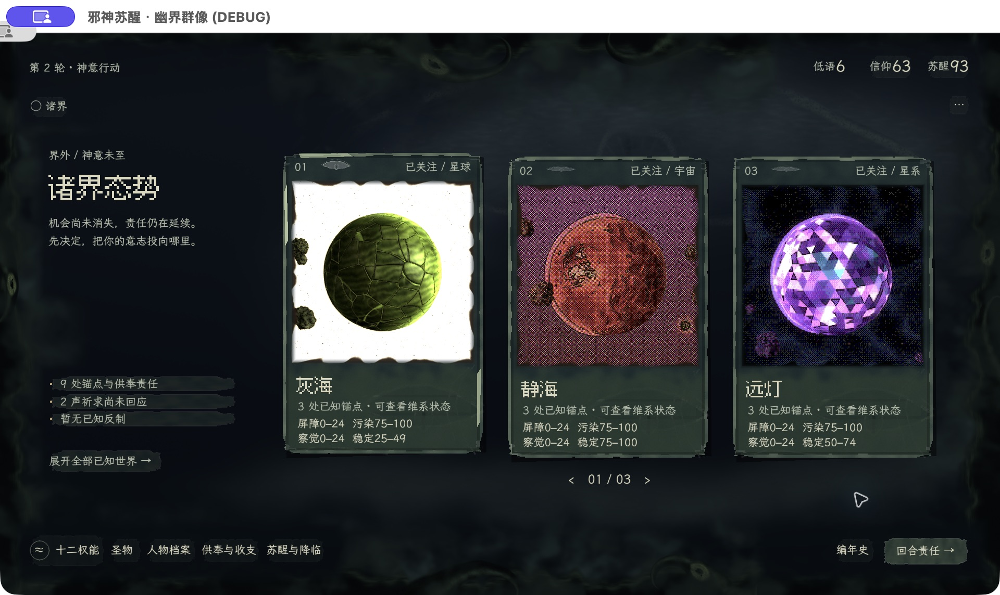
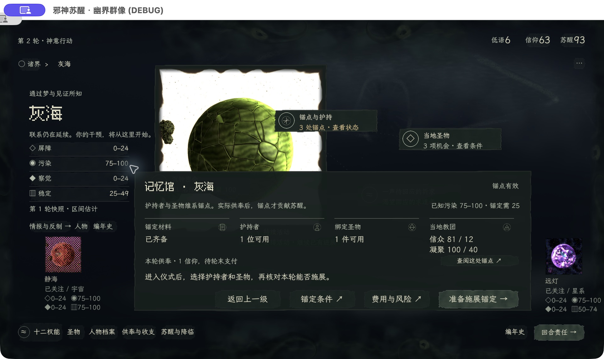
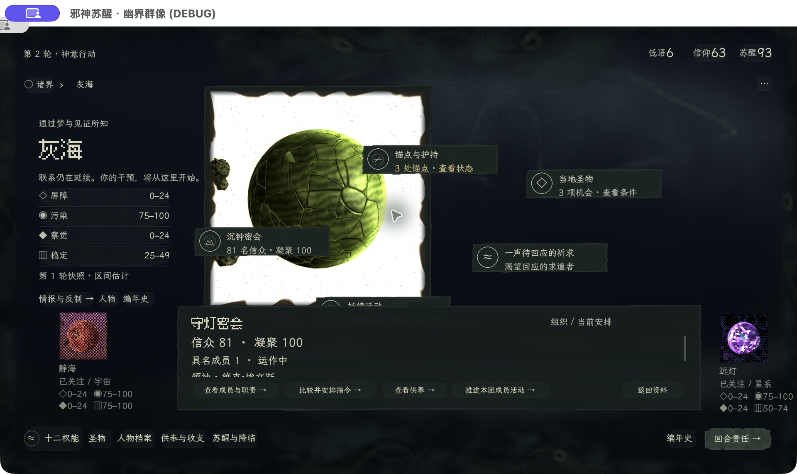
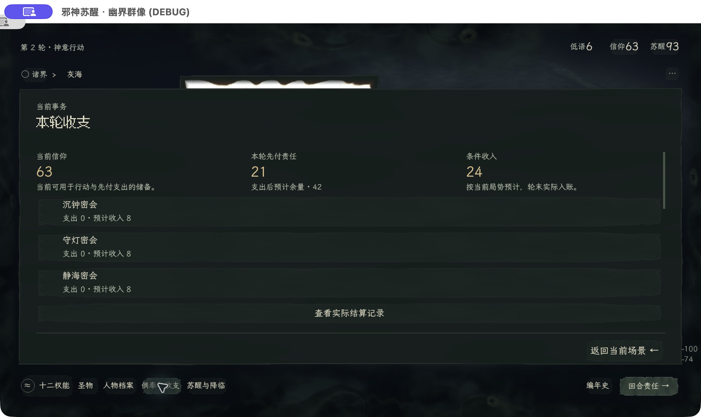
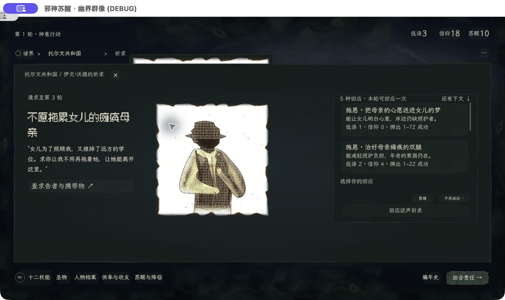

# 正式 UI 美术实机复审 · 2026-11-12

**结论：代表路径的视觉接入成立，但全游戏的美术完成度尚未达到已通过的诸界母版。** 世界卡、字体、外围气氛值得保留；当前瓶颈是复杂页面的承载材料与对象层次，另有可复现的遮挡、状态辨识和标题排版问题。本报告不替代制作人验收，也不授权更改锁定交互。

## 1. 版本、方法与覆盖

- 被审分支 `codex/ui-art-production`，提交 `9cf324e`，基于 `dcaf037`。启动前生产工作树干净。本次只新增审查证据、报告及 UIA-001 接手答复，未修改游戏实现。
- 从根目录 `正式UI体验.command` 启动正式入口；Godot 4.7.2，macOS；逻辑 1280×720，游戏内容 1920×1080。原始截图为 1920×1144，额外 64 像素为系统窗口栏，不属于游戏。
- 审查者参与过视觉母版制作；这是知情专家实机复评，非首次玩家研究。操作由工具离散执行，不能据此给出自然游玩手感或性能结论。
- 成熟状态通过正式「存档管理 → 导入副本」导入仓库 `docs/qa/ui-manifest/saves/ongoing.json`，不是自然玩出的新局；另从正式菜单创建种子 **1** 的新局。原 fixture 未改动；没有覆盖用户原存档、结算本轮或实际施展权能。
- 本次亲自操作：标题、导入、诸界、当地、教团经营、菜单教团目录的跨世界进入与返回、锚点详情、旧请求／新生成祈求、回应焦点与选择、人物目录、十二权能、聆听准备／世界选择器、供奉收支、编年史、暂停／新局。
- 轮初事件、结算回执、终局及部分经营分支仅复核此前交付证据和记录，未在本次重新推进；完整 24 秒运动闭合、60 fps、大字模式、发布包未重验。本次未见的状态不计通过。
- 依据为当前 [UI 美术规范](../art/visual-generation/ui-art-standard.md)、其冻结母版、[交付记录](../tasks/ui-art-production.md)及当前实现。未继承旧美术方案；未使用两项被禁技能。

### 成立的部分

1. **作品方向延续。** 灰绿粗印载体、点阵标题与文楷正文、外围窥视形体在正式游戏中成立；游戏内常驻品牌已撤掉。没有必要重新抽字体、颜色或外围方向。
2. **三种世界画风可共存。** 成熟档中的明底绿色星球、红色网点世界、紫色块面世界都进入同一套世界卡，主要阅读顺序清楚。白底本身是生成画风，不能当成错误删掉或统一染绿。
3. **基本路径和文本已实际接入。** 打开、选择、返回及局部滚动在本次经过的代表路径可用，未观察到默认 Godot 蓝灰控件回退。这个判断不覆盖所有功能结果。

## 2. 问题与建议（按处置顺序）

P1 表示优先修正的关键体验／作品身份缺口，P2 表示局部明显不足；证据缺口单列，不当成实现故障。成本 S 为局部修改，M 为共享组件或一张完整场景打样，不代表精确工时。

### UIR-01 · P1 · 阅读层透出背后文字

**实机事实，高把握：** 灰海 → 锚点与护持 → 记忆馆，前板后还能辨认教团、祈求及持续活动标签；聆听 → 世界候选浮层，候选列表后仍有「尚未建立联系」及提示文字。至少两个不同消费者复现。

**影响：** 当前阅读面与下层场景的语义混在一起；暗纹应是材料信息，不能由另一组可读标签充当。依据 A02/A08/A09。

**建议／成本 S–M：** 在共享阅读底板、局部遮挡与层级组合处修复。阅读区遮住下层字与交互标识，外围仍可保留空间色块；不要靠更亮的前景字压过透字，也不要仅修一张页。

**最小验收：** 原两条路径同幅复查，包含明底与暗底对象；前板范围内不能辨认下层字，关闭后原场景完整恢复。若透字只能由截图处理产生会削弱判断；本次原始无加工截图已直接显示，未做亮度提升。

另见 [世界选择器透字](ui-art-review-2026-11-12/08-selector-bleed.png)。

### UIR-02 · P1 · 教团缺少主体，并且跨世界进入时上下文错配

**实机事实，高把握：** 当地进入沉钟密会只有底部安排，没有教团场所图；在灰海的暂停菜单 → 教团 → 守灯密会，上方仍是灰海星球和沉钟密会标签，下方却是守灯密会。返回按钮「返回资料」及返回目录在这条路径上正常，不应误报为返回 bug。

**影响：** 玩家难以判断正在管理哪个世界的组织；教团还没有获得与世界、人物同等的客体身份。对应 [UIA-001](../art/visual-generation/ui-art-feedback.md#uia-001--教团当前安排的完整场所图没有独立槽)，不重复建单。

**建议／成本 M：** 在现有上方主体区域做一张完整教团场所样板，由本次选中的教团及其所属世界绑定图像；同时遮住背后当地的星球、教团名和关联标签，明确本教团身份。底部安排、滚动、四个操作和原返回来源保持。背景场景保留在下层，关闭教团层时恢复，避免重建导航状态。

**验收／边界：** 同世界进入和跨世界目录进入各一张同幅对照；底座与建筑完整、只表达当前教团，返回回到原入口且保留状态。此项涉及主体表现及可能的标签可见性改变，先打样标明影响范围，再由制作人裁决；本次没有完成小样或批准正式改动。只把建筑盖到星球上而保留错误标签不算解决。

### UIR-03 · P1 · 大面积阅读底板过平，复杂页面未达到母版完成度

**专家美术判断，中高把握：** 权能、供奉、编年史、祈求与行动准备的大板接近同一种暗绿薄色面；边缘很轻、内部层次稀少，大量横向颜料条重复。诸界有厚实载体与远近空间，进入这些页面后容易变成一张统一背景色的表单。此前轮初事件图也有同类倾向，但本次未亲自推进事件。

**根因依据：** 共享 `painted/theme.gd:_reading_stock()` 用 96×96 的小幅低对比色场扩展大板。安静阅读是正确目标，但不等于材料只剩纯色；对应 A02/A03/A06。留白和当前布局本身不判为错误。

**建议／成本 M，收益覆盖多页：** 先在供奉或编年史的既有几何内打磨一张「大阅读面」样板：用有方向的大色块、局部厚边、疏密不同的干刷与低对比压痕建立材料；实际文字区域保持安静。重做适合大尺寸的共享底材，不拉伸按钮纹理、不铺满颗粒／眼睛，也不靠重排内容填空。

**最小验收：** 同一份材料在稀疏编年史与密集供奉页均成立；画面缩小时有明确材料层次，原尺寸正文、数字和费用不降低可读性。若新材料抢字或比旧版更噪，应撤回该强化幅度，不能为复杂而复杂。

另见 [编年史](ui-art-review-2026-11-12/11-history.png)、[人物目录](ui-art-review-2026-11-12/06-people.png)。

### UIR-04 · P2 · 键盘焦点与已选回应视觉过于接近

**实机事实，高把握：** 种子 1 → 托尔文共和国 → 第一条祈求。Tab 令第二个回应呈现亮底和印边时，摘要仍是「选择你的回应」、提交不可用；Return 选中后，选项外观变化很小，主要依赖摘要和提交按钮变化才能确认。

**原因与范围：** `theme.gd:button_style()` 的 focus 和 selected 共用 `_marked_texture()`，其底材强度也接近。逻辑确实区分了焦点与选择，未观察到未选择就执行；问题是视觉语义，不是动作自动提交。依据 A09。

**建议／成本 S：** focus 使用清楚的局部外沿提示，selected 保留稳定且不同的实色印记；两者同时存在仍各自可认。保持现有 Tab、Return 和提交步骤。

**最小验收：** [仅有焦点](ui-art-review-2026-11-12/14-prayer-focus-only.png)与[实际选中](ui-art-review-2026-11-12/15-prayer-selected.png)在不依赖摘要文字时也可区分；再检查「选中 A、焦点在 B」以及禁用态，无需重跑所有祈求结果。

### UIR-05 · P2 · 长标题在实际新局里出现孤字落行

**实机事实，高把握：** 种子 1 的「不愿拖累女儿的瘫痪母亲」标题把最后一个「亲」单独留到下一行；处境正文正常。依据 A05 长名称规则。

**建议／成本 S：** 在原标题框内按词义平衡换行，保证「母亲」等词组完整；长描述型标题采用既有可读文字层级，不一律套短标题处理。不缩小整页或挤占人物／回应区。

**最小验收：** 当前长标题、短标题及大字模式各检查一例；不出现尾行单字、不截断完整含义、原阅读区不被侵占。

### UIR-06 · P2 · 人物与准备页的立绘承载不足，仍像贴图

**专家美术判断，中高把握：** 在祈求、人物目录和聆听准备中，完整图像已显示，但方形烧边纸与面板的关系较弱；人物和所属信息不如诸界卡紧密。准备页星球下方仍有均匀细椭圆，视觉语言与粗印绘画不够一致。

**建议／成本 M，可与 UIR-03 共做：** 给既有图槽补同源的背衬、局部厚边与接触暗部，使图像有承载物；保留画面完整、原图 RGB 与所属画风。精确细线标记若仍有交互含义，用同源笔触重画，不能未经核对删除。人物不必都套世界卡的 260×390 尺寸。

**最小验收：** 原槽内分别放明底、暗底立绘；头肩、手势／道具完整，无额外裁切和染绿；关联到同一对象时身份稳定。不因「白底太亮」把合法生成风格破坏掉。证据：[准备页](ui-art-review-2026-11-12/09-preparation.png)、[人物页](ui-art-review-2026-11-12/06-people.png)。

### UIR-07 · P2 · 十二权能和部分通用图标仍偏细线工具符号

**实机事实与艺术判断，高／中高把握：** 十二权能基本由圆环、三角、方形等重复组合，轮廓均匀细；和粗印标题、颜料块的笔触不够一致，十二个符印的记忆差异弱。编年史文档图标和祈求人形小图标也有同类倾向。没有因此判定语义或点击功能失效。

**代码依据：** `locked_controls.gd` 仅四类基础形状，用取模和内环半径区分十二项；透明度噪声不等于笔触已完成。依据 A10/S06。

**建议／成本 M：** 保留十二项现有名称、顺序及语义骨架，补一张十二符印实尺寸规范样张，以不等宽、断续墨痕、局部实色区分轮廓。优先权能大符印，再统一通用小图；避免改成华丽但不可读的符文。

**最小验收：** 正式最小显示尺寸仍分得清，选中／锁定时不丢图形；不靠旁边大标题或放大样张证明图标可用。[实机权能全览](ui-art-review-2026-11-12/07-powers.png)。

## 3. 尚未证明的部分与次要发现

### UIR-08 · 正式四世界以上叠放仍需一条真实路径证据

本次只亲自看到新局 1 世界与成熟档 3 世界。代码支持全部已知世界，现有宽度从 4 张起叠放，未读出明确截断或叠放错误；不能据代码宣布体验通过，也不能拿母版 12 张排布样牌代替正式对象验收。

建议取得由合法 Session 流程产生的 ≥4 世界状态，短验翻动、键盘焦点、叠层命中、进入返回和浮层阻断；不需重新跑所有经济与战斗规则。若只能构造夹具，应明确标注构造方式及结论上限。长名＋密集条目＋大字、焦点＋选中＋禁用同时存在，也各补一个代表状态即可。

### 代码发现，不混入实机确认问题

- **返回文案的另一条路径：** 世界档案详情 → 管理当地教团时，`world_management.gd:_show_cult()` 的 `_from_archive` 分支写「返回世界」，`back()` 实际回档案。本次未走这条路径；实机菜单教团入口的「返回资料」正确。建议后续修文案前仅复核该特定入口（S）。
- **生成失败后的静止恢复：** `object_portraits.gd` 有失败冷却，但重排主要依赖可见性／滚动，可能在临时失败后静止停留为不可用；本次未复现，不报已发生故障。仅在已有失败态检查中补证。
- **交付记录残句：** `docs/tasks/ui-art-production.md` 前部仍有「尚无本批正式证据」，与后面 B03 图和记录不一致；清理状态句即可，不据此否定已有证据。

## 4. 建议的下一轮范围

1. **先修明确表达缺陷：** UIR-01 遮挡、UIR-04 状态、UIR-05 标题；保留当前布局和业务。用原路径前后对照验收。
2. **同时补两张有决定价值的小样：** UIA-001 的完整教团场景；UIR-03/06 的复杂阅读面与立绘承载。前者提交具体布局／可见性差异，后者尽量只改既有区域画法。先看真实场景，再推广共享组件。
3. **最后收图标与证据：** 十二符印实际尺寸对照、正式 4+ 世界、长文大字代表状态。只检查这次改动触及的状态。

没有证据支持推翻已通过的母版，也不建议再全盘换肤一次。此次审查完成；修正、教团小样、全场景制作人复审仍未完成。
