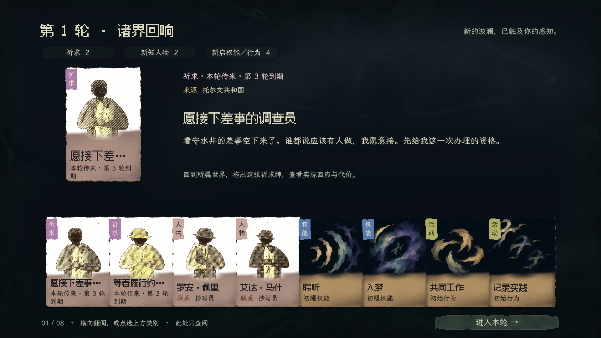
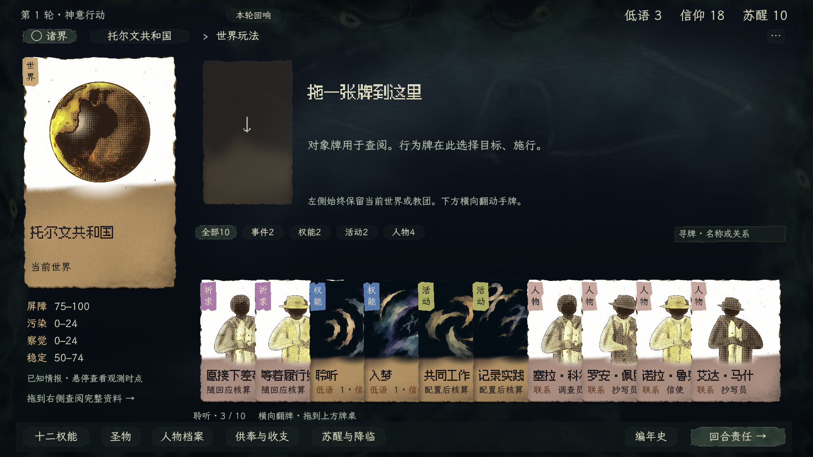
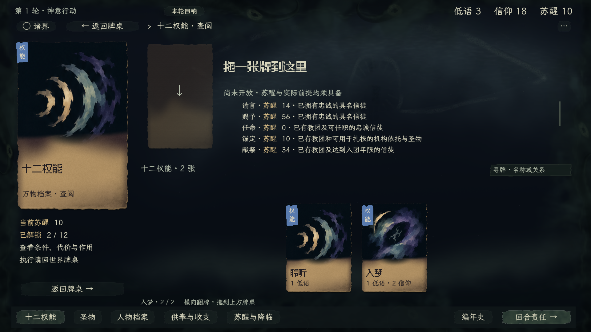
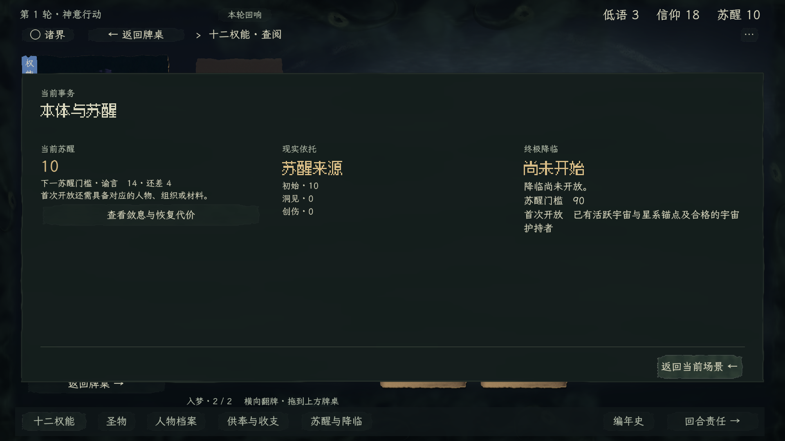

# 功能牌首次开放节奏 · 2026-11-15

范围：正式 `cthulhu-wakeup` 分支。制作人要求修正新局空操作过早投放；本批不改卡壳、美术、执行费用、随机结算或正式成长曲线。待制作人体验。

## 问题与处理

此前权能牌只看当前苏醒值：任命门槛为 0、锚定为 10，新局没有教团／媒介也入堆。活动只按世界类型罗列，缺少真实参加者或材料仍展示。降临苏醒达标即可出现，忽略两类锚点和护持者。轮初回响复用旧目录，把这些空功能当成新解锁；苏醒页还将阈值满足称为“全部权能已解锁”。

已统一为“首次具备最低结构前提后开放”。权能保留原苏醒阈值，并检查实际人物、组织、资格来源、媒介／锚点；16 项独立活动按真实参加者、联系及材料检查。全部 28 项详见 [CSV](../../data/card_unlocks.csv)；规则仅维护在 [system-powers-cults §6](../specs/system-powers-cults.md#functional-card-discovery)，不在本任务复制另一套标准。

首次开放跨回合、跨读档保留；当下缺费用、行动机会或冷却不隐藏卡片。失去组织／人物后卡可查看，正式预览与提交仍拒绝不合法执行。私祷、集会和祭仪不以先有教团为条件，避免切断首团路径。事件／祈求／预告、教团指令、锚点维系、圣物处置原本依真实对象出现，继续保持原规则。

底部权能图鉴与回响使用同一记录。活动目录与执行阶段／当前选中的人物分离，修复轮初事件阶段漏报新活动及单人自动选择隐藏已开放活动；旧的权能圈备用入口也改为未开放时只看要求。苏醒页不再提前提供降临准备入口。旧档缺少开放记录时按载入时真实状态初始化；不重写历史规则，不假装能重建已经失去的历史前提。

## 已验范围

- [逻辑记录](../art/visual-generation/production-evidence/card-unlock-pacing/logic.log)：69 项断言。覆盖 12 权能／16 独立活动的目录完整性、真实 seed 1 开局、任命／降临关键结构正反例、真实基础活动在轮初／行动阶段均保留、独自剩下非专业人物时仍保留活动目录、下一轮新牌提示及同轮去重、当前／旧 Session 兼容、失去教团后历史开放仍随档保留、未知 ID／未来轮次拒绝、只读检查不改 Turn 或 RNG。独立观察测量约 1.9 ms（此单局样本，不宣称大存档性能）。
- [原生记录](../art/visual-generation/production-evidence/card-unlock-pacing/native.log)：25 项检查。实际正式主场景、隔离 seed 1，新局回响→进入本轮→世界牌桌→权能图鉴→苏醒与降临。没有修改制作人存档。此新局权能为聆听／入梦，结伴协作和研习神迹随合格人物在初醒回响即开放；未列任命／锚定／降临。
- 降临双锚点、护持者及任命教团条件的正反例使用明确标记的隔离数据，不能冒充完整长局实跑。未遍历所有种子、完整成团至降临流程或全内容均衡。
- `git diff --check` 通过；新 CSV 由现有导出 `include_filter=data/*.csv` 覆盖，本轮未另做全量导出。

## 实机图

UI 清单：常驻底栏和拖放合同不变；未开放牌在分类／计数／寻牌前过滤；已开放牌可拖出查看当前缺项；回响不把阈值到达单独当作新牌；图鉴条件可滚动且没有覆盖牌堆。实机复看无本批新增遮挡，沿用锁定材质与字体，未主张新美术方向已获制作人认可。

架构登记见 [architecture](../architecture.md#功能牌首次开放2026-11-15)；本批未解决或关闭全目录可立即执行性求解待办，首次开放与当前可执行性是不同合同。
