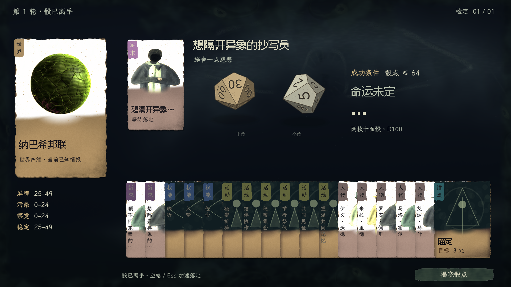
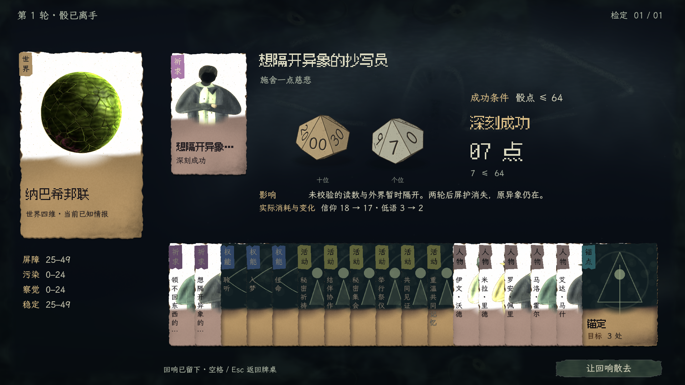

# 掷骰演出接入记录

日期：2026-11-14。分支：`cthulhu-wakeup`。本页记录本批范围、规则审查及验证证据，不另立一份 UI 或游戏规则规范。

## 授权与依据

制作人要求：所有需要掷骰的行为均须有适配克苏鲁背景的演出，看到骰子运动、真实骰点及事件后果；系统性覆盖全部检定入口，并与现有卡牌桌结合。

开工按 [当前 UI 执行路由](../progress/stage-priorities.md#游戏-ui-执行路由)，实施以 [交互合同](../specs/ui-interaction.md#worldplay-card-study)和 [美术唯一正文 A06–A08、A15／A17](../art/visual-generation/ui-art-standard.md)为准。沿用连续印面、左肩签、薄卡体、单向牌堆及有机窥视外围。`in-game-ux`、`visual-art-production` 及其副本、附属流程、间接委派持续禁用。本批不改变概率、RNG 顺序、费用、规则结算、存档语义；既有未提交的祈求精修、字段分色及密叠标签改动保留。

## 本批设计与实现合同

玩法呈现唯一正文为[共享掷骰合同](../specs/ui-interaction.md#dice-resolution-contract)，美术与原生实物见[A17 刻骨掷骰](../art/visual-generation/ui-art-standard.md#dice-art-contract)。本页只登记七处检定来源、接线及证据，不复制另一份规范。演出组件已经接入正式 Session；本批衍生画面与动画品质仍待制作人复审，自动验证不代表美术获准。

## 检定规则与七处产生点

检定统一由 [World.check_result](../../src/simulation/world.gd)判定。D100 小点成功：`roll ≤ floor(p / divisor)` 为深刻成功，其余 `roll ≤ p` 为成功；`roll > 100 − ceil((100 − p) / divisor)` 为灾变，其余失败。参数来自 [run_parameters.csv](../../data/run_parameters.csv)，当前 `check_critical_divisor=5`；界面消费已结算结果，不自行复制数值规则。所有以下路径都将真实骰点追加到 `Turn._checks`。

1. **权能即时执行：`Powers.commit()`。**
   - 源码：[powers.gd](../../src/game/powers.gd)，`plan.probability >= 0` 的分支。
   - 入梦、谕言、赐予、献祭、穿隙、播种、锚定、掩迹、迁引在正式提交时投骰。聆听、任命为确定性操作；降临启动／继续不等于最终检定。
   - `power_attempt → turn_check → power_result` 提供公开因果链，`result.checks` 提供原始骰点与档位。
2. **降临最终检定：`Powers.finish_manifest()`。**
   - 源码：[powers.gd](../../src/game/powers.gd)，由 [Endings 的轮末处理](../../src/game/endings.gd)调用。
   - 第三次继续时锁定成功上限；第三轮末、已支付且仪式仍合法时投一次最终骰。公开 `turn_check.changes.locked` 标识此检定。
   - 属于自动 `ending` 阶段，可能直接导致终局，不能只覆盖玩家点击提交的入口。
3. **当前组合式祈求：`PrayerSpace.commit()`。**
   - 源码：[prayer_space.gd](../../src/game/prayer_space.gd)。仅实际回应 `probability >= 0` 时投骰。
   - `turn_check` 和 `prayer_space_result` 描述同一骰；结果另含回应名、公开方式、影响、代价、后续供奉及实际变化。
   - 当前未知曲解使用同一 D100 选择结果区间，`prayer_space_twist.roll` 不新增骰子。确定性回应的 `roll=0 / probability=-1` 不进入演出。
4. **旧档冻结祈求：`Prayers.commit()`。**
   - 源码：[prayers.gd](../../src/game/prayers.gd)。旧契约回应正式提交时投骰。
   - `turn_check` 与 `prayer_result` 保存同次结果；按旧档实际契约呈现，不借美术接入把旧数据伪装成新生成器回应。
5. **活动与进展路线：`ProgressionRoutes.commit()`。**
   - 源码：[progression_routes.gd](../../src/game/progression_routes.gd)。玩家执行带概率的路线行动时投骰；跨轮保留进度不等于轮末自动掷活动骰。
   - 私祷、订立保管契约，以及记忆圈／互惠契约的准备阶段为确定性操作。引导梦境、履行契约分别转交已有入梦／旧祈求深应路径，不重复计算。
   - 其 `route_attempt` 属于 [PlayerKnowledge 内部事实](../../src/game/player_knowledge.gd)，公开 `facts` 中不保证存在；但 `result.checks` 仍有真实骰点。因此只扫描公开事实的做法会漏掉活动检定，演出不可为了补标题读取内部路线数据。
6. **通用即时效果：`Turn._effect()` 的 `check` 分支。**
   - 源码：[turn.gd](../../src/game/turn.gd)。先验证四档效果，再投骰、记录 `turn_check` 和执行对应分支。
   - 当前正式内容未直接发出此类通用 `check` 效果；它是已有框架／扩展能力，仍由公共回执入口覆盖。不能将这条代码路径存在写成“当前所有世界事件都有骰子”。
7. **到期批次效果：`Turn._run_selected_due()`。**
   - 源码：[turn.gd](../../src/game/turn.gd)。在 `start`／`deadlines` 的到期任务中处理 `check`。
   - 同批先按共同的判定前身份快照投完骰，再应用死亡等后果。某项后续效果可能因另一项已造成死亡而取消，但此前骰子已真实发生，必须保留原序和次数；不能只展示最终仍有对象变化的检定。
   - 公开 `turn_check` 可含任务、主体、世界与因果父事实。当前正式内容未创建此类通用检定任务，属于已接线的框架路径，不冒称自然游玩已出现。

### 不应伪装成玩家掷骰的范围

- [World._resolve_plans()](../../src/simulation/world.gd) 按当前合法性结算反制预告，修复／净化／追查等并不另掷 D100；不能为“预告”卡自行加成功率。
- [World.choose_behavior()](../../src/simulation/world.gd) 的 NPC 自主行为按资格及优先级选取；教团经济、维系、收入为确定性结算。
- 当前 [event_operations.csv](../../data/event_operations.csv) 的 12 类正式事件／24 个分支为确定性操作，未声明投骰。事件入口仍接入统一回执，以覆盖真正带检定的后续内容；目前无骰的事件不放假骰子。
- [abstract_sim.gd](../../src/simulation/abstract_sim.gd) 的背景事件概率、[source_fairness.gd](../../src/game/source_fairness.gd) 的门控与加权来源、[events.gd](../../src/game/events.gd) 的同伴抽取、[anchors.gd](../../src/game/anchors.gd) 的圣物池抽取、[world_initialization.gd](../../src/simulation/world_initialization.gd) 的生成随机数用于内容生成，不是可见行动检定。
- 旧冻结未知曲解的私有种子加权抽样也不是第二次公开行动骰。当前组合式曲解复用本次 D100，不重播结果事实中的重复点数。

## 统一接线与信息边界

[Session._submit()](../../src/presentation/session.gd) 在成功的新提交完成公开投影后发出 `checks_committed`。只有非空 `result.checks` 进入演出；拒绝、无骰操作、持久请求重放不触发。信号发送深拷贝，监听者不能篡改调用者收到的回执。

[RoundView](../../src/presentation/production/round_view.gd) 负责监听、保存本次公开提交前后基线、调用展示模型并排队。即时提交上下文来自五个现存 UI 入口：

1. [世界／教团牌桌 `WorldplayView._execute()`](../../src/presentation/production/worldplay/view.gd)：传入实际已出牌，承接权能、活动及新旧祈求。
2. [旧通用任务入口 `TaskView.run_action()`](../../src/presentation/production/task_view.gd)：提供实际动作标题及返回路径。
3. [轮初事件确认 `RoundView._commit_event()`](../../src/presentation/production/round_view.gd)：保留事件正式提交边界；当前确定性事件不会触发演出。
4. [旧祈求回应 `PrayerView._respond()`](../../src/presentation/production/prayer_view.gd)：沿旧契约和实际结果回到来源。
5. [组合式祈求回应 `PrayerSpaceView.respond()`](../../src/presentation/production/prayer_space_view.gd)：沿当前生成器选择及公开结果，保留曲解语义。

自动阶段由 `RoundView._advance()` 补足：每次 `progress()`／休整提交均更新该阶段的公开基线，Session 信号逐次捕获真正发生的骰子。原先推进循环覆盖前次 `progress()` 返回值、仅汇集事实／经营结算的路径不能作为骰子来源；现在演出不依赖循环最后一次返回。轮初回响、立绘过渡及终局交接必须等待已入队检定结束。

[result_model.gd](../../src/presentation/production/dice/result_model.gd) 为纯展示模型。输入为公开 `response/before/after/context`；输出批次含 `title/card/checks/lines/resources/turn/context`，每枚骰子含 `roll/target/outcome/label/title/subject/detail`。

- `checks` 的唯一来源是本次成功回执，严格沿原顺序、数值；公开 `turn_check` 的数量及顺序全部吻合时，才附其主体／世界。数量不足或错位时保留提交上下文和检定序号，不猜主体。
- 结果事实用公开因果父关系关联；仅单枚检定与单份祈求结果可按完整相同数值作明确兜底。不得对多枚同值骰建立数值唯一映射。
- 未知身份保持隐藏；缺少上下文的自动检定只称轮末检定。公开奖励／费用独立显示一次；祈求影响、后续供奉及其他实际变化通过共用字段渲染（“代价”栏按制作人修补要求移除），不把成功档位当作目标全部完成。
- 格式错误的展示批次整体拒绝，不能静默丢一枚骰子后把余下主体错配。无骰事实、预览概率、内部状态都不能补造骰点。

## 已验证证据与边界

### 展示模型：已通过

运行：

```sh
/Applications/Godot.app/Contents/MacOS/Godot --headless --path . --script tools/dice-presentation/receipt_probe.gd
```

[receipt_probe.gd](../../tools/dice-presentation/receipt_probe.gd) 返回 `DICE_RECEIPT_OK 26`。26 个定向断言覆盖：同值双骰不合并、按序关联主体、多骰序号、公开后果与资源独立、输入不变及深拷贝、部分／错序事实不猜主体、祈求 check/result/twist 不重复、未知“已显现”、祈求影响／供奉保留而代价文案移除、结果不重复标题、单枚祈求兜底、无公开 route_attempt 的活动、锁定降临和骰点 100、身份脱敏、无骰／拒绝／确定性回应不伪造骰子、终局结果保留。

该探针使用显式公开回执夹具，只证明展示映射与边界，不代表自然游玩或动效验证。

### Session 提交信号：已通过

运行：

```sh
/Applications/Godot.app/Contents/MacOS/Godot --headless --path . --script tools/dice-presentation/session_signal_probe.gd
```

[session_signal_probe.gd](../../tools/dice-presentation/session_signal_probe.gd) 返回 `DICE_SIGNAL_OK new_commit=1 replay=0 no_dice=0 observer_isolation=1`。实际从 seed 1 新局选取可执行的新祈求，验证新提交恰发一次、同 durable ID 重放不再发且快照不变、监听者修改信号副本不污染调用返回，以及开局／阶段无骰推进／无效操作／不再回应不播放。

### 正式 Production 接线：已通过代表路径

[integration_probe.gd](../../tools/dice-presentation/integration_probe.gd) 返回 `DICE_INTEGRATION_OK 101`；[完整日志](../art/visual-generation/production-evidence/dice-resolution/integration-checks.txt)。六条路径使用真实 Production 实例与 Session 提交，不改骰点或规则：

- seed 1 新生成祈求，从世界牌桌出牌、配置、正式回应。
- 同一现代生成器的保留祈求覆盖层入口。
- 通用 TaskView 的真实入梦权能；实际来源返回一次。
- 历史存档副本的冻结旧祈求，沿其原契约执行，不冒充现代请求。
- 历史进行中降临存档副本：第三次支付本身无骰，实际轮末才出现成功上限 15、骰点 52 的失败检定，之后进入下一轮事件。失败不自动等于游戏终局。
- 自然推进至第 9 轮的确定性事件，正式确认不出现假骰子；聆听等无骰行为也不触发。

定向检查覆盖真实回执与演出一一一致、输入及重复推进阻断、刷新的底层界面不漏出、演出不改快照／骰流、结束只返回一次、轮末检定不因循环覆盖而丢失、轮初回响等待检定。信号探针日志见[提交边界](../art/visual-generation/production-evidence/dice-resolution/session-checks.txt)。

### 原生画面与连续动态

[native_probe.gd](../../tools/dice-presentation/native_probe.gd) 从隔离的新局目录走真实拖牌、选择、确认输入；原玩家存档不变。1920×1080 实机结果：

- seed 5：`DICE_NATIVE_OK 27`，**7 点／上限 64，深刻成功**。左骰 00、右骰 7，停稳后读实际影响和费用；来源卡副文同步为结果；完整手牌冻结在下方。
- seed 1：`DICE_NATIVE_OK 28`，**51 点／上限 50，失败**。运动中 Esc 加速仍连续到原落点，演出继续显示失败与实付损失；再次 Esc 才退出，原牌桌和底栏恢复，没有第二份结果页。





[连续原生动态](../art/visual-generation/production-evidence/dice-resolution/prayer-roll.webp) · [失败画面](../art/visual-generation/production-evidence/dice-resolution/failure.png) · [结束后恢复牌桌](../art/visual-generation/production-evidence/dice-resolution/returned.png) · [运行日志](../art/visual-generation/production-evidence/dice-resolution/native-checks.txt)。动态以固定 30 FPS 捕获 85 帧，结尾加 2 秒阅读停留；未重绘截图。此 WebP 无音轨，也不是帧率基准。游戏组件自带低音量干碰声，其听感仍待制作人实听。

### 队列与骰面：显式呈现夹具

[queue_probe.gd](../../tools/dice-presentation/queue_probe.gd) 在真实 Production 宿主中使用**显式公开回执呈现夹具**，返回 `DICE_QUEUE_OK 18`；[日志](../art/visual-generation/production-evidence/dice-resolution/queue-checks.txt)。两批共三骰，首批两骰同点同阈值仍分别演出；Esc 只加速；已揭晓结果前后回看不重掷、不重复发落定信号；各批后果与费用独立，首批全部揭晓后回看其首骰仍可读共同后果；只结束一次，完整 Session／RNG 不变。它不证明当前正式内容自然产生了通用多骰任务。

[art_probe.gd](../../tools/dice-presentation/art_probe.gd) 的 `DICE_ART_OK` 检查 1–100 的最终十位／个位映射，包含 `00+0=100`。本次组件静帧复看包含翻滚与最终落面；真实成功／失败的整场构图另见上方原生实机。

### UI 收尾清单与未验范围

- **V01 母版一致性：**原世界牌、来源牌、完整单向手牌及有机外围同场；骰子用刻骨哑光与随面磨痕，无独立亮底框。原生画面已复看，衍生演出审美由制作人决定。
- **V02 主次与阅读：**1280×720 逻辑画幅对应 1920×1080 实机核过骰点、上限、档位与实际后果；长后果沿原 ScrollContainer，不把全文挤小。放大文字模式与其他窗口尺寸未在本批实走。
- **V03 对象绘画：**沿原身份立绘缓存和随包字库；真实暖纸网点、冷色厚涂的来源牌各已看。骰子没有重绘或染色人物与世界图。
- **V04 输入与状态：**信号及队列检查阻断底层输入、一次返回、加速不跳结果、已揭晓结果静态回看、关闭恢复原牌桌；自然点击和键盘执行另经 native probe。
- **V05 知情与结算：**规则、骰流、费用与存档格式不变；同值骰不合并，无骰不播放。四档映射及未知“已显现”由模型探针验证；真实原生画面本批只录到深刻成功与失败。
- **V06 有机连续性：**未改外围画法及材质；演出沿同一环境实例与时钟，没有重新创建背景。原生短动态核对切入／退出，未为此重录完整 24 秒周期。
- **V07 正式入口：**真实 Session 的拖牌、配置、执行、落定与返回已跑；六条保留入口／轮末路径有定向接线证据。自然路径、历史副本与呈现夹具在本页分别注明。
- **V08 性能与发布：**原生程序绘骰及合成干碰声无外部资产依赖；纹样固定随面，非每帧重新采样。正式主场景解析及定向运行无新增错误；未做具体帧率承诺、额外发布包或全游戏穷举。
- **覆盖边界：**活动的统一提交接线及缺失公开 route_attempt 情况已由源码审计／模型检查覆盖，本批没有自然游玩录到一条活动骰。通用即时／到期批次目前没有正式内容实例，仅审计与显式夹具。成功降临终局未实走；已有终局公开回执模型检查，实际轮末失败→下一轮交接已通过。不得将这些写成全部规则分支实机通过。

四项收尾登记：架构见[统一掷骰段](../architecture.md)；spec 已原地新增共享合同且不改规则系统；交付范围／证据与未验范围在本页；适用 UI 清单如上。正式运行入口仍为根目录 `正式UI体验.command`。制作人美术与手感复审：**待审**。

### 2026-11-14 修补：移除祈求结果“代价”栏

按制作人反馈，骰子结果、祈求牌桌回执、保留祈求结果入口及共享反馈均停止输出 `tradeoff` 文案；实际资源变化、影响、后续供奉和提交前费用照常。规则数据／存档与编年史原始记录不改。架构登记已更新本层展示说明，spec 已原地补祈求三态，交付范围如本段；A08／V02／V05 核对单一字段移除与实际费用保留。26 项现有模型检查通过；隔离新局 seed 1 的正式祈求执行／结果／返回通过 `DICE_NATIVE_OK 28`，实机已复看无“代价”栏。

[移除后的祈求结果](../art/visual-generation/production-evidence/dice-resolution/prayer-no-tradeoff.png)。上方首版图／动态保留当时演出证据，其“代价”栏不再是当前规范。
