# 世界玩法牌桌正式接入

日期：2026-11-12。分支：`codex/worldplay-integration`。制作人已通过 `a64712d` 的四区牌桌与整叠翻牌，并授权接入。此分支从该 UI 提交合并 `cthulhu-wakeup@7a76bfa`；原工作树未切分支、未覆盖。当前为**正式运行接入完成，制作人复审待进行**。

## 运行

双击本工作树根目录的 `正式UI体验.command`。标题 → 新局／继续／存档管理 → 诸界 → 世界卡 → 世界玩法。正式存档仍在 `user://production-ui-campaigns`，不是样板的临时复制目录。已有五世界测试档可通过菜单导入副本；生产入口不会自动替换或载入它。旧 `世界玩法探索.command` 继续复制隔离夹具，只作复现。

## 实际接入范围

- 世界／教团四区桌、完整叠牌、行为按动词归并、上桌直接配置与回执，进入正式 OverlayRoot。
- 常驻底栏的权能、圣物、人物进入同构只读图鉴，退出恢复原世界、教团、分类、寻牌、焦点和执行草稿。
- 菜单／档案打开教团也进入牌桌，并以所选教团的真实世界作为上下文。
- 新局和换档清空旧草稿。实际提交后重新读取公开对象与动作；过期目标清除。模态窗口、轮初事件不允许通过底栏或手牌绕过；卡片的绘制顺序限制在牌堆内部。
- 正式场景不包含复制夹具或自动开局逻辑。独立样板仅保留加载夹具与截图的适配，复用同一生产组件。

主逻辑包含 `8d2e73a` 的祈求后果和 `5a4e5bd` 的组合生成、能力改变、保存及正式执行。新回应从 Session 动态取得，展示实际类型、名称、公开提示、费用和持续供奉，提交时校验处境版本与报价。新局 seed 1 的一声祈求实际出现「施恩 · 应允所求」「交易 · 先许愿，再还债」「曲解 · 愿望归他，解释归你」；不是固定浅触／深应，也不保证每声祈求六种齐全。旧冻结请求原义保留，不为旧档补造回应。

合并同时保留 UI 线的开局处境优先、旧请求最低供给、跨世界槽位与注意力准入修正。`Prayers` 统一计算配额，`PrayerSpace.freeze(world, new_limit)` 使用新生成器；没有恢复旧 50 例故事池。继续旧档时暴露的 `Anchors._prayer_record` 空 tag 查询已补默认空串，非祈求公开材料仍被正确拒绝，不改变材料资格。

## 实机证据

下面均为正式 `project.godot` 主场景的 Godot viewport，1920×1080；新局和旧档测试使用隔离目录，不写玩家原存档。

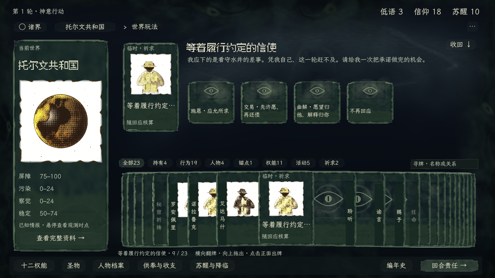

[选择后的费用与检定](../art/visual-generation/production-evidence/worldplay/new-game-prayer-preview.png) · [实际提交回执](../art/visual-generation/production-evidence/worldplay/new-game-prayer-receipt.png)

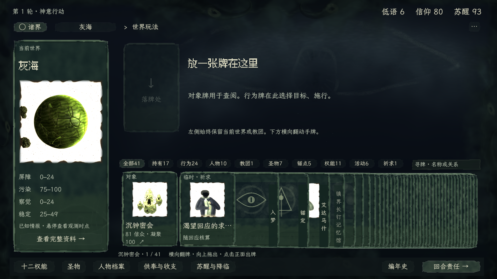

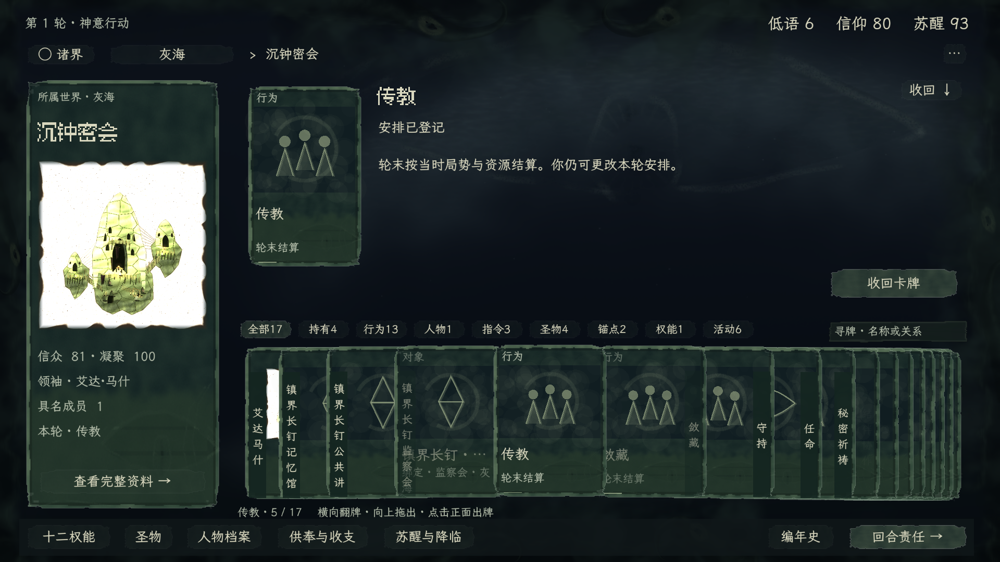

[自然轮初事件与禁用的底栏](../art/visual-generation/production-evidence/worldplay/event-boundary.png) · [独立 PCK 的现场出图](../art/visual-generation/production-evidence/worldplay/packed-world-table.png)

## 有限验证

日志统一在[证据目录](../art/visual-generation/production-evidence/worldplay/verification.txt)。

- `tools/worldplay-integration/probe.gd`：223 条断言（含逐张可达几何检查），正式标题新局 → 世界 → 动态祈求 → 只读图鉴往返 → 实际回应一次 → 保存／重载；再加载五世界旧档，验证 41 张完整叠牌、教团登记、模态隔离和下一轮刷新。只证明这些代表路径，不等于 223 项独立玩法全部验收。
- `event_probe.gd`：正常新局从回合责任确认推进，第 9 轮自然出现事件。Esc 与底栏不能绕过，选择并确认实际事件成功；未注入事件数据。
- `cult_route_probe.gd`：从既有教团入口跨三个世界逐个打开教团，所属世界与主卡身份一致，导航不产生提交。
- 原生输入检查：共享生产牌堆的正面点击、向上原生拖出、横拖不误出牌、底栏及键盘只读图鉴，未增加提交。
- `generator_probe.gd`：34 项新生成器与实际后果检查。该原有探针收窄作者候选并固定成功检定，以覆盖曲解、维护、理智与后续，不能当作自然分布抽样。
- `capability_probe.gd`：原有聚焦生成夹具，CIV_02 的实际能力改变 → 历法实践成功。牌桌人物资料读取同一公开能力／限制文字。
- `export_pack.sh`：隔离制作输入打包，独立目录运行 PCK，正式新局与程序立绘可用；包内没有五世界夹具。许可证和字体由原打包脚本一并纳入。

## 范围边界

`ISSUE-WORLDPLAY-ACTION-AVAILABILITY` 仍未关闭。牌桌使用真实草稿预览，尚未实现整个目录的确定性可用／缺条件汇总；生产目录不带旧超时扫描，更不出现「待选对象」资格终态。

没有逐条重测十二权能、全部持续活动、所有锚定材料与跨世界组合。标准字号有本次证据；大字、低帧率和长文本极值没有新证据。其他全局菜单、事件、回合责任、预算和旧关联任务覆盖层保留既有界面，不宣称它们已完成四区改造。轮初事件截图仍有旧的泛化求告对象文案，属于后续事件场景打磨问题。

## 依据与登记

交互唯一正文：[世界玩法合同](../specs/ui-interaction.md#worldplay-card-study)。美术采用 [A01–A03、A05–A06、A08、A11–A14](../art/visual-generation/ui-art-standard.md) 的灰绿卡纸、随包字体、程序图槽与有机外围；本次没有替换获准画法。运行检查覆盖 V 条目的对象一致性、读数、层级、输入和包内资源，不替代制作人审美验收。

架构、当前路由、当前工作、图文规范、UIA-001 状态和功能地图均已同步。源码入口为 `src/presentation/production/worldplay/view.gd`，原样板证据继续保存，不覆盖已获准母版图与动态。

### 2026-11-13 牌桌细化与新档复验

- 世界与教团手牌以同一顺序分类和排序。未解锁权能的卡面显示门槛，来源和落点均拒绝拖放。已解锁权能上桌后由 Session 核对可执行条件。手牌点击只聚焦，手牌和主卡通过原生拖放上桌。
- 卡身、牌缘与名签采用共享粗印分色。实机检查了长牌堆、祈求小牌及轮初事件牌，分色不改变立绘本身。正式事件专桌以公开事件为牌源，进入既有处理、复核、提交和阶段交接。
- 新档由种子 5 的正式新局通过合法活动、事件处理和关注操作推进到第 9 轮。确认五个完整已知世界、一座教团、11 条已知人物记录。在纳巴希邦联拖入组合生成的「等着供给的抄写员」，核对原话、求告者、期限及三个回应，使用隔离副本实际提交并取得回执。两种响应类型为施恩和交易，三项在交付档中均通过预览。
- 回归覆盖组合生成器、冻结档原话、正式事件拖入与确认、未解锁拒绝、已解锁但缺条件可上桌、点击及键盘不出牌、悬停轻弹。V01–V05、V07 的本批标准字号代表路径已实机核对，分色与动效待制作人复审。大字和全组合不在本批重测范围。

[五世界档的组合祈求](../art/visual-generation/production-evidence/worldplay-details/five-world-prayer.jpg) · [分类牌堆](../art/visual-generation/production-evidence/worldplay-details/hand-groups.jpg) · [轮初事件牌](../art/visual-generation/production-evidence/worldplay-details/event-cards.jpg)

### 2026-11-13 解锁过滤与状态精修

依据交互合同及 A06、A09。当地、教团和权能图鉴均在构造牌堆时排除未解锁牌。图鉴以文字保留未解锁权能的苏醒门槛。卡缘用短段干刷标识选中，诸界世界卡复用轻弹，执行槽以暗凹空印、实色印记和暖色下箭头分别区分空槽、已填槽与当前展开位置。

用第 9 轮五世界档的隔离副本核对。诸界叠放世界牌悬停放大后回稳、移出复位。苏醒 10 时「赐予」「降临」不进入牌堆，「入梦」仍可上桌查看缺条件。拖入「任命」后查看有效人物与空槽，选择岗位后槽位随草稿更新。保留组合祈求真实回应的提交回归。已验 V04、V07 的标准字号代表路径，美术待制作人复审。

[选中牌缘](../art/visual-generation/production-evidence/worldplay-details/selected-edge.jpg) · [任命槽位](../art/visual-generation/production-evidence/worldplay-details/appointment-slots.jpg)

### 2026-11-13 立绘提前准备与翻牌性能

针对点击人物才生成及缓存淘汰后再读图的问题，正式呈现改为在新局、读档和公开投影更新后准备当前可展示身份。按出生世界连续生成、直接复用星球上下文；当前公开对象纹理驻留，牌桌图槽同步取得已就绪纹理。只缺新增图时才打开「诸界流转」准备页，展示公开情报与真实进度，结束后恢复原事件／行动交接。未发现世界、未知身份不提前画出。身份、种子、画风、分辨率、玩法随机与存档格式保持原合同。

纯二维构图、PNG 读解码与写盘移入工作线程；GPU 节点构建按时间片让帧，正式调用只画最终图所需的 lit／NPR，工作台仍输出全部诊断阶段。另查出逐对象生成粗印卡纸造成首次导航停顿，改用初始化准备的四张原诸界卡纸；选中、分类颜色、立绘与轻弹仍沿现行组件。逐个人物拖入实机核对时发现已占用查看区的 ScrollContainer 会拦截下一张牌，已将同一区域的原生拖放转交桌面，连续换牌无需先收回。

**本机实测（M4 Pro，Godot 4.7.2 Compatibility；驱动缓存已热，其他进程未隔离，非跨机器帧率承诺）：**

- 第 9 轮五世界真实存档：5 世界、1 教团、11 人物，共 17 张。空 PNG／纹理缓存准备约 **10.92 秒**；加载期间帧间隔 P95 约 17.6 ms，最慢帧约 473 ms，首次 GPU 编译／回读仍可能在过渡阶段短停，不能称全程恒定 60 FPS。
- 重新创建图像提供者，从 PNG 缓存读取 17 张约 **458 ms**，生成次数为 0。
- 准备后遍历五个世界，并逐个拖入 11 个人物：生成增量 **0**、读盘增量 **0**、已绑定图槽没有空纹理，Session 快照不变。按同一输入探针计时，卡纸修正后最大世界导航耗时 **199 ms**，修正前为 1471 ms；此口径包含按键、帧等待和 UI 重建，不能当成单帧时长。
- 超过原 24 张淘汰阈值后，当前公开立绘仍全部驻留；破坏隔离缓存中的一张 PNG 只重画该张。日志中的 PNG 解码错误来自这项故障注入。
- 隔离存档经正常结束本轮、事件选择与确认从第 9 轮走到第 12 轮。第 10 轮准备两张新增公开立绘后恢复事件专桌，第 11、12 轮没有新增图；阶段和输入边界正常。
- 同参世界、教团、人物代表图与优化前 PNG 的 SHA-256 分别完全一致。正式教团单阶段输出切换回工作台三阶段后，最终像素也一致。没有全量复测全部原型、画风或玩法组合。

可复现入口：`tools/worldplay-integration/portrait_probe.gd` 和 `portrait_round_probe.gd`，参数均为原存档绝对路径与证据目录；探针复制真实 Session，读写独立测试存档及可丢弃缓存。制作人的原五世界存档 SHA-256 仍为 `9c709560d228f836d672cb237d7367b6d4e3fc64986153839ca8d8af295824c4`。

[缺图准备页](../art/visual-generation/production-evidence/portrait-performance/preparation.png) · [就绪的诸界](../art/visual-generation/production-evidence/portrait-performance/ready-worlds.png) · [冷／热缓存与连续查阅日志](../art/visual-generation/production-evidence/portrait-performance/portrait-performance.txt) · [真实换轮日志](../art/visual-generation/production-evidence/portrait-performance/portrait-round.txt)。准备页截图是第 12 轮独立缓存缺失一张后的恢复现场；不将其冒充第 10 轮自然新增时的截图。

依据 A01–A03、A11–A14 与 V03–V05、V07：复用已认可的字体、灰绿分层背景和卡纸；准备页仅使用公开区间情报。源码、图像生成合同、交互合同及架构已同步；准备页为本批性能需求新增表现，待制作人体验复审。

### 2026-11-13 轮初回响：本轮待办与新增内容

依据制作人本轮体验授权，加载完成后先呈现「诸界回响」。全部提示牌按世界事件、祈求、新知人物、新启权能／行为排序，在原灰绿氛围中显影；同一卡纸、分类色、原立绘和随包字体。卡堆与当前大牌轻移归位、雾膜消散，文字随后稳定，不倒计时替玩家翻页。下方保留完整牌堆，类别计数定位其首牌，上方阅读原话、世界、期限或新启内容。进入本轮／Esc 可随时收起；顶部「本轮回响」可回看轮初记录。

**真实来源与边界。** 事件来自公开投影中未决事件，说明来自正式选项名称；祈求使用当前生成器的公开求告原话，保留旧冻结请求合同。按真实求告者 ID 优先去重人物，仅请求线索不作为已识别新人物。权能门槛与行为动词归并抽到 ActionModel 的共同入口，牌堆和提示使用同一准入；它不保证资源／目标条件已满足。只在呈现会话记录轮初已见身份，不扩充存档，不消费随机数。行动期新增于下一轮比较；读档将当前身份和解锁状态作为基线，只展示当前待办，新局则标明“初醒／初始”。回看明确是轮初记录，当前已处理状态以牌桌为准。

**有限实机核对。** `round_arrival_probe.gd` 在真实五世界第 9 轮存档的隔离副本上，通过正常结束本轮到第 10 轮：2 项事件、3 声祈求、1 位新知人物；另一个新人物由祈求呈现，未重复。翻看与回看保持 Session 快照不变，立绘生成／读盘增量为 0。收起仍回事件专桌，按实际默认选项分别确认两个事件后进入行动，未跳过决策，也未重复演出。Esc、分类键盘激活、完整牌堆只读、知情过滤和空图检查均通过。共 80 项针对性断言；新增人物去重、苏醒门槛变化、同轮不重播及资源变化不冒充解锁包含明确的纯投影测试夹具，未安装进 Session，也未作为真实新解锁截图。

新局另核对起始牌（2 祈求、2 新人物、4 项起始权能／行为）、未解锁过滤、进入行动，共 19 项断言。实际第 10 轮没有新启权能，未声称在此真实路径中完成一次新权能解锁。没有逐条回归全部事件、权能、活动或所有分辨率；标准字号、正常窗口与现有固定逻辑画布有本次证据。

适用 A01–A03、A05–A06、A11–A15；V03–V05、V07–V08 的本批对象身份、阅读、输入边界和已有缓存复用已核对。新演出视觉与节奏仍待制作人体验复审。架构、交互合同、A15 图文规范及当前 UI 路由均同步；原批准母版和旧图册指纹未改。

- [事件预告](../art/visual-generation/production-evidence/round-arrival/events.png) · [祈求原话](../art/visual-generation/production-evidence/round-arrival/prayer.png) · [新知人物](../art/visual-generation/production-evidence/round-arrival/person.png) · [新局初醒权能](../art/visual-generation/production-evidence/round-arrival/powers.png)
- [约 4.4 秒原生动态](../art/visual-generation/production-evidence/round-arrival/arrival.webp)：`round_arrival_motion.gd` 通过正常换轮录制。原生 Movie Maker 固定 1280×720、30 FPS，取入场及祈求／人物翻阅段，不是运行帧率测量。保留灰绿外围共享时钟，没有新音频。
- [实机检查日志](../art/visual-generation/production-evidence/round-arrival/checks.txt) · [新局日志](../art/visual-generation/production-evidence/round-arrival/new-game.txt) · [动态录制日志](../art/visual-generation/production-evidence/round-arrival/motion.txt)

## 配色与卡面重设计（2026-11-13）

制作人接受配色分层，但已否定随后的规整裁边、图窗纸托和精装感，指出根因是构图／拼接／覆盖。A/B 后续又因凌乱及强烈卡面风格不兼容多样立绘被退回；延迟到达的 B 选择已由最新要求覆盖。当前转为[真实多画风同壳验证](../art/visual-generation/card-design-study/README.md)，尚未正式实施。前轮截图均不作为新母版。

先独立定位三处真实合成问题：半透明牌脊透出上下分色、程序图形越过图窗、缺图底与新纸托尺寸不一致。原生首轮设计样片验证了改法可行及 Session 不变，但画面仍是渐变名片，已内部淘汰、移除启动入口。随后用 ImageGen 内置工具制作完整构图母稿及压叠示意，独立审查后修订 A 的石质浮雕感和 B 的人眼形态。图像明确标为概念，不等同于原图像素、实际叠牌或最终素材。

近白试稿随后被制作人指出太白、方形贴图生硬。当前 Godot 原生构图板改为中间明度连续印面，源码仍为 `tools/card-carrier-study/`，新证据在上述设计目录的 `blended-carrier/`；`neutral-carrier/` 原白底试稿不再作为候选，来源及参数清单仍有效。原图完整加载、不改内部 RGB，通过 alpha 与卡体共轮廓，下缘材质化融入字区；未按亮度抠图。检查涵盖三种画风、完整卡及20张同组件压叠，并修正深／浅交界处的竖名可读性。

适用 A01–A03、A05–A08、A11–A14；交互 spec 无机制变更。当前只供制作人判断图面方向；部分原图及原生字、真实卡体遮挡已在独立样组观察，正式悬停／拖拽／超长动态文案与所有类别仍未接入或验收。架构、当前规范、路由与决定记录已纠正旧结论，两项技能禁令持续，用户存档和生产默认未动。

**类别识别增量（DEC-067）：**制作人已认可上述整体风格，要求补强密叠类别识别。本次提供边脊印签／肩位印签／分段侧墨三套同牌对照，包含九类18张手牌及黑底／白底原图，原下半部材质不变。独立入口 `卡牌类别识别对照.command` 可切换并翻牌；图片、范围及操作集中在[当前设计](../art/visual-generation/card-design-study/README.md#category-identity)。有限原生运行无脚本错误，复审修正对照标题空间；关闭识别增量后两张获准稿逐字节复现，7张原图指纹未变，记录见 `category-identity/checks.json`。未测试玩家识别速度，也未将任一方案定为正式默认。交互合同与生成器无改动，原存档不读写。

## 2026-11-13 · 单向牌堆与肩位（DEC-068）

制作人选定方案2并授权重构，采用 A01–A03、A05–A08、A11–A14。正式手牌保持固定右压左顺序；肩签扩大为两字单侧，浏览只抬升，横距/z不变；点击不出牌，上拖锁定按下对象，取消回位。连续印面与肩签正式迁入 `production/painted/card_carrier/`，保留原生成图RGB。四区腾出抬牌带，底栏常驻，轮初回响阅读与手牌互不覆盖。

范围为世界/教团/图鉴/事件的手牌与落牌、回响脸；首页世界壳、左主信息卡、槽位选择按钮未做本母版迁移。无玩法数据/费用/生成器或存档变更。有限实机证据与入口集中在[当前样板](../art/visual-generation/card-design-study/README.md#category-identity)，不再保留活跃的三方案切换。

5/18/48张全牌缘命中、固定横距和层级、点击不出牌、原生上拖落牌已核对；真实五世界第9轮隔离档验证祈求落牌、模态阻断及Session快照不变。样板输入双转发与正式误用旧底纹导致变暗均已据实机证据修正。本批画面及手感仍待制作人复审，未做全游戏再验收。

**卡体薄厚度增量。**制作人认可上述交付后要求增加一点真实卡厚；本批只改共用Card的薄纸芯与贴近阴影，拖影和正式已适配场景自动复用。规范为A06薄厚度条目；交互/Session/生成器合同无变更，未增加功能回归。`finish_preview.gd` 原生捕获5张平铺、48张密叠与完整卡/抬牌，shader正常编译，静态复核未见亮栅栏、双轮廓或文字遮盖；[材质证据](../art/visual-generation/card-design-study/card-thickness/full-and-hand.png)待制作人复审。架构登记在同一Card条目，无独立新系统spec。

### 2026-11-13 锁定卡面完整接入正式 Session

制作人锁定 `card-thickness/full-and-hand.png` 后要求完整接入，特别指定从轮间「诸界回响」开始。当前工作位于项目主目录 `cthulhu-wakeup` 分支。设计批准沿用原图；本节记录正式接入与代表路径核对，未替制作人签署所有场景的审美验收。

**实际覆盖，按玩家流程：**

- 轮间准备后的诸界回响：事件、祈求、新知人物、新启权能／行为的下方牌堆及上方展示牌均使用同一连续载体；雾膜按真实卡缘消散。回看仍只读，不跳过事件。
- 事件专桌与诸界：首页世界牌替换旧灰绿壳，牌堆固定右压左、全部在桌，点击／Enter 保持世界导航。世界数量增加不再触发旧的远牌隐藏。仅请求线索且无生成参数的世界明确显示缺图状态，不伪造立绘。
- 世界／教团四区：主卡、对象与行为手牌、拖影、上桌卡及空落牌位统一；左侧主卡维持纵向比例，核心四维／教团信息在其下方常驻。
- 执行候选：人物、世界、教团、圣物、锚点等小候选使用同材质和不规则融接；回应选择保留实际名称／代价。候选已选压印、空槽／已填槽、独立卡 hover 与手牌抬升保持各自输入边界。
- 底栏权能／人物／圣物图鉴：主卡、手牌和只读查看卡统一；未解锁牌仍不入堆。
- 尚保留的祈求详情、关联人物、准备与回执主体：经 `_object_art()` 统一为同一完整载体；小于等于110逻辑像素的资料缩略仅用同源不规则收边，不塞不可读的肩签和文字。它们仍是原资料行，不被改成新的行动入口。

**接入修复。** 热缓存图像曾因世界卡构建时尚未挂树而被 `_display()` 拒绝，后续也没有重新绑定；现允许挂树前赋值，保留弱引用／待删除节点／身份key保护。卡纸、纸芯切面和缩略图shader保留宿主alpha，使显影与空位淡化真实生效。卡面纹理加入独立生产PCK打包脚本，避免只在项目目录可用。独立包检查暴露的内建TEXTURE采样器传参编译问题已改为显式card_mask采样器，重导出后无shader错误。

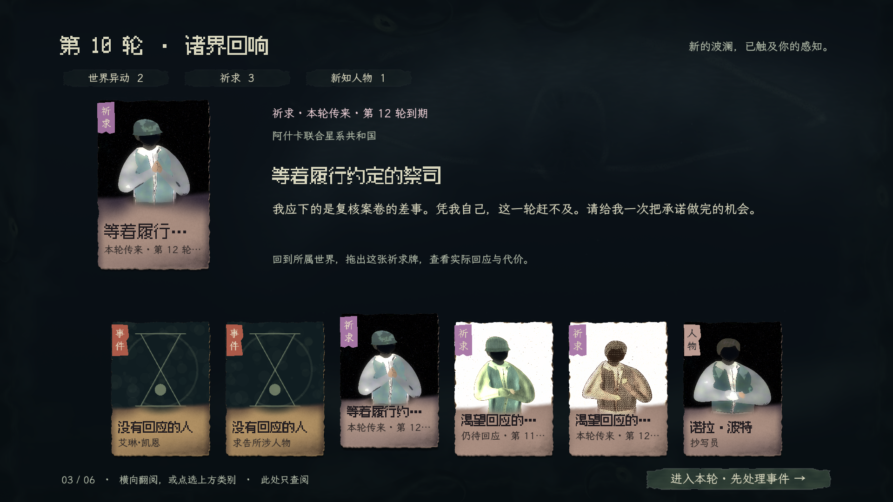

[事件](../art/visual-generation/production-evidence/card-rollout/arrival-event.png) · [新知人物](../art/visual-generation/production-evidence/card-rollout/arrival-person.png) · [新局初启权能](../art/visual-generation/production-evidence/card-rollout/arrival-initial-unlocks.png) · [诸界导航](../art/visual-generation/production-evidence/card-rollout/world-overview.png) · [教团牌桌](../art/visual-generation/production-evidence/card-rollout/cult-table.png)

[最新空落牌位](../art/visual-generation/production-evidence/card-rollout/empty-drop-slot.png) · [候选填入与hover](../art/visual-generation/production-evidence/card-rollout/candidate-filled-hover.png) · [人物图鉴](../art/visual-generation/production-evidence/card-rollout/library-person.png) · [权能图鉴](../art/visual-generation/production-evidence/card-rollout/library-power.png) · [圣物图鉴](../art/visual-generation/production-evidence/card-rollout/library-relic.png) · [保留的关联祈求窗口](../art/visual-generation/production-evidence/card-rollout/related-prayer.png)

**有限核对及边界。** `session_rollout_probe.gd` 使用真实正式主场景，通过正常存档菜单加载隔离副本，从第9轮确认结束本轮，进入第10轮，实际出现2件事件、3声祈求、1位去重人物。逐项查看后真实确认两个事件，再进入诸界、世界、教团、候选、三类图鉴和旧祈求入口；导航／查阅／选候选未改变Session快照，也未新增立绘生成。全路径684项断言主要含逐节点的共享材质／已就绪纹理检查，不代表684个独立玩法。之后仅为新修的空位和紧凑候选补163项定向检查，包含真实hover与已选压印；新局初始解锁补36项。输入探针的物理鼠标使用viewport stretch换算，避免1920窗口的坐标误判。旧第10轮局没有发生一次新的权能解锁，故新启类用真实新局的初始解锁核对，不冒充中途解锁事实。

所有截图为1920×1080、1280×720逻辑画幅，源存档为 `1794500154-3541809.json`，SHA-256 `9c709560d228f836d672cb237d7367b6d4e3fc64986153839ca8d8af295824c4`，原文件未写入。第10轮首页多出的「求告所涉世界」属于公开请求线索，不是造了第六个完整世界。新／旧冻结祈求沿原合同展示，未改变生成系统。

源码解析、热缓存绑定／过期回调定向检查、独立PCK资源加载及图文规范构建通过；日志见[checks.txt](../art/visual-generation/production-evidence/card-rollout/checks.txt)。不重测各行动全部结算分支、大字极值和任意生成种子；关联微型缩略及旧准备分支通过共享入口代码核对，代表实机为旧祈求主体，并未宣称逐个旧页面实走。

**收尾登记。** 架构已更新卡面单源、导航适配、旧主体图适配及绑定修复；交互spec原地记录完整覆盖，规则／数据/schema无变化；美术A06–A08、A15与图文规范引用已更新。适用V01–V05、V07–V08；有机外围未改，不重录既有周期。上列是本批UI清单与实际证据，正式各场景仍交制作人复审。

## 反制预告卡与诸界摘要定位（2026-11-13）

制作人授权独立预告分类，随后将类别名由「反制」改为「预告」，仍不归玩家「行为」。本批按交互合同与美术 A06 实施，正式 Session 接入完成，衍生卡面／定位印记交制作人复审。

- 世界牌堆新增独立「预告」分类，排序紧接「事件」中的祈求。数据直接来自 Session 公开当前计划；名称和定性预计影响沿 CSV，期限沿已公告计划，未新增数值规则。
- 左肩「预告」、陶赭类别印、断环受击符画沿锁定连续印面；卡上与查看区统一显示“n 轮后触发反制”。拖出用暖色字段名／骨白内容呈现来源世界、执行机构、已知线索和定性预计影响；移除处置与失效行。六类影响由 player_text.csv 的 preview_impact 提供，不改变结算规则／存档版本。没有执行／泛用撤销按钮，计划结束后卡牌与上桌草稿一起移除。
- 诸界三条摘要统一为关联世界定位：同时标记全部相关牌，短颜料印和左缘亮痕显入，沿原临界阻尼抬起当前定位牌。重复点击逐个定位、可清除，无匹配时禁用。牌序、横距、兄弟遮挡与 Session 保持；进入世界仍走原导航。
- 架构登记在 `docs/architecture.md`；交互正文、A06 视觉增量、当前开工路由与功能图 F01/F02 同步。图册引用 R02/R09 已重新核对范围及哈希。既有祈求探针改经「回合责任 → 本轮祈求」，不再错误消费改作定位的摘要。

### 实机与边界

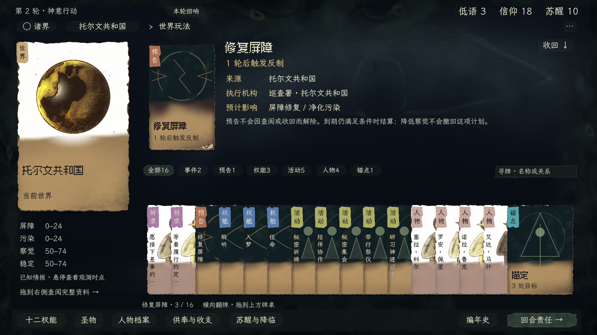

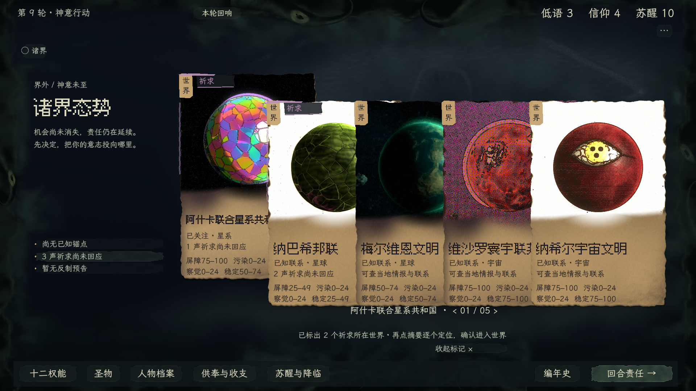

图为正式主场景 1920×1080。第一张是明确的初始局势夹具：只在首笔回执之前设置两个世界的屏障破口与察觉，随后安装全部正式模块、由真实计划器生成「修复屏障」计划，通过正常 Session 保存、读取隔离副本、推进到期；没有注入 pending_plan 或伪造结果。第二张使用既有第 9 轮五世界档的隔离副本，三声祈求落在两个公开世界。玩家原档未写入。

有限核对：公开计划与卡片逐字段对应；祈求先于预告；独立分类过滤与肩签一致，精简后的来源取世界、倒计时与卡面一致、预计影响读取展示目录、字段名与值有色差；原生拖放只读，不提供执行且调用执行保护也不改变快照；真实到期移除牌和已放置草稿；摘要同时标出两个世界、再次定位、清除，不跳页、不重排或改变存档。锚点非空映射额外使用显式公开投影夹具验证同域去重及未知域排除，未冒充自然获得锚点的完整游玩。六类计划的全分支与特殊轮初事件没有重新穷举；原有规则保持。

复现：Godot `--path . --script tools/worldplay-integration/resistance_probe.gd -- --fixture <输出目录>`；多世界定位将 `--fixture` 换为五世界存档绝对路径，并追加 `--five`。夹具定义在 `tools/worldplay-integration/resistance_fixture_session.gd`，只供探针，生产入口不引用。

## 回响牌面文字变淡／消失修复（2026-11-13）

**根因。**共用 Card 曾用露出宽度计算横排文字透明度，并用其补数显示竖排名签。回响牌宽 148px，1108px 的牌堆摆九张时，前八张各露出 118px，旧公式 `smoothstep(111,145,118)` 只有约 0.11；十张时露出约 104.9px，文字透明度直接归零。末张完整露出所以正常。该几何条件可以稳定复现，和祈求数据、立绘是否就绪无关。诸界大牌原先有局部可读性补丁，未覆盖共用的小牌与回响，造成场景间差异。

**修复范围。**共用载体改为宽露面保留完整墨色、窄牌缘明确切换竖排；WorldCard 额外指标与旧手牌适配同步使用同一判断，去掉大牌重复覆盖。没有更换卡面、层级、抬牌曲线或 Session 数据。适用交互合同的叠牌可见性、美术 A08／A15；架构与图文规范同步。此项修复不代表其他交付项已经制作人验收。

**实机核对。**正式入口新局 seed=5 自然得到祈求 2、人物 3、新启 4，共九张回响。滑至最后一张后，前八张实测露出 118px，名称／说明透明度均为 1；回看回响、快速切换人物与新启类别、进入世界人物分类、原生拖出只读查看及返回全部通过。另以实际公开卡面构建 1／5／8／9／10／12／18／48 张的呈现夹具，核对宽露面印字和窄牌缘名签；密度夹具没有添加 Session 对象，不冒充自然游戏内容。只读操作前后 Session 快照相同，玩家存档未改动。未重跑全玩法结算与旧场景穷举。

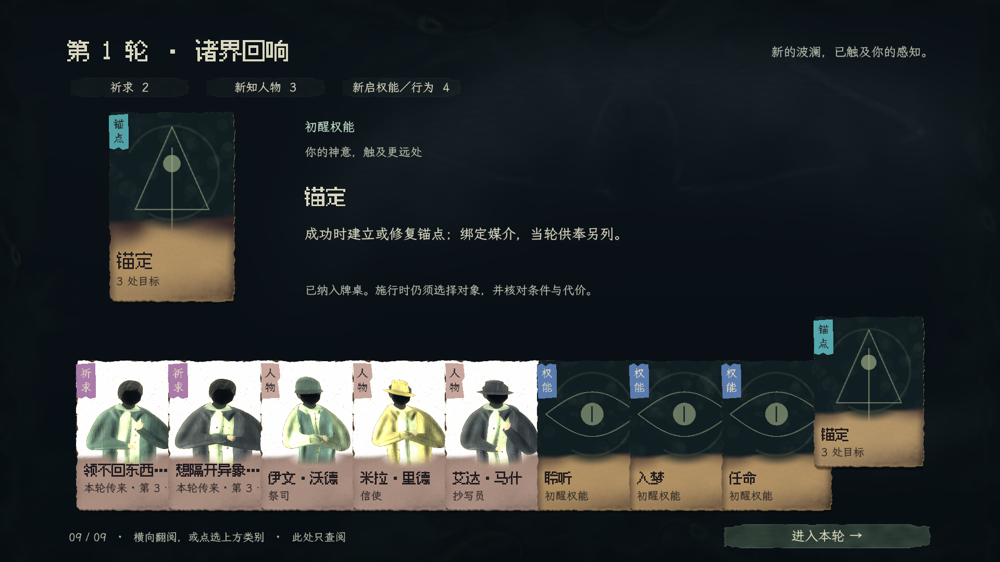

[世界人物分类实机](../art/visual-generation/production-evidence/card-text-visibility/world-person-cards.png)。复现：Godot `--path . --script tools/card-carrier-study/text_visibility_probe.gd -- <输出目录>`；探针从隔离新局按正常控件路径运行，完成输出 `CARD_TEXT_VISIBILITY_OK`。

## 全卡片字段层级统一（2026-11-14）

制作人要求把预告卡的字段名／内容分列、分色推广至所有卡片。本批沿 A08 实施共用 `painted/card_fields.gd`：深色查看区用暖色字段名、骨白内容；纸面用深赭字段名、深墨内容。字段由显式结构传入，叙事和祈求原话保留整句，数据中的富文本标记按字面显示。所有文字组件不截获卡片拖拽。

**接入清单：**诸界世界卡及其指标；世界／教团主卡信息；人物、教团、圣物、锚点、权能的卡面与上桌资料；祈求来源、求告者、期限、回应代价及原话；行为槽标题、费用、成功点数和结果说明；教团指令预估与锚点供奉；事件选项与确认；轮初回响的来源、人物身份与权能说明；卡片悬停资料。沿原阅读区换行／滚动，名称、叙事、状态短句不强拆字段。预告的定性影响规则保留，未修改 Session、资格、生成器或存档格式。

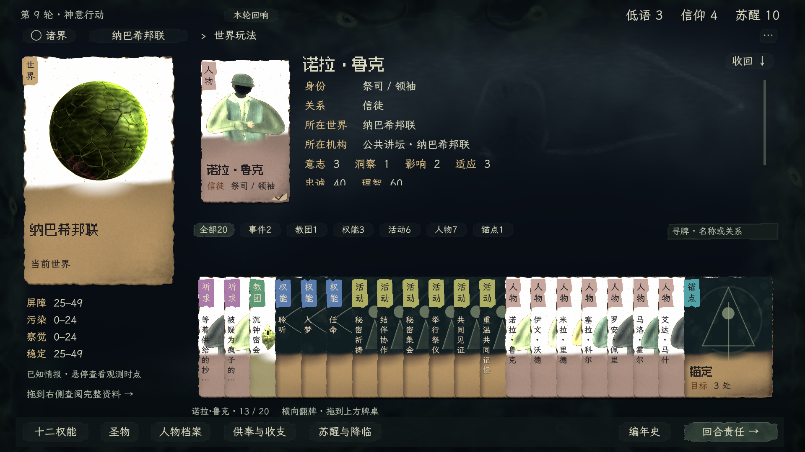

[祈求回应与原话](../art/visual-generation/production-evidence/card-fields/prayer-response.png) · [教团指令预估](../art/visual-generation/production-evidence/card-fields/cult-order.png) · [权能图鉴](../art/visual-generation/production-evidence/card-fields/power-library.png) · [悬停字段](../art/visual-generation/production-evidence/card-fields/person-hover.png) · [轮初九张回响](../art/visual-generation/production-evidence/card-fields/arrival-after.png)

**有限实机核对。**当前五世界第 9 轮存档的隔离副本覆盖诸界、世界、人物、教团、祈求及回应选择、活动、权能图鉴和教团指令；原生拖拽后只查阅／配置，未执行，前后 Session 快照相同。此档没有公开圣物／锚点对象，另用仓库旧五世界存档的隔离副本核对[圣物](../art/visual-generation/production-evidence/card-fields/legacy-object-fixture/relic.png)和[锚点](../art/visual-generation/production-evidence/card-fields/legacy-object-fixture/anchor.png)字段；旧档只用于这两类对象排版，不能当作当前祈求或生成内容验收。新局 seed=5 的九张回响、类别切换、回看，以及 1／5／8／9／10／12／18／48 张呈现夹具通过原文字可见性探针。源码解析通过。事件选项／确认通过代码检查，本批未实走全部事件和行动结算分支，也未穷举大字极值。

复现：`tools/card-carrier-study/fields_probe.gd -- <输出目录> <真实存档路径>`，成功输出 `CARD_FIELDS_OK`；共享文字回归仍用 `text_visibility_probe.gd`，本批输出 `CARD_TEXT_VISIBILITY_OK 878`。截图均为正式主场景 1920×1080，原存档不写入。架构、交互合同、A08 和图文规范引用同步更新；本批效果待制作人复审。

## 密叠肩签文字消失修复（2026-11-14）

**原因与修复。**肩签的字曾单独使用 `smoothstep(19,23,露边宽度)` 淡出；密叠未抬起时，19px 以下被抹成零透明度，21px 也只剩半透明，彩色签底却仍在。这与卡面正文的宽／窄切换是两处代码，之前正文检查没有覆盖程序绘制的肩签字。本次改为实墨常驻，将字横向排进实际露边，字号在 12–14px 内适配；抬牌期间排字位置／字号稳定，只由相邻实体卡自然遮挡。极密露边不足一个字时不能保证静止全名可读，仍可抬起查看。未改牌序、横距、输入或阻尼动画。

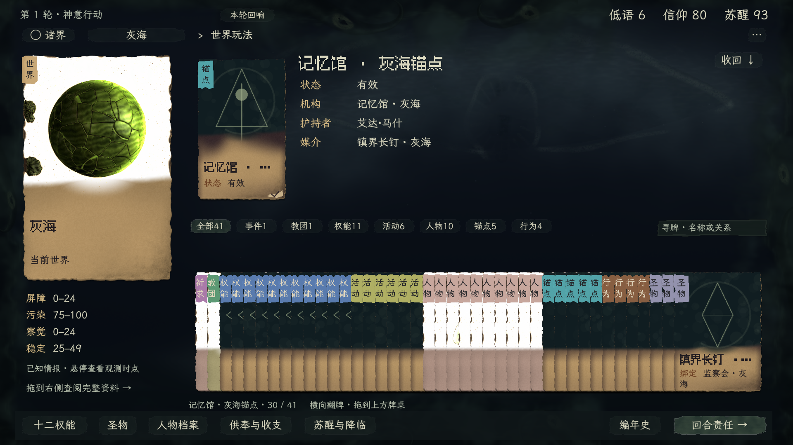

本图沿用旧五世界存档的隔离副本，仅用于复现 41 张密叠布局，不代表最新生成内容。诸界进入世界、原生拖拽、类别切换／图鉴返回与只读快照检查通过（`CARD_FIELDS_OK 62`）。共享肩签覆盖世界、事件、祈求、教团、权能、活动、人物、锚点、圣物、行为、预告 11 类；另以 16／19／21／23／26／32px 露边渲染到离屏画布，在两个汉字区域分别查实际墨色像素，共 132 项：原实现 66 项失败，修复后零失败。16px 包含目前手牌区 48 张密叠的宽度区间；这是呈现夹具，不是向 Session 增加对象。

复现像素检查：`tools/card-carrier-study/shoulder_ink_probe.gd -- <输出PNG>`；第二参数可给原版脚本以复现失败。[字宽夹具](../art/visual-generation/production-evidence/dense-shoulder-labels/glyph-widths.png)与[检查日志](../art/visual-generation/production-evidence/dense-shoulder-labels/pixel-check.txt)。架构、美术 A08 与交互合同同步；本批未重跑规则结算或任意极端牌量。

## 祈求牌浏览、准备与真实回执精修（2026-11-14）

制作人指出来源与当前世界重复、准备态重复身份／原话／费用与回应槽、结果态重复标题和收卡按钮且缺实掷点数。本批调整正式世界／教团牌桌三态，保留既定卡体、字段配色、四区与 Session 执行边界。

- 浏览态：去掉来源，保留求告者、期限、原话与该请求实际提供的回应小牌。
- 准备态：所选回应为单行说明，去掉绿色回应选择槽及重复原话／身份。保留真实必需槽和可选辅助，费用只显示一次；Esc／“返回 · Esc”回同一祈求的回应列表，不收牌、不提交。条件缺口与不可逆确认继续沿正式预览。
- 判定：实际规则为 D100 小点成功，即 `roll ≤ probability`；64 表示 1–64 成功，不是“至少 64”。预览写“成功条件 骰点 ≤ 64”，确定性回应明确无需掷骰。
- 结果态：信息区只一份祈求标题，突出实际结果与掷骰／成功上限；影响、后续代价及资源变化各自显示。完成卡的副文改为本次结果；只有“让回响散去”一个出口，Esc 同义。它关闭回执，并不把已回答的祈求放回牌堆。失败也按原规则结算实际消耗、结束请求，不伪造保留。
- 回执来源：新 `prayer_receipt.gd` 只读 Session 公开 facts／checks 与提交前后公开投影；不读隐藏 state、不重新掷骰，不拿准备预览冒充执行。公开回执缺失检定时不能默认成功或声称无需掷骰。未知曲解仍称“已显现”，不把检定成功说成救助成功；确定性回应依公开的零骰点／负概率标志显示无需掷骰。旧冻结请求保留旧公开事实兼容，生成器、数值、存档格式均未改。

### 实机清单与证据

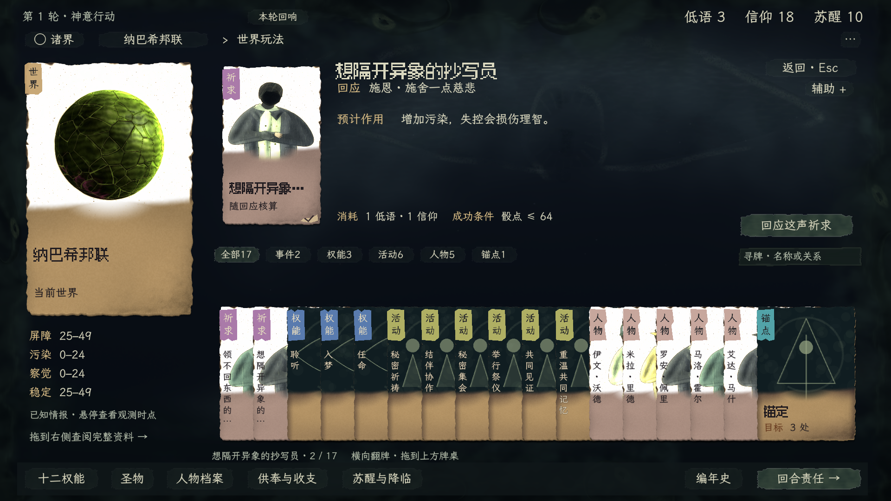

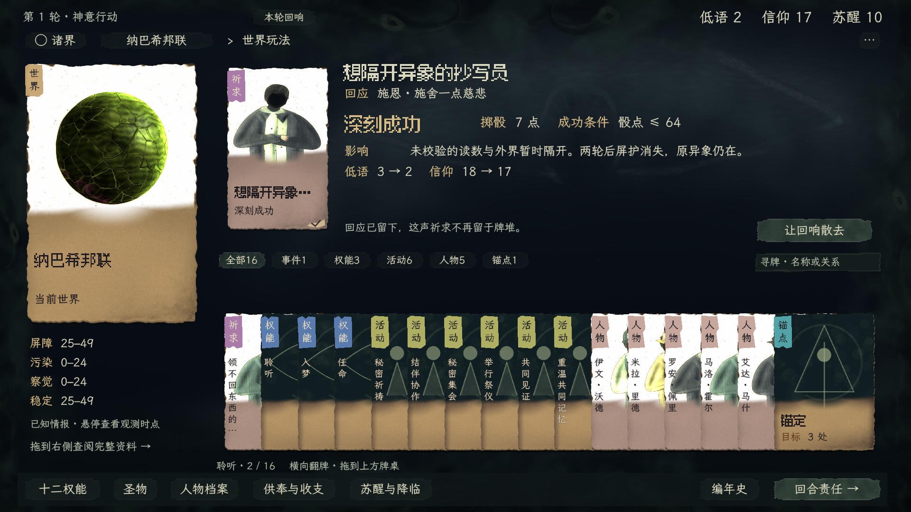

[浏览态](../art/visual-generation/production-evidence/prayer-flow/browse.png) · [失败：51点／上限50](../art/visual-generation/production-evidence/prayer-flow/failure.png) · [不再回应](../art/visual-generation/production-evidence/prayer-flow/dismiss.png) · [可选辅助](../art/visual-generation/production-evidence/prayer-flow/optional-inputs.png) · [检查日志](../art/visual-generation/production-evidence/prayer-flow/checks.txt)

原生正式主场景 1920×1080，隔离新局 seed=1、5，均由当前组合祈求生成器实际生成；未注入响应或骰点、未写玩家存档。探针实走拖入、选回应、辅助展开、Esc 退回并检查快照未变、真实回应、单次提交、结果骰点与实际已提交检查相同、不可重复执行、图鉴往返保留回执，以及 Esc 退出。seed=1 得到失败 51／50（41 项），seed=5 得到深刻成功 7／64（41 项）；另从 seed=1 独立新局验证不再回应、确认前取消无写入、关闭未掷骰且不占回应次数（42 项）。

另用 `prayer_receipt_probe.gd` 对公开回执结构做 6 项定向检查：成功／失败、确定性无骰、未知曲解、缺失骰点和缺失结果；这是展示合同夹具，不冒充这些分支的实机游玩。

复现：Godot `--path . --script tools/worldplay-integration/prayer_flow_probe.gd -- <输出目录> <种子>`，关闭分支追加 `--dismiss`。未穷举全部回应配方、灾变、大字极值或旧冻结请求的实机提交；旧全局覆盖层保持原合同，本批不宣称同步重做。架构登记、交互 spec、美术 A08、执行路由及功能地图 F03 已原地更新；上述清单是本批 UI 覆盖范围。按 V01–V05、V07 核对代表状态，未改外围或重录原周期；制作人审美复审待进行。
